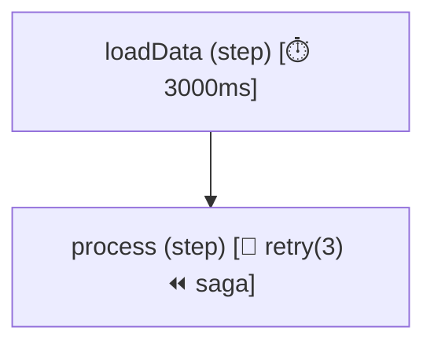

<p align="center">
  
</p>

> Zero-daemon, in-process workflow orchestration with durable checkpoints, Sagas, and live visual DevTools.

[](https://www.npmjs.com/package/siglo)
[](LICENSE)
[](https://nodejs.org)
[](https://www.typescriptlang.org/)
[]()

**Siglo** is a lightweight, zero-daemon workflow runtime for TypeScript. It orchestrates complex business logic into composable, resilient steps—featuring end-to-end type inference, automatic Sagas, durable checkpoints, and live DevTools without external infrastructure.

---

## Start with a Real Problem

What happens when checkout charges a customer, but shipping fails? [Build a checkout that handles failure](docs/01-getting-started.md) walks through payment retries, refunds, stock release, and duplicate requests with runnable TypeScript and fake services. No database or external services are needed for the demo.

For approvals that wait on people, imports that need bounded concurrency, and event consumers that need recovery rules, start with the tutorial’s [real-world use cases](docs/01-getting-started.md#7-apply-the-same-idea-to-other-problems).

## Positioning: In-Process Orchestration vs Distributed Engines

| Dimension | `Siglo` | Distributed Engines (Temporal, Inngest) |
|---|---|---|
| **Architecture** | Lightweight, zero-infrastructure in-process library | Heavy multi-cluster / external orchestrator daemon |
| **Latency** | Microsecond direct async function invocation | Millisecond-to-second RPC / polling overhead |
| **Footprint** | Zero external dependencies, pure TypeScript | Requires persistent workers, queue servers, and databases |
| **Primary Focus** | Modular workflows, parallel fan-out/fan-in, bounded worker mapping, request-scoped sagas, idempotency, durable event waits, retry backoff with jitter, OCC checkpointing | Months-long durable human-in-the-loop workflows |

---

## Documentation & Topic Guides

**APM tutorial:** [Zero-Code APM Dashboards](docs/zero-code-apm-dashboards.md) — run an isolated Kafka APM example and trace events from producer to consumer and inspect shared workflow metrics with Jaeger, Grafana, and Prometheus.

**Practical tutorial:** [Serve a REST Endpoint and Watch It Run Live](docs/rest-and-live-monitoring.md) — connect an Express checkout endpoint to the dashboard, inspect retries, and diagnose failed requests.

**Continue the tutorial:** [Distributed Checkout with PostgreSQL and Redis](docs/distributed-rest-and-live-monitoring.md) — run two API instances with shared persistence, caching, and a separate live monitor using Docker Compose.

**Durable workflows tutorial:** [Suspend Checkout for Approval and Resume Across Servers](docs/durable-distributed-checkout.md) — suspend long-running orders for external webhooks or human approvals, survive server restarts, and resume across replicas.

**Kafka routing tutorial:** [Route Kafka Order Events with `branch` and `when`](docs/kafka-order-routing.md) — consume events across two workers, route fulfillment decisions, share PostgreSQL idempotency, and inspect the live monitor.

Explore the 11 comprehensive guides covering architecture, design patterns, testing, and production operations:

1. 🚀 [01. Getting Started](docs/01-getting-started.md) &mdash; A practical checkout tutorial: retry payment, undo partial work, test recovery, and handle duplicate requests.
2. 💡 [02. Core Concepts](docs/02-core-concepts.md) &mdash; Executable ASTs, accumulated context immutability, 5-phase step lifecycle, and reserved keys.
3. ⛓️ [03. Sequential Workflows](docs/03-sequential-workflows.md) &mdash; Linear pipelines, clean POJO parameters, lifecycle hooks (`onBefore`, `onSkip`, `onAfter`), and caching.
4. 🔀 [04. Branching and Parallelism](docs/04-branching-and-parallelism.md) &mdash; Concurrent fan-outs (`parallel`, `all`, `allSettled`, `race`), dynamic routing (`when`, `branch`), and bounded mapping (`map`).
5. 🛡️ [05. Retries, Timeouts, and Cancellation](docs/05-retries-timeouts-and-cancellation.md) &mdash; Two-tier timeouts, exponential backoff with jitter, cooperative `AbortSignal` cancellation, and saga rollbacks.
6. ⏳ [06. Durable Workflows](docs/06-durable-workflows.md) &mdash; Long-running human-in-the-loop waits (`waitForEvent`, `wait`), checkpoint resumption, and state migrations.
7. 💾 [07. Storage and Adapters](docs/07-storage-and-adapters.md) &mdash; Distributed persistence contracts, PostgreSQL & Redis adapters, and multi-tenant namespaces.
8. 🔭 [08. Observability](docs/08-observability.md) &mdash; Graph exports (Mermaid, DOT, JSON), OpenTelemetry distributed tracing, and W3C trace propagation.
9. 🧪 [09. Testing and Replay](docs/09-testing-and-replay.md) &mdash; Deterministic workflow harnesses (`@siglo/testing`), fake clocks, step spies, mocks, and failure replay.
10. 🏷️ [10. TypeScript Reference](docs/10-typescript-reference.md) &mdash; End-to-end accumulated context inference, typed step history (`$steps`), and Standard Schema integration.
11. 🏭 [11. Production Operations](docs/11-production-operations.md) &mdash; Production deployment checklist, zero-daemon operational topologies, connection pooling, and retention cleanup.

### Architectural Contracts & Adapter Guides
- 🛡️ [Production Best Practices & Operational Runbook](docs/production-best-practices.md) &mdash; Comprehensive engineering runbook covering PostgreSQL OCC, `@siglo/scheduler` worker daemons, zero-trust network boundaries, named compensation DLQs, and DevTools hardening.
- 🔌 [Ecosystem Adapters Overview](docs/ecosystem-adapters.md) &mdash; Master guide for all official adapters and CLI tooling.
- 📜 [Execution Semantics Contract](docs/execution-semantics.md) &mdash; Formal semantics answering all 9 runtime execution contract questions.
- 🚨 [Error Model & Exception Hierarchy](docs/error-model.md) &mdash; Complete exception hierarchy (`SigloError`), metadata fields, and cause preservation.
- 💾 [Storage & Checkpoint Contract](docs/storage-contract.md) &mdash; Checkpoint schema v2.0.0, optimistic concurrency, and namespace isolation.
- 🔄 [Compensation & Sagas](docs/compensation-and-sagas.md) &mdash; Sagas with LIFO compensation rollbacks and retry policies.
- 🔑 [Idempotency & Deduplication](docs/idempotency.md) &mdash; Scoped idempotency keys, claim locking, and TTL stores.
- 🌐 [Network Egress Policy & Guardrails](docs/network-egress-policy.md) &mdash; Declarative least-privilege network policies via AsyncLocalStorage, multi-layer interceptors, and perimeter narrowing.
- 📊 [Live Monitoring & DevTools](docs/live-monitoring.md) &mdash; Real-time DevTools web dashboard, SSE/WebSocket streaming, latency waterfalls, and interactive resumption.
- 🗺️ [Live Monitoring Roadmap](docs/roadmap/live-monitoring.roadmap.md) &mdash; Implementation specifications and delivery phases.
- 🔐 [Crypto & Webhook Security](docs/adapters/crypto.md) &mdash; Cryptographic pipeline steps: multi-provider webhook verification, replay prevention, AEAD envelope field encryption, KeyRing rotation, and deep PII masking.
- 🤖 [AI & LLM Steps](docs/adapters/ai.md) &mdash; Multi-provider AI steps, native structured outputs, self-healing repair loops, fallback cascades, Step-as-Tool agent loops, and token cost telemetry.

---

## Key Features

- ⚡ **Composable Flows (`flow`)** &mdash; Compose steps directly into workflows without global registries; steps are pure execution units.
- 🧠 **Accumulated Context Inference** &mdash; TypeScript automatically computes the accumulated output type across composed sequential steps at compile time.
- 📜 **Typed Step History (`$steps`)** &mdash; Statically typed access to any step's output using string literal names (`context.$steps.loadUser.user`).
- 🗺️ **Workflow Graph Visualization** &mdash; Export workflow graphs directly to Mermaid diagrams (`flow.toMermaid()`), Graphviz DOT (`flow.toDot()`), and JSON AST (`flow.toJSON()`) with policy badges.
- 🧩 **IDE Extensions for VS Code & IntelliJ IDEA** &mdash; Explore workflow graphs, inspect step inputs and retry/timeout policies, navigate to source, and refresh diagrams as you edit. See [VS Code setup](plugins/vscode/README.md) and [IntelliJ IDEA setup](plugins/intellij/README.md).
- 🖥️ **Live DevTools & Monitoring** &mdash; Real-time step inspection, timeline waterfalls, active DAG node highlighting, and failure replay.
- 🧪 **Deterministic Test Harness (`@siglo/testing`)** &mdash; Zero-flake test harness with virtual clocks (`FakeClock`), step spies, mocking, trace snapshots, and failure replay.
- 💉 **Runtime Dependency Injection** &mdash; Inject services and repositories explicitly via `options.services` or step-level `step.withDependencies()`.
- 🔀 **Parallel Execution Combinators** &mdash; Run branches concurrently with `parallel`, `all`, `allSettled`, and `race`, equipped with branch context isolation and configurable merge strategies.
- 🌿 **Conditional Branching & Routing** &mdash; Dynamic decision routing via `when(predicate, thenStep, elseStep)` and multi-branch selectors via `branch(selectorFn, branchesMap, defaultBranch)`.
- 🔄 **Dynamic Mapping & Bounded Concurrency** &mdash; Process arrays with `map(items, step, { concurrency })`, order preservation, and error aggregation.
- 🔑 **Scoped Idempotency & Deduplication** &mdash; Protect workflows and individual steps (`step.idempotent()`) with deterministic hash keys and TTL stores.
- ⏪ **Sagas & LIFO Compensations** &mdash; Attach rollback handlers (`step.compensate(handler)`) that run automatically in reverse execution order upon failure.
- ⏳ **Durable Waits & Event Resumption** &mdash; Pause execution with `waitForEvent(eventName)` or `wait('30m')`, persist suspended checkpoints, and safely resume workflows.
- 🏷️ **Workflow Versioning & State Migrations** &mdash; Declare workflow versions (`flow.version('v2')`), detect version mismatches upon resumption, and run registered state transformation functions.
- ⏱️ **Resilient Deadlines & Two-Tier Timeouts** &mdash; Enforce per-step SLA (`step.timeout(ms)`) and workflow-level deadlines (`flow.timeout(ms)`).
- 🔁 **Structured Retry Strategies** &mdash; Automatic retries with exponential, linear, or fixed backoff, jitter, and `onRetry` hooks right in `onFail`.
- 📦 **Standard Schema Integration (`spec` / `schema`)** &mdash; Native Standard Schema, Zod, Valibot, and ArkType contract enforcement.
- 🛑 **Graceful Cancellation & AbortSignals** &mdash; Cancel flows, in-flight async steps, and retry timers seamlessly using standard `AbortSignal`.
- 🌐 **Network Egress Policy & Guardrails via ASL** &mdash; Declarative network egress policies via `AsyncLocalStorage` (`.allowNetwork()`, `.denyNetwork()`, `.networkPolicy()`), multi-layer interception (`fetch`, `http/https`, `net.Socket`), flow perimeter narrowing, and localhost exemptions.
- 🔐 **Cryptographic Security & Confidentiality (`@siglo/crypto`)** &mdash; Zero-dependency webhook signature verification (Stripe, GitHub, Shopify, Slack, Svix), distributed replay defense, AEAD envelope encryption (AES-256-GCM), KeyRing historical rotation, and structural copy-on-write PII masking.
- 🤖 **Resilient AI & LLM Inference (`@siglo/ai`)** &mdash; Multi-provider LLM steps (Anthropic, OpenAI, Gemini, Ollama), native JSON Schema structured outputs, self-healing prompt repair loops, model fallback cascades, Step-as-Tool agent loops with saga compensations, and OpenTelemetry GenAI observability.
- 🔌 **Ecosystem Integration Packages** &mdash; Ready-to-use adapters for PostgreSQL, Redis, BullMQ, Kafka, SQS, OpenTelemetry, Express, Fastify, Hono, and CLI developer tooling.

---

## Installation

```bash
# Core workflow runtime
npm install @siglo/core

# Optional testing harness & CLI developer tooling
npm install --save-dev @siglo/testing @siglo/cli
```

### Ecosystem Packages

| Package | Description |
|---|---|
| [`@siglo/core`](packages/core) | Core workflow engine and runtime |
| [`@siglo/testing`](packages/testing) | Deterministic test harness, fake clocks, step spies, mocks, and replay tooling |
| [`@siglo/cli`](packages/cli) | Developer CLI for scaffolding, diagram export, validation, and fixture replay |
| [`@siglo/postgres`](packages/postgres) | PostgreSQL durable storage adapter and transactional idempotency store |
| [`@siglo/redis`](packages/redis) | Redis caching, durable storage, idempotency store, and distributed locks |
| [`@siglo/crypto`](packages/crypto) | Zero-dependency cryptographic pipeline steps: webhook verification, replay defense, AEAD field encryption, KeyRing rotation, and deep PII masking |
| [`@siglo/opentelemetry`](packages/opentelemetry) | OpenTelemetry distributed tracing and W3C trace context propagation |
| [`@siglo/bullmq`](packages/bullmq) | BullMQ background worker adapter |
| [`@siglo/kafka`](packages/kafka) | Kafka consumer batch processor adapter |
| [`@siglo/sqs`](packages/sqs) | AWS SQS batch consumer with partial failure reporting |
| [`@siglo/http`](packages/http) | Resilient HTTP client steps, egress perimeter guardrails, and distributed tracing |
| [`@siglo/ai`](packages/ai) | Multi-provider AI steps, structured outputs, repair/fallback loops, typed tools, and token metrics |
| [`@siglo/scheduler`](packages/scheduler) | PostgreSQL row-level poller daemon (`FOR UPDATE SKIP LOCKED`), memory poller, and cloud webhook dispatchers |
| [`@siglo/fastify`](packages/fastify) | Fastify HTTP route handler adapter |
| [`@siglo/hono`](packages/hono) | Hono edge and Web Standards route handler adapter |
| [`@siglo/express`](packages/express) | Express HTTP route handler adapter |
| [`@siglo/monitor`](packages/monitor) | Live workflow monitoring server, SSE/WebSocket transports, DevTools Web UI, and Prometheus metrics |
| [`@siglo/notifications`](packages/notifications) | Multi-channel notifications, durable human approvals, and interactive webhook recovery |

---

## Quickstart: Type-Safe Composable Flows

```typescript
import { Step, flow } from '@siglo/core';

// 1. Define modular steps with input/output contracts
const fetchUser = Step.create('fetchUser', async (param: { userId: string }) => {
    return { name: 'Alice', tier: 'PRO' };
});

const calculateDiscount = Step.create('calculateDiscount', async (param: { tier: string }) => {
    const discount = param.tier === 'PRO' ? 0.20 : 0.05;
    return { discountPercentage: discount };
});

// 2. Compose into an executable flow
export const orderWorkflow = flow(fetchUser, calculateDiscount);

// 3. Run the flow with full type safety
async function main() {
    const result = await orderWorkflow.run({ userId: 'u_123' }, { pojo: true });
    console.log(result.name);               // 'Alice'
    console.log(result.discountPercentage); // 0.20
    console.log(result.$steps.fetchUser);   // { name: 'Alice', tier: 'PRO' }
}

main();
```

---

## IDE Extensions

Explore workflows directly in [VS Code](plugins/vscode/README.md) or [IntelliJ IDEA](plugins/intellij/README.md). The extensions statically analyze JavaScript and TypeScript source without executing your application. View branching and parallel paths, inspect input contracts and workflow settings, click steps to navigate to code, and enable **Auto-Reload** to update the graph as you edit. **All Flows** shows multiple workflows from the same file.

Follow the linked setup guides to build and install the VS Code VSIX or IntelliJ plugin ZIP. In a trusted project, open a workflow file and run **Siglo: Open Workflow Visualizer** in VS Code, or right-click the editor and choose **Visualize Siglo Workflow** in IntelliJ IDEA. For execution timelines and live runtime events, use [Live Monitoring & DevTools](docs/live-monitoring.md).

---

## Workflow Visualization & Export APIs

Export any workflow directly to Mermaid diagrams, Graphviz DOT, or JSON AST:

```typescript
import { Step, flow } from '@siglo/core';

const s1 = Step.create('loadData', async () => ({ data: [1, 2, 3] })).timeout(3000);
const s2 = Step.create('process', async () => ({ done: true }))
    .onFail({ maxRetries: 3, delay: 100 })
    .compensate(async () => { /* rollback */ });

const pipeline = flow(s1, s2);

// 1. Export as Mermaid flowchart with policy badges
const mermaidCode = pipeline.toMermaid({ direction: 'TD' });
console.log(mermaidCode);

// 2. Export as Graphviz DOT
const dotCode = pipeline.toDot({ graphName: 'OrderPipeline' });

// 3. Export as JSON AST
const jsonAst = pipeline.toJSON();
```

Generated Mermaid output automatically includes badges for timeouts, retries, sagas, caches, and durable waits:



---

## Deterministic Testing with `@siglo/testing`

Test workflows deterministically without flaky timers or complex mock infrastructure:

```typescript
import { expect } from 'chai';
import { createWorkflowHarness, FakeClock } from '@siglo/testing';
import { orderWorkflow } from './order.workflow';

describe('Order Workflow Suite', () => {
    it('executes with step spies, mocks, and virtual clocks', async () => {
        const clock = new FakeClock();
        const harness = createWorkflowHarness(orderWorkflow, { clock });

        // Spy on step execution
        const discountSpy = harness.spyStep('calculateDiscount');

        // Mock external service calls
        harness.mockStep('fetchUser', () => ({ name: 'TestUser', tier: 'PRO' }));

        const result = await harness.run({ userId: 'u-100' });

        expect(result.discountPercentage).to.equal(0.20);
        expect(discountSpy.called).to.be.true;
        expect(discountSpy.firstCall()?.input.tier).to.equal('PRO');

        // Assert step execution telemetry
        harness.assertStepExecuted('fetchUser', 1);
        harness.assertStepExecuted('calculateDiscount', 1);
    });
});
```

---

## Scaffolding & Replay CLI

`@siglo/cli` provides terminal commands for project creation, code generation, diagram export, and failure replay:

```bash
# Initialize a new TypeScript workflow project
npm exec --package=@siglo/cli -- siglo init

# Scaffold a typed workflow and harness test
npm exec --package=@siglo/cli -- siglo generate workflow checkout

# Scaffold a typed step and unit test
npm exec --package=@siglo/cli -- siglo generate step charge-card

# Export workflow diagrams from the command line
npm exec --package=@siglo/cli -- siglo export src/workflow.ts --format=mermaid
npm exec --package=@siglo/cli -- siglo export src/workflow.ts --format=dot
npm exec --package=@siglo/cli -- siglo export src/workflow.ts --format=json

# Statically validate workflow definitions for cycles
npm exec --package=@siglo/cli -- siglo validate src/workflow.ts

# Replay an execution against a recorded test fixture
npm exec --package=@siglo/cli -- siglo replay fixtures/failed-order.json src/workflow.ts
```

---

## Concurrency & Parallel Execution (`parallel`, `all`, `allSettled`, `race`)

```typescript
import { Step, flow, parallel, allSettled, race } from '@siglo/core';

const checkInventory = Step.create('inventory', async () => ({ inStock: true }));
const checkFraud = Step.create('fraud', async () => ({ fraudScore: 0.02 }));
const fetchExchangeRates = Step.create('rates', async () => ({ usdToEur: 0.92 }));

// 1. Parallel execution (fails fast and aborts siblings on error)
const orderPreparation = flow(
    parallel([checkInventory, checkFraud, fetchExchangeRates])
);

// 2. allSettled: Collect all results and errors without failing fast
const auditFlow = flow(
    allSettled([serviceA, serviceB, serviceC])
);

// 3. race: First branch to settle wins; losing branches are aborted
const fastestResult = flow(
    race([primaryApiStep, secondaryFallbackStep])
);
```

---

## Dynamic Branching & Routing (`when`, `branch`)

```typescript
import { Step, flow, when, branch } from '@siglo/core';

// Conditional If-Then-Else
const discountFlow = flow(
    when((ctx) => ctx.isVIP === true, applyVIPDiscount, applyStandardDiscount)
);

// Multi-path selector routing
const routingFlow = flow(
    branch({
        selector: (ctx) => ctx.tier, // 'gold' | 'silver' | 'bronze'
        branches: {
            gold: goldPipeline,
            silver: silverPipeline,
            bronze: bronzePipeline
        },
        defaultBranch: standardPipeline
    })
);
```

---

## Sagas & LIFO Compensations (`step.compensate`)

```typescript
import { Step, flow, CompensationException } from '@siglo/core';

const reserveHotel = Step.create('reserveHotel', async () => {
    const booking = await hotelApi.book();
    return { hotelBookingId: booking.id };
})
.compensate(async (ctx) => {
    // Automatic rollback if downstream steps fail
    await hotelApi.cancel(ctx.hotelBookingId);
});

const chargeCard = Step.create('chargeCard', async () => {
    throw new Error('Payment declined'); // Triggers saga compensation!
});

const bookingFlow = flow(reserveHotel, chargeCard);
```

---

## Durable Waits & External Event Resumption

```typescript
import { Step, flow, waitForEvent, wait, resumeWorkflow } from '@siglo/core';

const orderWorkflow = flow(
    createOrderStep,
    // 1. Suspend workflow until external event arrives or timeout occurs
    waitForEvent('paymentReceived', {
        correlationKey: (ctx) => ctx.orderId,
        timeout: '24h'
    }),
    fulfillOrderStep
);

// 1. Worker suspends when reaching waitForEvent
await orderWorkflow.run({ orderId: 'ord_999' }, { durable: true });

// 2. Webhook arrives hours later and resumes execution
const finalResult = await resumeWorkflow(orderWorkflow, 'ord_999', { paymentId: 'pay_777' });
```

---

## Network Egress Policy & Guardrails via AsyncLocalStorage

> 📘 **Dedicated Topic Guide**: For in-depth architectural details, pattern matching rules, and concurrency isolation semantics, consult the [Network Egress Policy & Guardrails Guide](docs/network-egress-policy.md).

Enforce least-privilege network access per step or flow. Siglo intercepts outbound requests across `globalThis.fetch`, `node:http`/`node:https`, and raw `node:net.Socket` using `AsyncLocalStorage`, preventing cross-talk between concurrent steps.

```typescript
import { Step, flow } from '@siglo/core';

// 1. Whitelist specific domains on a step
const chargeCustomer = Step.create('charge', async ({ amount }) => {
    return await fetch('https://api.stripe.com/v1/charges', { /* ... */ });
}).allowNetwork(['api.stripe.com', '*.stripe.network']);

// 2. Pure computation step: strictly disallow any external network egress
const calculateDiscounts = Step.create('discount', ({ cart }) => {
    return { discountedTotal: applyCoupons(cart) };
}).denyNetwork();

// 3. Flow-level perimeter: Flow supersedes Step (steps can only narrow within flow allowance)
const orderFlow = flow(calculateDiscounts, chargeCustomer)
    .networkPolicy({
        defaultPolicy: 'deny',
        allowedHosts: ['api.stripe.com'],
        allowLocalhost: false // Default: false when policy is active (localhost, 127.0.0.1, ::1, 0.0.0.0, Unix sockets)
    });

// 4. Per-run policy override:
await orderFlow.run(payload, {
    networkPolicy: {
        allowedHosts: ['api.stripe.com']
    }
});
```

---

## Real-Time DevTools & Live Monitoring (@siglo/monitor)

> 📘 **Dedicated Topic Guide**: For in-depth architectural details, transports, and React UI layout, consult the [Live Monitoring Guide](docs/live-monitoring.md) and [Monitor Adapter Guide](docs/adapters/monitor.md).

Stream workflow execution events in real time to a modern React 18 + Vite + Tailwind CSS DevTools dashboard, SSE clients, WebSockets, or Prometheus metrics:

```typescript
import { Step, flow } from "@siglo/core";
import { createMonitorServer, attachToMonitorServer } from "@siglo/monitor";

// 1. Launch standalone monitor server (or CLI: npm exec --package=@siglo/cli -- siglo monitor)
const monitor = await createMonitorServer({ port: 4000 });

// 2. Attach workflows to monitor
const orderPipeline = flow(stepA, stepB)
    .monitor(attachToMonitorServer(4000)); // Remote or in-process attachment

await orderPipeline.run({ orderId: "ord_123" });
```

Open `http://localhost:4000` to inspect the dynamic DAG topology, step latency waterfalls, state mutation diffs, and resume suspended workflows interactively.

---

## Webhook Security & Data Confidentiality (@siglo/crypto)

> 📘 **Dedicated Adapter Guide**: For in-depth architectural details, zero-dependency cryptographic contracts, and key rotation workflows, consult the [Crypto Adapter Guide](docs/adapters/crypto.md).

Implement end-to-end cryptographic defense in your pipelines using zero-dependency, native `node:crypto` primitives. `@siglo/crypto` provides drop-in workflow steps for multi-provider webhook verification with atomic replay prevention, tenant-isolated AEAD envelope field encryption with `KeyRing` rotation, and structural copy-on-write PII masking.

```typescript
import { flow } from '@siglo/core';
import {
  verifyWebhookStep,
  encryptFieldsStep,
  decryptFieldsStep,
  maskFieldsStep,
  StaticKeyRing,
  InMemoryNonceStore,
} from '@siglo/crypto';
import { RedisNonceStore } from '@siglo/redis';
import Redis from 'ioredis';

// 1. Enterprise KeyRing supporting active encryption & historical decryption
const keyRing = new StaticKeyRing({
  primaryKid: 'k2',
  keys: [
    { kid: 'k1', secret: process.env.HISTORICAL_KEY! },
    { kid: 'k2', secret: process.env.PRIMARY_KEY! },
  ],
});

// 2. Distributed replay defense store (or InMemoryNonceStore)
const redis = new Redis(process.env.REDIS_URL!);
const dedupStore = new RedisNonceStore({ client: redis });

// 3. Compose secure webhook ingestion & storage pipeline
export const secureOrderPipeline = flow(
  // Step 1: Verify Stripe/GitHub/Shopify signature & block intra-window replays
  verifyWebhookStep('verifyWebhook', {
    provider: 'stripe',
    secret: process.env.STRIPE_WEBHOOK_SECRET!,
    toleranceSeconds: 300,
    dedupStore,
    maxBodyBytes: 10 * 1024 * 1024, // 10MB DoS protection guard
  }),

  // Step 2: Encrypt sensitive PII using AES-256-GCM + tenant AAD + HKDF
  encryptFieldsStep('encryptFields', {
    keyRing,
    fields: ['body.customer.ssn', 'body.payment.creditCard'],
    aad: (ctx) => `tenant:${ctx.body.tenantId}`,
    onNeedsRekey: async (ctx, field, envelope) => {
      console.warn(`[RE-KEY] Field ${field} encrypted with stale key ${envelope.kid}`);
    },
  }),

  // Step 3: Deep copy-on-write structural redaction for audit logging
  maskFieldsStep('maskFields', {
    fields: ['body.customer.ssn', 'body.payment.*'],
    strategy: 'redact',
  })
);
```

### Key Security Capabilities:
- **Zero-Dependency Webhooks**: Built-in constant-time verification for Stripe, GitHub, Shopify, Slack, and Svix, paired with atomic nonce claims (`dedupStore`) to eliminate replay windows.
- **AEAD Envelope Encryption**: Authenticated AES-256-GCM encryption with NIST SP 800-38D IV management, context-derived subkeys via HKDF-SHA256, and tenant-bound Additional Authenticated Data (AAD).
- **KeyRing Rotation & Lazy Re-Keying**: Seamless cryptographic key migration without service downtime; automatically flags historical envelopes (`$needsRekey`) for background rotation.
- **Copy-on-Write PII Redaction**: Deep structural masking with dot-notation and wildcard (`users.*.ssn`) path resolution, preserving immutable DAG context and memory efficiency.

---

## API Reference Summary

> 📘 **Comprehensive Reference Pages**: For complete TypeScript signatures, option tables, and in-depth code examples, consult each dedicated reference guide:
> - ⛓️ [Orchestration & Combinators](docs/api/orchestration-and-combinators.md)
> - 🌊 [Flow Instance Methods (`Flow`)](docs/api/flow.md)
> - 🧱 [Step Methods (`Step`)](docs/api/step.md)
> - ⚙️ [Execution Options (`ExecutionOptions`)](docs/api/execution-options.md)
> - 💾 [Storage & Persistence Utilities](docs/api/storage-and-persistence.md)
> - 🚨 [Error Hierarchy & Exceptions (`SigloError`)](docs/api/error-hierarchy.md)
> - 🧪 [Deterministic Testing (`@siglo/testing`)](docs/api/testing.md)
> - 🌐 [Network Egress Policy & Guardrails](docs/network-egress-policy.md)
> - 🔐 [Crypto & Webhook Security Steps (`@siglo/crypto`)](docs/adapters/crypto.md)
> - 🤖 [AI & LLM Steps (`@siglo/ai`)](docs/adapters/ai.md)

### ⛓️ [Orchestration & Combinators](docs/api/orchestration-and-combinators.md)

| Function / Helper | Description |
|---|---|
| `flow<TIn, TOut>(...steps)` | Primary workflow orchestrator with accumulated context inference and typed step history (`$steps`). |
| `parallel(steps, options?)` | Runs branches concurrently, failing fast on error and isolating branch contexts. |
| `all(steps, options?)` | Alias for `parallel` (`mode: 'fail-fast'`). Runs branches concurrently. |
| `allSettled(steps, options?)` | Runs branches concurrently and collects all outcomes without failing fast (`$settled`, `$branches`). |
| `race(steps, options?)` | Settles as soon as the first branch completes; cancels losing branches via `AbortSignal`. |
| `when(predicate, thenStep, elseStep?)` | Conditional branch combinator running `thenStep` when predicate returns true, or optional `elseStep`. |
| `branch(selector, branches, defaultBranch?)` | Dynamic multi-path router selecting a branch based on selector function. |
| `map(items, step, options?)` | Maps a collection through a step or subflow with bounded concurrency and optional error aggregation. |
| `waitForEvent(eventName, options)` | Suspends workflow execution until an external event arrives or timeout expires. |
| `wait(duration)` | Pauses workflow execution for a duration string (`'10m'`, `'1h'`, `'2d'`) or milliseconds. |
| `resumeWorkflow(flow, key, payload?, options?)` | Restores and resumes a suspended workflow from storage by correlation key or stack ID. |
| `toGraph(item)` | Compiles any step, flow, or combinator into a JSON-serializable `WorkflowNode` AST. |
| `inspectGraph(item)` | Analyzes workflow AST and returns topographical metrics (node count, depth, edges). |
| `validateGraph(node)` | Validates graph structure, checking for cycles and reachability (returns `GraphValidationResult`). |
| `assertValidGraph(node)` | Validates graph structure, throwing `GraphValidationException` if validation fails. |
| `toMermaid(item, options?)` | Renders a workflow or node as a Mermaid flowchart diagram with badges. |
| `toDot(item, options?)` | Renders a workflow or node as a Graphviz DOT diagram. |
| `toJSON(item)` | Serializes a workflow AST to a clean JSON string. |
| `toPOJO(context)` | Converts internal tracked execution context into a clean, plain JavaScript object. |
| `isFlow(item)` | Type guard checking whether an object conforms to the `Flow` interface. |

### 🌊 [Flow Instance Methods (`Flow`)](docs/api/flow.md)

| Method / Property | Description |
|---|---|
| `flow.run(param?, options?)` | Executes the workflow with input parameters and runtime options, returning final accumulated context. |
| `flow.execute(param?, options?)` | Alias for `flow.run()`. |
| `flow.start(param?, options?)` | Alias for `flow.run()`. |
| `flow.networkPolicy(policy)` | Configures workflow-level network egress policy perimeter (flow supersedes step). |
| `flow.timeout(ms)` | Configures workflow-level SLA deadline; throws `FlowTimeoutException` if overall duration exceeds `ms`. |
| `flow.version(version)` | Declares workflow schema version (e.g. `'v2'`) for durable state validation and schema migrations. |
| `flow.resume(key, payload?, options?)` | Resumes a suspended instance of this flow by correlation key or stack ID. |
| `flow.compensate(stackId, options?)` | Manually triggers saga compensation rollbacks in reverse execution order for a given stack. |
| `flow.toGraph()` | Compiles the workflow into a `WorkflowNode` AST. |
| `flow.inspect()` | Analyzes workflow topology and returns graph metrics (`GraphInspectionResult`). |
| `flow.toMermaid(options?)` | Exports workflow graph as a Mermaid flowchart diagram string. |
| `flow.toDot(options?)` | Exports workflow graph as a Graphviz DOT diagram string. |
| `flow.toJSON()` | Serializes workflow AST to a formatted JSON string. |
| `flow.monitor(monitor)` | Attaches a workflow event emitter or monitor client for live telemetry streaming. |
| `flow.steps` | Returns the flattened array of underlying `Step` execution units. |

### 🧱 [Step Methods (`Step`)](docs/api/step.md)

| Method | Description |
|---|---|
| `Step.create<TIn, TOut, TName>(name?, action)` | Instantiates a new typed `Step` execution unit with input/output contracts. |
| `Step.setDefaultMonitor(monitor)` | Sets global default event emitter for all workflow runs in the process. |
| `Step.getDefaultMonitor()` | Returns the active default workflow event emitter. |
| `step.allowNetwork(hosts)` | Configures allowed outbound network hosts/patterns for this step. |
| `step.denyNetwork()` | Shorthand for strictly disallowing all external network egress. |
| `step.networkPolicy(policy)` | Configures full step-level network egress policy. |
| `step.withDependencies(deps)` | Attaches explicit runtime dependencies/services to the step. |
| `step.requireDependency<T>(key)` | Retrieves a required injected dependency or throws a descriptive error if missing. |
| `step.compensate(handler, options?)` | Registers a compensation rollback handler to execute in reverse order if downstream steps fail. |
| `step.idempotent(keyOrFn?, options?)` | Attaches idempotency deduplication and claim locking with TTL. |
| `step.timeout(ms)` | Sets per-step SLA deadline (throws `StepTimeoutException` on breach). |
| `step.onFail(config \| callback)` | Configures structured retry policies (`RetryConfig` with backoff/jitter) or error fallback handler. |
| `step.cache(ms \| options)` | Caches step results with namespace-aware partition keys and configurable TTL. |
| `step.spec(field, options)` | Declares parameter validation, default values, transforms, and translations. |
| `step.schema(schema)` | Validates context against Standard Schema (`~standard`), Zod, Valibot, or ArkType contracts. |
| `step.strict()` | Filters input context to declared spec fields rather than throwing validation error on extra fields. |
| `step.onBefore(hook)` | Pre-execution guard hook; returning `false` skips step execution. |
| `step.onSkip(hook)` | Fallback hook executed when `onBefore` skips the step. |
| `step.onAfter(hook)` | Post-execution hook enriching or transforming the output context. |
| `step.reduce(field)` | Assigns step output into a single targeted context property instead of shallow merge. |
| `step.run(param?, options?)` | Executes step directly returning a Promise resolving to step output. |
| `step.execute(param?, options?)` | Alias for `step.run()`. |
| `step.toGraph()` / `step.inspect()` | Compiles and inspects the step's AST representation. |
| `step.toMermaid()` / `step.toDot()` / `step.toJSON()` | Exports step diagram and AST. |

### ⚙️ [Execution Options (`ExecutionOptions`)](docs/api/execution-options.md)

| Option | Type | Description |
|---|---|---|
| `pojo` | `boolean` | When `true`, strips internal proxy wrappers and returns clean plain JavaScript objects (default in v1.0). |
| `mode` | `'pojo' \| 'wrapped'` | Specifies return mode (`'pojo'` recommended for modern workflows). |
| `networkPolicy` | `NetworkPolicyConfig` | Overrides or specifies flow-level network policy for a specific execution run. |
| `signal` | `AbortSignal` | Cooperative cancellation signal that aborts in-flight async steps and retry delay timers. |
| `timeout` / `timeoutMs` | `number` | Workflow-level SLA deadline in milliseconds. |
| `services` / `dependencies` | `Record<string, any>` | Dependency injection container accessible inside steps via `param.$services`. |
| `durable` | `boolean` | Enables durable execution state tracking and checkpoint persistence upon wait/suspend. |
| `workflowVersion` | `string \| number` | Declared workflow version for schema migration verification upon checkpoint resumption. |
| `workflowId` | `string` | Custom workflow identifier attached to telemetry, logs, and checkpoints. |
| `namespace` | `string` | Logical partition namespace scoping checkpoints, caches, and idempotency keys (requires application authorization). |
| `idempotencyKey` | `string \| ((ctx) => string)` | Workflow-level idempotency deduplication key or generator function. |
| `idempotencyStore` | `IdempotencyStore` | Custom idempotency store adapter (e.g. `PostgresIdempotencyStore`, `RedisIdempotencyStore`). |
| `idempotencyTtlMs` | `number` | Retention TTL for idempotency records in milliseconds (Redis/Postgres default: 24h; InMemory has no default expiration unless ttlMs is specified). |
| `migrations` | `Record<string, (fromVersion, toVersion, state) => any>` | State transformation functions keyed by version transitions (e.g. `'v1->v2'`) for upgrading suspended checkpoints. |

### 💾 [Storage & Persistence Utilities](docs/api/storage-and-persistence.md)

| Function / Helper | Description |
|---|---|
| `useStorage(adapter)` | Registers the global default persistence storage adapter (`StorageAdapter`). |
| `getStorageAdapter()` | Returns the currently configured storage adapter, or `undefined` if using in-memory default. |
| `setErrorMode(mode)` | Configures storage failure tolerance (`'best-effort'`, `'warn'`, or `'strict'`). |
| `getErrorMode()` | Retrieves the current storage error handling mode. |
| `checkpoint(stackId, options?)` | Creates an optimistic concurrency checkpoint snapshot (schema v2.0.0). |
| `restoreCheckpoint(data, options?)` | Restores an execution stack and context from serialized checkpoint data. |
| `getCheckpoint(stackId)` | Retrieves the stored checkpoint snapshot for a given execution stack ID. |
| `cleanExpiredCheckpoints()` | Prunes expired checkpoints from in-memory and persistent storage based on TTL. |
| `serializeState(stackId?)` | Serializes complete storage state or a specific stack into a portable JSON string. |
| `hydrateState(serialized, options?)` | Hydrates a serialized state string into the active storage manager. |

### 🚨 [Error Hierarchy & Exceptions (`SigloError`)](docs/api/error-hierarchy.md)

| Exception | Phase | Description |
|---|---|---|
| `SigloError` | &mdash; | Base error class with `stepName`, `phase`, `retryable`, `stackId`, `namespace`, `cause`, and `stateSnapshot`. |
| `StepTimeoutException` | `action` | Thrown when a step exceeds its configured `step.timeout(ms)` SLA deadline. |
| `FlowTimeoutException` | `action` | Thrown when workflow total execution duration exceeds `flow.timeout(ms)`. |
| `CancellationException` | &mdash; | Thrown when execution is aborted via an `AbortSignal`. |
| `ValidationException` | `validation` | Thrown when input parameters fail `step.spec()` or `step.schema()` validation contracts. |
| `CompensationException` | `action` | Thrown when downstream steps fail and saga compensation rollbacks are triggered (or rollback fails). |
| `IdempotencyConflictException` | `action` | Thrown when an in-progress idempotency key is concurrently claimed by another execution. |
| `WorkflowSuspendedException` | `action` | Thrown internally when a workflow pauses at `waitForEvent` or `wait` and suspends to storage. |
| `WorkflowVersionMismatchException` | `checkpoint` | Thrown when restoring a checkpoint whose version differs from workflow definition and no migration was provided. |
| `DuplicateEventException` | `action` | Thrown when an event is received for a workflow that is not waiting or has already been resumed. |
| `ExpiredWaitException` | `action` | Thrown when a suspended workflow wait duration or `waitForEvent` timeout window has expired. |
| `StorageAdapterException` | `checkpoint` | Thrown in strict mode when a storage adapter operation (`saveCheckpoint`, `getCheckpoint`, etc.) fails. |
| `CheckpointConflictException` | `checkpoint` | Thrown when optimistic concurrency control detects a revision conflict during checkpoint save. |
| `NamespaceMismatchException` | `checkpoint` | Thrown when restoring a checkpoint into a mismatched namespace. |
| `FieldCollisionException` | `action` | Thrown under `mergeStrategy: 'error'` when concurrent parallel branches write conflicting values to the same key. |
| `GraphValidationException` | `validation` | Thrown when static graph validation detects cycles or unreachable nodes. |
| `normalizeError(error, meta?)` | &mdash; | Normalizes any thrown error or primitive into a standard typed `SigloError`. |

### 🧪 [Deterministic Testing (`@siglo/testing`)](docs/api/testing.md)

| Function / Class | Description |
|---|---|
| `createWorkflowHarness(flow, options?)` | Factory creating an isolated `WorkflowHarness` with virtual clocks, storage, and spies. |
| `harness.run(input?, options?)` | Executes workflow through test harness, recording step traces and timing. |
| `harness.execute(input?, options?)` | Alias for `harness.run()`. |
| `harness.mockStep(stepName, mockImpl)` | Overrides a specific step's action with a deterministic mock implementation. |
| `harness.spyStep(stepName)` | Attaches a `StepSpy` tracking invocation count, inputs, outputs, errors, and timestamps. |
| `harness.injectEvent(name, key, payload?)` | Injects an external event to resume a durable waiting workflow in test scenarios. |
| `harness.assertStepExecuted(name, times?)` | Asserts that a step was executed an exact number of times (or at least once). |
| `harness.assertStepRetried(name, minAttempts?)` | Asserts that a step failed and retried at least `minAttempts` times. |
| `harness.assertStepFailed(name, errorPattern?)` | Asserts that a step failed, optionally matching against an error string or regex. |
| `harness.exportExecutionRecord(options?)` | Exports a sanitized execution record fixture with sensitive credentials redacted. |
| `replayExecution(record, flow, options?)` | Replays a recorded test fixture against a workflow to verify output parity and detect regressions. |
| `FakeClock` | Deterministic virtual clock providing `.advanceTime(ms)`, `.tick(ms)`, and `.now()` to advance its internal timestamp counter without replacing global timers. |
| `InMemoryStorageFake` | In-memory storage adapter tracking context changes and checkpoints for zero-dependency testing. |

---

## License

This project is licensed under the MIT License - see the [LICENSE](LICENSE) file for details.

### Author

**Jerico de Guzman** &mdash; [LinkedIn](https://www.linkedin.com/in/jerico-de-guzman-35126657)
