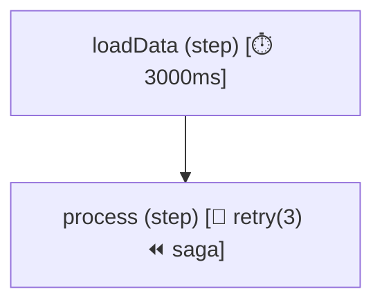

<p align="center">
  
</p>

# Rivulet
> Zero-daemon, in-process workflow orchestration with durable checkpoints, Sagas, and live visual DevTools.

[](https://www.npmjs.com/package/rivulet)
[](LICENSE)
[](https://nodejs.org)
[](https://www.typescriptlang.org/)
[]()

**Rivulet** allows you to break complex business logic into clean, reusable, and resilient steps. It combines functional composition with parameter contracts, deterministic caching, lifecycle hooks, structured retry strategies, isolated storage, parallel combinators, sagas with LIFO compensations, scoped idempotency, durable event-driven waits, end-to-end TypeScript context inference, visualization exports, live monitoring DevTools, and deterministic test harnesses.

---

## Positioning: In-Process Orchestration vs Distributed Engines

| Dimension | `Rivulet` | Distributed Engines (Temporal, Inngest) |
|---|---|---|
| **Architecture** | Lightweight, zero-infrastructure in-process library | Heavy multi-cluster / external orchestrator daemon |
| **Latency** | Microsecond direct async function invocation | Millisecond-to-second RPC / polling overhead |
| **Footprint** | Zero external dependencies, pure TypeScript | Requires persistent workers, queue servers, and databases |
| **Primary Focus** | Modular workflows, parallel fan-out/fan-in, bounded worker mapping, request-scoped sagas, idempotency, durable event waits, retry backoff with jitter, OCC checkpointing | Months-long durable human-in-the-loop workflows |

---

## Documentation & Topic Guides

Explore the 12 comprehensive guides covering architecture, design patterns, testing, and production operations:

1. 🚀 [01. Getting Started](docs/01-getting-started.md) &mdash; Installation, quickstart walkthrough, minimal examples, and CLI scaffolding.
2. 💡 [02. Core Concepts](docs/02-core-concepts.md) &mdash; Executable ASTs, accumulated context immutability, 5-phase step lifecycle, and reserved keys.
3. ⛓️ [03. Sequential Workflows](docs/03-sequential-workflows.md) &mdash; Linear pipelines, clean POJO parameters, lifecycle hooks (`onBefore`, `onSkip`, `onAfter`), and caching.
4. 🔀 [04. Branching and Parallelism](docs/04-branching-and-parallelism.md) &mdash; Concurrent fan-outs (`parallel`, `all`, `allSettled`, `race`), dynamic routing (`when`, `branch`), and bounded mapping (`map`).
5. 🛡️ [05. Retries, Timeouts, and Cancellation](docs/05-retries-timeouts-and-cancellation.md) &mdash; Two-tier timeouts, exponential backoff with jitter, cooperative `AbortSignal` cancellation, and saga rollbacks.
6. ⏳ [06. Durable Workflows](docs/06-durable-workflows.md) &mdash; Long-running human-in-the-loop waits (`waitForEvent`, `wait`), checkpoint resumption, and state migrations.
7. 💾 [07. Storage and Adapters](docs/07-storage-and-adapters.md) &mdash; Distributed persistence contracts, PostgreSQL & Redis adapters, and multi-tenant namespaces.
8. 🔭 [08. Observability](docs/08-observability.md) &mdash; Graph exports (Mermaid, DOT, JSON), OpenTelemetry distributed tracing, and W3C trace propagation.
9. 🧪 [09. Testing and Replay](docs/09-testing-and-replay.md) &mdash; Deterministic workflow harnesses (`@rivulet/testing`), fake clocks, step spies, mocks, and failure replay.
10. 🏷️ [10. TypeScript Reference](docs/10-typescript-reference.md) &mdash; End-to-end accumulated context inference, typed step history (`$steps`), and Standard Schema integration.
11. 🔄 [11. Migration and Compatibility](docs/11-migration-and-compatibility.md) &mdash; Upgrading from 0.x (`Chain`, `pipe`) to 1.0 (`Step`, `flow`), backwards compatibility, and modern POJO mode.
12. 🏭 [12. Production Operations](docs/12-production-operations.md) &mdash; Production deployment checklist, zero-daemon operational topologies, connection pooling, and retention cleanup.

### Architectural Contracts & Adapter Guides
- 🔌 [Ecosystem Adapters Overview](docs/ecosystem-adapters.md) &mdash; Master guide for all official adapters and CLI tooling.
- 📜 [Execution Semantics Contract](docs/execution-semantics.md) &mdash; Formal semantics answering all 9 runtime execution contract questions.
- 🚨 [Error Model & Exception Hierarchy](docs/error-model.md) &mdash; Complete exception hierarchy (`RivuletError`), metadata fields, and cause preservation.
- 💾 [Storage & Checkpoint Contract](docs/storage-contract.md) &mdash; Checkpoint schema v2.0.0, optimistic concurrency, and namespace isolation.
- 🔄 [Compensation & Sagas](docs/compensation-and-sagas.md) &mdash; Sagas with LIFO compensation rollbacks and retry policies.
- 🔑 [Idempotency & Deduplication](docs/idempotency.md) &mdash; Scoped idempotency keys, claim locking, and TTL stores.
- 📊 [Live Monitoring Roadmap](live-monitoring.roadmap.md) &mdash; Real-time DevTools, SSE/WebSocket streaming, and interactive DAG visualization.

---

## Key Features

- ⚡ **Composable Flows (`flow`)** &mdash; Compose steps directly into workflows without global registries; steps are pure execution units.
- 🧠 **Accumulated Context Inference** &mdash; TypeScript automatically computes the accumulated output type across composed sequential steps at compile time.
- 📜 **Typed Step History (`$steps`)** &mdash; Statically typed access to any step's output using string literal names (`context.$steps.loadUser.user`).
- 🗺️ **Workflow Graph Visualization** &mdash; Export workflow graphs directly to Mermaid diagrams (`flow.toMermaid()`), Graphviz DOT (`flow.toDot()`), and JSON AST (`flow.toJSON()`) with policy badges.
- 🖥️ **Live DevTools & Monitoring** &mdash; Real-time step inspection, timeline waterfalls, active DAG node highlighting, and failure replay.
- 🧪 **Deterministic Test Harness (`@rivulet/testing`)** &mdash; Zero-flake test harness with virtual clocks (`FakeClock`), step spies, mocking, trace snapshots, and failure replay.
- 💉 **Runtime Dependency Injection** &mdash; Inject services and repositories explicitly via `options.services` or step-level `step.withDependencies()`.
- 🔀 **Parallel Execution Combinators** &mdash; Run branches concurrently with `parallel`, `all`, `allSettled`, and `race`, equipped with branch context isolation and configurable merge strategies.
- 🌿 **Conditional Branching & Routing** &mdash; Dynamic decision routing via `when(predicate, thenStep).otherwise(elseStep)` and multi-branch selectors via `branch({...})`.
- 🔄 **Dynamic Mapping & Bounded Concurrency** &mdash; Process arrays with `map(items, step, { concurrency })`, order preservation, and error aggregation.
- 🔑 **Scoped Idempotency & Deduplication** &mdash; Protect workflows and individual steps (`step.idempotent()`) with deterministic hash keys and TTL stores.
- ⏪ **Sagas & LIFO Compensations** &mdash; Attach rollback handlers (`step.compensate(handler)`) that run automatically in reverse execution order upon failure.
- ⏳ **Durable Waits & Event Resumption** &mdash; Pause execution with `waitForEvent(eventName)` or `wait('30m')`, persist suspended checkpoints, and safely resume workflows.
- 🏷️ **Workflow Versioning & State Migrations** &mdash; Declare workflow versions (`flow.version('v2')`), detect version mismatches upon resumption, and run registered state transformation functions.
- ⏱️ **Resilient Deadlines & Two-Tier Timeouts** &mdash; Enforce per-step SLA (`step.timeout(ms)`) and workflow-level deadlines (`flow.timeout(ms)`).\
- 🔁 **Structured Retry Strategies** &mdash; Automatic retries with exponential, linear, or fixed backoff, jitter, and `onRetry` hooks right in `onFail`.\
- 📦 **Standard Schema Integration (`spec` / `schema`)** &mdash; Native Standard Schema, Zod, Valibot, and ArkType contract enforcement.\
- 🛑 **Graceful Cancellation & AbortSignals** &mdash; Cancel flows, in-flight async steps, and retry timers seamlessly using standard `AbortSignal`.\
- 🔌 **Ecosystem Integration Packages** &mdash; Ready-to-use adapters for PostgreSQL, Redis, BullMQ, Kafka, SQS, OpenTelemetry, Express, Fastify, Hono, and CLI developer tooling.

---

## Installation

```bash
# Core workflow runtime
npm install rivulet

# Optional testing harness & CLI developer tooling
npm install --save-dev @rivulet/testing @rivulet/cli
```

### Ecosystem Packages

| Package | Description |
|---|---|
| [`rivulet`](packages/core) | Core workflow engine and runtime |
| [`@rivulet/testing`](packages/testing) | Deterministic test harness, fake clocks, step spies, mocks, and replay tooling |
| [`@rivulet/cli`](packages/cli) | Developer CLI for scaffolding, diagram export, validation, and fixture replay |
| [`@rivulet/postgres`](packages/postgres) | PostgreSQL durable storage adapter and transactional idempotency store |
| [`@rivulet/redis`](packages/redis) | Redis caching, durable storage, idempotency store, and distributed locks |
| [`@rivulet/opentelemetry`](packages/opentelemetry) | OpenTelemetry distributed tracing and W3C trace context propagation |
| [`@rivulet/bullmq`](packages/bullmq) | BullMQ background worker adapter |
| [`@rivulet/kafka`](packages/kafka) | Kafka consumer batch processor adapter |
| [`@rivulet/sqs`](packages/sqs) | AWS SQS batch consumer with partial failure reporting |
| [`@rivulet/fastify`](packages/fastify) | Fastify HTTP route handler adapter |
| [`@rivulet/hono`](packages/hono) | Hono edge and Web Standards route handler adapter |
| [`@rivulet/express`](packages/express) | Express HTTP route handler adapter |

---

## Quickstart: Type-Safe Composable Flows

```typescript
import { Step, flow } from 'rivulet';

// 1. Define modular steps with input/output contracts
const fetchUser = Step.create('fetchUser', async (param: { userId: string }) => {
    return { name: 'Alice', tier: 'PRO' };
});

const calculateDiscount = Step.create('calculateDiscount', async (param: { tier: string }) => {
    const discount = param.tier === 'PRO' ? 0.20 : 0.05;
    return { discountPercentage: discount };
});

// 2. Compose into an executable flow
export const orderWorkflow = flow(fetchUser, calculateDiscount);

// 3. Run the flow with full type safety
async function main() {
    const result = await orderWorkflow.run({ userId: 'u_123' }, { pojo: true });
    console.log(result.name);               // 'Alice'
    console.log(result.discountPercentage); // 0.20
    console.log(result.$steps.fetchUser);   // { name: 'Alice', tier: 'PRO' }
}

main();
```

---

## Workflow Visualization & Export APIs

Export any workflow directly to Mermaid diagrams, Graphviz DOT, or JSON AST:

```typescript
import { Step, flow } from 'rivulet';

const s1 = Step.create('loadData', async () => ({ data: [1, 2, 3] })).timeout(3000);
const s2 = Step.create('process', async () => ({ done: true }))
    .onFail({ maxRetries: 3, delay: 100 })
    .compensate(async () => { /* rollback */ });

const pipeline = flow(s1, s2);

// 1. Export as Mermaid flowchart with policy badges
const mermaidCode = pipeline.toMermaid({ direction: 'TD' });
console.log(mermaidCode);

// 2. Export as Graphviz DOT
const dotCode = pipeline.toDot({ graphName: 'OrderPipeline' });

// 3. Export as JSON AST
const jsonAst = pipeline.toJSON();
```

Generated Mermaid output automatically includes badges for timeouts, retries, sagas, caches, and durable waits:



---

## Deterministic Testing with `@rivulet/testing`

Test workflows deterministically without flaky timers or complex mock infrastructure:

```typescript
import { expect } from 'chai';
import { createWorkflowHarness, FakeClock } from '@rivulet/testing';
import { orderWorkflow } from './order.workflow';

describe('Order Workflow Suite', () => {
    it('executes with step spies, mocks, and virtual clocks', async () => {
        const clock = new FakeClock();
        const harness = createWorkflowHarness(orderWorkflow, { clock });

        // Spy on step execution
        const discountSpy = harness.spyStep('calculateDiscount');

        // Mock external service calls
        harness.mockStep('fetchUser', () => ({ name: 'TestUser', tier: 'PRO' }));

        const result = await harness.run({ userId: 'u-100' });

        expect(result.discountPercentage).to.equal(0.20);
        expect(discountSpy.called).to.be.true;
        expect(discountSpy.firstCall()?.input.tier).to.equal('PRO');

        // Assert step execution telemetry
        harness.assertStepExecuted('fetchUser', 1);
        harness.assertStepExecuted('calculateDiscount', 1);
    });
});
```

---

## Scaffolding & Replay CLI

`@rivulet/cli` provides terminal commands for project creation, code generation, diagram export, and failure replay:

```bash
# Initialize a new TypeScript workflow project
npx rivulet init

# Scaffold a typed workflow and harness test
npx rivulet generate workflow checkout

# Scaffold a typed step and unit test
npx rivulet generate step charge-card

# Export workflow diagrams from the command line
npx rivulet export src/workflow.ts --format=mermaid
npx rivulet export src/workflow.ts --format=dot
npx rivulet export src/workflow.ts --format=json

# Statically validate workflow definitions for cycles
npx rivulet validate src/workflow.ts

# Replay an execution against a recorded test fixture
npx rivulet replay fixtures/failed-order.json src/workflow.ts
```

---

## Concurrency & Parallel Execution (`parallel`, `all`, `allSettled`, `race`)

```typescript
import { Step, flow, parallel, allSettled, race } from 'rivulet';

const checkInventory = Step.create('inventory', async () => ({ inStock: true }));
const checkFraud = Step.create('fraud', async () => ({ fraudScore: 0.02 }));
const fetchExchangeRates = Step.create('rates', async () => ({ usdToEur: 0.92 }));

// 1. Parallel execution (fails fast and aborts siblings on error)
const orderPreparation = flow(
    parallel([checkInventory, checkFraud, fetchExchangeRates])
);

// 2. allSettled: Collect all results and errors without failing fast
const auditFlow = flow(
    allSettled([serviceA, serviceB, serviceC])
);

// 3. race: First branch to settle wins; losing branches are aborted
const fastestResult = flow(
    race([primaryApiStep, secondaryFallbackStep])
);
```

---

## Dynamic Branching & Routing (`when`, `branch`)

```typescript
import { Step, flow, when, branch } from 'rivulet';

// Conditional If-Then-Else
const discountFlow = flow(
    when((ctx) => ctx.isVIP === true, applyVIPDiscount)
        .otherwise(applyStandardDiscount)
);

// Multi-path selector routing
const routingFlow = flow(
    branch({
        selector: (ctx) => ctx.tier, // 'gold' | 'silver' | 'bronze'
        branches: {
            gold: goldPipeline,
            silver: silverPipeline,
            bronze: bronzePipeline
        },
        defaultBranch: standardPipeline
    })
);
```

---

## Sagas & LIFO Compensations (`step.compensate`)

```typescript
import { Step, flow, CompensationException } from 'rivulet';

const reserveHotel = Step.create('reserveHotel', async () => {
    const booking = await hotelApi.book();
    return { hotelBookingId: booking.id };
})
.compensate(async (ctx) => {
    // Automatic rollback if downstream steps fail
    await hotelApi.cancel(ctx.hotelBookingId);
});

const chargeCard = Step.create('chargeCard', async () => {
    throw new Error('Payment declined'); // Triggers saga compensation!
});

const bookingFlow = flow(reserveHotel, chargeCard);
```

---

## Durable Waits & External Event Resumption

```typescript
import { Step, flow, waitForEvent, wait, resumeWorkflow } from 'rivulet';

const orderWorkflow = flow(
    createOrderStep,
    // 1. Suspend workflow until external event arrives or timeout occurs
    waitForEvent('paymentReceived', {
        correlationKey: (ctx) => ctx.orderId,
        timeout: '24h'
    }),
    fulfillOrderStep
);

// 1. Worker suspends when reaching waitForEvent
await orderWorkflow.run({ orderId: 'ord_999' }, { durable: true });

// 2. Webhook arrives hours later and resumes execution
const finalResult = await resumeWorkflow(orderWorkflow, 'ord_999', { paymentId: 'pay_777' });
```

---

## API Reference Summary

### Orchestration & Combinators

| Function / Helper | Description |
|---|---|
| `flow<TIn, TOut>(...steps)` | Primary workflow orchestrator with accumulated context inference. |
| `parallel(steps, options?)` | Runs branches concurrently, failing fast on error and isolating branch contexts. |
| `all(steps, options?)` | Alias for `parallel`. Runs an array or list of branches concurrently. |
| `allSettled(steps, options?)` | Runs branches concurrently and collects all outcomes without failing fast. |
| `race(steps, options?)` | Settles as soon as the first branch completes; cancels losing branches. |
| `when(predicate, thenStep)` | Conditional execution combinator supporting `.otherwise(elseStep)`. |
| `branch({ selector, branches, defaultBranch? })` | Multi-path dynamic branch router based on selector result. |
| `map(items, step, options?)` | Maps a collection through a step with bounded concurrency. |
| `waitForEvent(eventName, options)` | Suspends workflow until external event arrives or timeout expires. |
| `wait(duration)` | Pauses workflow execution for a duration string (`'10m'`, `'1h'`) or milliseconds. |
| `resumeWorkflow(flow, key, payload?, options?)` | Restores and resumes a suspended workflow from storage. |
| `toGraph(item)` | Compiles any step, flow, or combinator into a JSON-serializable `WorkflowNode` AST. |
| `inspectGraph(item)` | Analyzes workflow AST and returns topographical metrics (node count, depth, edges). |
| `validateGraph(node)` | Validates graph structure, checking for cycles and reachability. |
| `toMermaid(item, options?)` | Renders a workflow or node as a Mermaid flowchart diagram with badges. |
| `toDot(item, options?)` | Renders a workflow or node as a Graphviz DOT diagram. |
| `toJSON(item)` | Serializes a workflow AST to a clean JSON string. |

### Step Methods

| Method | Description |
|---|---|
| `Step.create<TIn, TOut, TName>(name?, action)` | Instantiates a new typed `Step` execution unit. |
| `step.withDependencies(deps)` | Attaches explicit runtime dependencies to the step. |
| `step.requireDependency(key)` | Retrieves a required dependency or throws a clear error. |
| `step.compensate(handler, options?)` | Registers a compensation rollback handler to run if downstream steps fail. |
| `step.idempotent(keyOrFn?, options?)` | Attaches idempotency deduplication and claim locking. |
| `step.timeout(ms)` | Sets per-step SLA deadline (throws `StepTimeoutException`). |
| `step.onFail(config \| callback)` | Configures retry policies (`RetryConfig`) or error handler. |
| `step.cache(ms \| options)` | Caches step results with namespace-aware partition keys. |
| `step.spec(field, options)` | Declares parameter validation, default values, transforms, and translations. |
| `step.schema(schema)` | Validates context against Standard Schema, Zod, or Valibot. |
| `step.onBefore(hook)` | Pre-execution guard hook; returning `false` skips the step. |
| `step.onSkip(hook)` | Fallback hook executed when `onBefore` skips the step. |
| `step.onAfter(hook)` | Post-execution hook enriching the output context. |
| `step.toMermaid()` / `step.toDot()` / `step.toJSON()` | Exports visualization diagrams and AST. |
| `step.execute(param?, options?)` / `step.run()` | Executes step returning a Promise. |

---

## License

This project is licensed under the MIT License - see the [LICENSE](LICENSE) file for details.

### Author

**Jerico de Guzman** &mdash; [LinkedIn](https://www.linkedin.com/in/jerico-de-guzman-35126657)
