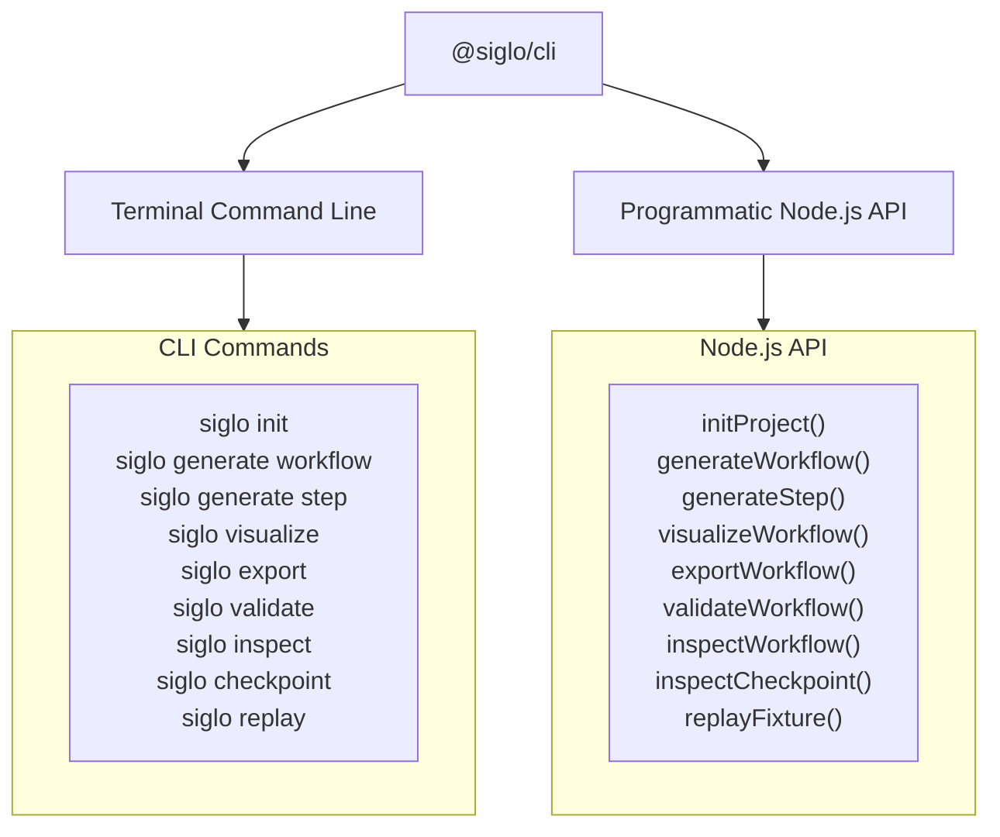
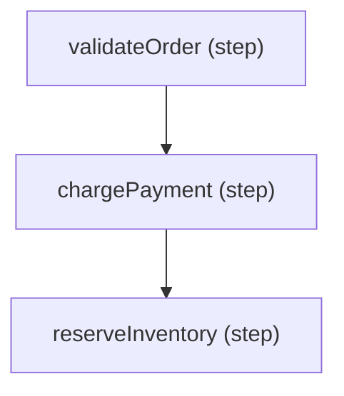

# Siglo Workflow Explorer — Continuation Handover

Exported: November 5, 2026 (Asia/Manila)
Repository: `/Users/jericodeguzman/Projects/fluid-func`

This document combines the previous handover and this conversation. Read the
current-state sections first. Appendix A preserves the original handover in
full; Appendix B preserves the attached CLI README in full. Historical claims
in the appendices do not supersede the current implementation described here.

## 1. User objective and session context

The user is improving the Siglo IntelliJ workflow explorer. Initial complaints
were missing branching/parallelism, incomplete step support and properties,
overlapping UI, poor spacing, and unused UI code. Subsequent requests covered
reload version semantics, overflowing workflow names, additional package steps,
shared branch destinations, structured step specs, labels for multiple flows,
and visualization of workflow properties.

The latest task was to export this session and the previous handover for later
continuation. No deployment, commit, push, or IDE installation was performed by
the assistant. Source fixes and a rebuilt installable ZIP are available locally.

## 2. Current architecture and corrections to the original handover

- The graph renderer is React with absolutely positioned HTML cards and SVG
  edges. It is **not Cytoscape**, despite the original handover's description.
- The analyzer uses the TypeScript syntax tree and does not execute application
  code. It is separate from the public `@siglo/cli` workflow-loading path.
- The UI is a Vite single-file HTML build copied into IntelliJ resources.
- The IntelliJ host communicates with a long-lived Node JSON-RPC daemon and
  deserializes/reserializes graph data using Kotlin/Gson models. Protocol fields
  must be updated on both the TypeScript and Kotlin sides or they can be lost.
- JCEF rendering, Swing fallback, navigation, source tracking, and plugin icons
  were inherited from the previous session. This session mainly improved the
  analyzer, webview, protocol models, and editor refresh handling.
- Current Gradle source declares `jvmToolchain(17)`. `gradle.properties` points
  Gradle itself to the local Temurin 21 installation. Do not copy the original
  handover's claim that the source toolchain is 21 without checking these files.
- IntelliJ Platform dependency remains IDEA Community 2024.1.4, with since-build
  241 and no until-build limit. Plugin version is still 1.0.0.

## 3. Changes completed in this conversation

### Graph layout and rendering

`packages/ide-ui/src/components/GraphCanvas.tsx` now uses longest-path layers,
placing forks alongside one another and joins below their inputs. Static
combinators produce explicit fork/join nodes. Edges have styles/colors for
sequential, parallel, branch, compensation, and fallback connections.
Unresolved expressions participate in layout. Step cards are buttons.

Each canvas uses a unique SVG arrow-marker ID, so multiple canvases do not
share marker IDs. Header space is reserved for workflow labels and optional
configuration badges. Inspector/card sizing and wrapping were improved, and an
unused map/import was removed. This is still a custom layout, not a general
purpose edge-routing engine; see the remaining work below.

### Analyzer: standalone combinators and expanded package coverage

The root cause of the cloud-race fixture failure was in analysis: standalone
`race(...)`, `parallel(...)`, and `allSettled(...)` were treated as unresolved
factories. Changing layout alone did not fix that. Recursive expression
expansion now supports:

| Category | Supported forms |
| --- | --- |
| Core steps | `Step.create`, `new Step`, `Func`/`Chain` constructors and `.create`, inline functions |
| Composition | `flow`, `pipe`, static `Step.flow`/`Step.pipe`, nested flows, sequential arrays |
| Combinators | `parallel`, `all`, `allSettled`, `race`, `branch`, `when`, `map`; corresponding `Step`/`Func`/`Chain` static forms |
| Durable waits | `wait`, `waitForEvent`, including static helpers |
| HTTP | `httpStep`, `new HttpStep` |
| AI | `aiStep`, `new AiStep` |
| Notifications | `sendNotificationStep`, `sendInteractiveApprovalStep` |
| Crypto | `verifyWebhookStep`, `encryptFieldsStep`, `decryptFieldsStep`, `maskFieldsStep`, and exported constructors |

Map renders its processing body once rather than inventing runtime item counts.
`when` without an else target includes a skip path to the join. Inline flows
inside combinators are expanded without becoming spurious standalone workflows
named after the enclosing combinator variable.

Fluent step timeout, compensation, cache, validation, hooks, network policy,
reduction, dependencies, and idempotency configuration are recognized. HTTP
`maxRetries` is mapped into execution retries. Static operational properties
are exposed for display. The property extractor uses an allowlist for factory
options rather than including request bodies and credentials as properties.

Queue, scheduler, web-framework, storage, monitor, and testing packages were
reviewed as integrations/adapters rather than additional step factories.
Coverage and static-analysis limitations are documented in
`packages/ide-analysis/README.md`.

### Reload versions and wrong-file refreshes

`SigloToolWindowPanel.kt` now tracks source revisions per URI/content. Reloading
unchanged text retains its revision. Request ordering uses a separate monotonic
counter so stale responses can be discarded independently of document revision.

Background document edits previously could switch the explorer to a different
file. Document edit refresh now checks the selected editor file both before
scheduling and after debounce. Tab changes cancel pending debounce requests and
invalidate old graph requests.

The UI displays source revision as `rN`, with a source-revision tooltip. This
is distinct from a workflow's declared schema version.

### Shared branch targets and fixture isolation

The user's report mentioned `SUBPRIME` alongside `settleLedgerEntry`. In source,
`SUBPRIME` belongs to use case 14, while `settleLedgerEntry` belongs to use case
15. The analyzer is now regression-tested to keep these documents separate.

Use case 14 sends both `SUBPRIME` and the default route to the same subflow.
These routes previously produced duplicate edge IDs and overlapping labels.
Equivalent typed connections are now normalized while retaining both route
names as `SUBPRIME / default`. Duplicate join connections are removed.

Use case 15 remains a three-step sequential graph. Its settlement step retains
its idempotency expression, `ledger-settlement` namespace, and 60000-ms TTL.
There is no source-defined SUBPRIME route in that fixture.

### Structured Step Properties and specs

Added `StepSpec` and `StepSpecRule` to TypeScript protocol types and Kotlin
models. Repeated `.spec(...)` calls used to overwrite earlier properties. They
are now preserved in declaration order as a list. Alias pairs are normalized:

- `default` / `defaultValue`
- `validate` / `validator`
- `transform` / `transformer`
- `translate` / `translator`

Required rules/messages, conditional requirements, field schemas, `.schema(...)`,
and whole-input `.spec(schema)` are represented. Whole-input scope is `$root$`.
Static string values are unquoted for display, and literal exception messages
inside validators can provide readable descriptions. Source expressions remain
unevaluated.

`StepProperties.tsx` groups rules into field cards, shows required/default and
validation information, and puts functions/schemas behind expandable source
sections. Repeated email/country specs appear together without dropping rules.
The inspector is wider, text wraps, and source indentation is normalized.

Use case 24 has 11 spec calls across 9 fields on `orderIntakeNormalize`, plus a
whole-input schema on `orderIntakeAccept`. Tests cover this structure, aliases,
false/zero/empty defaults, and schema handling.

### Multiple workflow labels

“All Flows” now renders each workflow in its own labeled canvas/section rather
than merging all edges/nodes into one unlabeled drawing. This preserves each
workflow's boundaries, including workflows that reuse other flows. Individual
views also have a label. Long selector names and canvas labels truncate with
ellipsis and expose the full name on hover.

`sample.ts` currently defines `flow1`, `flow2`, and `flow3 = flow(flow1, flow2)`.
The user changed this file during the session. Composition tests now use inline
source rather than appending declarations to this mutable sample.

### Workflow Properties

After reviewing `docs/api/flow.md` and the implementation in
`packages/core/src/features/step/index.ts`, added workflow property maps to both
`WorkflowGraph` and `GraphDocument`, and mirrored them in Kotlin/Gson models.

Extracted properties include:

- `.timeout(...)` → workflow deadline, separate from step timeout.
- `.version(...)` → workflow schema version, separate from source revision.
- `.networkPolicy(...)` → enabled/default policy/hosts/localhost/Unix sockets.
- `.monitor(...)` → monitor expression (supported in implementation).

Both chains and separate calls on known flow variables are handled in source
order. Nested flows do not transfer their execution defaults to the containing
flow. Runtime run/execute options are not shown as declared defaults. Dynamic
policies remain expressions; spreads do not cause invented resolved defaults.
For literal network policy objects, defaults follow the current implementation,
including `allowLocalhost: false`, despite a discrepancy in the API docs.

Click a workflow label to open `WorkflowInspector.tsx`, showing execution
settings, network perimeter, monitor, node counts, and clickable node names.
Click a step to return to its step inspector. Deadline/version badges appear
above the graph when declared, with extra layout space reserved for them.

## 4. Key files for continuing

| File | Purpose |
| --- | --- |
| `packages/ide-protocol/src/types.ts` | Shared graph, spec, workflow property contracts |
| `packages/ide-analysis/src/parser.ts` | Build documents/workflow summaries, source location resolution |
| `packages/ide-analysis/src/patterns/workflow-detector.ts` | Flow discovery, recursive combinators, subflow stitching, route normalization, workflow properties |
| `packages/ide-analysis/src/patterns/step-detector.ts` | Factories/constructors, fluent settings, structured specs, operational properties |
| `packages/ide-analysis/src/bin.ts` | JSON-RPC daemon; advertised syntax matrix needs review |
| `packages/ide-analysis/test/parser.test.ts` | Topology, fixtures, specs, and workflow property regressions |
| `packages/ide-analysis/README.md` | Coverage and constraints |
| `packages/ide-ui/src/App.tsx` | Flow selection, per-flow canvases, step/workflow inspector switching |
| `packages/ide-ui/src/components/GraphCanvas.tsx` | Layout, SVG connections, workflow labels/badges |
| `packages/ide-ui/src/components/InspectorPanel.tsx` | Step identity, execution config, source coordinates, diagnostics |
| `packages/ide-ui/src/components/StepProperties.tsx` | Structured input-contract cards and property details |
| `packages/ide-ui/src/components/WorkflowInspector.tsx` | Workflow-level metadata and node list |
| `packages/ide-ui/src/vite-env.d.ts` | Vite asset typing, including PNG imports |
| `plugins/intellij/src/main/kotlin/io/siglo/idea/process/ProtocolModels.kt` | Gson models; preserve all protocol additions here |
| `plugins/intellij/src/main/kotlin/io/siglo/idea/toolwindow/SigloToolWindowPanel.kt` | Source revisions, active-file tracking, stale-response/debounce handling |
| `plugins/intellij/src/test/kotlin/io/siglo/idea/ProtocolModelsTest.kt` | Four test methods, including structured spec round trip |
| `plugins/intellij/src/main/resources/ide-ui/index.html` | Copied build artifact loaded by JCEF |

## 5. Validation already performed

The last implementation checks in this conversation passed:

- `npm test --workspace=@siglo/ide-analysis`: **19 passing**.
- `npx tsc -p packages/ide-ui/tsconfig.json`: passed.
- `npm run build --workspace=@siglo/ide-ui`: passed.
- `./gradlew test buildPlugin` in `plugins/intellij`: passed.
- Ad hoc React server-render checks: structured field cards and schema details;
  separate workflow labels and unique SVG markers; workflow property metadata,
  clickable label markup, deadline/version badges, and reserved header space.

The latest plugin ZIP was rebuilt successfully. These checks do **not** establish
live JCEF visual correctness. There was no browser screenshot/layout inspection
or post-install IntelliJ interaction test in this session. The original
handover's 1,018-monorepo-test result is historical; the complete monorepo suite
was not rerun here. Do not report that count as fresh verification.

## 6. Build, analyzer discovery, and install

Run from repository root:

```bash
npm run build --workspace=@siglo/ide-protocol
npm test --workspace=@siglo/ide-analysis
npx tsc -p packages/ide-ui/tsconfig.json
npm run build --workspace=@siglo/ide-ui
cp packages/ide-ui/dist/index.html plugins/intellij/src/main/resources/ide-ui/index.html
```

Then run in `plugins/intellij`:

```bash
./gradlew test buildPlugin
```

Latest artifact:
`plugins/intellij/build/distributions/siglo-intellij-plugin-1.0.0.zip`

Install through IntelliJ Settings → Plugins → gear → Install Plugin from Disk,
then restart IntelliJ. A restarted analyzer process is needed to load rebuilt
analyzer JavaScript.

The plugin locates the analyzer separately, in this order:

1. `SIGLO_ANALYZER_BIN` environment variable or `siglo.analyzer.bin` JVM property.
2. `<project>/packages/ide-analysis/dist/bin.js`.
3. `<project>/node_modules/@siglo/ide-analysis/dist/bin.js`.

Rebuilding only the ZIP is insufficient if analyzer `dist` is stale. The checked
Gradle configuration contains a machine-specific Java-home path:
`/Users/jericodeguzman/Library/Java/JavaVirtualMachines/temurin-21.0.12.1/Contents/Home`.

## 7. Remaining limitations and useful next work

1. Verify the latest ZIP in IntelliJ/JCEF on use cases 13, 14, 15, 24, and sample.
   Check labels, all-flow grouping, inspector switching, expanded source text,
   branch/default labels, tab changes, background edits, and unchanged reloads.
2. Static syntax coverage is not complete semantic TypeScript resolution.
   Renamed imports, namespace aliases outside recognized static helper forms,
   external step definitions, runtime factories, and dynamic branch maps remain
   unresolved or incomplete. Variable-name maps are not fully lexical-scope-aware.
3. Standalone step mutations/assignments are not folded into step declarations.
   Separate known flow configuration calls are supported, but arbitrary aliasing,
   direct property assignments, conditional execution, and runtime mutations are
   not fully evaluated.
4. Layout still uses recursive longest-path layering and simple curves. Long
   edges, cycles, deep nesting, or dense labels can need better routing. Tests
   establish static markup/structure, not absence of every visual overlap.
5. Subflow stitching still derives entry/exit from the first/last node in some
   paths. Broader multi-entry/multi-exit/reused-step topology deserves tests.
6. The parser retains legacy fluent topology forms (`.then`, `.parallel`,
   `.branch`, `.fallback`, `.compensate`) from prior work. Actual documented
   `Flow.compensate(stackId, options)` is an execution operation, so compatibility
   parsing should be audited against current runtime API semantics.
7. `bin.ts`'s `SUPPORTED_SYNTAX_MATRIX` still lists the older subset, despite
   expanded parser support; align advertised capabilities if needed.
8. Original handover future work remains: live execution overlays, quick fixes,
   and export controls. The public CLI README is a useful reference, but its
   loader dynamically imports modules and can invoke factories; do not replace
   the IDE's zero-execution AST parser with that loader without an explicit
   design decision.
9. Preserve uncommitted user changes. No commit was created in this session.
   At export, Git reports modified example test/index files, package-lock,
   roadmap, and numerous untracked plugin/package/example files. Do not assume
   all changes were made by this session, clean them, or overwrite sample files.

## 8. Suggested restart prompt

> Continue from SESSION_HANDOVER_2026-11-05_CONTINUATION.md. Inspect current files
> before changing them. The plugin and analyzer builds passed, but live JCEF
> rendering still needs confirmation. Preserve user edits and keep TypeScript
> protocol, Kotlin Gson models, analyzer dist, and embedded UI artifact in sync.

---

## Appendix A — Original SESSION_HANDOVER.md (verbatim snapshot)

The following is historical context. Current-state corrections above take
precedence.

# Siglo IntelliJ Plugin & Workflow Explorer - Session Handover

**Exported Date**: November 5, 2026  
**Repository**: `/Users/jericodeguzman/Projects/fluid-func`  
**Distribution ZIP**: `plugins/intellij/build/distributions/siglo-intellij-plugin-1.0.0.zip`  
**Target Fixtures Tested**:
- `examples/src/workflow/usecases/sample.ts`
- `examples/src/workflow/usecases/usecase-13-parallel-cloud-race.ts`

---

## 1. Summary of Work Completed

### A. IntelliJ Plugin Roadmap Implementation (`roadmap/intellij.roadmap.md`)
1. **`@siglo/ide-protocol`**:
   - Implemented JSON-RPC 2.0 schemas and interfaces:
     - `siglo/initialize`
     - `siglo/discoverWorkflows`
     - `siglo/getGraph`
     - `siglo/resolveLocation`
     - `siglo/shutdown`
   - Added support for multi-workflow documents (`WorkflowGraph[]` within `GraphDocument`).

2. **`@siglo/ide-analysis`**:
   - **Pure Static AST Analysis**: Built on `typescript` AST parser (`ts.createSourceFile`). **Zero application code execution** is performed.
   - **Chained and Variadic Workflow Support**: Supports both fluent `.then()`, `.parallel()`, `.branch()`, `.fallback()`, `.compensate()` call chains AND variadic multi-argument declarations (e.g. `flow(step1, step2, step5)`).
   - **Subflow Composition**: Automatically resolves nested flows passed as arguments (e.g. `flow(flow1, flow2)`) by expanding and stitching subflow step sequences according to runtime `flattenSteps` semantics.
   - **Multi-Flow Identification**: Derives names from variable assignments (`const flow1 = flow(...)`), explicit name parameters (`flow('name', ...)`), or expression arguments (`flow(flow1, flow2)`).
   - **CLI Stdio Daemon**: `bin.ts` runs as a long-lived Node daemon with stdio communication.

3. **`@siglo/ide-ui`**:
   - Single-file webview bundle built with Vite (`vite-plugin-singlefile`) and Tailwind CSS.
   - **Cytoscape Graph Visualizer**: Renders step nodes, directional edges (sequential, parallel, branch, compensation, fallback), and status markers.
   - **Detail Inspector Panel**: Displays step metadata, execution config (retries, timeouts, compensation), source locations, and static diagnostics.
   - **Header Controls**:
     - **Flow Switcher**: Allows toggling between individual flows (`flow1`, `flow2`), composite flows (`flow(flow1, flow2)`), or a combined view (`All Flows`).
     - **Reload Button**: Manually triggers graph re-analysis.
     - **Auto-Reload Toggle**: Checkbox controlling dynamic re-rendering on buffer edits.
   - **Theme & Mascot**: Official Siglo otter logo displayed in the header and empty states without text, styled to match the dark/light IDE themes.

4. **`plugins/intellij`**:
   - **Gradle & JDK Compatibility**: Configured for Gradle 8.10.2 + IntelliJ Platform Gradle Plugin 2.1.0 using Java 21 toolchain (`temurin-21.0.12.1`).
   - **Target Build Compatibility**: Configured `sinceBuild = "241"` and `untilBuild = provider { null }` to support modern IntelliJ versions including `IU-262.11879.100` (IntelliJ IDEA 2026.2).
   - **JCEF ClassLoader Isolation**: Isolated JCEF browser integration into `JcefBrowserView.kt` guarded behind `<depends optional="true" config-file="siglo-jcef.xml">com.intellij.modules.jcef</depends>` and runtime reflection check `isJcefAvailable()`. Gracefully falls back to Swing `JBTree` when JCEF is absent.
   - **Thread-Safe Read Actions**: Wrapped document lookups from JCEF callbacks (`CefHandlers-execution-*` threads) in `ApplicationManager.getApplication().runReadAction { ... }` and scheduled UI updates on EDT (`invokeLater`), fixing threading violations.
   - **Editor Synchronization**:
     - `FileEditorManagerListener`: Automatically refreshes graph on tab switches.
     - `DocumentListener`: Debounces document edits (250ms `Alarm`) for live typing updates when Auto-Reload is enabled.
     - Bi-directional navigation: Clicking a node in the webview navigates the IntelliJ editor to the exact line and character offset via `OpenFileDescriptor`.
   - **Theme-Aligned Icons**:
     - Tool window and action icons: `siglo.svg` (light) and `siglo_dark.svg` (dark).
     - Plugin Manager marketplace icons: `pluginIcon.svg` and `pluginIcon_dark.svg`.

---

## 2. Key Architecture & File Map

| Component | Path | Description |
| :--- | :--- | :--- |
| **Protocol Types** | `packages/ide-protocol/src/types.ts` | Graph node, edge, document, diagnostic & workflow contracts |
| **Protocol Methods** | `packages/ide-protocol/src/protocol.ts` | JSON-RPC 2.0 message contracts & helpers |
| **AST Parser** | `packages/ide-analysis/src/parser.ts` | Top-level static parsing & discovery |
| **Workflow Detector** | `packages/ide-analysis/src/patterns/workflow-detector.ts` | Syntax analysis for `flow()`, chaining, diagnostics, subflows |
| **Step Detector** | `packages/ide-analysis/src/patterns/step-detector.ts` | Pattern matching for `Step.create`, ecosystem steps (`httpStep`, etc.) |
| **CLI Daemon** | `packages/ide-analysis/src/bin.ts` | Node stdio JSON-RPC server |
| **Webview UI App** | `packages/ide-ui/src/App.tsx` | UI top bar, multi-flow dropdown, auto-reload, canvas layout |
| **Graph Canvas** | `packages/ide-ui/src/components/GraphCanvas.tsx` | Cytoscape graph renderer |
| **Tool Window Panel** | `plugins/intellij/src/main/kotlin/.../SigloToolWindowPanel.kt` | Swing/JCEF host, editor listeners, threading actions |
| **JCEF View** | `plugins/intellij/src/main/kotlin/.../JcefBrowserView.kt` | JCEF browser bridge and `CefMessageRouter` query handler |
| **Analyzer Service** | `plugins/intellij/src/main/kotlin/.../SigloAnalyzerService.kt` | Project service running the Node background process |
| **Plugin XML** | `plugins/intellij/src/main/resources/META-INF/plugin.xml` | Tool window registration, actions, optional JCEF dependency |

---

## 3. How to Build & Package

### Quick Build Commands
```bash
# 1. Build TypeScript packages
npm run build --workspace=@siglo/ide-protocol
npm run build --workspace=@siglo/ide-analysis
npm run build --workspace=@siglo/ide-ui

# 2. Copy compiled UI bundle to plugin resources
cp packages/ide-ui/dist/index.html plugins/intellij/src/main/resources/ide-ui/index.html

# 3. Run Kotlin tests and build IntelliJ plugin ZIP
cd plugins/intellij
./gradlew test
./gradlew buildPlugin --rerun-tasks
```
The resulting installable artifact is:
`plugins/intellij/build/distributions/siglo-intellij-plugin-1.0.0.zip`

### Installing into IntelliJ IDEA
1. Open IntelliJ IDEA $\rightarrow$ **Settings / Preferences** (`⌘,` on macOS, `Ctrl+Alt+S` on Linux/Windows).
2. Go to **Plugins** $\rightarrow$ Click the gear icon ⚙️ $\rightarrow$ **Install Plugin from Disk...**.
3. Select `plugins/intellij/build/distributions/siglo-intellij-plugin-1.0.0.zip`.
4. Click **Restart IDE**.
5. The **Siglo Workflows** tool window is available on the right-hand stripe.

---

## 4. Verification & Testing History

1. **Monorepo Packages**:
   - `npm run test:packages`: **1,018 tests passing**.
2. **Analysis Unit Tests**:
   - `npm test --workspace=@siglo/ide-analysis`: **8 tests passing** (zero-execution verification, multi-flow parsing, subflow expansion, unicode offsets, and diagnostics).
3. **IntelliJ Plugin Tests**:
   - `./gradlew test`: **3 tests passing** (`ProtocolModelsTest` verifying GSON serialization, JSON-RPC envelopes, and Node binary resolution).

---

## 5. Potential Next Steps to Continue Later

- **Ecosystem Step Visual Customization**: Custom badge styling or distinct icons in `GraphCanvas` for ecosystem steps (`@siglo/http`, `@siglo/ai`, `@siglo/notifications`, `@siglo/crypto`).
- **Live Execution Overlay**: Connecting to `@siglo/monitor` SSE streams to show real-time step status (running, completed, failed) on the static graph.
- **Quick-Fix Intentions**: Implementing IntelliJ QuickFix intentions for static diagnostics (e.g., auto-inserting missing compensation steps for side-effects).
- **Exporting Diagrams**: Adding UI buttons in the webview to export the rendered graph as SVG, PNG, or Mermaid diagram syntax.


---

## Appendix B — Attached packages/cli/README.md (verbatim snapshot)

This guide is preserved as attached reference material; no CLI changes were
requested or made as part of the handover export.

# @siglo/cli Developer Tools & CLI Guide

`@siglo/cli` provides developer tooling, code scaffolding, static analysis, command-line inspection, architecture export, and regression testing utilities for `Siglo` workflows. It allows engineering teams to scaffold typed steps/workflows, visualize execution graphs, export to Mermaid/Graphviz/JSON, detect cyclic dependencies, inspect serialized checkpoints, and replay golden test fixtures in CI/CD pipelines.

See the [ecosystem generator cookbook](ECOSYSTEM.md) for HTTP, webhook, notification, and AI step templates and offline testing.

---

## 1. Overview

`@siglo/cli` operates both as an executable terminal tool (`Siglo`) and as a programmatic TypeScript library:



---

## 2. Installation

Install `@siglo/cli` locally in your project or globally:

```bash
# Local development dependency (recommended)
npm install --save-dev @siglo/cli @siglo/testing Siglo tsx

# Or run directly via npx
npx siglo --help
```

---

## 3. Command Line Interface (CLI)

The CLI executable is `Siglo`.

### General Usage

```bash
Siglo <command> [arguments] [options]
```

### Global Options:
- `--format=mermaid|text|dot|json`: Diagram representation or export format (default: `mermaid`).
- `--direction=TD|LR|TB`: Graph layout direction for Mermaid or DOT diagrams (default: `TD`).
- `--out=<file>`: Write output directly to a file instead of `stdout`.
- `--redact=key1,key2`: Comma-delimited list of sensitive context keys or node names to mask with `[REDACTED]`.
- `--help`, `-h`: Show CLI usage guide.
- `--version`, `-v`: Display CLI version.

---

### Command 1: `siglo init [dir]`

Scaffolds a clean starter project preconfigured with `Siglo`, `tsx`, modern TypeScript config, and a runnable workflow test.

```bash
siglo init ./services/order-orchestrator
```

#### Generated Files:
1. `package.json`: Contains scripts (`npm test`, `npm start`) and required dependencies.
2. `src/workflow.ts`: Example order processing pipeline with validation and payment steps.
3. `src/workflow.test.ts`: Automated test executing the workflow with assertions.

---

### Command 2: `siglo generate workflow <name>`

Scaffolds a brand new typed workflow file and companion unit test powered by `@siglo/testing`.

```bash
siglo generate workflow order-processing
```

#### Generated Files:
1. `src/workflows/order-processing.workflow.ts`: Strongly-typed input/output interfaces, steps, and default workflow export.
2. `src/workflows/order-processing.workflow.test.ts`: Test harness setup verifying end-to-end execution and step invocations.

---

### Command 3: `siglo generate step <name>`

Scaffolds an isolated, strongly-typed `Step` module and companion unit test.

```bash
siglo generate step send-notification
```

#### Generated Files:
1. `src/steps/send-notification.step.ts`: Typed step module with input/output interfaces.
2. `src/steps/send-notification.step.test.ts`: Direct step execution test.

---

### Command 4: `siglo visualize <workflow-file> [options]`

Renders the workflow graph AST as either a Mermaid flowchart or an indented ASCII text hierarchy.

#### Mermaid Diagram (Default):
```bash
siglo visualize src/workflows/checkout.ts
```
*Output:*


#### Text Diagram (`--format=text`):
```bash
siglo visualize src/workflows/checkout.ts --format=text
```
*Output:*
```text
Workflow Graph (total nodes: 3, edges: 2):
├── [step] validateOrder (validateOrder)
├── [step] chargePayment (chargePayment)
└── [step] reserveInventory (reserveInventory)
```

---

### Command 5: `siglo export <workflow-file> [options]`

Exports the workflow topology graph directly to standard formats for architectural documentation, diagrams, or web visualization:
- `--format=mermaid`: Mermaid flowchart with policy badges (retries, timeouts, fallback).
- `--format=dot`: Graphviz DOT format compatible with Graphviz tools and PlantUML.
- `--format=json`: Comprehensive AST node/edge graph JSON.
- `--direction=TD|LR|TB`: Graph layout orientation (top-down, left-to-right).
- `--out=<file>`: Save result directly to a specified destination file.

```bash
# Export Mermaid diagram to file with Left-to-Right layout
siglo export src/workflows/order.workflow.ts --format=mermaid --direction=LR --out=docs/order-flow.mmd

# Export Graphviz DOT format
siglo export src/workflows/order.workflow.ts --format=dot --out=diagrams/order.dot

# Export raw JSON AST
siglo export src/workflows/order.workflow.ts --format=json --out=dist/order-ast.json
```

---

### Command 6: `siglo validate <workflow-file>`

Performs static analysis on the workflow graph AST without executing any step business logic:
- Detects cyclic dependencies.
- Identifies unreachable nodes or disconnected subgraphs.
- Verifies combinator structures (`parallel`, `branch`, `map`).

```bash
siglo validate src/workflows/loan-pipeline.ts
```

*Success Output:*
```text
✔ Workflow graph is valid (acyclic, reachable)
```

*Failure Output (Exit Code 1):*
```text
✖ Workflow validation failed:
  - Cycle detected between nodes 'processPayment' and 'retryPayment'
```

---

### Command 7: `siglo inspect <workflow-file> [options]`

Returns a detailed JSON telemetry summary of the workflow topology, node classifications, edge connections, and total complexity metrics.

```bash
siglo inspect src/workflows/settlement.ts --redact=taxId,secretKey
```

*Output:*
```json
{
  "totalNodes": 4,
  "edges": [
    { "from": "step1", "to": "step2" },
    { "from": "step2", "to": "step3" }
  ],
  "nodes": [
    { "id": "step1", "name": "validateInput", "type": "step" },
    { "id": "step2", "name": "[REDACTED]", "type": "step" },
    { "id": "step3", "name": "persistAudit", "type": "step" }
  ],
  "redactedFields": ["taxId", "secretKey"]
}
```

---

### Command 8: `siglo checkpoint <file> [options]`

Parses and validates a serialized checkpoint state JSON file (e.g., dumped from Redis or PostgreSQL during debugging), summarizing step chains and execution context while masking sensitive credentials.

```bash
siglo checkpoint ./logs/crash-checkpoint.json --redact=apiKey,password
```

*Output:*
```json
{
  "stackId": "stack-8123-bba8",
  "namespace": "tenant-enterprise",
  "type": "flow",
  "stepCount": 3,
  "chains": ["validate", "charge", "notify"],
  "contexts": {
    "charge": {
      "apiKey": "[REDACTED]",
      "status": "APPROVED",
      "amount": 250
    }
  }
}
```

---

### Command 9: `siglo replay <fixture> [workflow-file]`

Replays an end-to-end workflow execution using recorded inputs and validates that output values match golden expectations.

```bash
# Replay against default src/workflow.ts
siglo replay fixtures/order-regression.json

# Replay against explicit workflow module
siglo replay fixtures/order-regression.json src/workflows/order.workflow.ts
```

*Success Output:*
```text
✔ Replay passed in 14ms
```

*Regression Output (Exit Code 1):*
```text
✖ Replay failed with discrepancies: {
  "total": {
    "expected": 100,
    "actual": 120
  }
}
```

---

## 4. Programmatic API Reference

Import programmatic utilities directly in your tests, scripts, and build pipelines:

```typescript
import {
    initProject,
    generateWorkflow,
    generateStep,
    visualizeWorkflow,
    validateWorkflow,
    inspectWorkflow,
    inspectCheckpoint,
    replayFixture,
    exportWorkflow,
    toMermaid,
    toTextGraph,
    ReplayFixture,
    ReplayResult,
    WorkflowVisualizationResult,
    ExportWorkflowOptions
} from '@siglo/cli';
```

---

### `generateWorkflow(name, targetDir?)`

Generates typed workflow and test templates:

```typescript
const { filePath, testPath } = generateWorkflow('payment-settlement');
console.log(`Generated: ${filePath} and ${testPath}`);
```

---

### `generateStep(name, targetDir?)`

Generates typed step and test templates:

```typescript
const { filePath, testPath } = generateStep('audit-logger');
console.log(`Generated: ${filePath} and ${testPath}`);
```

---

### `exportWorkflow(workflow, options?)`

Exports a workflow to Mermaid, Graphviz DOT, or JSON format:

```typescript
// Mermaid format with top-to-bottom layout
const mermaidDiagram = exportWorkflow(myWorkflow, {
    format: 'mermaid',
    direction: 'TD',
    includeBadges: true
});

// Graphviz DOT format with left-to-right layout
const dotGraph = exportWorkflow(myWorkflow, {
    format: 'dot',
    direction: 'LR'
});

// JSON AST format
const jsonAST = exportWorkflow(myWorkflow, {
    format: 'json'
});
```

---

### `visualizeWorkflow(workflow)`

Generates both Mermaid and ASCII text representations of a workflow:

```typescript
const result: WorkflowVisualizationResult = visualizeWorkflow(orderWorkflow);

console.log(result.mermaid);   // Mermaid flowchart TD string
console.log(result.text);      // ASCII text tree
console.log(result.nodeCount); // Total nodes in AST
console.log(result.hasCycles); // Boolean cycle indicator
```

---

### `validateWorkflow(workflow)`

Runs cycle detection and connectivity validation on the compiled graph:

```typescript
const validation = validateWorkflow(myWorkflow);

if (!validation.valid) {
    console.error('Validation errors:', validation.errors);
}
```

---

### `inspectWorkflow(workflow, options?)`

Analyzes graph structure and optionally redacts sensitive node names:

```typescript
const inspection = inspectWorkflow(myWorkflow, {
    redact: ['confidentialStep', 'authStep']
});
```

---

### `inspectCheckpoint(checkpoint, options?)`

Inspects a checkpoint object or JSON string, redacting specified context fields across all steps:

```typescript
const summary = inspectCheckpoint(checkpointJsonString, {
    redact: ['accessToken', 'cardToken']
});
```

---

### `replayFixture(workflow, fixture)`

Replays an end-to-end workflow against a recorded golden test fixture. Ideal for CI regression testing, schema evolution validation, and deterministic output verification.

#### TypeScript Interface:

```typescript
export interface ReplayFixture {
    name?: string;
    version?: string;
    initialParam: Record<string, any>;
    expectedOutputs?: Record<string, any>;
    checkpoints?: any[];
}

export interface ReplayResult {
    success: boolean;
    durationMs: number;
    finalContext: Record<string, any>;
    diff?: Record<string, { expected: any; actual: any }>;
}
```

---

## 5. Golden Fixture Testing in CI

Use `replayFixture` in your test suite to ensure that workflow refactoring preserves identical behavior and contract outputs:

### Step 1: Define Fixture File (`test/fixtures/pricing-fixture.json`)

```json
{
  "name": "StandardTierPricing",
  "version": "2.0.0",
  "initialParam": {
    "seats": 10,
    "tier": "pro",
    "annualDiscount": true
  },
  "expectedOutputs": {
    "subtotal": 1200,
    "discount": 240,
    "total": 960,
    "approved": true
  }
}
```

### Step 2: Implement Test Runner (`test/pricing.test.ts`)

```typescript
import test from 'node:test';
import assert from 'node:assert/strict';
import * as path from 'path';
import { replayFixture } from '@siglo/cli';
import { pricingFlow } from '../src/workflows/pricingFlow';

test('Pricing Flow matches golden fixture expectations', async () => {
    const fixturePath = path.resolve(__dirname, 'fixtures/pricing-fixture.json');
    const result = await replayFixture(pricingFlow, fixturePath);

    assert.equal(
        result.success,
        true,
        `Workflow regression detected: ${JSON.stringify(result.diff, null, 2)}`
    );

    assert.ok(result.durationMs < 500, `Execution took ${result.durationMs}ms, exceeded 500ms budget`);
});
```

---

## 6. Workflow File Loading Mechanics

When `Siglo` loads a workflow file specified on the command line (e.g. `siglo visualize src/workflow.ts` or `siglo export src/workflow.ts`):
1. The file is dynamically imported using Node.js ES modules.
2. The loader checks exports in the following order:
   - `export default flowInstance`
   - `export const workflow = flowInstance`
   - `export const pipeline = flowInstance`
   - Any named export satisfying `isFlow` or containing a `run()` function.
   - If the candidate is a zero-argument factory function (e.g., `export default () => flow(...)`), it is invoked automatically to construct the graph.

