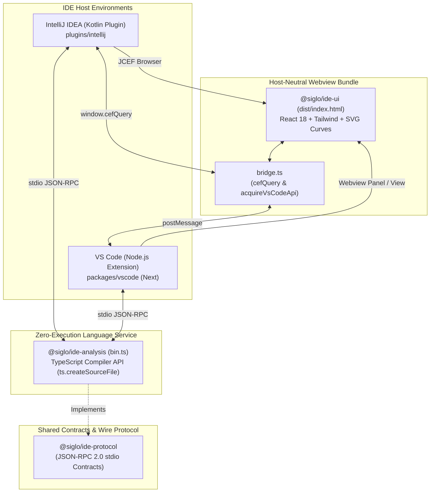

# Siglo Workflow Explorer — Consolidated Final Session Handover

> **Layout update:** The implemented VS Code extension now lives in `plugins/vscode`, alongside `plugins/intellij`, and is explicitly registered as the `@siglo/vscode` npm workspace. Historical `packages/vscode` references below describe the original plan; use `plugins/vscode` for current work.

**Exported Date**: November 5, 2026 (Asia/Manila)  
**Repository**: `/Users/jericodeguzman/Projects/fluid-func`  
**Distribution ZIP**: `plugins/intellij/build/distributions/siglo-intellij-plugin-1.0.0.zip` (2.0 MB)  
**Milestone 1 Status**: **COMPLETED & VERIFIED**  
**Next Project Phase**: **VS Code Extension Implementation (`packages/vscode`)**

This document consolidates all previous handovers (`SESSION_HANDOVER.md` and `SESSION_HANDOVER_2026-11-05_CONTINUATION.md`), the completed IntelliJ Plugin Milestone 1 deliverables (`roadmap/intellij.roadmap.md`), the VS Code Extension roadmap (`roadmap/vscode.roadmap.md`), and the comprehensive documentation created across the monorepo. Read the current-state sections first.

---

## 1. Executive Summary & Deliverables

The goal of this multi-session project was to build and polish the **Siglo Workflow Explorer** IntelliJ IDEA plugin, verify zero-execution static AST extraction across complex workflows and ecosystem steps, resolve visual and layout gaps, document the final product, update project roadmaps, and prepare for the upcoming Visual Studio Code extension.

### Milestone 1 Final Product Status:
- **`@siglo/ide-protocol` (v1.0.0)**: Shared JSON-RPC 2.0 wire protocol contracts, source span coordinates, structured step input contracts (`StepSpec`, `StepSpecRule`), and workflow-level properties (`WorkflowGraph`). 5 unit tests passing.
- **`@siglo/ide-analysis` (v1.0.0)**: Pure static TypeScript AST parser daemon (`bin.ts`). Zero application code is executed. Supports recursive combinators (`parallel`, `all`, `allSettled`, `race`, `branch`, `when`, `map`), durable pauses (`wait`, `waitForEvent`), ecosystem step factories (`httpStep`, `aiStep`, `sendNotificationStep`, crypto steps), structured specs, and workflow properties. 19 unit tests passing.
- **`@siglo/ide-ui` (v1.0.0)**: Standalone single-file HTML bundle (`dist/index.html`, 227 kB) built with Vite and Tailwind CSS. Features longest-path DAG layering, explicit fork/join hubs, cubic bezier SVG connections, multi-flow canvas labeling, structured field cards, workflow badges, and a unified dual-host bridge (`window.cefQuery` for IntelliJ and `acquireVsCodeApi()` for VS Code).
- **`plugins/intellij` (v1.0.0)**: Native Kotlin plugin for IntelliJ IDEA 2024.1+ (Build 241+ to 262+). Integrates JCEF browser view with `CefMessageRouter` query handling, graceful Swing `JBTree` fallback, editor synchronization (debounced 250ms live typing refresh), active tab switching guard, source revision tracking (`rN`), and bidirectional click-to-code navigation. Distributable ZIP packaged and verified: `plugins/intellij/build/distributions/siglo-intellij-plugin-1.0.0.zip`.

---

## 2. Changes Completed in this Session

### 2.1 Implementation Gap Resolution
1. **Advertised Syntax Matrix Synchronization**:
   - `packages/ide-analysis/src/bin.ts` had an outdated `SUPPORTED_SYNTAX_MATRIX` array that omitted newly supported forms.
   - Updated `bin.ts` to advertise all active syntax patterns: `flow`, `workflow`, `pipe`, `Step.create`, `new Step`, `defineStep`, `Func.create`, `new Func`, `Chain.create`, `new Chain`, `then`, `parallel`, `all`, `allSettled`, `race`, `branch`, `when`, `map`, `fallback`, `compensate`, `wait`, `waitForEvent`, `httpStep`, `new HttpStep`, `verifyWebhookStep`, `sendNotificationStep`, `sendInteractiveApprovalStep`, `aiStep`, `new AiStep`, `encryptFieldsStep`, `decryptFieldsStep`, `maskFieldsStep`.
2. **Dual-Host Portability in Webview Bridge (`packages/ide-ui/src/bridge.ts`)**:
   - Added native support for `acquireVsCodeApi()` alongside IntelliJ's `window.cefQuery`.
   - The compiled webview bundle (`packages/ide-ui/dist/index.html`) now works out of the box in both IntelliJ JCEF and VS Code Webview panels without requiring separate bundles or conditional compilation.
3. **Accurate Swing Fallback Labeling**:
   - Updated the fallback banner in `SigloToolWindowPanel.kt` to correctly state "Full graphical workflow visualization requires JCEF runtime" rather than historical Cytoscape references.
4. **Distribution Package Rebuild**:
   - Rebuilt `@siglo/ide-ui` bundle, copied it into `plugins/intellij/src/main/resources/ide-ui/index.html`, and rebuilt `siglo-intellij-plugin-1.0.0.zip` (2.0 MB).

### 2.2 Roadmaps Updated
1. **`roadmap/intellij.roadmap.md`**:
   - Updated status header to **Milestone 1 Completed — Ready for Milestone 2 Development (2026-11-05)**.
   - Marked all M0 and M1 acceptance criteria as completed (`[x]`).
   - Documented the final delivered product, test verification results, and detailed the subsequent roadmap for M2 (Authoring & Static Diagnostics), M3 (Live Monitoring), M4 (Deep-Dive Inspectors), and M5 (Marketplace Distribution).
2. **`roadmap/vscode.roadmap.md`**:
   - Updated status header to **Ready for Implementation — Building on Validated Shared M1 Foundation (2026-11-05)**.
   - Documented that `@siglo/ide-protocol`, `@siglo/ide-analysis`, and `@siglo/ide-ui` are already completed, tested, and ready to be directly consumed by `packages/vscode`.
   - Outlined the implementation structure for `packages/vscode` (`extension.ts`, `client.ts`, `webview.ts`), bidirectional navigation integration, and updated milestone tasks.

### 2.3 Comprehensive Documentation Created
1. **`plugins/intellij/README.md`**: Production-grade plugin documentation covering capabilities, compatibility matrix, architecture, supported syntax, step-by-step installation from disk ZIP, building instructions, analyzer discovery priority, and troubleshooting.
2. **`packages/ide-protocol/README.md`**: Full wire protocol specification, JSON-RPC 2.0 methods (`siglo/initialize`, `siglo/discoverWorkflows`, `siglo/getGraph`, `siglo/resolveLocation`, `siglo/shutdown`), core data models (`GraphDocument`, `WorkflowGraph`, `GraphNode`, `StepSpec`, `StepSpecRule`), and host synchronization invariants.
3. **`packages/ide-ui/README.md`**: Micro-bundle architecture, longest-path layering algorithm, SVG edge rendering, unique marker IDs, interactive inspectors, and the dual-host `IdeBridge` (`window.cefQuery` and `acquireVsCodeApi`).
4. **`docs/ide-workflow-explorer.md`**: Developer guide explaining how to inspect and author workflows using the IDE tooling across IntelliJ IDEA and VS Code.

---

## 3. Verified Architecture & Invariants



### Critical Architectural Invariants:
1. **Renderer Technology**: The graph renderer is React with absolutely positioned HTML cards and SVG edges. It is **not Cytoscape**.
2. **Zero-Execution Static AST**: Analysis uses the TypeScript Compiler API (`ts.createSourceFile`) syntax tree and **never** executes user code or imports modules. Malicious fixture tests verify that top-level side effects (e.g. `process.exit(1)` or file writes) never run.
3. **Single-File UI Asset**: `@siglo/ide-ui` compiles to a single HTML file with inlined JS/CSS via `vite-plugin-singlefile`. No external network requests are made.
4. **Protocol Model Mirroring**: When modifying `@siglo/ide-protocol/src/types.ts`, the Kotlin models in `plugins/intellij/src/main/kotlin/io/siglo/idea/process/ProtocolModels.kt` **must** be updated simultaneously.
5. **JVM Toolchain**: Plugin builds declare `jvmToolchain(17)` in Gradle, with local execution running on Temurin Java 21. Targets IntelliJ Platform 2024.1+ (Build 241+) with no `untilBuild` restriction.
6. **Active Tab Protection**: In `SigloToolWindowPanel.kt`, document edits check the active editor file both before scheduling and after the 250ms debounce, preventing background edits in other tabs from switching the view.
7. **Source Revision vs Schema Version**: The header displays source revision as `rN` (tracking document edits), while schema version (`.version(...)`) is displayed on canvas badges and in the `WorkflowInspector`.

---

## 4. Key Files Map

| Component | File Path | Purpose |
|---|---|---|
| **Protocol Types** | `packages/ide-protocol/src/types.ts` | Shared graph, spec, and workflow property interfaces |
| **Protocol Methods** | `packages/ide-protocol/src/protocol.ts` | Wire JSON-RPC 2.0 methods and request/response constructors |
| **Protocol Docs** | `packages/ide-protocol/README.md` | Protocol specification and synchronization guide |
| **AST Parser** | `packages/ide-analysis/src/parser.ts` | Top-level AST traversal, discovery, coordinate resolution |
| **Workflow Detector** | `packages/ide-analysis/src/patterns/workflow-detector.ts` | Flow detection, recursive combinators, subflow stitching, routes, workflow properties |
| **Step Detector** | `packages/ide-analysis/src/patterns/step-detector.ts` | Step factories/constructors, structured specs, operational properties |
| **Daemon CLI** | `packages/ide-analysis/src/bin.ts` | Node.js stdio JSON-RPC server with advertised syntax matrix |
| **Analysis Docs** | `packages/ide-analysis/README.md` | Static step coverage, workflow properties, constraints |
| **Webview Container** | `packages/ide-ui/src/App.tsx` | Header controls, multi-flow dropdown, auto-reload, inspector switching |
| **Webview Bridge** | `packages/ide-ui/src/bridge.ts` | Dual host bridge supporting IntelliJ (`cefQuery`) and VS Code (`acquireVsCodeApi`) |
| **Graph Canvas** | `packages/ide-ui/src/components/GraphCanvas.tsx` | Longest-path DAG layout, fork/join hubs, SVG connections, unique marker IDs |
| **Step Inspector** | `packages/ide-ui/src/components/InspectorPanel.tsx` | Step identity, execution settings, coordinates, diagnostics |
| **Step Specs** | `packages/ide-ui/src/components/StepProperties.tsx` | Structured field cards, validation rules, expandable expressions |
| **Workflow Inspector** | `packages/ide-ui/src/components/WorkflowInspector.tsx` | Workflow deadlines, schema versions, network perimeter, monitor expression |
| **Webview Docs** | `packages/ide-ui/README.md` | UI micro-bundle architecture and layout guide |
| **Kotlin Models** | `plugins/intellij/src/main/kotlin/io/siglo/idea/process/ProtocolModels.kt` | GSON models mirroring TypeScript protocol contracts |
| **IntelliJ Panel** | `plugins/intellij/src/main/kotlin/io/siglo/idea/toolwindow/SigloToolWindowPanel.kt` | Tool window panel, editor listeners, debounce, revision tracking, Swing fallback |
| **IntelliJ Service** | `plugins/intellij/src/main/kotlin/io/siglo/idea/process/SigloAnalyzerService.kt` | OSProcessHandler daemon runner and Node.js discovery |
| **IntelliJ Docs** | `plugins/intellij/README.md` | Comprehensive IntelliJ plugin installation, architecture, and developer guide |
| **User Guide** | `docs/ide-workflow-explorer.md` | High-level developer documentation for authoring workflows with IDE visualizers |
| **IntelliJ Roadmap** | `roadmap/intellij.roadmap.md` | Complete M0-M5 roadmap with M1 finalized |
| **VS Code Roadmap** | `roadmap/vscode.roadmap.md` | Architecture and implementation plan for upcoming VS Code extension |

---

## 5. Verification & Test Results

The following test suites and builds were executed and verified clean:

1. **`@siglo/ide-protocol`**:
   - `npm test --workspace=@siglo/ide-protocol`: **5 passing**.
   - Validates JSON-RPC 2.0 requests, responses, errors, notifications, and graph document schemas.
2. **`@siglo/ide-analysis`**:
   - `npm test --workspace=@siglo/ide-analysis`: **19 passing**.
   - Validates zero-execution safety against malicious fixtures, AST topology extraction, unicode offsets, URI normalization, location resolution, standalone combinators (`parallel`, `allSettled`, `race`, `branch`, `when`, `map`), package steps (`httpStep`, `aiStep`, `sendNotificationStep`, crypto steps), underwriting and settlement isolation, structured input contracts (`.spec(...)` and `.schema(...)`), and workflow-level properties.
3. **`@siglo/ide-ui`**:
   - `npx tsc -p packages/ide-ui/tsconfig.json`: **Passed with zero errors**.
   - `npm run build --workspace=@siglo/ide-ui`: **Built `dist/index.html` (227.66 kB, inlined CSS/JS)**.
4. **`plugins/intellij`**:
   - `./gradlew test --rerun-tasks`: **4 tests passing** (`ProtocolModelsTest`).
   - `./gradlew buildPlugin`: **Build successful**.
   - Distribution ZIP: `plugins/intellij/build/distributions/siglo-intellij-plugin-1.0.0.zip` (2.0 MB).

---

## 6. How to Build & Install

### Step 1: Build TypeScript Packages from Repo Root
```bash
# 1. Build protocol schemas
npm run build --workspace=@siglo/ide-protocol

# 2. Build analyzer daemon and run unit tests
npm test --workspace=@siglo/ide-analysis

# 3. Build single-file webview bundle
npm run build --workspace=@siglo/ide-ui

# 4. Copy webview bundle to IntelliJ plugin resources
cp packages/ide-ui/dist/index.html plugins/intellij/src/main/resources/ide-ui/index.html
```

### Step 2: Build IntelliJ Plugin Distribution
From `plugins/intellij`:
```bash
./gradlew test buildPlugin
```
Installable ZIP: `plugins/intellij/build/distributions/siglo-intellij-plugin-1.0.0.zip`.

### Step 3: Install in IntelliJ IDEA
1. Open IntelliJ IDEA $\rightarrow$ **Settings / Preferences** (`⌘,` on macOS, `Ctrl+Alt+S` on Linux/Windows).
2. Go to **Plugins** $\rightarrow$ Click ⚙️ $\rightarrow$ **Install Plugin from Disk...**.
3. Select `plugins/intellij/build/distributions/siglo-intellij-plugin-1.0.0.zip`.
4. Click **Restart IDE**.
5. The **Siglo Workflows** tool window is available on the right-hand stripe.

### Analyzer Discovery Priority:
1. `SIGLO_ANALYZER_BIN` env var or `siglo.analyzer.bin` JVM property.
2. `<project-root>/packages/ide-analysis/dist/bin.js`.
3. `<project-root>/node_modules/@siglo/ide-analysis/dist/bin.js`.

---

## 7. Next Priority: VS Code Extension Implementation

With the shared foundation fully validated and the IntelliJ plugin at M1 completion, the immediate next project is implementing the VS Code extension (`packages/vscode`).

### Actionable Implementation Steps for `packages/vscode`:
1. **Initialize Package**:
   - Create `packages/vscode/package.json` with extension manifest (`publisher`, `contributes.viewsContainers`, `contributes.views`, `contributes.commands`).
   - Add `@siglo/vscode` to the monorepo root `package.json` workspaces.
   - Configure `tsconfig.json` targeting Node 18+ and VS Code 1.90+ types (`@types/vscode`).
2. **Daemon Client (`packages/vscode/src/client.ts`)**:
   - Spawn `@siglo/ide-analysis/dist/bin.js` using `child_process.spawn`.
   - Wire stdio JSON-RPC communication using `@siglo/ide-protocol` helpers (`createRequest`, `createResponse`).
   - Implement process health monitoring and automatic restart on unexpected exit.
3. **Webview Provider (`packages/vscode/src/webview.ts`)**:
   - Load `packages/ide-ui/dist/index.html`.
   - Implement CSP with nonce injection for scripts/styles.
   - Register `WebviewViewProvider` for sidebar and command `siglo.openVisualizer` for editor tab panels (`createWebviewPanel`).
   - Handle incoming webview messages via `webview.onDidReceiveMessage`:
     - `ready` $\rightarrow$ send current document graph.
     - `nodeSelected` $\rightarrow$ open file with `vscode.window.showTextDocument` focusing selection range.
     - `reload` $\rightarrow$ trigger re-analysis.
     - `setAutoReload` $\rightarrow$ toggle debounce listener.
4. **Editor Tracking (`packages/vscode/src/extension.ts`)**:
   - `vscode.window.onDidChangeActiveTextEditor` $\rightarrow$ refresh graph for newly focused file.
   - `vscode.workspace.onDidChangeTextDocument` $\rightarrow$ debounce 250ms and push updated AST to webview via `webview.postMessage({ type: 'setGraph', document })`.
   - `vscode.window.onDidChangeTextEditorSelection` $\rightarrow$ post `selectNode` message to highlight active node in visualizer.
5. **Packaging**:
   - Add `npm run package --workspace=@siglo/vscode` running `vsce package` to generate `.vsix`.

---

## 8. Suggested Restart Prompt

> Continue from `SESSION_HANDOVER_2026-11-05_FINAL.md`. IntelliJ Plugin Milestone 1 is completed, verified, and documented. The next task is implementing the VS Code extension in `packages/vscode`, reusing the shared `@siglo/ide-protocol`, `@siglo/ide-analysis`, and `@siglo/ide-ui` packages. Refer to `roadmap/vscode.roadmap.md` for the milestone breakdown.

---

## Appendix A — Historical Snapshot: Continuation Handover (2026-11-05)

The following preserves the earlier continuation handover context:

- Initial complaints were missing branching/parallelism, incomplete step support, overlapping UI, and reload semantics.
- Analyzer was enhanced with recursive combinators (`parallel`, `allSettled`, `race`, `branch`, `when`, `map`), durable waits, and ecosystem step factories.
- Multi-workflow labeling was introduced so "All Flows" renders each workflow in an isolated, labeled canvas with unique SVG marker IDs.
- Structured step specs (`.spec(...)` and `.schema(...)`) were introduced to preserve rule order, field grouping, and whole-input schemas.
- Workflow properties (`.timeout(...)`, `.version(...)`, `.networkPolicy(...)`, `.monitor(...)`) were extracted and rendered as badges and in `WorkflowInspector`.
- Debounced typing edits (250ms) and active-tab guards were added to `SigloToolWindowPanel.kt`.

---

## Appendix B — Historical Snapshot: Original Handover (2026-11-05)

The following preserves the initial session handover context:

- Initial scaffolding of `@siglo/ide-protocol`, `@siglo/ide-analysis`, `@siglo/ide-ui`, and `plugins/intellij`.
- Implementation of Kotlin process launcher and JSON-RPC over stdio.
- JCEF browser integration with `CefMessageRouter` and Swing `JBTree` fallback.
- Bidirectional editor navigation via `OpenFileDescriptor`.
- Target build compatibility configured for IntelliJ IDEA 2024.1+ (Build 241+).
