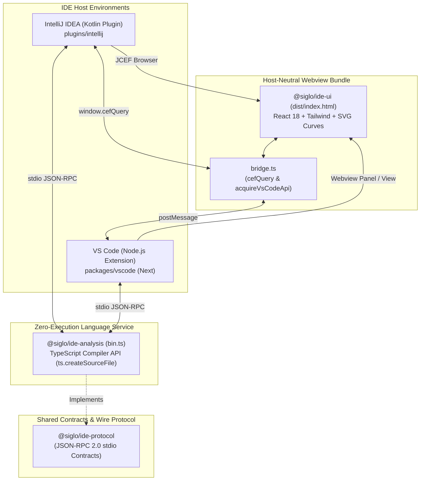

# Siglo Workflow Explorer — Combined IntelliJ and VS Code Session Handover

**Exported:** November 5, 2026 (Asia/Manila)  
**Repository:** `/Users/jericodeguzman/Projects/fluid-func`  
**Current extension directory:** `plugins/vscode`  
**npm workspace:** `@siglo/vscode`  
**Installed VS Code extension ID:** `jsoftgem.siglo-workflow-explorer`

This is the current continuation handover. It combines this session's implementation and debugging results with the complete VS Code README and the previous consolidated handover, included below as snapshots. **The current-state sections take precedence over historical plans, paths, test counts, and status claims in the appended previous handover.**

## 1. Current status and immediate continuation

- **IntelliJ M1:** Previously completed, verified, and documented. Its Gradle tests and ZIP build were not rerun during this VS Code session.
- **VS Code M0/M1:** Functionality implemented, with 10 passing automated extension tests and a successful targeted runtime smoke test in an isolated macOS VS Code Extension Development Host. Full manual acceptance remains open.
- **Blank webview bug:** Reproduced, diagnosed, fixed, regression tested, packaged, and reinstalled locally. The fixed VSIX successfully renders all five steps in `examples/src/workflow/usecases/usecase-2-ai-rag-pipeline.ts`.
- **User action pending:** Run **Developer: Reload Window** in the user's normal VS Code window, then reopen **Siglo: Open Workflow Visualizer**. Installation is complete, but the user has not yet confirmed the outcome after reloading their existing window.
- **Next priority:** Finish the remaining M0/M1 acceptance checks in [the VS Code roadmap](roadmap/vscode.roadmap.md), then proceed to M2 authoring and diagnostics when appropriate. Do not describe full M0/M1 manual verification as complete.

The user's explicit layout preference is to keep editor integrations together under `plugins/`: **`plugins/intellij` and `plugins/vscode`**. Shared libraries remain in `packages/`. Do not move the VS Code extension back to `packages/vscode` based on the old plan.

## 2. Work completed in this session

### Extension implementation

Created the VS Code extension using the existing shared packages rather than duplicating analysis or rendering:

- `@siglo/ide-protocol`: JSON-RPC helpers, graph contracts, and source ranges.
- `@siglo/ide-analysis`: Bundled out-of-process static AST analyzer, including TypeScript; never executes application code.
- `@siglo/ide-ui`: Shared single-file React/SVG UI with the existing VS Code message bridge.

Implemented:

- Sidebar `WebviewViewProvider` (`siglo.workflows`) and dedicated editor panel via `siglo.openVisualizer`.
- Activity bar container and command palette contributions.
- Analyzer initialization/shutdown, concurrent request correlation, monotonic IDs, 10-second request timeout, rejection of failed in-flight work, and crash restart with exponential backoff from 500 ms to 30 seconds.
- Workspace trust checks before daemon launch or workspace scanning.
- Bundled analyzer launch using the extension host executable in Node mode, with `NODE_OPTIONS` and `NODE_PATH` cleared.
- Webview ready/reload/auto-reload handling and host-validated node ID navigation; webview-supplied source coordinates are ignored.
- Active editor tracking, cursor-to-node highlighting, and 250 ms debounced live edits with stale request/editor/revision filtering.
- Per-view auto-reload control, manual reload, and protection against background edits switching the displayed source.
- Cancellable workspace discovery across multiple roots, limited to 100 JavaScript/TypeScript source files and excluding build/dependency folders.
- Strict CSP with nonced script/style elements, data images only, no network/local resources, and `style-src-attr 'unsafe-inline'` for React graph coordinates.
- Build, package, installation, lifecycle, security, and troubleshooting documentation.

### Directory migration

The extension was initially implemented at the old roadmap's `packages/vscode` location. The user requested a move to `plugins`, which was completed:

- Moved implementation, scripts, tests, assets, and VSIX to `plugins/vscode`.
- Explicitly registered `plugins/vscode` in root `package.json` workspaces.
- Updated build script paths to shared code in `../../packages/ide-analysis` and `../../packages/ide-ui`.
- Updated repository metadata, lockfile workspace links, README, user guide, and both editor roadmaps.
- Added a relocation note to the previous handover while retaining its historical content.
- Re-ran extension tests and VSIX packaging after the move.

### Shared UI adjustment

Updated `packages/ide-ui/src/App.tsx`, `components/InspectorPanel.tsx`, and `components/WorkflowInspector.tsx` so narrow views stack the inspector below the graph. This supports VS Code sidebars while retaining the wide layout. The VS Code archive contains this rebuilt UI. The IntelliJ plugin's embedded HTML/ZIP was not rebuilt in this session; rebuild/copy its assets if distributing the shared UI change there.

## 3. Critical bug: blank visualizer from CSP injection

### Symptom and reproduction

The user installed the extension but reported that it did not load the file. The extension was activated in the local VS Code logs, but the Siglo output channel contained no useful error. A clean, isolated Extension Development Host using the extracted VSIX reproduced an empty webview with no initialized `window.__SIGLO_BRIDGE__`.

### Root cause

`secureHtml()` in `plugins/vscode/src/webview.ts` originally performed global replacements for `<script` and `<style` to insert nonces. React's bundled JavaScript contains a literal `"<script>"` string. The global replacement inserted an unescaped nonce attribute inside that JavaScript string, producing invalid JavaScript. The UI therefore never mounted and never sent its `ready` message to request the graph.

This was a host HTML transformation bug, not missing workflow syntax or a failure to parse the selected RAG source file. The shared analyzer correctly extracts five steps from that file.

### Fix and regression coverage

`secureHtml()` now matches complete raw-text script/style elements and changes only their opening tags, preserving their contents. Do not restore broad global tag replacements inside the bundle.

Added regression tests that:

1. Preserve tag-like strings inside JavaScript and CSS.
2. Compare scripts in the actual built `dist/index.html` before and after nonce injection, then check that the resulting JavaScript compiles.

The regression using the real bundle is essential: the earlier host mocks and toy HTML CSP test did not catch this failure.

### Actual runtime verification

Launched the packaged extension in an isolated macOS VS Code Extension Development Host with a separate temporary profile and extensions directory, opened the RAG pipeline source, and invoked `siglo.openVisualizer`. Chromium DevTools runtime inspection of the webview confirmed:

- UI bridge initialized.
- Workflow title `pipeline`, revision `r1`, and `5 steps` displayed.
- All five cards rendered: `ragExtractDocumentText`, `ragChunkContent`, `ragGenerateEmbeddings`, `ragUpsertVectorStore`, and `ragIndexSearchMetadata`.
- Inspector displayed structured input contract fields.

The temporary smoke instance exited after the test. Its temporary profile/scripts are not durable project test infrastructure. The normal VS Code window was not automatically reloaded.

## 4. Packaging and installation

### Artifact and names

- VSIX: `plugins/vscode/siglo-workflow-explorer-1.0.0.vsix` (approximately 1.08 MB).
- npm workspace/source manifest name: `@siglo/vscode`.
- Packaged manifest name: `siglo-workflow-explorer`.
- Installed extension ID: `jsoftgem.siglo-workflow-explorer`.
- Version remains **1.0.0**, including the bug fix; older archives with the same filename/version can contain the broken UI transformation.
- No marketplace publishing was performed.

VS Code rejects scoped extension names. `scripts/package.mjs` stages an unscoped manifest in a temporary directory, removes npm-only development metadata/scripts, copies the compiled assets/README/license/icon, invokes `vsce package --no-dependencies`, then removes staging. Do not rename the workspace or temporarily mutate its source manifest to package it.

### Commands from repository root

```sh
npm install
npm test --workspace=@siglo/vscode
npm run package --workspace=@siglo/vscode
```

The build bundles the analyzer, TypeScript, and host code with esbuild and copies the shared UI HTML. The analyzer bundle is minified to reduce memory use. Installed extensions need neither a separately configured Node executable nor workspace npm dependencies.

To refresh only packaging after a README change, once compiled assets are current:

```sh
node plugins/vscode/scripts/package.mjs
```

### Local installation already completed

The fixed archive was installed using:

```sh
"/Applications/Visual Studio Code.app/Contents/Resources/app/bin/code" \
  --install-extension "/Users/jericodeguzman/Projects/fluid-func/plugins/vscode/siglo-workflow-explorer-1.0.0.vsix" \
  --force
```

The CLI reported successful installation. SHA-1 comparison confirmed that the installed `dist/extension.js` matched the current build. Installed directory:

```text
~/.vscode/extensions/jsoftgem.siglo-workflow-explorer-1.0.0
```

The user should run **Developer: Reload Window** and open the visualizer again. The README snapshot below contains the graphical installation instructions and keyboard shortcuts.

## 5. Verification ledger and outstanding checks

| Check | Result / limit |
| --- | --- |
| Extension automated suite | **10 passing** after the nonce fix |
| Protocol suite | **5 passing**, run during implementation |
| Shared analyzer fixture suite | **19 passing**, run during implementation |
| VS Code host typecheck/build | Passed |
| Shared UI typecheck/build | Passed |
| Analyzer stress check | 1,000 small-workflow edit cycles; sampled peak approximately **124 MB RSS** on this machine |
| Extracted VSIX analyzer | Initialized, parsed source, and shut down without repository dependencies |
| VSIX packaging | Successful after migration and bug fix |
| Real macOS VS Code targeted smoke | Analyzer startup and five-step RAG graph rendering verified |
| Installed fix | CLI installation successful; installed host bundle matched build |
| User's existing window after reload | **Awaiting user confirmation** |
| Full manual M0/M1 acceptance | **Still pending** |

Remaining verification includes actual click navigation, cursor highlighting, trust transitions, narrow sidebar layout, multi-root discovery, live typing and tab switching in the real IDE, daemon recovery in Electron, other operating systems, and remote-host operation. Some are covered by automated mocks/process tests but have not been fully exercised manually in the real IDE.

The 1,000-edit RSS test uses a small workflow; do not generalize it to maximum-size graphs or other platforms. There is no cross-platform RSS watchdog yet. Browser-only VS Code and virtual workspaces are unsupported.

## 6. File map and repository cautions

| Path | Purpose |
| --- | --- |
| `plugins/vscode/src/extension.ts` | Activation, commands, editor tracking, discovery, navigation |
| `plugins/vscode/src/client.ts` | Analyzer stdio JSON-RPC transport and lifecycle |
| `plugins/vscode/src/webview.ts` | Sidebar/panel adapter, CSP, message routing, nonce fix |
| `plugins/vscode/test/client.test.cjs` | Real analyzer transport, trust, restart, disposal, stress tests |
| `plugins/vscode/test/host.test.cjs` | Host behavior, CSP/bundle regressions, multi-root discovery |
| `plugins/vscode/scripts/build.mjs` | Shared asset build/bundling |
| `plugins/vscode/scripts/package.mjs` | Unscoped staging manifest and VSIX generation |
| `plugins/vscode/package.json` | Scoped npm workspace and VS Code contributions |
| `plugins/vscode/README.md` | Installation, usage, architecture, troubleshooting |
| `roadmap/vscode.roadmap.md` | Current implementation status and remaining milestones |
| `roadmap/intellij.roadmap.md` | Completed IntelliJ M1 baseline and later milestones |
| `docs/ide-workflow-explorer.md` | Cross-editor user documentation |

The working tree has uncommitted changes, including earlier shared UI/documentation work and the new extension. `plugins/vscode/media/siglo.svg` is staged and was independently changed during the session; preserve the current asset. No commits, pushes, or marketplace releases were performed by this session. Do not reset unrelated changes.

Keep the established shared invariants: zero application execution, React/HTML/SVG rendering rather than Cytoscape, separate source revisions and workflow schema versions, and Kotlin protocol model updates whenever shared protocol contracts change. This session did not change protocol contracts.

## 7. Suggested restart prompt

> Continue from `SESSION_HANDOVER_2026-11-05_VSCODE.md`. IntelliJ M1 is completed. The VS Code extension is implemented at `plugins/vscode`, explicitly registered as npm workspace `@siglo/vscode`; keep editor integrations under `plugins/`. The blank webview issue was caused by nonce injection corrupting React's bundled JavaScript and is fixed, regression tested (10 passing tests), packaged, and reinstalled locally. A real isolated macOS VS Code smoke test rendered all five RAG pipeline steps. The user's existing window still needs Developer: Reload Window and confirmation. Finish remaining M0/M1 acceptance checks in `roadmap/vscode.roadmap.md` before treating full manual verification as complete. Preserve uncommitted work and the current staged SVG asset. Read the current-state sections before the historical appendix.

---

## Appendix A. Current VS Code README snapshot

Source: `plugins/vscode/README.md`, copied at export time. The maintained standalone README remains the canonical installation document.

### Siglo Workflow Explorer for VS Code

Read-only workflow exploration for VS Code 1.90+ on desktop and remote workspace hosts. Uses the same `@siglo/ide-protocol`, zero-execution `@siglo/ide-analysis`, and React/SVG `@siglo/ide-ui` as the IntelliJ plugin. Requires workspace trust. Browser-only VS Code and virtual workspaces are unsupported.

#### Install in VS Code

Use the generated archive at `plugins/vscode/siglo-workflow-explorer-1.0.0.vsix`. If it is missing, follow [Build and package](plugins/vscode/README.md#build-and-package) first.

1. Open VS Code's **Extensions** view (`Cmd+Shift+X` on macOS; `Ctrl+Shift+X` on Windows/Linux).
2. Click **…** in the Extensions view, then select **Install from VSIX…**.
3. Select `siglo-workflow-explorer-1.0.0.vsix` from this repository's `plugins/vscode` directory.
4. Reload VS Code if prompted.
5. Open your project folder and trust the workspace to enable workflow analysis.

#### Open and use the visualizer

1. Open a JavaScript or TypeScript file containing a Siglo workflow.
2. Open the Command Palette (`Cmd+Shift+P` on macOS; `Ctrl+Shift+P` on Windows/Linux) and run **Siglo: Open Workflow Visualizer**. This opens the graph in an editor panel. For the sidebar, select the **Siglo** activity bar icon and open **Siglo Workflows**.
3. Click a step to navigate to its source. Move the editor cursor into a step to highlight it. Edits refresh the graph after 250 ms; each view has its own **Auto-Reload** toggle and **Reload** button.
4. Run **Siglo: Discover Workspace Workflows** from the Command Palette to choose a workflow across workspace folders. Scans at most 100 source files, excluding `node_modules`, `dist`, `.git`, `coverage`, `build`, and `.idea`. The scan honors unsaved content in open documents and can be cancelled.

The shared renderer supports multi-flow canvases, fork/join combinators, unresolved dynamic expressions, ecosystem steps, structured input specs, and workflow properties. Analysis never imports or executes the application. The initial release does not execute workflows, connect to runtime monitors, or provide authoring diagnostics.

#### Build and package

From the repository root (Node.js version per the root package manifest):

```sh
npm install
npm test --workspace=@siglo/vscode
npm run package --workspace=@siglo/vscode
```

Output: `plugins/vscode/siglo-workflow-explorer-1.0.0.vsix`.

The root explicitly registers `plugins/vscode` as an npm workspace. The build bundles the extension host and analyzer (including TypeScript) and copies the shared single-file HTML UI. Installation needs neither a separate Node executable nor workspace npm dependencies. The analyzer runs using the extension host executable in Node mode, also on remote hosts.

The npm workspace retains the name `@siglo/vscode`. Packaging stages an unscoped VS Code manifest (`siglo-workflow-explorer`) in a temporary directory because VS Code rejects scoped names. The installed extension ID is `jsoftgem.siglo-workflow-explorer`; no publishing is performed.

For local debugging, extract the VSIX into a temporary directory and launch its `extension` subdirectory as an Extension Development Host using VS Code's `--extensionDevelopmentPath` flag. Use the staged, unscoped manifest rather than the scoped npm source manifest.

#### Lifecycle and security

The client uses newline-delimited JSON-RPC, monotonic request IDs, concurrent request correlation, a 10-second timeout, and automatic restart with exponential backoff (500 ms to 30 seconds). Failed in-flight requests are rejected; recovery refreshes the active document. Deactivation sends `siglo/shutdown`, with a forced-exit fallback.

Workspace trust is checked before launching the analyzer or scanning files. Only the bundled analyzer is used, with `NODE_OPTIONS` and `NODE_PATH` cleared. No workspace scripts or dependency executables are launched. Incoming card clicks are resolved against current host graph IDs and revisions; supplied locations are ignored. Edit responses are discarded when their editor, revision, or request generation is stale.

The webview disallows local resources and network connections. Scripts and style elements use per-view CSP nonces. `style-src-attr 'unsafe-inline'` permits React's calculated node positions; script execution remains nonce restricted. These controls follow the [VS Code webview guide](https://code.visualstudio.com/api/extension-guides/webview) and [workspace trust guide](https://code.visualstudio.com/api/extension-guides/workspace-trust).

#### Verification and limitations

Automated tests exercise the packaged analyzer through the real stdio client, including trust gating, concurrent requests, RPC errors, restart, disposal, and 1,000 edit cycles with sampled RSS. Host tests use a VS Code API mock to verify ready messages, navigation, live edits, tab switching, and manual reload. The shared analyzer fixture suite remains the source of syntax coverage.

All 10 extension tests pass, including a regression check that CSP injection leaves the actual bundled JavaScript unchanged and syntactically valid. A targeted smoke test in an isolated macOS VS Code Extension Development Host confirmed that the packaged extension starts the analyzer and renders all five steps in `usecase-2-ai-rag-pipeline.ts`.

Full manual verification of navigation, trust transitions, sidebar layout, crash recovery, other operating systems, and remote hosts remains pending before declaring M0/M1 manually verified. RSS samples are environment dependent and currently tested with a small workflow, not a maximum-size graph. There is no cross-platform RSS watchdog yet.

##### Blank visualizer after installing an earlier VSIX

An earlier 1.0.0 archive incorrectly inserted CSP nonces into tag-like strings inside React's bundled JavaScript, preventing the UI from starting. The rebuilt archive preserves script contents. Reinstall the current `plugins/vscode/siglo-workflow-explorer-1.0.0.vsix` using **Install from VSIX…**, then run **Developer: Reload Window** from the Command Palette to load the fix. The archive version remains 1.0.0.

If analysis fails, inspect **Output → Siglo Workflow Explorer**. Trust the workspace if analysis is blocked. On failure, the last graph remains visible; manual Reload retries analysis. A scan covers only its first 100 matching files; open a source file directly to inspect workflows outside that limit.


---

## Appendix B. Previous consolidated handover snapshot (historical)

Source: `SESSION_HANDOVER_2026-11-05_FINAL.md`, copied at export time. This appendix preserves the completed IntelliJ baseline and earlier plans. Its instructions to implement VS Code next, references to `packages/vscode`, and older test counts are superseded by the current-state sections above. The IntelliJ verification results in this appendix are historical results, not checks rerun during this session.

### Siglo Workflow Explorer — Consolidated Final Session Handover

> **Layout update:** The implemented VS Code extension now lives in `plugins/vscode`, alongside `plugins/intellij`, and is explicitly registered as the `@siglo/vscode` npm workspace. Historical `packages/vscode` references below describe the original plan; use `plugins/vscode` for current work.

**Exported Date**: November 5, 2026 (Asia/Manila)  
**Repository**: `/Users/jericodeguzman/Projects/fluid-func`  
**Distribution ZIP**: `plugins/intellij/build/distributions/siglo-intellij-plugin-1.0.0.zip` (2.0 MB)  
**Milestone 1 Status**: **COMPLETED & VERIFIED**  
**Next Project Phase**: **VS Code Extension Implementation (`packages/vscode`)**

This document consolidates all previous handovers (`SESSION_HANDOVER.md` and `SESSION_HANDOVER_2026-11-05_CONTINUATION.md`), the completed IntelliJ Plugin Milestone 1 deliverables (`roadmap/intellij.roadmap.md`), the VS Code Extension roadmap (`roadmap/vscode.roadmap.md`), and the comprehensive documentation created across the monorepo. Read the current-state sections first.

---

#### 1. Executive Summary & Deliverables

The goal of this multi-session project was to build and polish the **Siglo Workflow Explorer** IntelliJ IDEA plugin, verify zero-execution static AST extraction across complex workflows and ecosystem steps, resolve visual and layout gaps, document the final product, update project roadmaps, and prepare for the upcoming Visual Studio Code extension.

##### Milestone 1 Final Product Status:
- **`@siglo/ide-protocol` (v1.0.0)**: Shared JSON-RPC 2.0 wire protocol contracts, source span coordinates, structured step input contracts (`StepSpec`, `StepSpecRule`), and workflow-level properties (`WorkflowGraph`). 5 unit tests passing.
- **`@siglo/ide-analysis` (v1.0.0)**: Pure static TypeScript AST parser daemon (`bin.ts`). Zero application code is executed. Supports recursive combinators (`parallel`, `all`, `allSettled`, `race`, `branch`, `when`, `map`), durable pauses (`wait`, `waitForEvent`), ecosystem step factories (`httpStep`, `aiStep`, `sendNotificationStep`, crypto steps), structured specs, and workflow properties. 19 unit tests passing.
- **`@siglo/ide-ui` (v1.0.0)**: Standalone single-file HTML bundle (`dist/index.html`, 227 kB) built with Vite and Tailwind CSS. Features longest-path DAG layering, explicit fork/join hubs, cubic bezier SVG connections, multi-flow canvas labeling, structured field cards, workflow badges, and a unified dual-host bridge (`window.cefQuery` for IntelliJ and `acquireVsCodeApi()` for VS Code).
- **`plugins/intellij` (v1.0.0)**: Native Kotlin plugin for IntelliJ IDEA 2024.1+ (Build 241+ to 262+). Integrates JCEF browser view with `CefMessageRouter` query handling, graceful Swing `JBTree` fallback, editor synchronization (debounced 250ms live typing refresh), active tab switching guard, source revision tracking (`rN`), and bidirectional click-to-code navigation. Distributable ZIP packaged and verified: `plugins/intellij/build/distributions/siglo-intellij-plugin-1.0.0.zip`.

---

#### 2. Changes Completed in this Session

##### 2.1 Implementation Gap Resolution
1. **Advertised Syntax Matrix Synchronization**:
   - `packages/ide-analysis/src/bin.ts` had an outdated `SUPPORTED_SYNTAX_MATRIX` array that omitted newly supported forms.
   - Updated `bin.ts` to advertise all active syntax patterns: `flow`, `workflow`, `pipe`, `Step.create`, `new Step`, `defineStep`, `Func.create`, `new Func`, `Chain.create`, `new Chain`, `then`, `parallel`, `all`, `allSettled`, `race`, `branch`, `when`, `map`, `fallback`, `compensate`, `wait`, `waitForEvent`, `httpStep`, `new HttpStep`, `verifyWebhookStep`, `sendNotificationStep`, `sendInteractiveApprovalStep`, `aiStep`, `new AiStep`, `encryptFieldsStep`, `decryptFieldsStep`, `maskFieldsStep`.
2. **Dual-Host Portability in Webview Bridge (`packages/ide-ui/src/bridge.ts`)**:
   - Added native support for `acquireVsCodeApi()` alongside IntelliJ's `window.cefQuery`.
   - The compiled webview bundle (`packages/ide-ui/dist/index.html`) now works out of the box in both IntelliJ JCEF and VS Code Webview panels without requiring separate bundles or conditional compilation.
3. **Accurate Swing Fallback Labeling**:
   - Updated the fallback banner in `SigloToolWindowPanel.kt` to correctly state "Full graphical workflow visualization requires JCEF runtime" rather than historical Cytoscape references.
4. **Distribution Package Rebuild**:
   - Rebuilt `@siglo/ide-ui` bundle, copied it into `plugins/intellij/src/main/resources/ide-ui/index.html`, and rebuilt `siglo-intellij-plugin-1.0.0.zip` (2.0 MB).

##### 2.2 Roadmaps Updated
1. **`roadmap/intellij.roadmap.md`**:
   - Updated status header to **Milestone 1 Completed — Ready for Milestone 2 Development (2026-11-05)**.
   - Marked all M0 and M1 acceptance criteria as completed (`[x]`).
   - Documented the final delivered product, test verification results, and detailed the subsequent roadmap for M2 (Authoring & Static Diagnostics), M3 (Live Monitoring), M4 (Deep-Dive Inspectors), and M5 (Marketplace Distribution).
2. **`roadmap/vscode.roadmap.md`**:
   - Updated status header to **Ready for Implementation — Building on Validated Shared M1 Foundation (2026-11-05)**.
   - Documented that `@siglo/ide-protocol`, `@siglo/ide-analysis`, and `@siglo/ide-ui` are already completed, tested, and ready to be directly consumed by `packages/vscode`.
   - Outlined the implementation structure for `packages/vscode` (`extension.ts`, `client.ts`, `webview.ts`), bidirectional navigation integration, and updated milestone tasks.

##### 2.3 Comprehensive Documentation Created
1. **`plugins/intellij/README.md`**: Production-grade plugin documentation covering capabilities, compatibility matrix, architecture, supported syntax, step-by-step installation from disk ZIP, building instructions, analyzer discovery priority, and troubleshooting.
2. **`packages/ide-protocol/README.md`**: Full wire protocol specification, JSON-RPC 2.0 methods (`siglo/initialize`, `siglo/discoverWorkflows`, `siglo/getGraph`, `siglo/resolveLocation`, `siglo/shutdown`), core data models (`GraphDocument`, `WorkflowGraph`, `GraphNode`, `StepSpec`, `StepSpecRule`), and host synchronization invariants.
3. **`packages/ide-ui/README.md`**: Micro-bundle architecture, longest-path layering algorithm, SVG edge rendering, unique marker IDs, interactive inspectors, and the dual-host `IdeBridge` (`window.cefQuery` and `acquireVsCodeApi`).
4. **`docs/ide-workflow-explorer.md`**: Developer guide explaining how to inspect and author workflows using the IDE tooling across IntelliJ IDEA and VS Code.

---

#### 3. Verified Architecture & Invariants



##### Critical Architectural Invariants:
1. **Renderer Technology**: The graph renderer is React with absolutely positioned HTML cards and SVG edges. It is **not Cytoscape**.
2. **Zero-Execution Static AST**: Analysis uses the TypeScript Compiler API (`ts.createSourceFile`) syntax tree and **never** executes user code or imports modules. Malicious fixture tests verify that top-level side effects (e.g. `process.exit(1)` or file writes) never run.
3. **Single-File UI Asset**: `@siglo/ide-ui` compiles to a single HTML file with inlined JS/CSS via `vite-plugin-singlefile`. No external network requests are made.
4. **Protocol Model Mirroring**: When modifying `@siglo/ide-protocol/src/types.ts`, the Kotlin models in `plugins/intellij/src/main/kotlin/io/siglo/idea/process/ProtocolModels.kt` **must** be updated simultaneously.
5. **JVM Toolchain**: Plugin builds declare `jvmToolchain(17)` in Gradle, with local execution running on Temurin Java 21. Targets IntelliJ Platform 2024.1+ (Build 241+) with no `untilBuild` restriction.
6. **Active Tab Protection**: In `SigloToolWindowPanel.kt`, document edits check the active editor file both before scheduling and after the 250ms debounce, preventing background edits in other tabs from switching the view.
7. **Source Revision vs Schema Version**: The header displays source revision as `rN` (tracking document edits), while schema version (`.version(...)`) is displayed on canvas badges and in the `WorkflowInspector`.

---

#### 4. Key Files Map

| Component | File Path | Purpose |
|---|---|---|
| **Protocol Types** | `packages/ide-protocol/src/types.ts` | Shared graph, spec, and workflow property interfaces |
| **Protocol Methods** | `packages/ide-protocol/src/protocol.ts` | Wire JSON-RPC 2.0 methods and request/response constructors |
| **Protocol Docs** | `packages/ide-protocol/README.md` | Protocol specification and synchronization guide |
| **AST Parser** | `packages/ide-analysis/src/parser.ts` | Top-level AST traversal, discovery, coordinate resolution |
| **Workflow Detector** | `packages/ide-analysis/src/patterns/workflow-detector.ts` | Flow detection, recursive combinators, subflow stitching, routes, workflow properties |
| **Step Detector** | `packages/ide-analysis/src/patterns/step-detector.ts` | Step factories/constructors, structured specs, operational properties |
| **Daemon CLI** | `packages/ide-analysis/src/bin.ts` | Node.js stdio JSON-RPC server with advertised syntax matrix |
| **Analysis Docs** | `packages/ide-analysis/README.md` | Static step coverage, workflow properties, constraints |
| **Webview Container** | `packages/ide-ui/src/App.tsx` | Header controls, multi-flow dropdown, auto-reload, inspector switching |
| **Webview Bridge** | `packages/ide-ui/src/bridge.ts` | Dual host bridge supporting IntelliJ (`cefQuery`) and VS Code (`acquireVsCodeApi`) |
| **Graph Canvas** | `packages/ide-ui/src/components/GraphCanvas.tsx` | Longest-path DAG layout, fork/join hubs, SVG connections, unique marker IDs |
| **Step Inspector** | `packages/ide-ui/src/components/InspectorPanel.tsx` | Step identity, execution settings, coordinates, diagnostics |
| **Step Specs** | `packages/ide-ui/src/components/StepProperties.tsx` | Structured field cards, validation rules, expandable expressions |
| **Workflow Inspector** | `packages/ide-ui/src/components/WorkflowInspector.tsx` | Workflow deadlines, schema versions, network perimeter, monitor expression |
| **Webview Docs** | `packages/ide-ui/README.md` | UI micro-bundle architecture and layout guide |
| **Kotlin Models** | `plugins/intellij/src/main/kotlin/io/siglo/idea/process/ProtocolModels.kt` | GSON models mirroring TypeScript protocol contracts |
| **IntelliJ Panel** | `plugins/intellij/src/main/kotlin/io/siglo/idea/toolwindow/SigloToolWindowPanel.kt` | Tool window panel, editor listeners, debounce, revision tracking, Swing fallback |
| **IntelliJ Service** | `plugins/intellij/src/main/kotlin/io/siglo/idea/process/SigloAnalyzerService.kt` | OSProcessHandler daemon runner and Node.js discovery |
| **IntelliJ Docs** | `plugins/intellij/README.md` | Comprehensive IntelliJ plugin installation, architecture, and developer guide |
| **User Guide** | `docs/ide-workflow-explorer.md` | High-level developer documentation for authoring workflows with IDE visualizers |
| **IntelliJ Roadmap** | `roadmap/intellij.roadmap.md` | Complete M0-M5 roadmap with M1 finalized |
| **VS Code Roadmap** | `roadmap/vscode.roadmap.md` | Architecture and implementation plan for upcoming VS Code extension |

---

#### 5. Verification & Test Results

The following test suites and builds were executed and verified clean:

1. **`@siglo/ide-protocol`**:
   - `npm test --workspace=@siglo/ide-protocol`: **5 passing**.
   - Validates JSON-RPC 2.0 requests, responses, errors, notifications, and graph document schemas.
2. **`@siglo/ide-analysis`**:
   - `npm test --workspace=@siglo/ide-analysis`: **19 passing**.
   - Validates zero-execution safety against malicious fixtures, AST topology extraction, unicode offsets, URI normalization, location resolution, standalone combinators (`parallel`, `allSettled`, `race`, `branch`, `when`, `map`), package steps (`httpStep`, `aiStep`, `sendNotificationStep`, crypto steps), underwriting and settlement isolation, structured input contracts (`.spec(...)` and `.schema(...)`), and workflow-level properties.
3. **`@siglo/ide-ui`**:
   - `npx tsc -p packages/ide-ui/tsconfig.json`: **Passed with zero errors**.
   - `npm run build --workspace=@siglo/ide-ui`: **Built `dist/index.html` (227.66 kB, inlined CSS/JS)**.
4. **`plugins/intellij`**:
   - `./gradlew test --rerun-tasks`: **4 tests passing** (`ProtocolModelsTest`).
   - `./gradlew buildPlugin`: **Build successful**.
   - Distribution ZIP: `plugins/intellij/build/distributions/siglo-intellij-plugin-1.0.0.zip` (2.0 MB).

---

#### 6. How to Build & Install

##### Step 1: Build TypeScript Packages from Repo Root
```bash
### 1. Build protocol schemas
npm run build --workspace=@siglo/ide-protocol

### 2. Build analyzer daemon and run unit tests
npm test --workspace=@siglo/ide-analysis

### 3. Build single-file webview bundle
npm run build --workspace=@siglo/ide-ui

### 4. Copy webview bundle to IntelliJ plugin resources
cp packages/ide-ui/dist/index.html plugins/intellij/src/main/resources/ide-ui/index.html
```

##### Step 2: Build IntelliJ Plugin Distribution
From `plugins/intellij`:
```bash
./gradlew test buildPlugin
```
Installable ZIP: `plugins/intellij/build/distributions/siglo-intellij-plugin-1.0.0.zip`.

##### Step 3: Install in IntelliJ IDEA
1. Open IntelliJ IDEA $\rightarrow$ **Settings / Preferences** (`⌘,` on macOS, `Ctrl+Alt+S` on Linux/Windows).
2. Go to **Plugins** $\rightarrow$ Click ⚙️ $\rightarrow$ **Install Plugin from Disk...**.
3. Select `plugins/intellij/build/distributions/siglo-intellij-plugin-1.0.0.zip`.
4. Click **Restart IDE**.
5. The **Siglo Workflows** tool window is available on the right-hand stripe.

##### Analyzer Discovery Priority:
1. `SIGLO_ANALYZER_BIN` env var or `siglo.analyzer.bin` JVM property.
2. `<project-root>/packages/ide-analysis/dist/bin.js`.
3. `<project-root>/node_modules/@siglo/ide-analysis/dist/bin.js`.

---

#### 7. Next Priority: VS Code Extension Implementation

With the shared foundation fully validated and the IntelliJ plugin at M1 completion, the immediate next project is implementing the VS Code extension (`packages/vscode`).

##### Actionable Implementation Steps for `packages/vscode`:
1. **Initialize Package**:
   - Create `packages/vscode/package.json` with extension manifest (`publisher`, `contributes.viewsContainers`, `contributes.views`, `contributes.commands`).
   - Add `@siglo/vscode` to the monorepo root `package.json` workspaces.
   - Configure `tsconfig.json` targeting Node 18+ and VS Code 1.90+ types (`@types/vscode`).
2. **Daemon Client (`packages/vscode/src/client.ts`)**:
   - Spawn `@siglo/ide-analysis/dist/bin.js` using `child_process.spawn`.
   - Wire stdio JSON-RPC communication using `@siglo/ide-protocol` helpers (`createRequest`, `createResponse`).
   - Implement process health monitoring and automatic restart on unexpected exit.
3. **Webview Provider (`packages/vscode/src/webview.ts`)**:
   - Load `packages/ide-ui/dist/index.html`.
   - Implement CSP with nonce injection for scripts/styles.
   - Register `WebviewViewProvider` for sidebar and command `siglo.openVisualizer` for editor tab panels (`createWebviewPanel`).
   - Handle incoming webview messages via `webview.onDidReceiveMessage`:
     - `ready` $\rightarrow$ send current document graph.
     - `nodeSelected` $\rightarrow$ open file with `vscode.window.showTextDocument` focusing selection range.
     - `reload` $\rightarrow$ trigger re-analysis.
     - `setAutoReload` $\rightarrow$ toggle debounce listener.
4. **Editor Tracking (`packages/vscode/src/extension.ts`)**:
   - `vscode.window.onDidChangeActiveTextEditor` $\rightarrow$ refresh graph for newly focused file.
   - `vscode.workspace.onDidChangeTextDocument` $\rightarrow$ debounce 250ms and push updated AST to webview via `webview.postMessage({ type: 'setGraph', document })`.
   - `vscode.window.onDidChangeTextEditorSelection` $\rightarrow$ post `selectNode` message to highlight active node in visualizer.
5. **Packaging**:
   - Add `npm run package --workspace=@siglo/vscode` running `vsce package` to generate `.vsix`.

---

#### 8. Suggested Restart Prompt

> Continue from `SESSION_HANDOVER_2026-11-05_FINAL.md`. IntelliJ Plugin Milestone 1 is completed, verified, and documented. The next task is implementing the VS Code extension in `packages/vscode`, reusing the shared `@siglo/ide-protocol`, `@siglo/ide-analysis`, and `@siglo/ide-ui` packages. Refer to `roadmap/vscode.roadmap.md` for the milestone breakdown.

---

#### Appendix A — Historical Snapshot: Continuation Handover (2026-11-05)

The following preserves the earlier continuation handover context:

- Initial complaints were missing branching/parallelism, incomplete step support, overlapping UI, and reload semantics.
- Analyzer was enhanced with recursive combinators (`parallel`, `allSettled`, `race`, `branch`, `when`, `map`), durable waits, and ecosystem step factories.
- Multi-workflow labeling was introduced so "All Flows" renders each workflow in an isolated, labeled canvas with unique SVG marker IDs.
- Structured step specs (`.spec(...)` and `.schema(...)`) were introduced to preserve rule order, field grouping, and whole-input schemas.
- Workflow properties (`.timeout(...)`, `.version(...)`, `.networkPolicy(...)`, `.monitor(...)`) were extracted and rendered as badges and in `WorkflowInspector`.
- Debounced typing edits (250ms) and active-tab guards were added to `SigloToolWindowPanel.kt`.

---

#### Appendix B — Historical Snapshot: Original Handover (2026-11-05)

The following preserves the initial session handover context:

- Initial scaffolding of `@siglo/ide-protocol`, `@siglo/ide-analysis`, `@siglo/ide-ui`, and `plugins/intellij`.
- Implementation of Kotlin process launcher and JSON-RPC over stdio.
- JCEF browser integration with `CefMessageRouter` and Swing `JBTree` fallback.
- Bidirectional editor navigation via `OpenFileDescriptor`.
- Target build compatibility configured for IntelliJ IDEA 2024.1+ (Build 241+).
