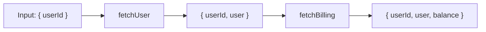
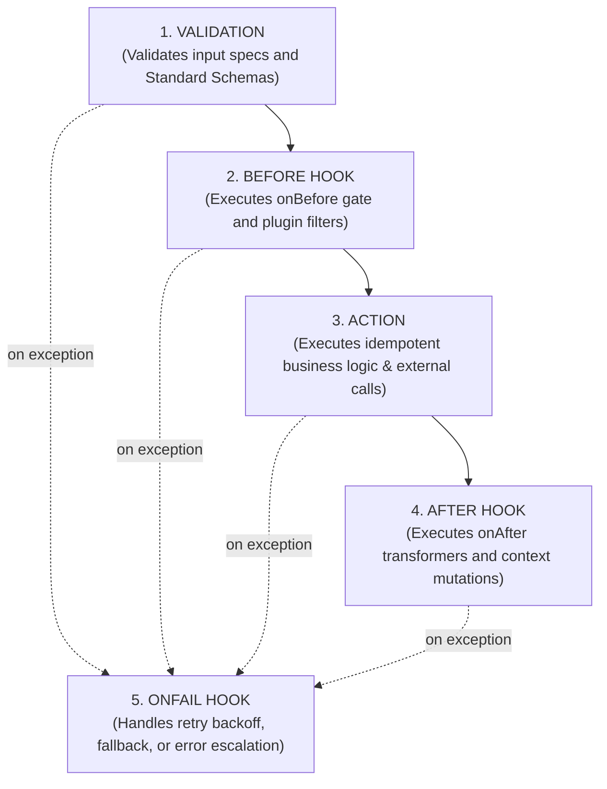

## 1. Workflows as ASTs and Execution DAGs

In `Siglo`, a workflow is not a simple promise chain. Internally, it is represented as a declarative **Abstract Syntax Tree (AST)** of `WorkflowNode` objects (`pipeline.toGraph()`), which flattens into a **Directed Acyclic Graph (DAG)** of nodes and directed edges (`pipeline.inspect()`) for static analysis, cycle detection, and visual rendering:

- `StepNode`: An isolated unit of work with input schemas, lifecycles, retries, and policies.
- `SequenceNode`: Sequential execution pipeline created with `flow(...)`.
- `ParallelNode`: Concurrent fan-out/fan-in with merge strategies (`parallel`, `race`).
- `BranchNode`: Dynamic conditional routing and predicate dispatch (`branch`, `when`).
- `WaitNode`: Durable event suspension or timer sleep (`waitForEvent`, `wait`).
- `MapNode`: Concurrently bounded array transformations (`map`).

Because workflows are represented as declarative ASTs that compile to DAGs, they can be statically inspected, validated for cycles, visualised as diagrams, and checked before runtime execution.

```typescript
import { Step, flow } from '@siglo/core';

const s1 = Step.create('step1', async () => ({ a: 1 }));
const s2 = Step.create('step2', async () => ({ b: 2 }));
const pipeline = flow(s1, s2);

// 1. Hierarchical AST (WorkflowNode tree)
const ast = pipeline.toGraph();

// 2. Flattened DAG (nodes, directed edges, entry/exit IDs)
const dag = pipeline.inspect();
console.log('Total Nodes:', dag.totalNodes);
console.log('Directed Edges:', dag.edges);
```

---

## 2. Context & Accumulated Inference

When steps execute sequentially, return values are merged into an **Accumulated Context**. Each subsequent step receives the combined outputs of all prior steps.



TypeScript automatically computes the intersection type of this accumulated state at compile time:

```typescript
const stepA = Step.create('stepA', (p: { id: string }) => ({ name: 'Alice' }));
const stepB = Step.create('stepB', (p: { name: string }) => ({ verified: true }));

const wf = flow(stepA, stepB);
const result = await wf.run({ id: '123' });
// result is statically typed as:
// { id: string; name: string; verified: boolean; $steps: { stepA: { name: string }; stepB: { verified: boolean } } }
```

If a step needs to access the exact isolated output of an earlier step without risk of key collisions, it can read from `param.$steps.<stepName>` (or `param.$history.<stepName>`), or call `param.$steps('<stepName>')`.

---

## 3. Step Lifecycle Pipeline

Each step goes through a strict 5-phase lifecycle:



1. **Validation**: Evaluates field rules (`step.spec(...)`) or Standard Schemas (`step.schema(...)`). Rejections throw `ValidationException`.
2. **Before Hook (`onBefore`)**: Runs predicates to decide whether to execute the action or skip it. If skipped, `onSkip` provides fallback data.
3. **Action**: Executes the primary asynchronous business logic. If idempotency (`step.idempotent(...)`) or caching (`step.cache(...)`) is configured, cached results short-circuit execution.
4. **After Hook (`onAfter`)**: Transforms or augments the action output before it is merged into accumulated context.
5. **OnFail Hook (`onFail`)**: Invoked when an exception occurs in `validation`, `before`, `action`, or `after` (unless the error is non-retryable, such as `ValidationException` or `CancellationException`). Evaluates retry predicates, calculates backoff delay (fixed, linear, exponential with jitter), and escalates to workflow-level saga compensations if retries are exhausted.

---

## 4. Reserved Keys and Namespaces

`Siglo` reserves specific context keys prefixed with `$` (along with convenience aliases) to expose execution metadata without polluting business properties:

| Reserved Key                          | Description                                                                                                                | Type                                                    |
| ------------------------------------- | -------------------------------------------------------------------------------------------------------------------------- | ------------------------------------------------------- |
| `$steps` / `$history`                 | Record and callable accessor (`$steps('name')` or `$steps.name`) of each completed step's output                           | `Record<string, any> & ((stepName?: string) => any)`    |
| `$attempt`                            | Retry counter set by `onFail` after a failed attempt (`undefined` on initial run, `() => 1` on 1st retry; also `.val`)     | `(() => number) & { val: number } \| number \| undefined` |
| `$retryDelay`                         | Backoff delay in ms applied before the current retry (`undefined` on initial run; callable `() => number` with `.val`)     | `(() => number) & { val: number } \| number \| undefined` |
| `$services` / `$deps` / `$dependencies` | Injected service containers and mock clients                                                                             | `Record<string, any>`                                   |
| `signal` / `$signal`                  | Cancellation signal (`param.signal` is native `AbortSignal`; `$signal` is a callable accessor with `.val`)                 | `AbortSignal` / `(() => AbortSignal) & AbortSignal`     |
| `stackId` / `$stackId`                | Unique execution instance identifier (`param.stackId` is `string`; `param.$stackId` is callable in steps, `string` on final result) | `string` / `(() => string) & { val: string }`   |
| `namespace` / `$namespace`            | Logical key partitioning and storage scoping tag (`param.namespace` is `string`; `param.$namespace` is callable in steps)  | `string` / `(() => string) & { val: string }`           |
| `$isDurable`                          | Flag indicating if durable storage is active (callable `() => boolean` with `.val`)                                        | `(() => boolean) & { val: boolean } \| boolean`         |
| `$branchSelected`                     | Active branch key selected by `branch()` or `when()`                                                                       | `string` (`'then'`, `'else'`, `'default'`, or route key) |
| `$skippedBranches`                    | Branch keys bypassed during dynamic routing                                                                                | `string[]`                                              |

---

## Minimal Example

```typescript
import { Step, flow } from '@siglo/core';

const auditStep = Step.create('auditStep', async (param: { transactionId: string }) => {
    return {
        loggedAt: Date.now(),
        status: 'RECORDED',
    };
});

const workflow = flow(auditStep);
const res = await workflow.run({ transactionId: 'tx_99' });
console.log(res.status); // 'RECORDED'
```

---

## Failure Example: Phase Diagnostic Tagging

When an action or lifecycle hook throws, the runtime wraps the failure into a `SigloError` (or subclass) and tags it with diagnostic metadata:

```typescript
import { Step, flow } from '@siglo/core';

const validateAge = Step.create('validateAge', (p: { age: number }) => {
    if (p.age < 18) {
        throw new Error('Customer must be at least 18');
    }
    return { eligible: true };
});

const wf = flow(validateAge);

try {
    await wf.run({ age: 16 });
} catch (err: any) {
    console.log(err.stepName); // 'validateAge'
    console.log(err.phase); // 'action'
    console.log(err.stackId); // UUID of execution stack
}
```

---

## Testing Example

```typescript
import { expect } from 'chai';
import { createWorkflowHarness } from '@siglo/testing';
import { Step, flow } from '@siglo/core';

const s1 = Step.create('load', () => ({ val: 10 }));
const s2 = Step.create('double', (p: { val: number }) => ({ doubled: p.val * 2 }));
const wf = flow(s1, s2);

describe('Core Concepts Test', () => {
    it('propagates accumulated state across sequential steps', async () => {
        const harness = createWorkflowHarness(wf);
        const res = await harness.run();

        expect(res.val).to.equal(10);
        expect(res.doubled).to.equal(20);
        expect(res.$steps.load.val).to.equal(10);
        expect(res.$steps.double.doubled).to.equal(20);
    });
});
```

---

## Operational Caveats

1. **Avoid Overwriting Context Keys**: While later steps can overwrite earlier keys if intended, naming step outputs distinctly (e.g. `user`, `order`, `payment`) maintains clean history and avoids confusion. If needed, access raw outputs via `$steps.<stepName>`.
2. **Never Mutate Param Directly**: Treat input parameters as read-only (`toPOJO` freezes step inputs). Always return a new object with changes.
3. **Namespace Isolation**: In multi-tenant environments, pass `{ namespace: tenantId }` in execution options to isolate caches and checkpoints.
4. **Native Abort Signals**: When passing signals to external libraries (such as `fetch(url, { signal: param.signal })`), prefer `param.signal` over legacy accessors.

---

## API Reference Links

- [Sequential Workflows](/03-sequential-workflows)
- [Branching and Parallelism](/04-branching-and-parallelism)
- [Storage and Adapters](/07-storage-and-adapters)
- [TypeScript Reference](/10-typescript-reference)
