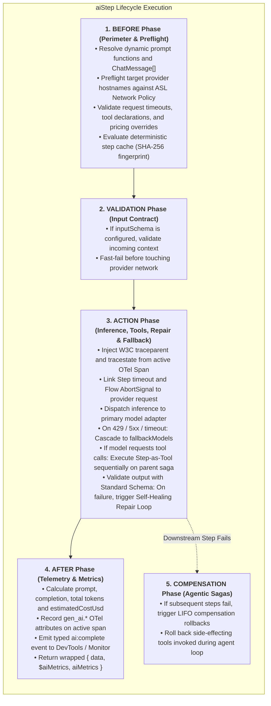

# @siglo/ai Step & Agent Guide

`@siglo/ai` provides resilient, enterprise-grade, multi-provider LLM inference, native structured outputs, and agentic step execution for `Siglo` workflows. It replaces fragile ad-hoc AI SDK scripts with coordinated rate-limit fallback cascades, automated self-healing schema repair loops, Step-as-Tool agent loops backed by parent saga compensations, AsyncLocalStorage (ASL) network perimeter enforcement, deterministic offline replay testing, and OpenTelemetry GenAI observability.

---

## 1. Executive Summary & Problem Space

Integrating Large Language Models (LLMs) and generative agents directly into production workflows introduces non-deterministic outputs, transient rate limits (`429`), latency spikes, and severe security challenges. When developers call LLM SDKs directly inside workflow steps, pipelines suffer from systemic failure modes:

| Ad-Hoc LLM Anti-Pattern | Operational Risk in Distributed Workflows | How `@siglo/ai` Solves It |
|---|---|---|
| **Unregulated Network Egress** | AI SDK calls bypass the workflow network perimeter, risking SSRF, data exfiltration, or unauthorized API access. | Enforces Siglo's AsyncLocalStorage (ASL) network egress policy (`allowNetwork`). Preflights provider hostnames in `BEFORE` and re-verifies before dispatch. Localhost is denied by default. |
| **Runtime Data Corruption** | Unstructured or malformed JSON responses crash downstream steps without compile-time or runtime type guarantees. | Native JSON Schema structured output APIs backed by Standard Schema V1 (`~standard` with Zod, Valibot, ArkType), inferring typed outputs directly into workflow context (`result.data`). |
| **Fragile One-Shot Failures** | Minor JSON syntax issues or hallucinated enum values abort the entire business workflow. | Automated **Self-Healing Prompt Repair Loop**: captures validation diagnostics and feeds them into an ephemeral correction turn before failing, bounded by `maxRepairAttempts`. |
| **Provider Rate Limiting (`429`) & Outages** | Sudden traffic spikes or provider outages crash critical business pipelines. | **Model Fallback Cascades**: automatically routes requests through fallback providers (e.g., Claude 3.5 Sonnet &rarr; GPT-4o &rarr; Gemini 2.0 Flash) on `429`, `5xx`, or request timeout. |
| **Dangling TCP Sockets on Timeout** | Standard AI client calls hang indefinitely during heavy generation or network latency when a workflow timeout triggers. | First-class `AbortSignal` binding: Siglo step deadlines and flow cancellations cooperatively abort provider requests and close underlying TCP sockets immediately. |
| **Redundant Token Expense on Retries** | Upstream step failures or idempotent retries re-execute expensive LLM prompts repeatedly. | Integrates with Siglo's deterministic step caching (`step.cache()`) and SHA-256 prompt/model/context hashing, returning cached outputs without touching the network. |
| **Telemetry & Cost Black Holes** | No visibility into token consumption, latency, or dollar cost inside APM dashboards. | Injects OpenTelemetry GenAI Semantic Convention attributes (`gen_ai.*`), emits live typed `ai:complete` events, and records metrics in `$steps.<name>.aiMetrics`. |
| **Isolated Execution (No Tool Access)** | LLMs cannot interact with workflow state or invoke internal business steps safely. | **Step-as-Tool Agent Loop**: exposes existing Siglo steps directly as typed tools to the model within a managed execution loop, executing on the parent saga stack with LIFO compensation. |

---

## 2. Architecture & Step Lifecycle Integration

Siglo executes steps through a formal 5-phase lifecycle: `BEFORE` &rarr; `VALIDATION` &rarr; `ACTION` &rarr; `AFTER` &rarr; `COMPENSATE`. `@siglo/ai` hooks natively into every phase:



---

## 3. Installation & Setup

Install `@siglo/ai` and `@siglo/http` alongside `siglo`:

```bash
npm install siglo @siglo/ai @siglo/http
```

Peer dependencies:
- `siglo`: `^1.0.0`
- `@siglo/http`: `^1.0.0` (for network perimeter and Standard Schema integration)
- `@opentelemetry/api`: `^1.0.0` (optional, for distributed trace context propagation)

---

## 4. Deep Technical Capabilities

### 4.1 Multi-Provider Abstraction

`@siglo/ai` provides a unified interface across leading generative AI providers and local runtimes:

| Provider | Protocol / API | Native Schema Mechanism | Tool Calling Support |
|---|---|---|---|
| **Anthropic** (`anthropic`) | Messages API (`/v1/messages`) | Native tool constraint (`siglo_structured_output`) | Full multi-turn tool calling |
| **OpenAI** (`openai`) | Chat Completions (`/chat/completions`) | `response_format: { type: 'json_schema', strict: true }` | Native function calling |
| **Google Gemini** (`gemini`) | Generate Content (`/models/<model>:generateContent`) | `generationConfig.responseJsonSchema` | Function declarations & signed parts |
| **Ollama / vLLM** (`ollama`) | OpenAI-compatible (`/chat/completions`) | Schema passed via `response_format` | OpenAI-compatible function calling |
| **Custom Endpoints** (`custom`) | OpenAI-compatible HTTP REST | Customizable via `baseUrl` | OpenAI-compatible function calling |

#### Credential Isolation & Environment Variables

Credentials resolve independently for each provider. There is **no implicit credential sharing** across primary and fallback models:

1. Static or dynamic `apiKey` provided on the specific model config:
   ```typescript
   apiKey: (ctx) => ctx.tenantApiKey
   ```
2. Standard environment variable matching the provider:
   - `OPENAI_API_KEY` for `openai`
   - `ANTHROPIC_API_KEY` for `anthropic`
   - `GEMINI_API_KEY` for `gemini`
3. Custom and Ollama endpoints require an explicit `baseUrl` and receive no implicit environment keys.

---

### 4.2 Zero-Trust ASL Network Perimeter

`@siglo/ai` integrates with Siglo's AsyncLocalStorage (ASL) network egress perimeter:

- **Preflight Enforcement**: Every configured primary and fallback endpoint hostname is registered in the step's `.allowNetwork()` policy during construction and verified during the `BEFORE` phase before any request or cache lookup.
- **Pre-Dispatch Verification**: Right before `fetch` execution, `assertNetworkPolicy()` re-verifies the exact destination URL and hostname.
- **SSRF & Localhost Defense**: Localhost endpoints (such as `http://localhost:11434` for Ollama) require explicit `allowLocalhost: true` on both the step and enclosing flow when network policies are active.
- **Strict Redirect Defense**: HTTP redirects (`301`, `302`, `307`, `308`) are rejected with `redirect: 'error'` to prevent credential forwarding or egress perimeter escalation.

```typescript
import { flow } from 'siglo';
import { aiStep } from '@siglo/ai';

export const safeAiStep = aiStep('generateInsight', {
  model: { provider: 'openai', model: 'gpt-4o' },
  prompt: 'Analyze system telemetry.'
});

// Enclosing workflow network policy governs the step:
export const secureFlow = flow(safeAiStep).networkPolicy({
  allowedHosts: ['api.openai.com']
});
```

---

### 4.3 Native Structured Outputs & Standard Schema V1

`@siglo/ai` enforces strict type safety using the **Standard Schema V1 (`~standard`)** specification supported by Zod, Valibot, and ArkType.

#### TypeScript Type Inference

Outputs are statically inferred into the workflow execution context:

```typescript
import { z } from 'zod';
import { aiStep } from '@siglo/ai';

const AnalysisSchema = z.object({
  sentiment: z.enum(['POSITIVE', 'NEUTRAL', 'NEGATIVE']),
  score: z.number().min(0).max(1),
  tags: z.array(z.string())
});

export const analyzeStep = aiStep('analyze', {
  model: { provider: 'openai', model: 'gpt-4o' },
  schema: AnalysisSchema,
  jsonSchema: z.toJSONSchema(AnalysisSchema),
  prompt: (ctx: { review: string }) => `Analyze this review: ${ctx.review}`
});

// Downstream step receives fully typed ctx.data:
// ctx.data.sentiment -> 'POSITIVE' | 'NEUTRAL' | 'NEGATIVE'
// ctx.data.score -> number
// ctx.data.tags -> string[]
```

#### Object Enveloping for Primitives & Arrays

OpenAI and Anthropic native structured outputs require an object root. When your schema is a primitive (`z.string()`) or array (`z.array(...)`), `@siglo/ai` transparently envelopes the request into `{ data: schema }` for the provider, while unwrapping the validated value so your workflow receives the exact primitive or array.

#### Local Validation vs Native Enforcement

If using models or providers that do not support native JSON schema constraints, disable native enforcement while preserving local runtime schema validation and self-healing repair:

```typescript
export const legacyStep = aiStep('legacyAnalysis', {
  model: { provider: 'ollama', model: 'llama3' },
  schema: AnalysisSchema,
  enforceNativeStructuredOutputs: false, // Disables native schema; relies on prompt & local validator
  prompt: 'Output JSON matching the schema.'
});
```

---

### 4.4 Self-Healing Prompt Repair Fallback Loop

If an LLM produces malformed JSON or hallucinates fields that violate the schema, `@siglo/ai` automatically intercepts the error and executes an automated repair turn:

```
[System] You previously emitted invalid JSON that failed the required schema.
[Assistant] { "sentiment": "VERY_GOOD", "score": "high" }
[User] Your previous output failed validation. Return ONLY corrected JSON.
Validation diagnostics: [
  { "path": "sentiment", "message": "Invalid enum value. Expected 'POSITIVE' | 'NEUTRAL' | 'NEGATIVE'" },
  { "path": "score", "message": "Expected number, received string" }
]
```

- **Bounded Budget**: Controlled by `maxRepairAttempts` (default: 2, set to 0 to disable).
- **Diagnostics Preservation**: If repair turns are exhausted, throws `AiOutputValidationError` containing the structured diagnostic issues for debugging.
- **Accurate Accounting**: Every repair attempt is tracked in metrics (`metrics.repairAttempts`) and token usage sums across all repair turns.

---

### 4.5 Model Fallback Cascades & Transient Error Classification

Network hiccups, sudden traffic surges (`429 Rate Limit`), and transient cloud outages (`500`, `502`, `503`, `504`) are handled automatically without crashing your workflow:

```typescript
export const resilientStep = aiStep('resilientSummary', {
  model: {
    provider: 'anthropic',
    model: 'claude-3-5-sonnet-20241022',
    requestTimeoutMs: 15_000
  },
  fallbackModels: [
    { provider: 'openai', model: 'gpt-4o', requestTimeoutMs: 10_000 },
    { provider: 'gemini', model: 'gemini-2.0-flash', requestTimeoutMs: 10_000 }
  ],
  prompt: (ctx: { text: string }) => `Summarize: ${ctx.text}`
});
```

#### Error Classification Rules

| Error Type | Trigger | Fallback Behavior |
|---|---|---|
| **Rate Limit (`429`)** | Upstream provider returns HTTP 429 | Advances immediately to next fallback model |
| **Transient Server Error (`5xx`)** | Upstream provider returns 500, 502, 503, 504 | Advances immediately to next fallback model |
| **Request Timeout (`AiRequestTimeoutError`)** | Single request exceeds `requestTimeoutMs` | Advances immediately to next fallback model |
| **Authentication Error (`401`, `403`)** | Invalid API keys or permissions | **Fatal**: Fails fast without fallback |
| **Client Error (`400`, `422`)** | Bad request parameters or invalid schema | **Fatal**: Fails fast without fallback |
| **Workflow Cancellation / Abort** | Step timeout or workflow `cancel()` | **Fatal**: Terminates immediately without fallback |

---

### 4.6 Step-as-Tool Execution Bridge & Parent Saga Integration

`@siglo/ai` allows standard Siglo workflow steps to be passed directly as tools to the model using `defineAiTool`:

```typescript
import { Step } from 'siglo';
import { defineAiTool, aiStep } from '@siglo/ai';
import { z } from 'zod';

const bookingArgs = z.object({ roomId: z.string(), nights: z.number() });

const bookRoomStep = Step.create('bookRoom', async ({ roomId, nights }: { roomId: string; nights: number }) => {
  const reservation = await reservationService.book(roomId, nights);
  return { reservationId: reservation.id };
}).compensate(async (ctx) => {
  // Saga compensation rollback!
  await reservationService.cancel(ctx.reservationId);
});

export const bookRoomTool = defineAiTool({
  name: 'bookRoom',
  description: 'Reserve a hotel room for a guest',
  inputSchema: bookingArgs,
  jsonSchema: z.toJSONSchema(bookingArgs),
  mapInput: (args, ctx) => ({ roomId: args.roomId, nights: args.nights }),
  step: bookRoomStep
});
```

#### Tool Execution Governance

1. **Pre-Validation**: The entire batch of tool calls emitted by the model is validated against each tool's `inputSchema` before the first side-effecting step runs.
2. **Sequential Lifecycle Execution**: Tools run via `Step.start` within the active workflow stack (`stackId`), inheriting parent cancellation signals and network policies.
3. **Parent Saga Integration**: Tool steps register compensations onto the parent saga stack. If subsequent inference fails or downstream steps fail, tool compensations roll back in reverse order (LIFO).
4. **Safety Restrictions**: Tool-bearing AI steps strictly forbid step-level caching, failure recovery/retries, and idempotent replay to prevent accidental duplicate side effects.
5. **Turn Bounding**: Bounded by `maxToolTurns` (default: 5) to prevent infinite agentic ping-pong loops.

---

### 4.7 Deterministic Caching for AI Steps

For schema-validated or text inference steps without tools, `@siglo/ai` integrates with Siglo's `.cache()`:

```typescript
export const cachedSummaryStep = aiStep('cachedSummary', {
  model: { provider: 'openai', model: 'gpt-4o' },
  prompt: (ctx: { documentId: string; content: string }) => `Summarize: ${ctx.content}`,
  cacheVersion: 'v1'
}).cache({ ttl: 3600 });
```

- **Deterministic Hash**: The cache key is computed as a SHA-256 digest covering:
  - `cacheVersion` (bump when prompt wording or validation rules change)
  - Resolved prompt string or messages
  - Model cascade configurations and credential scopes
  - Native JSON schema and validator code
  - Sampling parameters (`temperature`, `maxTokens`)
  - Workflow input payload
- **Stampede Protection**: In-flight stampede sharing defaults to `false` so that aborting one request never aborts concurrent workflow callers.
- **Cache Hits**: Cache hits return original metrics without making external network calls or emitting duplicate `ai:complete` events.

---

### 4.8 OpenTelemetry GenAI Observability & Cost Accounting

`@siglo/ai` instruments every request according to the **OpenTelemetry GenAI Semantic Conventions**:

- **Span Attributes**:
  - `gen_ai.system`: e.g. `'openai'`, `'anthropic'`, `'gemini'`
  - `gen_ai.provider.name`: e.g. `'openai'`, `'anthropic'`, `'gcp.gemini'`
  - `gen_ai.operation.name`: `'chat'`
  - `gen_ai.request.model`: e.g. `'gpt-4o'`
  - `gen_ai.response.model`: e.g. `'gpt-4o'`
  - `gen_ai.usage.input_tokens`: total prompt tokens
  - `gen_ai.usage.output_tokens`: total completion tokens
- **W3C Distributed Tracing**: Injects `traceparent` and `tracestate` headers onto outgoing provider HTTP requests.
- **Live Monitoring Events**: Emits typed `ai:complete` monitoring events containing token counts, latency, model used, and repair/fallback statistics (prompts and generated text are excluded to prevent secret/PII leaks).
- **Cost Estimation**: Automatically computes `estimatedCostUsd` using built-in baseline rates or custom per-model pricing overrides (`pricing: { inputPerMillion, outputPerMillion }`).

---

### 4.9 Offline Testing & Deterministic Replay (`MockAiProvider`)

`@siglo/ai/testing` provides `MockAiProvider` for zero-network, 100% deterministic testing:

```typescript
import { flow } from 'siglo';
import { WorkflowHarness } from '@siglo/testing';
import { MockAiProvider } from '@siglo/ai/testing';
import { aiStep } from '@siglo/ai';
import { z } from 'zod';

const schema = z.object({ summary: z.string() });

// Scripted mock provider (simulates a malformed response followed by a valid repair)
const mock = new MockAiProvider([
  { text: 'malformed json', promptTokens: 20, completionTokens: 5 },
  { text: '{"summary":"Workflow completed successfully"}', promptTokens: 30, completionTokens: 10 }
]);

const step = aiStep('summarize', {
  model: { provider: 'openai', model: 'gpt-4o', adapter: mock },
  schema,
  jsonSchema: z.toJSONSchema(schema),
  prompt: 'Summarize report'
});

const harness = new WorkflowHarness(flow(step));
const result = await harness.run({});

mock.assertDone(); // Asserts all mock responses were consumed
console.log(result.data.summary); // 'Workflow completed successfully'
console.log(result.$steps.summarize.aiMetrics.repairAttempts); // 1
```

#### Record & Replay

Recordings can be exported and replayed for regression verification:

```typescript
const recording = mock.exportRecording();
const replayAdapter = MockAiProvider.replay(recording);
```

---

## 5. Production-Ready Scenarios

### Scenario A: Financial Loan Underwriting Pipeline with Model Fallbacks

```typescript
import { flow, Step } from 'siglo';
import { aiStep } from '@siglo/ai';
import { z } from 'zod';

const UnderwritingSchema = z.object({
  decision: z.enum(['APPROVE', 'MANUAL_REVIEW', 'DECLINE']),
  riskTier: z.enum(['LOW', 'MEDIUM', 'HIGH', 'PROHIBITIVE']),
  maxApprovedLimit: z.number().min(0),
  conditions: z.array(z.string()),
  rationale: z.string()
});

interface LoanApplication {
  applicantId: string;
  applicantName: string;
  creditScore: number;
  requestedAmount: number;
  monthlyDebt: number;
  monthlyIncome: number;
}

export const underwriteLoanStep = aiStep('underwriteLoan', {
  model: {
    provider: 'anthropic',
    model: 'claude-3-5-sonnet-20241022',
    requestTimeoutMs: 12_000
  },
  fallbackModels: [
    { provider: 'openai', model: 'gpt-4o', requestTimeoutMs: 10_000 },
    { provider: 'gemini', model: 'gemini-2.0-flash', requestTimeoutMs: 8_000 }
  ],
  temperature: 0.1,
  schema: UnderwritingSchema,
  jsonSchema: z.toJSONSchema(UnderwritingSchema),
  maxRepairAttempts: 2,
  prompt: (ctx: LoanApplication) => [
    {
      role: 'system',
      content: 'You are a senior credit underwriter. Make risk assessments strictly based on debt-to-income and credit score.'
    },
    {
      role: 'user',
      content: `Applicant: ${ctx.applicantName} (ID: ${ctx.applicantId})
Credit Score: ${ctx.creditScore}
Requested: $${ctx.requestedAmount}
Monthly Debt: $${ctx.monthlyDebt}
Monthly Income: $${ctx.monthlyIncome}`
    }
  ]
});

export const loanWorkflow = flow(
  underwriteLoanStep,
  Step.create('notifyApplicant', async (ctx) => {
    // TypeScript guarantees ctx.data contains decision, riskTier, etc.
    return { status: 'notified', decision: ctx.data.decision };
  })
);
```

---

### Scenario B: Agentic Portfolio Advisor with Compensating Tools

```typescript
import { flow, Step } from 'siglo';
import { aiStep, defineAiTool } from '@siglo/ai';
import { z } from 'zod';

// Step 1: Customer Portfolio Lookup Step
const portfolioArgs = z.object({ customerId: z.string() });
const lookupPortfolioStep = Step.create('lookupPortfolio', async ({ customerId }: { customerId: string }) => {
  return { netWorth: 250_000, riskTolerance: 'MODERATE', holdings: ['VTI', 'BND'] };
});

const lookupPortfolioTool = defineAiTool({
  name: 'lookupPortfolio',
  description: 'Lookup customer investment portfolio and risk tolerance',
  inputSchema: portfolioArgs,
  jsonSchema: z.toJSONSchema(portfolioArgs),
  mapInput: (args) => args,
  step: lookupPortfolioStep
});

// Step 2: Trade Allocation Step with Compensation
const tradeArgs = z.object({ symbol: z.string(), action: z.enum(['BUY', 'SELL']), amountUsd: z.number() });
const executeTradeStep = Step.create('executeTrade', async ({ symbol, action, amountUsd }: { symbol: string; action: 'BUY' | 'SELL'; amountUsd: number }) => {
  const tradeId = `tr_${Date.now()}`;
  return { tradeId, status: 'EXECUTED' };
}).compensate(async (ctx) => {
  // Compensating rollback if subsequent steps or advisor fail!
  console.log(`Cancelling trade ${ctx.tradeId}`);
});

const executeTradeTool = defineAiTool({
  name: 'executeTrade',
  description: 'Execute a portfolio balancing trade',
  inputSchema: tradeArgs,
  jsonSchema: z.toJSONSchema(tradeArgs),
  mapInput: (args) => args,
  step: executeTradeStep
});

// Output recommendation schema
const AdvisoryResultSchema = z.object({
  portfolioSummary: z.string(),
  rebalancingCompleted: z.boolean(),
  notes: z.string()
});

export const portfolioAdvisor = aiStep('portfolioAdvisor', {
  model: { provider: 'openai', model: 'gpt-4o' },
  prompt: (ctx: { customerId: string }) => `Review and balance portfolio for customer ${ctx.customerId}.`,
  tools: [lookupPortfolioTool, executeTradeTool],
  maxToolTurns: 4,
  schema: AdvisoryResultSchema,
  jsonSchema: z.toJSONSchema(AdvisoryResultSchema)
});

export const advisoryFlow = flow(portfolioAdvisor);
```

---

## 6. API Reference

### `aiStep(name, options)`

Instantiates a typed `AiStep` execution unit extending Siglo's core `Step`.

#### Configuration Options (`AiStepOptions`)

| Option | Type | Default | Description |
|---|---|---|---|
| `model` | `AiModelConfig` | *Required* | Primary model configuration (provider, model ID, requestTimeoutMs, apiKey, baseUrl, adapter, pricing). |
| `fallbackModels` | `AiModelConfig[]` | `[]` | Sequential fallback models invoked on `429`, `5xx`, or request timeouts. |
| `prompt` | `string \| ChatMessage[] \| ((ctx: TInput) => string \| ChatMessage[])` | *Required* | Static prompt string, ChatMessage array, or dynamic prompt function. |
| `schema` | `TSchema extends StandardSchemaV1` | `undefined` | Standard Schema V1 validator for structured JSON output. |
| `jsonSchema` | `Record<string, unknown>` | `undefined` | Native JSON Schema for provider structured output. Required unless schema supports Standard JSON Schema conversion. |
| `inputSchema` | `StandardSchemaV1` | `undefined` | Validates step input context during `VALIDATION` phase before inference. |
| `temperature` | `number` | `undefined` | Sampling temperature between `0` and `2`. |
| `maxTokens` | `number` | `undefined` | Maximum completion tokens to generate. |
| `maxRepairAttempts` | `number` | `2` | Maximum correction turns when model output fails JSON parsing or schema validation. |
| `tools` | `AiTool[]` | `[]` | Typed tools created with `defineAiTool` exposed to the model. |
| `maxToolTurns` | `number` | `5` | Maximum agentic multi-turn tool interaction rounds. |
| `enforceNativeStructuredOutputs` | `boolean` | `true` | Set to `false` to disable provider-native schema enforcement and rely on local validation and repair. |
| `cacheVersion` | `string` | `'1'` | Cache namespace identifier; bump when prompt closures or validation semantics change. |

---

#### Output Result Structure (`AiStepResult<T>`)

Every AI step produces a wrapped result structure:

```typescript
export interface AiStepResult<TOutput> {
  data: TOutput;           // Validated structured output or raw text string
  $aiMetrics: AiMetrics;   // Telemetry and token accounting metadata
  aiMetrics: AiMetrics;    // Alias for $aiMetrics
}
```

#### Metrics Structure (`AiMetrics`)

```typescript
export interface AiMetrics {
  promptTokens: number;
  completionTokens: number;
  totalTokens: number;
  estimatedCostUsd?: number;
  latencyMs: number;
  modelUsed: string;
  providerUsed: AiProvider;
  repairAttempts: number;
  fallbackCount: number;
}
```

---

## 7. Initial Release Boundaries & Guidelines

- **Excluded from v1**: Streaming (`ReadableStream`) and mid-agent loop durable suspensions are outside the initial release scope.
- **Tool Restrictions**: Tool-bearing AI steps strictly reject step-level caching, failure recovery/retries, and idempotent replay.
- **Schema Compatibility**: Provider schemas must be valid JSON Schema objects. Primitive and array outputs use an internal object envelope for OpenAI and Anthropic.
- **Offline CI**: All continuous integration tests run offline without network egress or live API keys using `MockAiProvider`.
