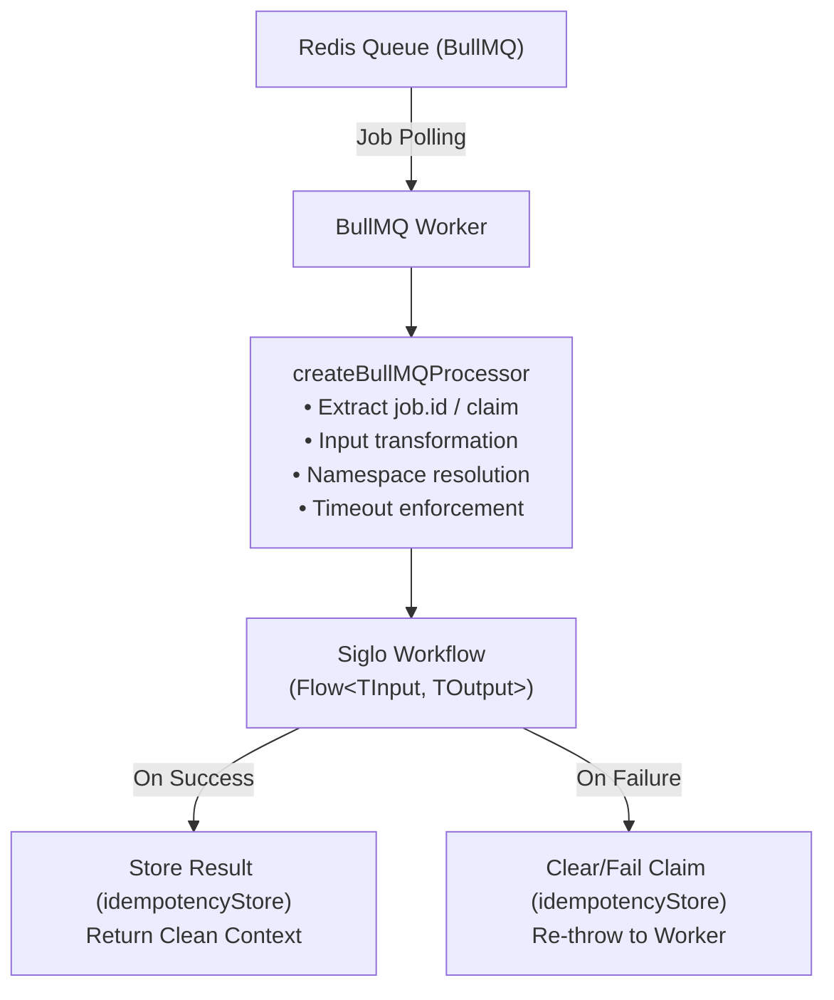

# @siglo/bullmq Adapter Guide

`@siglo/bullmq` provides a high-throughput, Redis-backed job queue consumer and worker processor adapter for `Siglo` workflows. It bridges BullMQ workers with the Siglo execution engine, offering payload unwrapping, distributed idempotency deduplication, timeout enforcement, tenant namespace partitioning, and graceful failure handling.

---

## 1. Overview & Architecture

When executing distributed workflows across worker clusters, BullMQ distributes asynchronous jobs backed by Redis. The `@siglo/bullmq` adapter wraps workflow execution within a standard BullMQ worker processor function (`(job: Job) => Promise<any>`).

> **Note on Guarantees**: Processing operates with at-least-once delivery semantics. On job delivery, the entire workflow executes from the beginning; it does not automatically resume at the last completed step. Claims and cached results do not make external side-effects atomic with job completion. A worker crash after an external effect (e.g., charge or API call) but before claim completion leaves an in-progress claim until TTL expiry, which can repeat the external effect on retry. Workflows must ensure external effects are idempotent or supply provider-level deduplication keys.



---

## 2. Installation & Requirements

### Package Dependencies

Install `@siglo/bullmq` alongside `Siglo`. BullMQ and ioredis are declared as optional peer dependencies so you control the exact version:

```bash
npm install @siglo/core @siglo/bullmq bullmq ioredis
```

Peer dependency matrix:
- `Siglo`: `*` (v1.0.0+)
- `bullmq`: `^5.0.0`
- `ioredis`: `^5.0.0 || ^6.0.0`

---

## 3. API Reference

### `createBullMQProcessor(workflow, options)`

Creates a BullMQ-compliant worker processor function:

```typescript
function createBullMQProcessor<TInput = any, TOutput = any, TJob = any>(
    workflow: Flow<TInput, TOutput>,
    options?: SigloBullMQOptions<TJob, TInput, TOutput>
): (job: any) => Promise<any>;
```

#### Parameters:
- `workflow` (`Flow<TInput, TOutput>`): The compiled `Siglo` workflow instance to execute.
- `options` (`SigloBullMQOptions<TJob, TInput, TOutput>`): Optional configuration dictionary.

---

## 4. Configuration Options (`SigloBullMQOptions`)

| Option | Type | Default | Description |
| :--- | :--- | :--- | :--- |
| `input` | `(job: TJob) => Promise<TInput> \| TInput` | `(job) => job.data` | Custom mapper to transform the BullMQ `Job` into workflow inputs. |
| `output` | `(result: any, job: TJob) => Promise<TOutput> \| TOutput` | `(result) => result` | Custom mapper to format or filter the workflow result before returning to BullMQ. |
| `idempotencyStore` | `IdempotencyStore` | `undefined` | Distributed store (e.g., `RedisIdempotencyStore` or `PostgresIdempotencyStore`) to provide distributed deduplication and claim locking. |
| `idempotencyTtlMs` | `number` | `undefined` | Time-to-live for the idempotency claim in milliseconds. Passed through to store (Redis/Postgres default: 24h; InMemory has no default expiration unless specified). |
| `timeout` | `number` | `undefined` | SLA deadline in milliseconds for workflow execution. Throws `StepTimeoutException` / `FlowTimeoutException` if exceeded. |
| `namespace` | `string \| ((job: TJob) => string \| undefined)` | `job.data?.namespace` | Target namespace for state partitioning and checkpoint isolation. |

---

## 5. Execution Lifecycle & Data Flow

1. **Job Identification & Idempotency Key**:
   - The adapter generates an idempotency key: `bullmq:job:${job.id || String(Date.now())}`.
   - If `idempotencyStore` is provided, the key is atomically claimed:
     - `'completed'`: Returns cached result immediately via `store.getResult(key)` without re-running the workflow.
     - `'in-progress'`: Throws `Error('Job ... is already in-progress concurrently')`, signaling BullMQ to avoid concurrent race conditions.
     - `'claimed'`: Proceeds to workflow execution.

2. **Input Mapping**:
   - If `options.input` is defined, it is invoked with `job`.
   - Otherwise, `job.data || {}` is passed directly as the initial workflow input parameter.

3. **Namespace Resolution**:
   - If `options.namespace` is a function, `options.namespace(job)` is called.
   - If `options.namespace` is a static string, it is used.
   - Otherwise, the adapter inspects `job.data?.namespace`.

4. **Workflow Execution & Context Unwrapping**:
   - The workflow executes with `{ timeout: options.timeout, namespace }`.
   - Results are automatically unwrapped (`unwrapContext`), removing internal engine properties (keys prefixed with `$`) and resolving getter accessor functions into standard JSON-serializable primitives.

5. **Completion & Failure Handling**:
   - **Success**: If an idempotency store is configured, `store.complete(idempKey, cleanResult)` is called, and `options.output` (if provided) shapes the return value.
   - **Failure**: If an error is thrown, `store.fail(idempKey, err)` is called to release the in-flight lock, enabling BullMQ retry strategies. The error is re-thrown to trigger BullMQ failure handling.

---

## 6. Complete Production Examples

### Basic Media Transcoder Worker

```typescript
import { Worker, Job } from 'bullmq';
import { Step, flow } from '@siglo/core';
import { createBullMQProcessor } from '@siglo/bullmq';
import { Redis } from 'ioredis';

const connection = new Redis(process.env.REDIS_URL || 'redis://localhost:6379', {
    maxRetriesPerRequest: null,
});

// 1. Define workflow steps
interface VideoJobData {
    videoId: string;
    sourceBucket: string;
    resolutions: ('720p' | '1080p' | '4k')[];
}

const downloadSource = Step.create('downloadSource', async (param: VideoJobData) => {
    console.log(`Downloading video ${param.videoId} from ${param.sourceBucket}`);
    return { localPath: `/tmp/${param.videoId}.mp4` };
});

const transcode = Step.create('transcode', async (param: any) => {
    console.log(`Transcoding ${param.localPath} into ${param.resolutions.join(', ')}`);
    return {
        transcodedFiles: param.resolutions.map((r: string) => `/tmp/${param.videoId}_${r}.mp4`),
        durationSec: 124,
    };
});

const uploadCdn = Step.create('uploadCdn', async (param: any) => {
    console.log(`Uploading ${param.transcodedFiles.length} files to CDN`);
    return {
        cdnUrls: param.transcodedFiles.map((f: string) => `https://cdn.example.com/${param.videoId}`),
        status: 'READY',
    };
});

const transcodeFlow = flow(downloadSource, transcode, uploadCdn);

// 2. Create BullMQ worker with processor adapter
const worker = new Worker<VideoJobData>(
    'video-processing-queue',
    createBullMQProcessor(transcodeFlow, {
        timeout: 120000, // 2-minute deadline
        input: (job: Job<VideoJobData>) => ({
            videoId: job.data.videoId,
            sourceBucket: job.data.sourceBucket,
            resolutions: job.data.resolutions,
        }),
        output: (result, job) => ({
            jobId: job.id,
            videoId: job.data.videoId,
            cdnUrls: result.cdnUrls,
            durationSec: result.durationSec,
        }),
    }),
    { connection, concurrency: 5 }
);

worker.on('completed', (job, returnvalue) => {
    console.log(`Job ${job.id} completed. Transcoded video ready:`, returnvalue.cdnUrls);
});

worker.on('failed', (job, err) => {
    console.error(`Job ${job?.id} failed: ${err.message}`);
});
```

---

### Distributed Idempotent Worker with `@siglo/redis`

In high-concurrency environments with Redis clusters, duplicate job events or worker restarts should never cause duplicate processing:

```typescript
import { Worker } from 'bullmq';
import { Step, flow } from '@siglo/core';
import { createBullMQProcessor } from '@siglo/bullmq';
import { RedisIdempotencyStore, RedisStorageAdapter } from '@siglo/redis';
import { Redis } from 'ioredis';

const redis = new Redis('redis://localhost:6379');

// Configure global storage for checkpoints
Step.useStorage(new RedisStorageAdapter({ client: redis }));

// Configure distributed idempotency store
const idempotencyStore = new RedisIdempotencyStore({
    client: redis,
    keyPrefix: 'siglo:idemp:bullmq:',
    defaultTtlMs: 3600000, // 1 hour
});

const billingWorkflow = flow(
    Step.create('chargeInvoice', async ({ invoiceId, amount }: any) => {
        // Charging payment gateway
        return { chargeId: `ch_${invoiceId}`, settled: true };
    })
);

const worker = new Worker(
    'billing-queue',
    createBullMQProcessor(billingWorkflow, {
        idempotencyStore,
        idempotencyTtlMs: 3600000,
        timeout: 10000,
        namespace: (job) => job.data.tenantId, // Multi-tenant namespace
    }),
    { connection: redis, concurrency: 10 }
);
```

---

## 7. Graceful Shutdown & Connection Draining

Ensure that ongoing workflow executions finish gracefully when the host process terminates (e.g., during Kubernetes pod evictions):

```typescript
async function shutdown() {
    console.log('Shutting down BullMQ worker...');
    await worker.close();
    await redis.quit();
    process.exit(0);
}

process.on('SIGTERM', shutdown);
process.on('SIGINT', shutdown);
```
