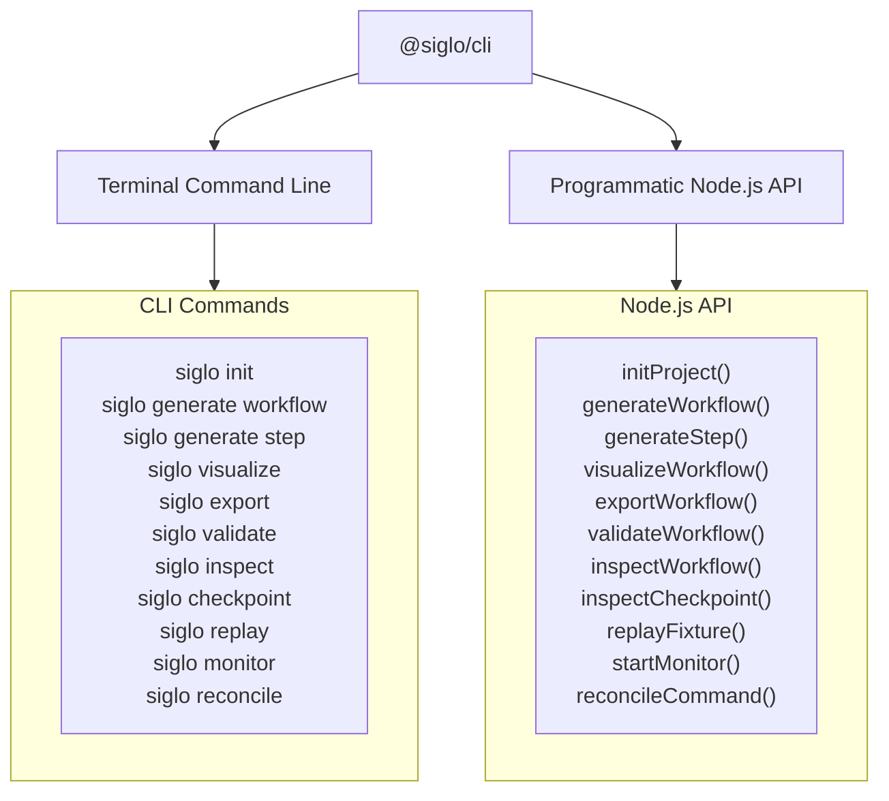
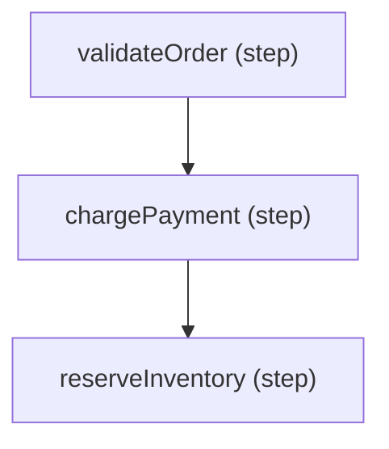

# @siglo/cli Developer Tools & CLI Guide

`@siglo/cli` provides developer tooling, code scaffolding, static analysis, command-line inspection, architecture export, and regression testing utilities for `Siglo` workflows. It allows engineering teams to scaffold typed steps/workflows, visualize execution graphs, export to Mermaid/Graphviz/JSON, detect cyclic dependencies, inspect serialized checkpoints, and replay golden test fixtures in CI/CD pipelines.

---

## 1. Overview

`@siglo/cli` operates both as an executable terminal tool (`Siglo`) and as a programmatic TypeScript library:



---

## 2. Installation

Install `@siglo/cli` locally in your project or globally:

```bash
# Local development dependency (recommended)
npm install --save-dev @siglo/cli @siglo/testing @siglo/core tsx

# Or run directly via npx
npm exec --package=@siglo/cli -- siglo --help
```

---

## 3. Command Line Interface (CLI)

The CLI executable is `siglo`.

### General Usage

```bash
siglo <command> [arguments] [options]
```

### Global Options:

- `--format=mermaid|text|dot|json`: Diagram representation or export format (default: `mermaid`).
- `--direction=TD|LR|TB`: Graph layout direction for Mermaid or DOT diagrams (default: `TD`).
- `--out=<file>`: Write output directly to a file instead of `stdout`.
- `--redact=key1,key2`: Comma-delimited list of sensitive context keys or node names to mask with `[REDACTED]`.
- `--port=<port>`: Port number for the live monitor server (default: `4000`).
- `--host=<host>`: Host interface binding for the live monitor server (default: `0.0.0.0`).
- `--namespace=<ns>`: Filter telemetry events to a specific tenant namespace.
- `--help`, `-h`: Show CLI usage guide.
- `--version`, `-v`: Display CLI version.

---

### Command 1: `siglo init [dir]`

Scaffolds a clean starter project preconfigured with `Siglo`, `tsx`, modern TypeScript config, and a runnable workflow test.

```bash
siglo init ./services/order-orchestrator
```

#### Generated Files:

1. `package.json`: Contains scripts (`npm test`, `npm start`) and required dependencies.
2. `src/workflow.ts`: Example order processing pipeline with validation and payment steps.
3. `src/workflow.test.ts`: Automated test executing the workflow with assertions.

---

### Command 2: `siglo generate workflow <name>`

Scaffolds a brand new typed workflow file and companion unit test powered by `@siglo/testing`.

```bash
siglo generate workflow order-processing
```

#### Generated Files:

1. `src/workflows/order-processing.workflow.ts`: Strongly-typed input/output interfaces, steps, and default workflow export.
2. `src/workflows/order-processing.workflow.test.ts`: Test harness setup verifying end-to-end execution and step invocations.

---

### Command 3: `siglo generate step <name>`

Scaffolds an isolated, strongly-typed `Step` module and companion unit test.

```bash
siglo generate step send-notification
```

#### Generated Files:

1. `src/steps/send-notification.step.ts`: Typed step module with input/output interfaces.
2. `src/steps/send-notification.step.test.ts`: Direct step execution test.

---

### Command 4: `siglo visualize <workflow-file> [options]`

Renders the workflow graph AST as either a Mermaid flowchart or an indented ASCII text hierarchy.

#### Mermaid Diagram (Default):

```bash
siglo visualize src/workflows/checkout.ts
```

_Output:_



#### Text Diagram (`--format=text`):

```bash
siglo visualize src/workflows/checkout.ts --format=text
```

_Output:_

```text
Workflow Graph (total nodes: 3, edges: 2):
├── [step] validateOrder (validateOrder)
├── [step] chargePayment (chargePayment)
└── [step] reserveInventory (reserveInventory)
```

---

### Command 5: `siglo export <workflow-file> [options]`

Exports the workflow topology graph directly to standard formats for architectural documentation, diagrams, or web visualization:

- `--format=mermaid`: Mermaid flowchart with policy badges (retries, timeouts, fallback).
- `--format=dot`: Graphviz DOT format compatible with Graphviz tools and PlantUML.
- `--format=json`: Comprehensive AST node/edge graph JSON.
- `--direction=TD|LR|TB`: Graph layout orientation (top-down, left-to-right).
- `--out=<file>`: Save result directly to a specified destination file.

```bash
# Export Mermaid diagram to file with Left-to-Right layout
siglo export src/workflows/order.workflow.ts --format=mermaid --direction=LR --out=docs/order-flow.mmd

# Export Graphviz DOT format
siglo export src/workflows/order.workflow.ts --format=dot --out=diagrams/order.dot

# Export raw JSON AST
siglo export src/workflows/order.workflow.ts --format=json --out=dist/order-ast.json
```

---

### Command 6: `siglo validate <workflow-file>`

Performs static analysis on the workflow graph AST without executing any step business logic:

- Detects cyclic dependencies.
- Identifies unreachable nodes or disconnected subgraphs.
- Verifies combinator structures (`parallel`, `branch`, `map`).

```bash
siglo validate src/workflows/loan-pipeline.ts
```

_Success Output:_

```text
✔ Workflow graph is valid (acyclic, reachable)
```

_Failure Output (Exit Code 1):_

```text
✖ Workflow validation failed:
  - Cycle detected between nodes 'processPayment' and 'retryPayment'
```

---

### Command 7: `siglo inspect <workflow-file> [options]`

Returns a detailed JSON telemetry summary of the workflow topology, node classifications, edge connections, and total complexity metrics.

```bash
siglo inspect src/workflows/settlement.ts --redact=taxId,secretKey
```

_Output:_

```json
{
    "totalNodes": 4,
    "edges": [
        { "from": "step1", "to": "step2" },
        { "from": "step2", "to": "step3" }
    ],
    "nodes": [
        { "id": "step1", "name": "validateInput", "type": "step" },
        { "id": "step2", "name": "[REDACTED]", "type": "step" },
        { "id": "step3", "name": "persistAudit", "type": "step" }
    ],
    "redactedFields": ["taxId", "secretKey"]
}
```

---

### Command 8: `siglo checkpoint <file> [options]`

Parses and validates a serialized checkpoint state JSON file (e.g., dumped from Redis or PostgreSQL during debugging), summarizing step chains and execution context while masking sensitive credentials.

```bash
siglo checkpoint ./logs/crash-checkpoint.json --redact=apiKey,password
```

_Output:_

```json
{
    "stackId": "stack-8123-bba8",
    "namespace": "tenant-enterprise",
    "type": "flow",
    "stepCount": 3,
    "chains": ["validate", "charge", "notify"],
    "contexts": {
        "charge": {
            "apiKey": "[REDACTED]",
            "status": "APPROVED",
            "amount": 250
        }
    }
}
```

---

### Command 9: `siglo replay <fixture> [workflow-file]`

Replays an end-to-end workflow execution using recorded inputs and validates that output values match golden expectations.

```bash
# Replay against default src/workflow.ts
siglo replay fixtures/order-regression.json

# Replay against explicit workflow module
siglo replay fixtures/order-regression.json src/workflows/order.workflow.ts
```

_Success Output:_

```text
✔ Replay passed in 14ms
```

_Regression Output (Exit Code 1):_

```text
✖ Replay failed with discrepancies: {
  "total": {
    "expected": 100,
    "actual": 120
  }
}
```

---

### Command 10: `siglo monitor [workflow-file]`

Launches the real-time DevTools live monitoring HTTP server and web dashboard:

```bash
# Launch monitor on default port 4000
siglo monitor

# Launch with custom port and host
siglo monitor --port=8080 --host=127.0.0.1

# Launch with a specific workflow preloaded and namespace filter
siglo monitor src/workflows/checkout.ts --port=4000 --namespace=tenant-alpha
```

_Output:_

```text
🚀 Siglo Live Monitor running at http://localhost:4000
   - Dashboard: http://localhost:4000/
   - SSE Stream: http://localhost:4000/events
   - WebSocket: ws://localhost:4000/ws
   - Prometheus Metrics: http://localhost:4000/metrics
```

Workflows in other processes or terminals can attach immediately via:

```typescript
flow(...).monitor(attachToMonitorServer(4000));
```

---

---

### Command 11: `siglo reconcile [workflow-file] [options]`

Scans persistent storage for abandoned workflow execution stacks stuck in `RUNNING` state past a stale threshold, and safely reconciles them:

```bash
# Inspect abandoned stacks stuck for more than 10 minutes (dry-run audit)
siglo reconcile --stale-threshold=10m --action=inspect

# Trigger LIFO compensation rollbacks on abandoned stacks
siglo reconcile src/workflows/checkout.ts --stale-threshold=15m --action=compensate --mode=best-effort

# Mark abandoned stacks as failed across a specific tenant namespace
siglo reconcile --stale-threshold=30m --action=fail --namespace=tenant-us
```

#### Reconcile Options:

- `--stale-threshold=<duration>`: Duration threshold past which a running stack is considered abandoned (e.g. `10m`, `1h`, `30000ms`; default: `10m`).
- `--action=inspect|compensate|fail`: Reconciliation action (default: `compensate`).
    - `inspect`: Read-only audit report detailing abandoned stacks without mutating state.
    - `compensate`: Executes LIFO saga compensation handlers on pending steps.
    - `fail`: Transitions abandoned stack states to `FAILED` and releases locks.
- `--mode=strict|best-effort`: Compensation error tolerance (default: `best-effort`).
- `--namespace=<ns>`: Scopes reconciliation query to a specific tenant partition.

## 4. Programmatic API Reference

Import programmatic utilities directly in your tests, scripts, and build pipelines:

```typescript
import {
    initProject,
    generateWorkflow,
    generateStep,
    visualizeWorkflow,
    validateWorkflow,
    inspectWorkflow,
    inspectCheckpoint,
    replayFixture,
    exportWorkflow,
    startMonitor,
    reconcileCommand,
    toMermaid,
    toTextGraph,
    ReplayFixture,
    ReplayResult,
    WorkflowVisualizationResult,
    ExportWorkflowOptions,
    MonitorOptions,
} from '@siglo/cli';
```

---

### `startMonitor(options?: MonitorOptions)`

Starts the live workflow monitoring dev server and React DevTools web dashboard programmatically:

```typescript
const monitor = await startMonitor({
    port: 4000,
    host: '0.0.0.0',
    namespace: 'eu-west',
});

console.log(`Live DevTools available at: http://localhost:${monitor.port}`);
```

---

### `generateWorkflow(name, targetDir?)`

Generates typed workflow and test templates:

```typescript
const { filePath, testPath } = generateWorkflow('payment-settlement');
console.log(`Generated: ${filePath} and ${testPath}`);
```

---

### `generateStep(name, targetDir?)`

Generates typed step and test templates:

```typescript
const { filePath, testPath } = generateStep('audit-logger');
console.log(`Generated: ${filePath} and ${testPath}`);
```

---

### `exportWorkflow(workflow, options?)`

Exports a workflow to Mermaid, Graphviz DOT, or JSON format:

```typescript
// Mermaid format with top-to-bottom layout
const mermaidDiagram = exportWorkflow(myWorkflow, {
    format: 'mermaid',
    direction: 'TD',
    includeBadges: true,
});

// Graphviz DOT format with left-to-right layout
const dotGraph = exportWorkflow(myWorkflow, {
    format: 'dot',
    direction: 'LR',
});

// JSON AST format
const jsonAST = exportWorkflow(myWorkflow, {
    format: 'json',
});
```

---

### `visualizeWorkflow(workflow)`

Generates both Mermaid and ASCII text representations of a workflow:

```typescript
const result: WorkflowVisualizationResult = visualizeWorkflow(orderWorkflow);

console.log(result.mermaid); // Mermaid flowchart TD string
console.log(result.text); // ASCII text tree
console.log(result.nodeCount); // Total nodes in AST
console.log(result.hasCycles); // Boolean cycle indicator
```

---

### `validateWorkflow(workflow)`

Runs cycle detection and connectivity validation on the compiled graph:

```typescript
const validation = validateWorkflow(myWorkflow);

if (!validation.valid) {
    console.error('Validation errors:', validation.errors);
}
```

---

### `inspectWorkflow(workflow, options?)`

Analyzes graph structure and optionally redacts sensitive node names:

```typescript
const inspection = inspectWorkflow(myWorkflow, {
    redact: ['confidentialStep', 'authStep'],
});
```

---

### `inspectCheckpoint(checkpoint, options?)`

Inspects a checkpoint object or JSON string, redacting specified context fields across all steps:

```typescript
const summary = inspectCheckpoint(checkpointJsonString, {
    redact: ['accessToken', 'cardToken'],
});
```

---

### `replayFixture(workflow, fixture)`

Replays an end-to-end workflow against a recorded golden test fixture. Ideal for CI regression testing, schema evolution validation, and deterministic output verification.

#### TypeScript Interface:

```typescript
export interface ReplayFixture {
    name?: string;
    version?: string;
    initialParam: Record<string, any>;
    expectedOutputs?: Record<string, any>;
    checkpoints?: any[];
}

export interface ReplayResult {
    success: boolean;
    durationMs: number;
    finalContext: Record<string, any>;
    diff?: Record<string, { expected: any; actual: any }>;
}
```

---

## 5. Golden Fixture Testing in CI

Use `replayFixture` in your test suite to ensure that workflow refactoring preserves identical behavior and contract outputs:

### Step 1: Define Fixture File (`test/fixtures/pricing-fixture.json`)

```json
{
    "name": "StandardTierPricing",
    "version": "2.0.0",
    "initialParam": {
        "seats": 10,
        "tier": "pro",
        "annualDiscount": true
    },
    "expectedOutputs": {
        "subtotal": 1200,
        "discount": 240,
        "total": 960,
        "approved": true
    }
}
```

### Step 2: Implement Test Runner (`test/pricing.test.ts`)

```typescript
import test from 'node:test';
import assert from 'node:assert/strict';
import * as path from 'path';
import { replayFixture } from '@siglo/cli';
import { pricingFlow } from '../src/workflows/pricingFlow';

test('Pricing Flow matches golden fixture expectations', async () => {
    const fixturePath = path.resolve(__dirname, 'fixtures/pricing-fixture.json');
    const result = await replayFixture(pricingFlow, fixturePath);

    assert.equal(result.success, true, `Workflow regression detected: ${JSON.stringify(result.diff, null, 2)}`);

    assert.ok(result.durationMs < 500, `Execution took ${result.durationMs}ms, exceeded 500ms budget`);
});
```

---

## 6. Workflow File Loading Mechanics

When `Siglo` loads a workflow file specified on the command line (e.g. `siglo visualize src/workflow.ts` or `siglo export src/workflow.ts`):

1. The file is dynamically imported using Node.js ES modules.
2. The loader checks exports in the following order:
    - `export default flowInstance`
    - `export const workflow = flowInstance`
    - `export const pipeline = flowInstance`
    - Any named export satisfying `isFlow` or containing a `run()` function.
    - If the candidate is a zero-argument factory function (e.g., `export default () => flow(...)`), it is invoked automatically to construct the graph.
