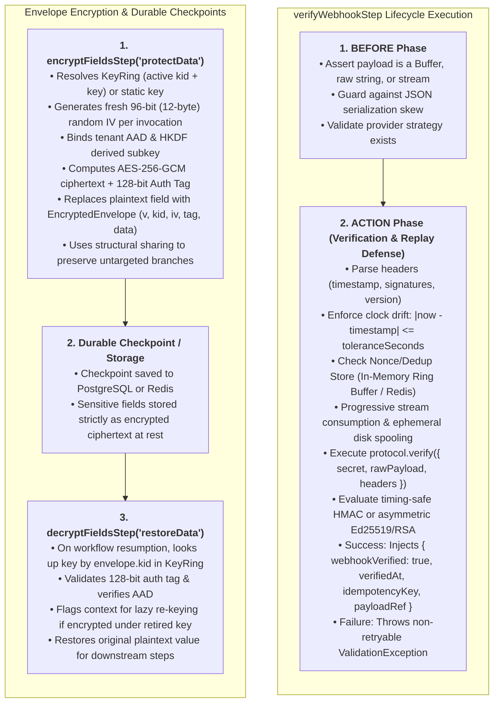
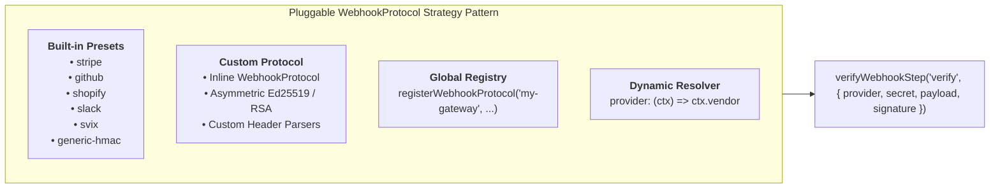
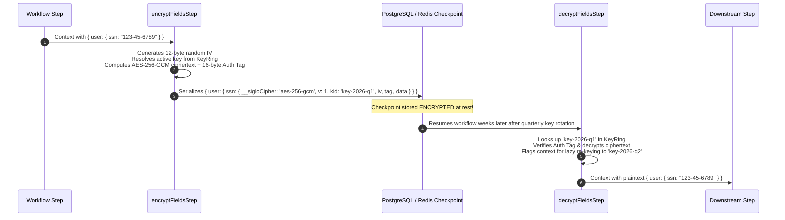

# @siglo/crypto Security & Cryptography Guide

`@siglo/crypto` provides zero-dependency, enterprise-grade security primitives for `Siglo` workflows. Built directly on native Node.js `node:crypto` and standard Web Crypto APIs, it introduces timing-attack safe webhook signature verification, intra-window replay attack defense, pluggable cryptographic protocols (symmetric HMAC, asymmetric Ed25519, and RSA), AEAD envelope field encryption (`aes-256-gcm`) across durable checkpoints, multi-key `KeyRing` rotation, Additional Authenticated Data (AAD) multi-tenant isolation, ephemeral HKDF subkeys, streaming HMAC calculation with disk spooling, and declarative PII context redaction with structural sharing.

---

## 1. Executive Summary & Problem Space

Enterprise workflows ingest untrusted external events (webhooks) and process highly sensitive business assets (payment credentials, PII, healthcare records, API secrets). Implementing cryptographic operations manually inside workflow steps introduces severe security vulnerabilities:

| Vulnerability in Ad-Hoc Code | Real-World Attack / Impact | How `@siglo/crypto` Solves It |
|---|---|---|
| **String Comparison (`===`)** | Vulnerable to **Side-Channel Timing Attacks**, allowing attackers to brute-force valid HMAC signatures byte-by-byte. | Uses `crypto.timingSafeEqual` with strict buffer length checks in [`timingSafeCompare()`](#41-constant-time-comparison-timingsafecompare) to eliminate timing leaks. |
| **Missing Timestamp Checks** | Enables **Replay Attacks**: attackers re-transmit previously intercepted valid webhook requests hours or days later. | Automatically parses header timestamps (e.g. `t=...`) and enforces configurable clock drift tolerances (`toleranceSeconds: 300`). |
| **Intra-Window Replay Storms** | Intercepted webhooks re-transmitted within the 5-minute tolerance window duplicate charges or state transitions. | Integrated **`WebhookDedupStore`** with in-memory bucketed ring buffers (`InMemoryNonceStore`) and distributed Redis locks (`RedisNonceStore`). |
| **JSON Serialization Skew** | Verifying signatures over `JSON.stringify(req.body)` fails due to key reordering, spacing differences, or number formatting. | Guarantees verification strictly over the original raw `Buffer`, unparsed payload string, or streaming chunks in the `BEFORE` phase. |
| **Memory DoS from Large Payloads** | 50MB–200MB webhooks cause heap exhaustion (OOM) when buffered in memory. | Progressive stream ingestion with `maxBodyBytes` guard and disk spooling (`payloadRef`). |
| **Rigid Hardcoded Protocols** | Traditional libraries hardcode Stripe or GitHub, failing on modern protocols (Svix, Slack, Shopify, or asymmetric Ed25519 signatures). | Pluggable **`WebhookProtocol` Strategy Pattern** supporting presets, inline custom protocols, asymmetric cryptography, and dynamic runtime resolution. |
| **Plaintext Checkpoint Leaks** | Siglo serializes accumulated context to PostgreSQL or Redis checkpoints. Storing raw SSNs or card tokens violates GDPR, HIPAA, and PCI-DSS. | In-place **Envelope Encryption** (AES-256-GCM) secures sensitive context keys before storage write operations. |
| **Key Rotation Checkpoint Failures** | Long-running workflows pausing across quarterly key rotations fail to decrypt older checkpoints. | Multi-key **`KeyRing`** architecture with `kid` envelope headers, historical key resolution, and lazy checkpoint re-keying. |
| **Shared Key / Multi-Tenant Collisions** | Using static keys across tenants risks IV collisions and cross-tenant ciphertext swapping. | Context-derived **HKDF subkeys** and **Additional Authenticated Data (AAD)** binding tenant identity into the GCM auth tag. |
| **Telemetry & Log Leaks** | Live DevTools, OpenTelemetry spans, and console logs record raw step inputs and outputs, exposing secrets in APM dashboards. | Declarative **Context Redaction & Masking** (`maskFieldsStep`) with dot-notation wildcard paths and immutable structural sharing. |

---

## 2. Architecture & Step Lifecycle Integration

`@siglo/crypto` relies exclusively on native Node.js `node:crypto`, introducing **zero external npm dependencies**.



---

## 3. Installation

Install `@siglo/crypto` alongside `@siglo/core`:

```bash
npm install @siglo/core @siglo/crypto
```

Peer dependencies:
- `@siglo/core`: `^1.0.0`
- Node.js: `>= 18.0.0` (native `node:crypto`)

---

## 4. Webhook Security (`verifyWebhookStep`)

### 4.1 Constant-Time Comparison (`timingSafeCompare`)

Standard JavaScript string equality operators (`===` or `==`) return early as soon as the first non-matching byte is encountered. Attackers measuring sub-microsecond network latencies can deduce the signature byte-by-byte.

`@siglo/crypto` eliminates timing leaks by using `crypto.timingSafeEqual` preceded by constant-time length verification:

```typescript
import { timingSafeCompare } from '@siglo/crypto';

// Compares identical length buffers or encoded strings in constant time
const isValid = timingSafeCompare(computedSignature, providedSignature, 'hex');
```

Guards:
- Returns `false` immediately if buffer lengths differ (preventing buffer overflow exceptions).
- Returns `false` on empty strings or buffers.
- Gracefully handles invalid encodings without crashing the process.

### 4.2 Replay Attack Defense & Intra-Window Deduplication

Replay attacks occur when an unauthorized actor intercepts a valid webhook request and resends it to the workflow endpoint.

`verifyWebhookStep` enforces two layers of replay protection:
1. **Timestamp Drift Tolerance (`toleranceSeconds`)**:
   - Rejects events where `|currentTime - webhookTimestamp| > toleranceSeconds` (default: 300 seconds / 5 minutes).
2. **Intra-Window Nonce Deduplication (`dedupStore`)**:
   - Prevents an attacker from replaying an intercepted request 500 times *within* the 300-second window.
   - Computes a deterministic SHA-256 delivery hash: `sha256(provider + timestamp + signatureHeader)`.
   - Atomically claims the key with a TTL matching `toleranceSeconds`. If already claimed, throws a non-retryable `ValidationException`.

```typescript
import { verifyWebhookStep, InMemoryNonceStore } from '@siglo/crypto';
import { RedisNonceStore } from '@siglo/redis';

// Option A: High-performance single-process in-memory bucketed ring buffer
const inMemoryDedup = new InMemoryNonceStore(60); // 60s bucket intervals

// Option B: Multi-replica distributed Redis store (SET ... PX ... NX)
const redisDedup = new RedisNonceStore({ client: redisClient });

export const verifyStripe = verifyWebhookStep('verifyStripe', {
  provider: 'stripe',
  secret: process.env.STRIPE_WEBHOOK_SECRET!,
  payload: (ctx) => ctx.rawBody,
  signature: (ctx) => ctx.headers['stripe-signature'],
  toleranceSeconds: 300,
  dedupStore: redisDedup // Intra-window replay protection
});
```

### 4.3 Streaming Payloads & Ephemeral Disk Spooling

When ingesting large webhooks (e.g. 50MB–200MB multi-part files or bulk syncs), buffering contiguous payloads in memory causes Node.js heap exhaustion (OOM).

`verifyWebhookStep` natively supports streams and async iterables with memory guardrails:
- **Disk Spooling Protection**: Large streams are spooled to temporary files under `os.tmpdir()` to prevent heap memory exhaustion during receipt. Note that protocol verification subsequently reads the spooled file into memory as a `Buffer` before HMAC calculation rather than performing a bounded-memory streaming HMAC.
- **Payload Size Limits (`maxBodyBytes`)**: Rejects oversized payloads exceeding limits (default: 10MB) by throwing a non-retryable `ValidationException` (which web adapters map to HTTP 400 Bad Request by default).
- **Disk Spooling (`spoolThresholdBytes`)**: Streams exceeding the threshold (default: 5MB) are automatically spooled to temporary disk storage. The step outputs a compact `{ payloadRef: { storage: 'file', path: '...', bytes: ... } }` reference, keeping durable database checkpoints small and fast.

```typescript
import { verifyWebhookStep } from '@siglo/crypto';

export const verifyLargeWebhook = verifyWebhookStep('verifyStream', {
  provider: 'generic-hmac',
  secret: process.env.WEBHOOK_SECRET!,
  payload: (ctx) => ctx.reqStream, // Node.js Readable stream or AsyncIterable<Buffer>
  signature: (ctx) => ctx.headers['x-signature'],
  maxBodyBytes: 50 * 1024 * 1024,      // 50MB maximum ceiling
  spoolThresholdBytes: 5 * 1024 * 1024 // Spool to disk if > 5MB
});
```

### 4.4 Pluggable Protocol Architecture

Real-world enterprise systems ingest webhooks from dozens of vendors with fundamentally different headers, signature hashing schemes, and payload formats:



#### Supported Built-in Presets

| Provider Preset | Signature Header | Signed Payload Format | Default Algorithm | Key Features |
|---|---|---|---|---|
| `'stripe'` | `stripe-signature` | `${timestamp}.${rawBody}` | HMAC-SHA256 (hex) | Parses `t=...,v1=...`; supports key rotation (multiple `v1=` signatures). |
| `'github'` | `x-hub-signature-256`, `x-hub-signature` | `${rawBody}` | HMAC-SHA256 / HMAC-SHA1 (hex) | Automatically handles `sha256=` or legacy `sha1=` prefixes. |
| `'shopify'` | `x-shopify-hmac-sha256` | `${rawBody}` | HMAC-SHA256 (base64) | Verifies base64-encoded HMAC-SHA256 digest. |
| `'slack'` | `x-slack-signature` | `v0:${timestamp}:${rawBody}` | HMAC-SHA256 (hex) | Reads `x-slack-request-timestamp`; verifies `v0=${hash}`. |
| `'svix'` | `svix-signature`, `webhook-signature` | `${svixId}.${timestamp}.${rawBody}` | HMAC-SHA256 / Ed25519 (base64) | Standard Webhooks; supports `whsec_` secrets and asymmetric Ed25519 keys. |
| `'generic-hmac'` | `signature`, `x-signature` | `${timestamp}.${rawBody}` or `${rawBody}` | HMAC-SHA256 / SHA512 / SHA1 | Configurable algorithm (`algorithm: 'sha512'`) and auto-detects hex vs base64. |

### 4.5 Custom & Asymmetric Webhook Protocols

For a runnable Ed25519 request-authentication example with Express, key lookup, body digests, and nonce protection, see [Accept Asymmetrically Signed Orders](/signed-order-intake).

Supply an inline protocol object implementing the `WebhookProtocol` interface:

```typescript
import { WebhookProtocol, verifyWebhookStep } from '@siglo/crypto';
import crypto from 'node:crypto';

export const customTokenProtocol: WebhookProtocol = {
  name: 'custom-internal-gateway',
  
  parseHeaders(headers, signatureHeader) {
    return {
      timestamp: Number(headers['x-timestamp']),
      signatures: [signatureHeader]
    };
  },

  verify({ secret, rawPayload, signatureHeader }) {
    const expected = crypto.createHmac('sha256', secret).update(rawPayload).digest('hex');
    return crypto.timingSafeEqual(Buffer.from(signatureHeader), Buffer.from(expected));
  }
};
```

---

## 5. Envelope Field Encryption (`encryptFieldsStep` & `decryptFieldsStep`)

Siglo serializes accumulated workflow state to persistent storage (PostgreSQL, Redis) whenever execution pauses (e.g. `waitForEvent()`). Storing raw SSNs, card numbers, or API tokens violates GDPR and PCI-DSS compliance.

`@siglo/crypto` provides transparent, in-place **Envelope Encryption** using `AES-256-GCM`:



### 5.1 Encrypted Envelope Structure

Target fields are replaced in-place with an `EncryptedEnvelope` object:

```typescript
export interface EncryptedEnvelope {
  __sigloCipher: 'aes-256-gcm';
  v?: number;          // Envelope schema version (default: 1)
  kid?: string;        // Active Key ID at encryption time
  iv: string;          // Hex-encoded 96-bit (12-byte) Initialization Vector
  tag: string;         // Hex-encoded 128-bit (16-byte) Authentication Tag
  data: string;        // Hex-encoded ciphertext
  edek?: string;       // Optional base64 wrapped DEK for cloud KMS
  kekId?: string;      // Optional KMS Key ARN / Identifier
}
```

### 5.2 Key Rotation & Checkpoint Archaeology (`KeyRing`)

In long-running durable workflows (e.g. `waitForEvent('LEGAL_APPROVAL', { timeout: '90d' })`), checkpoints encrypted on Day 1 will be resumed after quarterly key rotation.

`StaticKeyRing` enables multi-key rotation without failing checkpoint resurrection:
- **Active Key**: Used for encrypting all new fields.
- **Historical Keys**: Preserved in the ring for decrypting older envelopes identified by `envelope.kid`.
- **Lazy Re-Keying**: Detects when an envelope was encrypted under an older key, invoking `onNeedsRekey` or marking `$needsRekey = true` to allow in-flight re-encryption under the active key before the next checkpoint save.

```typescript
import { StaticKeyRing, encryptFieldsStep, decryptFieldsStep } from '@siglo/crypto';

// Initialize KeyRing with active key and historical rotation keys
const keyRing = new StaticKeyRing('key-2026-q2', {
  'key-2026-q1': process.env.KEY_2026_Q1!, // Historical retirement key
  'key-2026-q2': process.env.KEY_2026_Q2!  // Current active encryption key
});

export const encryptStep = encryptFieldsStep('protectData', {
  fields: ['user.ssn'],
  keyRing
});

export const decryptStep = decryptFieldsStep('restoreData', {
  fields: ['user.ssn'],
  keyRing,
  onNeedsRekey: (ctx, field, oldKid, activeKid) => {
    console.log(`Field ${field} encrypted with ${oldKid} needs re-keying to ${activeKid}`);
  }
});
```

### 5.3 Cryptographic Hardening, AAD & HKDF Key Derivation

1. **Context-Bound Ephemeral Subkeys (HKDF)**:
   Avoid encrypting millions of records under a static master key. `@siglo/crypto` supports RFC 5869 HKDF derivation:
   ```typescript
   encryptFieldsStep('protectStep', {
     fields: ['taxId'],
     secretKey: process.env.MASTER_KEY!,
     deriveKeyContext: (ctx) => `workflow:${ctx.workflowId}` // Ephemeral subkey per workflow run
   });
   ```
2. **Additional Authenticated Data (AAD)**:
   Binds tenant identity into the AES-GCM authentication tag. If ciphertext is swapped across tenant boundaries, decryption immediately throws an authentication tag failure:
   ```typescript
   encryptFieldsStep('protectTenantData', {
     fields: ['billing.card.number'],
     secretKey: process.env.MASTER_KEY!,
     aad: (ctx) => `tenant:${ctx.tenantId}` // Cryptographically binds ciphertext to tenant
   });
   ```
3. **NIST SP 800-38D Usage Ceiling**: Tracks key invocations and warns when a static key crosses $2^{24}$ ($16,777,216$) invocations.

---

## 6. Deep Path Redaction & Structural Sharing (`maskFieldsStep`)

`maskFieldsStep` declaratively sanitizes sensitive fields before telemetry emission to Siglo DevTools (`@siglo/monitor`) and OpenTelemetry dashboards.

### 6.1 Dot-Notation Paths & Array Wildcards

Target deeply nested object properties and array collections directly:

```typescript
import { maskFieldsStep, maskPatterns } from '@siglo/crypto';

export const sanitizeStep = maskFieldsStep('sanitizeForDevTools', {
  fields: [
    'user.billing.taxId',             // Nested object path
    'passengers.*.passportNumber',    // Array wildcard
    'orders.*.payment.cardToken'      // Deep nested wildcard
  ],
  maskPattern: maskPatterns.last4
});
```

### 6.2 Immutable Structural Sharing (Copy-on-Write)

Unlike shallow object copying (`{ ...ctx }`), `@siglo/crypto` uses structural sharing path traversal:
- Clones **only** ancestor objects along the modified path ($O(d)$ wrappers where $d$ is path depth).
- Untargeted sibling subtrees (`ctx.user.profile`, `ctx.unrelated`) retain exact referential identity (`===`).
- Prevents accidental shared-reference mutation and race conditions across parallel combinator branches.
- Includes `deepFreeze(obj)` helper for development mode immutability assertions.

---

## 7. TypeScript API Reference

```typescript
import { Step } from '@siglo/core';

// Webhook Verification Step
export function verifyWebhookStep<const TName extends string, TInput>(
  name: TName,
  options: WebhookVerifyOptions<TInput>
): WebhookVerifyStep<TInput, TName>;

// AES-256-GCM Envelope Encryption Step
export function encryptFieldsStep<const TName extends string, TInput>(
  name: TName,
  options: FieldCipherOptions<TInput>
): EncryptFieldsStep<TInput, TName>;

// AES-256-GCM Envelope Decryption Step
export function decryptFieldsStep<const TName extends string, TInput>(
  name: TName,
  options: FieldCipherOptions<TInput>
): DecryptFieldsStep<TInput, TName>;

// Context Redaction Step
export function maskFieldsStep<const TName extends string, TInput>(
  name: TName,
  options: MaskFieldsOptions<TInput>
): MaskFieldsStep<TInput, TName>;

// KeyRing and Utilities
export class StaticKeyRing implements KeyRing { ... }
export class InMemoryNonceStore implements WebhookDedupStore { ... }
export function deriveSubkey(masterKey: string | Buffer, contextInfo: string | Buffer): Buffer;
export function timingSafeCompare(a: string | Buffer, b: string | Buffer, encoding?: 'hex' | 'base64'): boolean;
export function deepFreeze<T>(obj: T): T;
```
