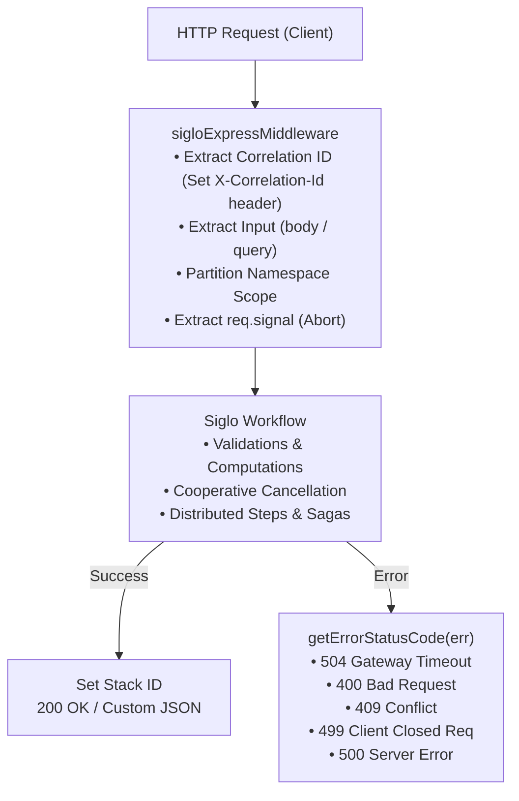

# @siglo/express Adapter Guide

`@siglo/express` provides an Express middleware adapter for executing `Siglo` workflows within traditional Node.js web applications. It automates HTTP request extraction, correlation identifier propagation, cooperative cancellation, timeout enforcement, and semantic error-to-HTTP status code mapping.

---

## 1. Overview & Architecture

The Express adapter acts as a route-level or path-level middleware:



---

## 2. Installation & Requirements

Install `@siglo/express` and `Siglo`:

```bash
npm install @siglo/core @siglo/express express
npm install --save-dev @types/express
```

Peer dependency matrix:
- `Siglo`: `*` (v1.0.0+)
- `express`: `^4.18.0 || ^5.0.0`

---

## 3. API Reference

### `sigloExpressMiddleware(workflow, options)`

Returns a standard Express middleware function `(req, res, next) => Promise<any>`.

```typescript
function sigloExpressMiddleware<TInput = any, TOutput = any, TReq = any>(
    workflow: Flow<TInput, TOutput>,
    options?: SigloExpressOptions<TReq, TInput, TOutput>
): (req: any, res: any, next: (err?: any) => void) => Promise<any>;
```

---

## 4. Configuration Options (`SigloExpressOptions`)

| Option | Type | Default | Description |
| :--- | :--- | :--- | :--- |
| `input` | `(req: TReq) => Promise<TInput> \| TInput` | `req.body \|\| req.query` | Custom mapping function from `Request` to workflow input parameters. |
| `output` | `(result: TOutput, res: Response) => Promise<any> \| any` | `res.json(result)` | Custom responder to set custom status codes, headers, or response shapes. |
| `timeout` | `number` | `undefined` | Execution timeout in milliseconds. Throws `StepTimeoutException` / `FlowTimeoutException` if exceeded. |
| `namespace` | `string \| ((req: TReq) => string \| undefined)` | `undefined` | Namespace string or extractor function for tenant data partitioning. |
| `allowHeaderNamespace` | `boolean` | `false` | When true, permits extracting tenant namespace from incoming `x-namespace` headers. Keep disabled when client requests are untrusted. |
| `exposeErrorDetails` | `boolean` | `process.env.NODE_ENV !== 'production'` | Controls whether 500 error messages expose internal details. In production, a generic `'Internal workflow execution error'` is returned. |
| `onError` | `(err: any, req: TReq, res: any, next: NextFunction) => any` | Default JSON handler | Custom error responder. If omitted, maps status codes and returns sanitized `{ error: message }`. |
| `correlationIdHeader` | `string` | `'x-correlation-id'` | Header name to inspect for incoming correlation IDs. |

---

## 5. Built-in Headers & Tracing

The middleware automatically enriches HTTP headers:

- **`X-Correlation-Id`**: Inspects incoming request headers (matching `correlationIdHeader` or `x-request-id`). If present, the value is mirrored in the outgoing response header `X-Correlation-Id`.
- **`X-Workflow-Stack-Id`**: Upon workflow completion, injects the unique execution stack ID into the response headers. Useful for log correlation and customer support triage.

---

## 6. HTTP Error Status Code Mapping

When an unhandled exception is thrown inside a workflow, the adapter's `getErrorStatusCode(err)` inspects the error hierarchy and sets appropriate HTTP status codes:

| Error Name / Type | HTTP Status Code | Description |
| :--- | :--- | :--- |
| `StepTimeoutException` / `FlowTimeoutException` | `504 Gateway Timeout` | Step or workflow timeout SLA was exceeded. |
| `ValidationException` / `SpecFailedException` | `400 Bad Request` | Input schema, parameter, or contract validation failed. |
| `IdempotencyConflictException` | `409 Conflict` | Concurrent claim detected on an in-progress idempotency key. |
| `CancellationException` / `AbortError` | `499 Client Closed Request` | Client terminated connection or request was cancelled. |
| `CompensationException` / Generic `Error` | `500 Internal Server Error` | Unexpected runtime error or failed saga compensation. |

---

## 7. Cooperative Request Cancellation

When a client closes an HTTP connection early (e.g. user closes browser or upstream proxy aborts), Express exposes `req.signal` (in Express 5) or `req.raw?.signal`.

`@siglo/express` passes this abort signal directly to the workflow engine (`ExecutionOptions.signal`). Steps inside your workflow can listen to this signal via `param.$signal?.()`:

```typescript
const fetchExternalInventory = Step.create(async (param) => {
    const signal = param.$signal?.(); // AbortSignal combined from HTTP request & step timeout
    const res = await fetch('https://inventory.internal/check', { signal });
    return await res.json();
});
```

If the client terminates the connection while the fetch is pending, the HTTP request is cancelled immediately, freeing server sockets.

---

## 8. Complete Production Example

```typescript
import express, { Request, Response } from 'express';
import { Step, flow } from '@siglo/core';
import { sigloExpressMiddleware } from '@siglo/express';

const app = express();
app.use(express.json());

// 1. Define Domain Steps
interface CheckoutInput {
    cartId: string;
    userId: string;
    currency: string;
}

const validateCart = Step.create('validateCart', async (input: CheckoutInput) => {
    if (!input.cartId) {
        const err = new Error('Field cartId is required');
        err.name = 'ValidationException';
        throw err;
    }
    return { validated: true, subtotal: 150 };
});

const chargeCustomer = Step.create('chargeCustomer', async (param: any) => {
    // Perform payment processing
    return { transactionId: `txn_${Date.now()}`, charged: true };
});

const createOrderRecord = Step.create('createOrderRecord', async (param: any) => {
    return { orderId: `ord_${Date.now()}`, status: 'PLACED' };
});

const checkoutFlow = flow(validateCart, chargeCustomer, createOrderRecord);

// 2. Mount Siglo Route
app.post(
    '/api/v1/checkout',
    sigloExpressMiddleware(checkoutFlow, {
        timeout: 10000, // 10s execution SLA
        correlationIdHeader: 'x-request-id',
        input: (req: Request) => ({
            cartId: req.body.cartId,
            userId: req.body.userId,
            currency: req.body.currency || 'USD',
        }),
        output: (result, res: Response) => {
            return res.status(201).json({
                success: true,
                orderId: result.orderId,
                transactionId: result.transactionId,
                status: result.status,
            });
        },
        onError: (err, req, res, next) => {
            if (err.name === 'ValidationException') {
                return res.status(400).json({ error: err.message, code: 'INVALID_INPUT' });
            }
            if (err.name === 'StepTimeoutException') {
                return res.status(504).json({ error: 'Checkout SLA timed out', code: 'TIMEOUT' });
            }
            return res.status(500).json({ error: 'Internal order failure', detail: err.message });
        },
    })
);

app.listen(3000, () => {
    console.log('Checkout service running on http://localhost:3000');
});
```
