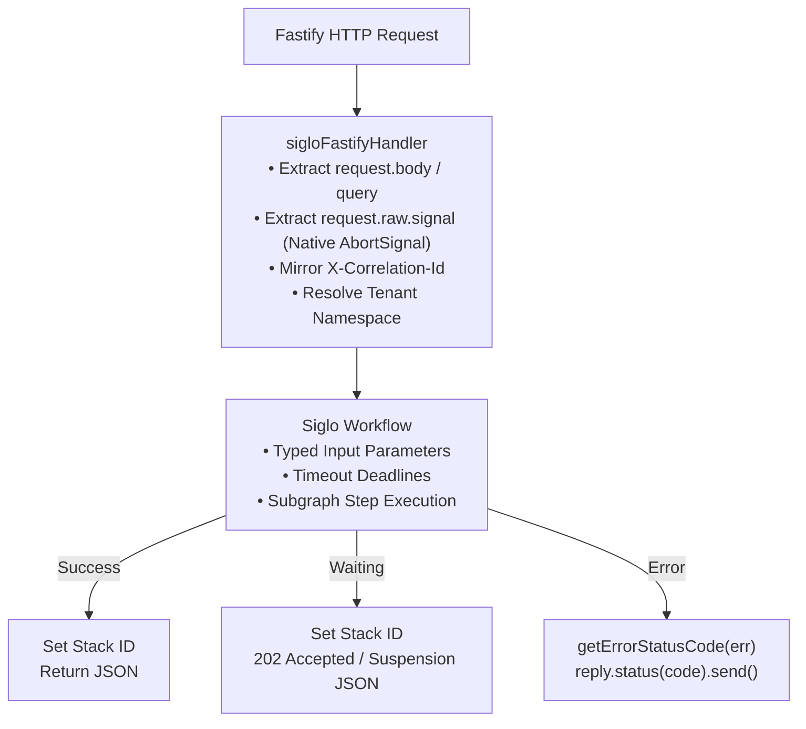

# @siglo/fastify Adapter Guide

`@siglo/fastify` provides an idiomatic Fastify route handler adapter for executing `Siglo` workflows. It is optimized for high-throughput, low-overhead microservices, taking advantage of Fastify's asynchronous request lifecycle, schema validation, and raw Node.js HTTP stream signals for cooperative cancellation.

---

## 1. Overview & Architecture

Fastify is designed for minimal overhead. The `@siglo/fastify` handler adapter integrates as a standard Fastify route handler:



---

## 2. Installation & Requirements

Install `@siglo/fastify` alongside Fastify:

```bash
npm install @siglo/core @siglo/fastify fastify
```

Peer dependency matrix:
- `Siglo`: `*` (v1.0.0+)
- `fastify`: `^4.0.0 || ^5.0.0`

---

## 3. API Reference

### `sigloFastifyHandler(workflow, options)`

Creates a Fastify route handler `(request, reply) => Promise<any>`:

```typescript
function sigloFastifyHandler<TInput = any, TOutput = any, TReq = any>(
    workflow: Flow<TInput, TOutput>,
    options?: SigloFastifyOptions<TReq, TInput, TOutput>
): (request: any, reply: any) => Promise<any>;
```

---

## 4. Configuration Options (`SigloFastifyOptions`)

| Option | Type | Default | Description |
| :--- | :--- | :--- | :--- |
| `input` | `(req: TReq) => Promise<TInput> \| TInput` | `request.body \|\| request.query` | Function transforming incoming Fastify request into workflow parameters. |
| `output` | `(result: TOutput, reply: FastifyReply) => Promise<any> \| any` | `result` | Function formatting the final response. If omitted, Fastify serializes the clean result. |
| `timeout` | `number` | `undefined` | Execution timeout in milliseconds. |
| `durable` | `boolean \| ((req: TReq) => boolean)` | `undefined` | Enables durable suspension, either for every request or through a request-specific resolver. |
| `namespace` | `string \| ((req: TReq) => string \| undefined)` | `undefined` | Namespace identifier or extractor function for tenant partitioning. |
| `allowHeaderNamespace` | `boolean` | `false` | When true, permits extracting tenant namespace from incoming `x-namespace` headers. Keep disabled when client requests are untrusted. |
| `exposeErrorDetails` | `boolean` | `process.env.NODE_ENV !== 'production'` | Controls whether 500 error messages expose internal details. In production, a generic `'Internal workflow execution error'` is returned. |
| `onError` | `(err: any, reply: FastifyReply) => Promise<any> \| any` | Default JSON error handler | Custom error responder. If omitted, maps status codes and returns sanitized `{ error: message }`. |
| `correlationIdHeader` | `string` | `'x-correlation-id'` | Header name for correlation propagation. |

Without a custom `output` callback, a workflow result with `status: 'waiting'` returns **202 Accepted** with the suspension descriptor as JSON. Completed workflows use the normal **200 OK** response. Suspension is a successful result and does not invoke `onError`. A custom `output` callback controls both the response body and status.

---

## 5. Status Code Resolution & Error Semantics

If a workflow throws an unhandled error and no `onError` hook is specified, the adapter automatically categorizes the error and formats the response:

| Error Name / Hierarchy | Status Code | HTTP Status |
| :--- | :--- | :--- |
| `StepTimeoutException` / `FlowTimeoutException` | `504` | Gateway Timeout |
| `ValidationException` / `SpecFailedException` | `400` | Bad Request |
| `IdempotencyConflictException` | `409` | Conflict |
| `CancellationException` / `AbortError` | `499` | Client Closed Request |
| Other `Error` instances | `500` | Internal Server Error (sanitized in production) |

*Default Error JSON Payload:*
```json
{
  "error": "Timeout occurred while executing step 'chargeCustomer'"
}
```

---

## 6. Native Request Abort & Cooperative Cancellation

Fastify exposes Node.js's native `request.raw.signal`. When an HTTP client aborts (e.g. closes connection or timeout occurs on the client proxy), Fastify emits an abort event on `request.raw.signal`.

The adapter extracts `request.raw.signal` and attaches it to the workflow's `ExecutionOptions`. Any workflow step calling external APIs can link their child operations:

```typescript
const queryExternalAPI = Step.create(async (param) => {
    const signal = param.$signal?.();
    const res = await fetch('https://api.upstream.io/data', { signal });
    return await res.json();
});
```

---

## 7. Complete Production Example

```typescript
import Fastify from 'fastify';
import { Step, flow } from '@siglo/core';
import { sigloFastifyHandler } from '@siglo/fastify';

const fastify = Fastify({
    logger: true,
});

// 1. Workflow Definition
interface KYCInput {
    customerId: string;
    ssn: string;
    country: string;
}

const verifyIdentity = Step.create('verifyIdentity', async (input: KYCInput) => {
    if (!input.customerId || !input.ssn) {
        const err = new Error('customerId and ssn are required');
        err.name = 'ValidationException';
        throw err;
    }
    return { verified: true, riskScore: 12 };
});

const runSanctionCheck = Step.create('runSanctionCheck', async (param: any) => {
    // Upstream sanctions database check
    return { sanctioned: false, clearanceId: `clear_${Date.now()}` };
});

const kycPipeline = flow(verifyIdentity, runSanctionCheck);

// 2. Fastify Route Schema + Handler Adapter
fastify.post(
    '/api/v1/kyc/verify',
    {
        schema: {
            body: {
                type: 'object',
                required: ['customerId', 'ssn'],
                properties: {
                    customerId: { type: 'string' },
                    ssn: { type: 'string' },
                    country: { type: 'string', default: 'US' },
                },
            },
        },
    },
    sigloFastifyHandler(kycPipeline, {
        timeout: 8000, // 8-second timeout SLA
        correlationIdHeader: 'x-request-id',
        namespace: (req) => req.headers['x-tenant-id'] as string,
        output: (result, reply) => {
            reply.status(200).send({
                success: true,
                clearanceId: result.clearanceId,
                verified: result.verified,
                riskScore: result.riskScore,
            });
        },
        onError: (err, reply) => {
            if (err.name === 'ValidationException') {
                return reply.status(400).send({ error: err.message, type: 'BAD_REQUEST' });
            }
            if (err.name === 'StepTimeoutException') {
                return reply.status(504).send({ error: 'KYC check timed out', type: 'TIMEOUT' });
            }
            reply.status(500).send({ error: 'KYC verification failed', detail: err.message });
        },
    })
);

// Start server
const start = async () => {
    try {
        await fastify.listen({ port: 3000, host: '0.0.0.0' });
    } catch (err) {
        fastify.log.error(err);
        process.exit(1);
    }
};

start();
```


---

## 8. Durable Workflows and Automatic HTTP Responses

Enable `durable: true` so `waitForEvent()` or `wait()` can suspend execution. The adapter automatically returns **202 Accepted** when the result has `status: 'waiting'`, including the suspension descriptor and `X-Workflow-Stack-Id` header. A workflow that completes uses **200 OK** by default.

```typescript
import Fastify from 'fastify';
import { Step, flow, waitForEvent, resumeWorkflow } from '@siglo/core';
import { sigloFastifyHandler } from '@siglo/fastify';

const app = Fastify();

const approvalWorkflow = flow(
    waitForEvent('order.approved', {
        correlationKey: (input: { orderId: string }) => `order:${input.orderId}`,
        timeout: '24h'
    }),
    Step.create('confirmOrder', () => ({ status: 'confirmed' }))
);

// POST JSON: { "orderId": "order-5001" }
// Returns 202 with status: 'waiting'; no output callback is required.
app.post('/api/orders', sigloFastifyHandler(approvalWorkflow, {
    durable: true,
    namespace: 'orders'
}));

// In a separate approval webhook handler, resume the existing execution:
// await resumeWorkflow(approvalWorkflow, 'order:order-5001', { approved: true });
```

The waiting JSON includes `status`, `stackId`, `stepId`, `correlationKey`, `eventName`, `expiresAt` (a Unix timestamp in milliseconds when a timeout is set), and `continuationStepIndex`. Suspension is a successful result, so it does not invoke `onError`. Calling the submission handler again starts a new execution; approval webhooks must call `resumeWorkflow()` to continue the suspended one.

For request-specific control, replace `durable: true` with `durable: (req) => req.headers['x-durable'] === 'true'`. Headers, query parameters, and JSON fields do not automatically enable durable mode in this adapter. Explicit `durable: false` disables suspension; wait nodes then use their non-durable behavior.

| Workflow outcome | Default HTTP response |
| :--- | :--- |
| Suspended at `waitForEvent()` or `wait()` | `202 Accepted` with the waiting descriptor |
| Completed | `200 OK` with the clean workflow result |
| Failed | Existing error-to-status mapping, or custom `onError` |

A custom `output` callback takes full control of the response body and status, including for waiting results. If you supply one, handle `result.status === 'waiting'` explicitly when you want to preserve the `202` response.

The HTTP adapter does not supply persistence. Configure a shared storage adapter that supports checkpoints and wait records to survive process restarts and resume across replicas. Timer waits also need a scheduler to resume them when due. See [Durable Workflows](../06-durable-workflows.md), [Storage and Adapters](../07-storage-and-adapters.md), and [the distributed checkout tutorial](../durable-distributed-checkout.md).
