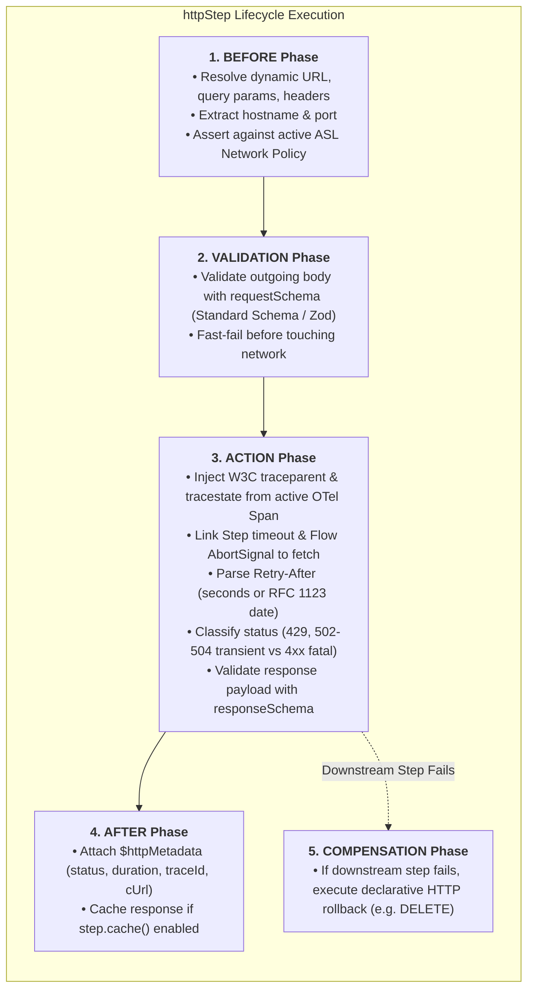

# @siglo/http Client Step Guide

`@siglo/http` provides resilient, enterprise-grade, W3C-traced HTTP client steps for `Siglo` workflows. It replaces fragile, ad-hoc `fetch()` and `axios()` calls inside workflow steps with coordinated retry backoff, first-class socket abort signal binding, AsyncLocalStorage (ASL) network egress perimeter enforcement, declarative saga compensations, and Standard Schema validation.

---

## 1. Overview & Architecture

In modern backend architectures, workflow steps frequently interact with third-party SaaS APIs, payment gateways, and microservices via HTTP/REST. Ad-hoc HTTP clients introduce systemic failure modes: conflicting retries that multiply thundering herds, unclosed TCP sockets that leak file descriptors on timeout, missing W3C trace context, and uncompensated mutations when downstream steps fail.

`@siglo/http` integrates directly into Siglo's 5-phase step lifecycle:



---

## 2. Key Capabilities & Technical Specifications

| Feature | Problem Solved | How `@siglo/http` Solves It |
|---|---|---|
| **Coordinated Retries** | Ad-hoc Axios retries conflict with Siglo's step retry policies, causing exponential request multiplication. | Coordinated status classification (`429`, `502`, `503`, `504`) with jittered backoff and `Retry-After` parsing. |
| **Dangling Sockets** | Native `fetch` keeps background TCP sockets open after a workflow timeout expires, leaking file descriptors. | First-class `AbortSignal` binding: Siglo step timeouts and workflow cancellations immediately destroy socket connections. |
| **Distributed Observability** | Outgoing HTTP calls lack W3C trace context, fragmenting OpenTelemetry spans across service boundaries. | Automatic injection of W3C `traceparent` and `tracestate` headers linked to the active OTel span. |
| **Egress Governance** | Vulnerable to SSRF, data exfiltration, or rogue API calls by untrusted dependencies. | Enforces Siglo's AsyncLocalStorage (ASL) network egress perimeter (`allowNetwork`) with host verification. |
| **Declarative Sagas** | If step 3 of a pipeline fails, previous POST requests (charges, bookings) remain uncompensated. | Declarative `.compensateWithHttp()` automatically registers compensating REST rollbacks (e.g. `DELETE` or refund `POST`). |
| **Type Safety & Contracts** | Unvalidated API responses cause runtime crashes deep in downstream steps. | Seamless Standard Schema (`zod`, `valibot`, `arktype`) parsing for both request and response payloads. |

---

## 3. Installation

Install `@siglo/http` alongside `siglo`:

```bash
npm install siglo @siglo/http
```

Peer dependencies:
- `siglo`: `^1.0.0`
- `@opentelemetry/api`: `^1.0.0` (optional, for distributed trace context propagation)

---

## 4. Deep Technical Capabilities

### 4.1 AsyncLocalStorage (ASL) Network Egress Perimeter

`@siglo/http` integrates natively with Siglo's least-privilege network egress security perimeter:

1. **Host Verification**: Before sending a single byte over the wire, `httpStep` extracts the target hostname and port from the URL (static or dynamically resolved from workflow context).
2. **Policy Assertion**: It verifies the host against active AsyncLocalStorage storage (`networkPolicyStorage.getStore()`):
   - If the host matches an authorized pattern (e.g. `api.stripe.com`, `*.internal.net`, or `localhost`), execution proceeds.
   - If unauthorized, it immediately throws `NetworkPolicyViolationException` with `{ phase: 'before', retryable: false }`.
3. **AST Graph Governance**: When static URLs are provided, `httpStep` registers the target host into the step's metadata (`step.allowNetwork([host])`), making egress dependencies visible in `toGraph()`, `inspectGraph()`, and Mermaid diagrams.

```typescript
import { flow } from 'siglo';
import { httpStep } from '@siglo/http';

const getExchangeRates = httpStep('getExchangeRates', {
  url: 'https://api.exchangerates.io/v1/latest',
  method: 'GET'
});

const workflow = flow(getExchangeRates)
  .allowNetwork(['api.exchangerates.io']); // Enforces egress perimeter
```

### 4.2 W3C Distributed Trace Context Propagation

When running within an instrumented workflow (`@siglo/opentelemetry`), `@siglo/http` maintains an unbroken trace across service boundaries:

- **Outgoing Headers**: Automatically injects W3C headers:
  - `traceparent`: `00-{traceId}-{spanId}-{traceFlags}`
  - `tracestate`: vendor routing state (if present).
- **Span Semantic Conventions**: Enriches the active span with standard HTTP attributes:
  - `http.request.method`: `POST`
  - `url.full`: `https://api.example.com/v1/resource`
  - `server.address`: `api.example.com`
  - `http.response.status_code`: `200`
- **Metadata Output**: Populates `$httpMetadata.traceId` on the step's return payload.

### 4.3 Status Code Classification & `Retry-After` Backoff

`@siglo/http` intelligently classifies HTTP response codes:

| HTTP Status | Category | Engine Behavior |
|---|---|---|
| `429 Too Many Requests` | **Transient (Rate Limited)** | Inspects `Retry-After` header (seconds or RFC 1123 HTTP date). Backs off before triggering retry. |
| `502 Bad Gateway`, `503 Service Unavailable`, `504 Gateway Timeout` | **Transient (Server Overload)** | Retries using exponential backoff with full decorrelated jitter up to `maxRetries`. |
| `ECONNRESET`, `ETIMEDOUT`, `EAI_AGAIN` | **Transient (Network Transport)** | Retries using exponential backoff up to `maxRetries`. |
| `400 Bad Request`, `422 Unprocessable` | **Fatal (Contract Mismatch)** | Fails fast with `ValidationException`. Never retried. |
| `401 Unauthorized`, `403 Forbidden` | **Fatal (Authentication Failure)** | Fails fast with `SigloError`. Never retried. |
| `404 Not Found` | **Fatal (Resource Missing)** | Fails fast with `SigloError` (unless `allowNotFound: true` is configured). |

#### `allowNotFound: true`
When fetching optional resources, setting `allowNotFound: true` prevents 404 from throwing an error. Instead, the step returns:
```typescript
{
  notFound: true,
  data: null,
  $httpMetadata: { status: 404, statusText: 'Not Found', ... }
}
```

### 4.4 Declarative Saga Compensation (`.compensateWithHttp`)

When an HTTP step creates an external state mutation (such as an authorized charge or hotel reservation), and a subsequent workflow step fails, Siglo's Saga engine rolls back state in reverse order (LIFO).

You can declare the rollback HTTP call inline via `compensate` or fluent `.compensateWithHttp()`:

```typescript
import { httpStep } from '@siglo/http';

export const reserveInventory = httpStep('reserveInventory', {
  url: 'https://inventory.service.internal/reservations',
  method: 'POST',
  body: (ctx) => ({ sku: ctx.sku, quantity: ctx.quantity }),
  // Registered in Siglo's CompensationManager
  compensate: {
    url: (ctx, res) => `https://inventory.service.internal/reservations/${res.reservationId}`,
    method: 'DELETE',
    headers: (ctx) => ({ 'X-Tenant-Id': ctx.tenantId })
  }
});
```

---

## 5. API Reference

### `httpStep(name, options)`

Creates an `HttpStep` instance conforming to `Step<TInput, HttpStepResult<TOutput>, TName>`.

```typescript
function httpStep<const TName extends string, TInput = any, TOutput = Record<string, any>>(
  name: TName,
  options: HttpStepOptions<TInput, TOutput>
): HttpStep<TInput, TOutput, TName>;
```

### `HttpStepOptions` Configuration

| Option | Type | Default | Description |
|---|---|---|---|
| `url` | `string \| ((ctx: TInput) => string)` | *Required* | Target URL or dynamic resolver function. |
| `method` | `'GET' \| 'POST' \| 'PUT' \| 'PATCH' \| 'DELETE' \| 'HEAD' \| 'OPTIONS'` | `'GET'` | HTTP request method. |
| `headers` | `Record<string, string> \| ((ctx: TInput) => Record<string, string>)` | `{}` | Static or dynamic request headers. |
| `query` | `Record<string, any> \| ((ctx: TInput) => Record<string, any>)` | `undefined` | Query string parameters appended to the URL. |
| `body` | `any \| ((ctx: TInput) => any)` | `undefined` | Request payload. Automatically JSON-serialized unless string or binary. |
| `requestSchema` | `StandardSchemaV1 \| ZodSchema \| Function` | `undefined` | Schema validating the outgoing request payload before dispatch. |
| `responseSchema` | `StandardSchemaV1 \| ZodSchema \| Function` | `undefined` | Schema validating and typing incoming response data. |
| `responseType` | `'json' \| 'text' \| 'blob' \| 'arrayBuffer'` | `'json'` | Response parser strategy. |
| `retryOnStatus` | `number[]` | `[429, 502, 503, 504]` | HTTP status codes that trigger retry with jitter. |
| `maxRetries` | `number` | `3` | Maximum retry attempts for transient errors. |
| `allowNotFound` | `boolean` | `false` | When true, 404 responses return `{ notFound: true, data: null }` instead of throwing. |
| `timeoutMs` | `number` | `undefined` | Socket timeout in milliseconds (aborts connection when elapsed). |
| `compensate` | `CompensationHttpConfig<TInput, TOutput>` | `undefined` | Inline saga rollback HTTP configuration. |

### `HttpMetadata` Telemetry

Every `httpStep` attaches telemetry accessible via `$httpMetadata` and `$steps.<stepName>.httpMetadata`:

```typescript
export interface HttpMetadata {
  status: number;          // e.g. 200
  statusText: string;      // e.g. 'OK'
  durationMs: number;      // Network round-trip duration in milliseconds
  url: string;             // Final resolved URL
  method: HttpMethod;      // e.g. 'POST'
  headers: Record<string, string>; // Normalized response headers
  traceId?: string;        // Active W3C trace ID if tracing is enabled
  retryAttempts: number;   // Number of retries performed (0 if succeeded first attempt)
  cUrl?: string;           // Formatted cURL command for debugging
}
```

---

## 6. Concrete Usage Examples

### Example 1: E-Commerce Payment with Refund Compensation & Zod Validation

```typescript
import { flow, Step } from 'siglo';
import { httpStep } from '@siglo/http';
import { z } from 'zod';

const StripeChargeResponse = z.object({
  id: z.string(),
  amount: z.number(),
  currency: z.string(),
  status: z.literal('succeeded')
});

interface OrderContext {
  orderId: string;
  customerId: string;
  amount: number;
  stripeApiKey: string;
}

export const chargeCard = httpStep('chargeCard', {
  url: 'https://api.stripe.com/v1/charges',
  method: 'POST',
  headers: (ctx: OrderContext) => ({
    Authorization: `Bearer ${ctx.stripeApiKey}`,
    'Content-Type': 'application/x-www-form-urlencoded'
  }),
  body: (ctx: OrderContext) => ({
    customer: ctx.customerId,
    amount: ctx.amount,
    currency: 'usd',
    'metadata[orderId]': ctx.orderId
  }),
  responseSchema: StripeChargeResponse,
  retryOnStatus: [429, 502, 503],
  maxRetries: 3,
  timeoutMs: 5000,
  // Automatic saga compensation: Refund if subsequent warehouse step fails
  compensate: {
    url: 'https://api.stripe.com/v1/refunds',
    method: 'POST',
    headers: (ctx: OrderContext) => ({
      Authorization: `Bearer ${ctx.stripeApiKey}`
    }),
    body: (_ctx, res) => ({
      charge: res.id,
      reason: 'requested_by_customer'
    })
  }
});

export const checkoutOrderWorkflow = flow(
  chargeCard,
  Step.create('allocateWarehouseInventory', async (ctx) => {
    // If inventory allocation throws, chargeCard.compensate automatically executes!
    throw new Error('SKU out of stock');
  })
);
```

### Example 2: Dynamic Routing Slip with ASL Egress Governance

```typescript
import { flow } from 'siglo';
import { httpStep } from '@siglo/http';

interface CloudMetadataContext {
  region: 'us-east-1' | 'eu-west-1' | 'ap-northeast-1';
  clusterId: string;
}

export const fetchClusterHealth = httpStep('fetchClusterHealth', {
  url: (ctx: CloudMetadataContext) => `https://${ctx.region}.k8s-control.internal/clusters/${ctx.clusterId}/health`,
  method: 'GET',
  headers: {
    'Accept': 'application/json'
  },
  timeoutMs: 2500
});

export const clusterHealthWorkflow = flow(fetchClusterHealth)
  // Lock down egress: only allow designated internal control planes
  .allowNetwork(['*.k8s-control.internal']);
```

---

## 7. Deterministic Testing with `@siglo/http/testing`

`@siglo/http/testing` provides `createMockHttpServer` to deterministically mock outgoing HTTP requests without starting external processes or opening live network sockets:

```typescript
import test from 'node:test';
import assert from 'node:assert/strict';
import { httpStep } from '@siglo/http';
import { createMockHttpServer } from '@siglo/http/testing';
import { flow } from 'siglo';

test('httpStep executes GET with mock server', async () => {
  const mockServer = createMockHttpServer('https://api.example.com');

  mockServer.intercept({
    path: '/users/42',
    method: 'GET',
    responseStatus: 200,
    responseBody: { id: '42', name: 'Ada Lovelace' }
  });

  const getUser = httpStep('getUser', {
    url: 'https://api.example.com/users/42',
    method: 'GET'
  });

  const workflow = flow(getUser);
  const result = await workflow.run({});

  assert.equal(result.id, '42');
  assert.equal(result.name, 'Ada Lovelace');
  assert.equal(result.$httpMetadata.status, 200);

  mockServer.assertDone();
  mockServer.close();
});
```

### Testing Rate Limiting with `FakeClock`

Test `429 Too Many Requests` responses with `Retry-After: 60` headers instantly using `clock` and `sleep` hooks:

```typescript
import { FakeClock } from '@siglo/testing';
import { httpStep } from '@siglo/http';
import { createMockHttpServer } from '@siglo/http/testing';

const clock = new FakeClock();
const mockServer = createMockHttpServer('https://api.example.com');

mockServer.intercept({
  path: '/rate-limited',
  method: 'GET',
  responseStatus: 429,
  responseHeaders: { 'retry-after': '60' }
});

mockServer.intercept({
  path: '/rate-limited',
  method: 'GET',
  responseStatus: 200,
  responseBody: { success: true }
});

const step = httpStep('rateLimitedCall', {
  url: 'https://api.example.com/rate-limited',
  method: 'GET',
  clock,
  sleep: async (ms) => clock.advanceTime(ms) // Instant simulated delay!
});
```
