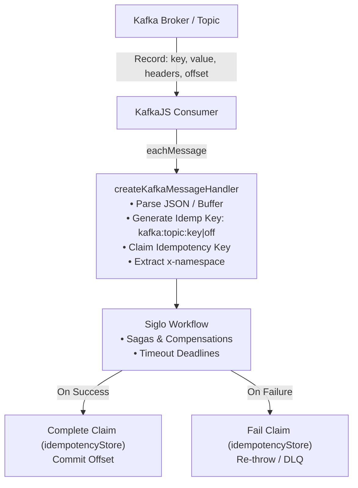
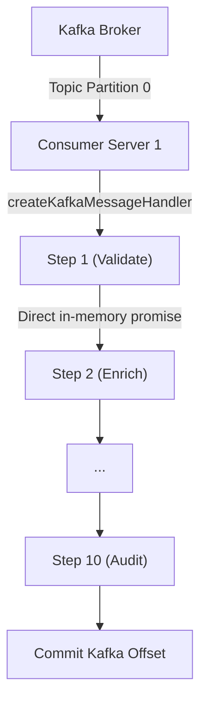
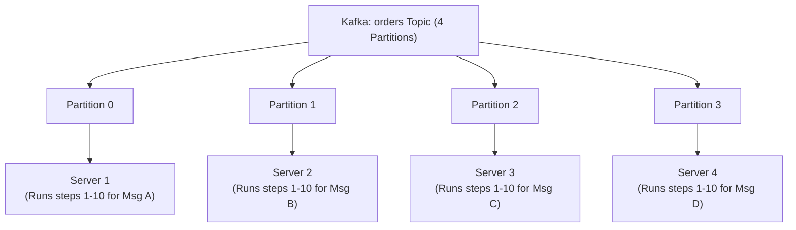
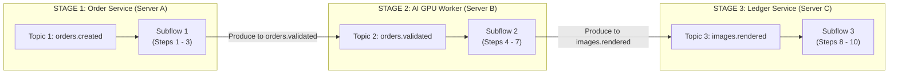

# @siglo/kafka Adapter Guide

`@siglo/kafka` provides an enterprise event streaming consumer adapter for executing `Siglo` workflows from Apache Kafka topics. It handles binary and JSON payload deserialization, partition offset tracking, distributed idempotency deduplication, header-based tenant namespace routing, and graceful error recovery.

---

## 1. Overview & Architecture

In an event-driven architecture, Kafka delivers partitioned event streams to consumer groups. The `@siglo/kafka` adapter handles incoming messages with at-least-once processing semantics, coordinates deduplication via an `IdempotencyStore`, and executes the workflow within configured timeout bounds.

> **Note on Guarantees**: Claims and cached results do not make external side-effects atomic with record completion. When a Kafka message is delivered, the whole workflow executes from the beginning; it does not automatically resume at the last successful step. A crash after an external effect (e.g. payment charge) succeeds but before claim completion leaves an in-progress claim until expiry, which may repeat the external effect upon message redelivery. Workflows must design external effects to be idempotent or supply provider-level deduplication keys.



---

## 2. Execution Model: In-Process vs. Distributed Step Execution

A common question in distributed event-driven systems is:

> **"If I have a 10-step workflow, will those 10 steps run across different consumer servers?"**

### Direct Answer: **No. By default, all 10 steps execute in-process on the single consumer server that pulled the Kafka message.**

`Siglo` is an **in-process orchestrator** rather than a multi-machine RPC scheduler (such as Temporal or AWS Step Functions).

When an instance of your consumer service pulls a Kafka record, the entire 10-step pipeline runs in-memory on that node:



### In-Process Execution Architectural Trade-offs

| Dimension | In-Process Orchestration (`Siglo`) | Distributed Step Orchestration |
| :--- | :--- | :--- |
| **Step-to-Step Invocation** | Direct in-memory async promise chaining. | Every step requires network RPC, queue write, and external coordination. |
| **Execution Boundary** | Runs full workflow in-process on consumer node. | Dispatches individual steps across cluster workers. |
| **Payload Handling** | Pass rich domain models, Buffers, Maps, or Streams directly in memory. | Payloads must be serialized to JSON across each step boundary. |
| **Infrastructure Overhead** | Runs directly inside your application container with no extra engine servers. | Requires external orchestrator clusters and database infrastructure. |
| **Debugging & Local Testing** | Standard debugger breakpoints stepping directly between steps. | Requires cross-machine distributed trace correlation and event replay. |
| **Saga Compensation** | Immediate in-process reverse rollback if downstream step fails. | Rollback messages queue behind other cluster tasks. |

#### 1. In-Process vs. Multi-Hop Step Orchestration
In systems that distribute every individual step to different servers across a network, each step boundary incurs serialization, broker scheduling, and network transfer overhead. In `Siglo`, Step 1 yields to Step 2 directly in memory with zero network latency.

#### 2. Horizontally Scaling via Partitions
Work is scaled horizontally by **Kafka Partitions (Message-Level Distribution)**, not by splitting individual steps across machines:



Each consumer server processes independent messages in parallel at full hardware capability with maximum CPU cache locality.

---

## 3. How to Distribute Steps Across Different Servers (When Needed)

Distributing individual steps across physically separate machines is only necessary in specific architectural scenarios:
1. **Heterogeneous Compute**: Steps 1–3 run on standard Node.js CPU instances, but Step 4 requires dedicated GPU worker nodes (e.g. AI model inference).
2. **Distinct Microservice Boundaries**: Steps 1–3 belong to the *Checkout Team*, while Steps 4–7 belong to the *Fulfillment Team*.
3. **Multi-Hour Uninterruptible Tasks**: Tasks taking hours where a crash cannot afford restarting from Step 1.

For these cases, implement **Event-Driven Choreography** using intermediate Kafka topics:



### Pattern Example: Chaining Workflows Across Topics

```typescript
// --- SERVICE A: Order Service (Runs Steps 1 to 3) ---
const step1 = Step.create('validate', async (order: any) => ({ valid: true, order }));
const step2 = Step.create('checkCredit', async (ctx: any) => ({ creditApproved: true }));
const step3_publish = Step.create('publishValidated', async (ctx: any) => {
    // Produce message to intermediate topic for Service B
    await kafkaProducer.send({
        topic: 'orders.validated',
        messages: [{ key: ctx.order.id, value: JSON.stringify(ctx) }],
    });
    return { published: true };
});

const stage1Flow = flow(step1, step2, step3_publish);
const stage1Handler = createKafkaMessageHandler(stage1Flow);


// --- SERVICE B: GPU Processing Service (Runs Steps 4 to 6) ---
const step4 = Step.create('generateAssets', async (ctx: any) => ({ assetUrl: 'https://...' }));
const step5 = Step.create('renderVideo', async (ctx: any) => ({ videoRendered: true }));
const step6_publish = Step.create('publishRendered', async (ctx: any) => {
    await kafkaProducer.send({
        topic: 'images.rendered',
        messages: [{ key: ctx.order.id, value: JSON.stringify(ctx) }],
    });
    return { dispatched: true };
});

const stage2Flow = flow(step4, step5, step6_publish);
const stage2Handler = createKafkaMessageHandler(stage2Flow);
```

---

## 4. Crash Recovery, Rebalances & Failure Semantics

What happens if Server 1 is executing **Step 6** of 10 and the process crashes?

1. **Uncommitted Offset**: The `@siglo/kafka` adapter only returns and acknowledges the Kafka record after the workflow completes. Because Step 6 failed or the process died, the offset is **never committed**.
2. **Kafka Partition Rebalance**: Kafka detects consumer heartbeat loss and reassigns that topic partition to another consumer (Server 2).
3. **Idempotency Protection**: Server 2 re-receives the message from the last committed offset. When it calls `createKafkaMessageHandler`, the configured `IdempotencyStore` (`@siglo/redis` or `@siglo/postgres`) ensures external payments or mutations aren't duplicated.
4. **Durable Resumption**: If durable execution was used with `@siglo/postgres`, state saved from prior checkpoints can be loaded via `restoreCheckpoint()`.

---

## 5. Installation & Requirements

Install `@siglo/kafka` and `kafkajs`:

```bash
npm install @siglo/core @siglo/kafka kafkajs
```

Peer dependency matrix:
- `Siglo`: `*` (v1.0.0+)
- `kafkajs`: `^2.0.0`

---

## 6. API Reference

### `createKafkaMessageHandler(workflow, options)`

Creates an asynchronous message consumer handler:

```typescript
function createKafkaMessageHandler<TInput = any, TOutput = any>(
    workflow: Flow<TInput, TOutput>,
    options?: SigloKafkaOptions<TInput, TOutput>
): (payload: { topic: string; partition: number; message: SigloKafkaMessage }) => Promise<any>;
```

### `SigloKafkaMessage` Interface

```typescript
export interface SigloKafkaMessage {
    key?: Buffer | string | null;
    value?: Buffer | string | null;
    partition: number;
    topic: string;
    offset: string;
    headers?: Record<string, Buffer | string | undefined>;
}
```

---

## 7. Configuration Options (`SigloKafkaOptions`)

| Option | Type | Default | Description |
| :--- | :--- | :--- | :--- |
| `input` | `(message: SigloKafkaMessage) => Promise<TInput> \| TInput` | JSON parser on `message.value` | Custom transformer converting Kafka record into workflow input. |
| `output` | `(result: any, message: SigloKafkaMessage) => Promise<TOutput> \| TOutput` | `result` | Custom post-processor formatting the workflow output. |
| `idempotencyStore` | `IdempotencyStore` | `undefined` | Distributed store (e.g., `RedisIdempotencyStore` or `PostgresIdempotencyStore`) to prevent duplicate processing. |
| `idempotencyTtlMs` | `number` | `undefined` | Time-to-live for idempotency claim lock. Passed through to store (Redis/Postgres default: 24h; InMemory has no default expiration unless specified). |
| `timeout` | `number` | `undefined` | SLA execution timeout in milliseconds. |
| `namespace` | `string \| ((message: SigloKafkaMessage) => string \| undefined)` | `message.headers['x-namespace']` | Namespace identifier for tenant partitioning. |

---

## 8. Idempotency Key Semantics

Kafka guarantees at-least-once message delivery under network failures or consumer rebalances. `@siglo/kafka` constructs an idempotency key using the message record's natural identity:

$$\text{idempKey} = \text{kafka}:\langle\text{topic}\rangle:\langle\text{key} \lor (\text{partition}:\text{offset})\rangle$$

- If `message.key` is defined (e.g., `user_8819`), the key is `kafka:orders:user_8819`.
- If `message.key` is null, the key falls back to partition and offset: `kafka:orders:2:104921`.

### Claim States:
1. `'completed'`: The message was already processed in a previous attempt. The adapter immediately returns the cached result without executing the workflow.
2. `'in-progress'`: Throws `Error('Kafka message ... is already being processed concurrently')`, preventing duplicate parallel writes.
3. `'claimed'`: Executes workflow. On completion, saves result; on error, calls `store.fail()` so subsequent retries are permitted.

---

## 9. Complete Production Consumer Example

```typescript
import { Kafka } from 'kafkajs';
import { Step, flow } from '@siglo/core';
import { createKafkaMessageHandler } from '@siglo/kafka';
import { PostgresIdempotencyStore } from '@siglo/postgres';
import { Pool } from 'pg';

// 1. Database & Idempotency Store
const pgPool = new Pool({ connectionString: process.env.DATABASE_URL });
const idempotencyStore = new PostgresIdempotencyStore({ client: pgPool });
await idempotencyStore.ensureTable();

// 2. Define Transaction Processing Workflow
interface PaymentEvent {
    paymentId: string;
    accountId: string;
    amount: number;
    currency: string;
}

const validateAccount = Step.create('validateAccount', async (param: PaymentEvent) => {
    console.log(`Checking account ${param.accountId} balance for payment ${param.paymentId}`);
    return { accountValid: true };
});

const debitAccount = Step.create('debitAccount', async (param: any) => {
    console.log(`Debiting ${param.amount} ${param.currency} from ${param.accountId}`);
    return { ledgerEntryId: `led_${Date.now()}`, debited: true };
});

const paymentPipeline = flow(validateAccount, debitAccount);

// 3. Setup Kafka Consumer
const kafka = new Kafka({
    clientId: 'payment-consumer-service',
    brokers: ['localhost:9092'],
});

const consumer = kafka.consumer({ groupId: 'payment-engine-group' });

const messageHandler = createKafkaMessageHandler(paymentPipeline, {
    idempotencyStore,
    idempotencyTtlMs: 3600000, // 1 hour claim lock
    timeout: 5000,             // 5s execution SLA
    namespace: (msg) => String(msg.headers?.['x-tenant-id'] || 'default'),
});

await consumer.connect();
await consumer.subscribe({ topic: 'payments.inbound', fromBeginning: false });

await consumer.run({
    eachMessage: async (payload) => {
        try {
            const result = await messageHandler(payload);
            console.log(`Processed payment message offset ${payload.message.offset}:`, result);
        } catch (err: any) {
            console.error(`Failed processing message at offset ${payload.message.offset}: ${err.message}`);
            // Depending on architecture: push to Dead Letter Queue (DLQ) or let consumer retry
            throw err;
        }
    },
});

// 4. Graceful Shutdown
process.on('SIGTERM', async () => {
    console.log('Disconnecting Kafka consumer...');
    await consumer.disconnect();
    await pgPool.end();
    process.exit(0);
});
```
