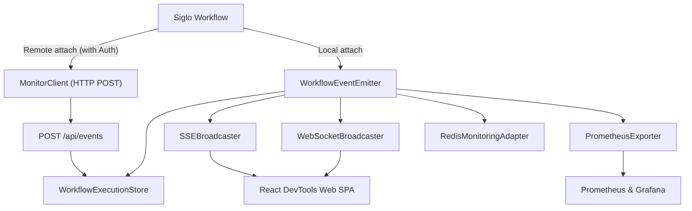

# @siglo/monitor Adapter & Live DevTools

`@siglo/monitor` provides real-time workflow telemetry, dynamic DAG topology visualization, execution latency waterfalls, state diff inspection, SSE/WebSocket transports, and Prometheus metrics for `Siglo` applications.

---

## 1. Installation

```bash
npm install @siglo/monitor @siglo/core
```

Optional developer CLI:
```bash
npm install --save-dev @siglo/cli
```

---

## 2. Architecture & Components



| Component | Responsibility |
|---|---|
| `createMonitorServer` | Standalone HTTP server serving the React Web UI, SSE, WebSockets, REST APIs, and `/metrics`. Supports `auth`, `cors`, `maxPayloadBytes`, `allowRemoteResume`, and `reuseExisting: true`. |
| `attachToMonitorServer` | Universal attachment hook for workflows. Auto-detects in-process server or connects remotely over HTTP (`POST /api/events`) with optional API key authentication. |
| `createMonitorClient` | High-throughput buffered HTTP client with queue bounds, token authentication, and auto-flush for streaming events from external processes or worker pools. |
| `getActiveMonitorServer` | Resolves the singleton in-process monitor server instance (by optional port). |
| `getMonitorEmitter` | Resolves the `WorkflowEventEmitter` of the active in-process monitor server. |
| `WorkflowExecutionStore` | In-memory store tracking active and completed workflow runs, step durations, and context diffs. |
| `SSEBroadcaster` | Native HTTP Server-Sent Events broadcaster with automated heartbeats and tenant isolation. |
| `WebSocketBroadcaster` | RFC 6455 bi-directional WebSocket server supporting client commands, authentication, and event resumption. |
| `RedisMonitoringAdapter` | Multi-worker pub/sub event broadcaster for distributed workflows across clusters. |
| `PrometheusExporter` | Exports workflow execution metrics in standard Prometheus exposition format (`/metrics`). |
| `createExpressMonitorMiddleware` | Express middleware mounting dashboard and SSE stream under a route prefix. |
| `fastifyMonitorPlugin` | Fastify plugin mounting DevTools and monitoring routes. |
| `honoMonitorMiddleware` | Hono middleware mounting dashboard and API endpoints. |

---

## 3. Quick Start: Standalone Dev Server

```typescript
import { Step, flow } from '@siglo/core';
import { createMonitorServer } from '@siglo/monitor';

// 1. Start live monitor server
const monitor = await createMonitorServer({ port: 4000 });
console.log(`Live DevTools: http://localhost:${monitor.port}`);

// 2. Define workflow
const step1 = Step.create('validate', async () => ({ valid: true }));
const step2 = Step.create('process', async () => ({ processed: true }));

const pipeline = flow(step1, step2)
    .monitor(monitor.emitter); // Attach monitor emitter

// 3. Execute
await pipeline.run({ orderId: '123' });
```

---

## 4. Attaching to an Existing / Running Server

### Scenario A: Remote Server with Authentication (Cross-Process or CLI)

Attach workflows to a monitor server already running in another terminal or remote cluster:

```typescript
import { Step, flow } from '@siglo/core';
import { attachToMonitorServer } from '@siglo/monitor';

const pipeline = flow(step1, step2)
    .monitor(attachToMonitorServer('https://monitor.corp.internal:4000', {
        apiKey: process.env.MONITOR_API_KEY
    }));
    // or local dev: .monitor(attachToMonitorServer(4000))

await pipeline.run({ orderId: '123' });
```

Events are dispatched asynchronously via non-blocking HTTP `POST /api/events` batches without impeding workflow execution. If the monitor server is unreachable, the client buffer protects host memory via `maxQueueSize` (default: 1000).

### Scenario B: In-Process Singleton (App Bootstrap)

When the monitor server is started once during application bootstrap:

```typescript
import { createMonitorServer, attachToMonitorServer } from '@siglo/monitor';
import { Step, flow } from '@siglo/core';

// In bootstrap file:
await createMonitorServer({
    port: 4000,
    reuseExisting: true // Safe to call multiple times without EADDRINUSE
});

// In any service file:
const pipeline = flow(step1, step2)
    .monitor(attachToMonitorServer()); // Automatically connects to active server
```

You can also access the server or emitter directly:

```typescript
import { getActiveMonitorServer, getMonitorEmitter } from '@siglo/monitor';

const server = getActiveMonitorServer();
const emitter = getMonitorEmitter();
```

### Scenario C: High-Throughput Buffered Worker Client

For serverless functions or worker pools pushing telemetry to a centralized monitor instance:

```typescript
import { createMonitorClient } from '@siglo/monitor';
import { flow } from '@siglo/core';

const client = createMonitorClient({
    url: 'https://monitor-internal:4000',
    apiKey: process.env.MONITOR_INGESTION_TOKEN,
    batchSize: 50,          // Batch up to 50 events
    flushIntervalMs: 100,   // Flush every 100ms
    maxQueueSize: 2000,     // Bounded memory buffer
    redaction: {
        redactKeys: ['password', 'secret', 'creditCard']
    }
});

const pipeline = flow(step1, step2).monitor(client.monitor);
await pipeline.run();

await client.close(); // Flushes remaining buffered events
```

---

## 5. Security & Production Hardening

When deploying `@siglo/monitor` across internal networks:

```typescript
import { createMonitorServer } from '@siglo/monitor';

const monitor = await createMonitorServer({
    port: 4000,
    // 1. Scoped Authentication Tokens
    auth: {
        ingestionKey: 'worker-token-xyz', // Authorizes POST /api/events
        adminKey: 'admin-token-abc'        // Authorizes /resume, /replay, /api/workflows
    },
    // 2. Disable Remote Resumption in Production
    allowRemoteResume: false, // 403 Forbidden on resume/replay
    // 3. Strict CORS Whitelisting
    cors: {
        origin: ['https://devtools.corp.internal', 'http://localhost:3000'],
        credentials: true
    },
    // 4. Ingestion Payload Size Cap
    maxPayloadBytes: 1024 * 1024 // 1 MB limit (413 on breach)
});
```

---

## 6. Web Framework Middlewares

Embed the live monitoring UI and endpoints directly into your existing HTTP application:

### Express
```typescript
import express from 'express';
import { createExpressMonitorMiddleware } from '@siglo/monitor';
import { WorkflowEventEmitter, Step } from '@siglo/core';

const app = express();
const emitter = new WorkflowEventEmitter();
const monitor = createExpressMonitorMiddleware({ emitter });

app.use('/_siglo', monitor);
Step.setDefaultMonitor(emitter);

app.listen(3000);
```

### Fastify
```typescript
import Fastify from 'fastify';
import { fastifyMonitorPlugin } from '@siglo/monitor';

const fastify = Fastify();
fastify.register(fastifyMonitorPlugin, { prefix: '/_siglo' });
fastify.listen({ port: 3000 });
```

### Hono
```typescript
import { Hono } from 'hono';
import { honoMonitorMiddleware } from '@siglo/monitor';

const app = new Hono();
app.use('/_siglo/*', honoMonitorMiddleware());
```

---

## 7. Distributed Redis Pub/Sub

For distributed worker clusters across multiple containers, separate publisher and subscriber wiring to avoid republishing received events:

```typescript
import { RedisMonitoringAdapter } from '@siglo/monitor';
import { defaultWorkflowEventEmitter } from '@siglo/core';

// In Worker: publishes events to Redis
const workerAdapter = new RedisMonitoringAdapter({
    publisher: redisClient,
    channel: 'siglo:monitor:events'
});
workerAdapter.attachToEmitter(defaultWorkflowEventEmitter);

// In Central Monitor Server: receives events from Redis into server's emitter
const serverAdapter = new RedisMonitoringAdapter({
    subscriber: redisSubClient,
    channel: 'siglo:monitor:events',
    emitter: monitorServer.emitter
});
```

---

## 8. Prometheus & Grafana

`@siglo/monitor` automatically exposes metrics at `GET /metrics`:
- `siglo_active_flows`: Current active workflow gauge
- `siglo_flow_executions_total{status="..."}`: Total workflow counter
- `siglo_flow_duration_seconds`: Workflow execution duration summary
- `siglo_step_retries_total`: Step retry attempts counter
- `siglo_steps_total{status="..."}`: Step outcome counter

Ready-to-import Grafana template:
`examples/zero-code-apm-dashboards/grafana/provisioning/dashboards/siglo-live-monitoring.json`

---

## 9. Data Redaction

Automatic redaction masks credentials in event streams:
`password`, `token`, `secret`, `apikey`, `authorization`, `cookie`, `creditcard`, `ssn`, `privkey`, `privatekey`

Custom redaction hooks can be supplied:
```typescript
createMonitorServer({
    redaction: {
        redactKeys: ['bankAccount'],
        redactHook: (key, val) => (key === 'email' ? '***@***.com' : undefined)
    }
});
```

---

## 10. REST API Endpoints

| Method | Route | Description | Auth Scope |
|---|---|---|---|
| `GET` | `/` | Serves the React DevTools Single Page Application (SPA) | Public |
| `GET` | `/events` | Server-Sent Events (SSE) telemetry stream | `read` |
| `POST` | `/api/events` | Telemetry event ingestion (accepts single event or array of events) | `ingest` |
| `GET` | `/metrics` | Prometheus metrics exposition format | `read` |
| `GET` | `/api/workflows` | Query list of recorded workflows (`?namespace=...&status=...`) | `read` |
| `GET` | `/api/workflows/:stackId` | Fetch execution details, steps, and context diff | `read` |
| `POST` | `/api/workflows/:stackId/resume` | Resume a suspended workflow with payload | `control` |
| `POST` | `/api/workflows/:stackId/replay` | Replay execution with recorded context | `control` |
