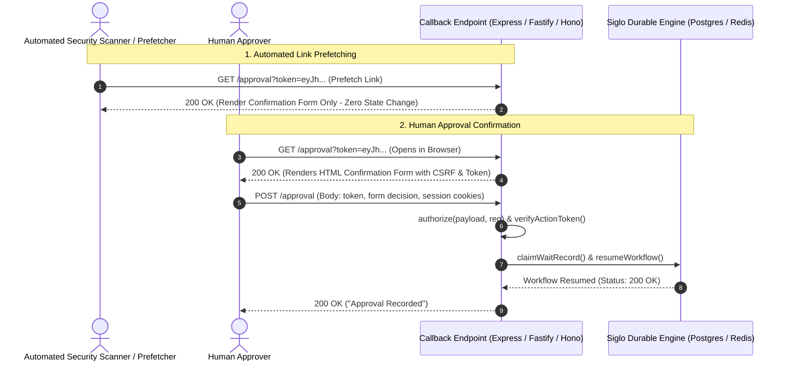

# Notification Approval Security & Recovery

This guide outlines the production security architecture, authorization controls, durable recovery guarantees, and network egress defenses implemented across `@siglo/notifications`. For standard multi-channel messaging and interactive step setup, see the [@siglo/notifications Adapter Guide](/adapters/notifications).

---

## 1. Two-Phase Approval Confirmation (Email Scanner Defense)

Enterprise email systems and corporate anti-virus filters (Microsoft Defender, Proofpoint, Mimecast) aggressively prefetch and follow all HTTP links inside incoming emails to inspect target pages. If an approval link accepted decisions on `GET` requests, automated scanners would inadvertently approve or reject mission-critical workflows before the human recipient even opened the email.

To eliminate this vulnerability, `@siglo/notifications` enforces a strict **Two-Phase Confirmation Protocol**:



> [!SECURITY]
> **GET and HEAD requests are strictly read-only**:
> `GET` and `HEAD` never accept approval decisions or mutate workflow state, regardless of `responseFormat`. `GET` renders an interactive HTML confirmation form; only a `POST` request containing the signed token in the request body is accepted. `OPTIONS` handles preflight requests, and all other HTTP methods return `405 Method Not Allowed`.

### Framework Callback Registration

Register both `GET` and `POST` handlers on your callback route, and configure URL-encoded body parsing:

```typescript
import express from 'express';
import { createNotificationExpressMiddleware } from '@siglo/notifications';

const app = express();

// Required: URL-encoded body parser for HTML form submissions
app.use(express.urlencoded({ extended: false }));

app.all('/approval', createNotificationExpressMiddleware({
  workflow,
  signingSecret: process.env.SIGLO_SIGNING_SECRET!,
  responseFormat: 'html',
  allowedOrigins: ['https://orchestrator.example.com'],
  authorize: async (payload, req) => {
    // 1. Authenticate request via session or SSO cookie
    const user = req.user;
    if (!user) return false;

    // 2. Validate pending request against application database
    const pending = await approvals.findByCorrelationKey(payload.correlationKey);
    if (!pending || pending.stackId !== payload.stackId) return false;

    // 3. Verify user is authorized approver & validate CSRF
    const isApprover = pending.approverId === user.id || user.roles.includes('admin');
    const csrfValid = await csrf.isValid(req);
    return isApprover && csrfValid;
  }
}));
```

> [!IMPORTANT]
> **Authorization & Bearer Token Mode**:
> For production enterprise systems, always provide an `authorize(payload, request)` callback that authenticates the user session and validates identity against the expected approver.
>
> If you are building a low-risk workflow where possession of the signed link is sufficient authorization, you must explicitly opt in by setting `allowBearerApproval: true`. Tokens are cryptographically signed HMAC bearer credentials; `toleranceSeconds` validates issuance timestamps against future clock drift, but link possession alone does not authenticate human identity unless `authorize` or application authentication is enforced.

---

## 2. Distributed PostgreSQL Storage Setup

In distributed production environments (Kubernetes clusters, multi-container deployments), approval callbacks and worker instances must share the same database stores:

```typescript
import { Pool } from 'pg';
import { useStorage } from '@siglo/core';
import { PostgresStorageAdapter } from '@siglo/postgres';
import {
  PostgresApprovalRevocationStore,
  configureApprovalRevocationStore,
  PostgresNotificationDispatchStore,
  configureNotificationDispatchStore
} from '@siglo/notifications';

const pool = new Pool({
  connectionString: process.env.DATABASE_URL,
  max: 20
});

// 1. Primary Durable Storage Adapter
const storage = new PostgresStorageAdapter({ client: pool });
await storage.ensureTables(); // Adds resume_payload column to siglo_wait_records
useStorage(storage);

// 2. Distributed Approval Revocation Store
const revocations = new PostgresApprovalRevocationStore(pool);
await revocations.initialize();
configureApprovalRevocationStore(revocations);

// 3. Distributed Notification Dispatch Store
const dispatches = new PostgresNotificationDispatchStore(pool);
await dispatches.initialize();
configureNotificationDispatchStore(dispatches);
```

> [!WARNING]
> **Connection Pool Sizing & Advisory Lock Affinity**:
> Configure these stores on every worker and scheduler instance connected to the same PostgreSQL database. Process-local defaults (`InMemoryApprovalRevocationStore`) are not suitable for multi-node deployments.
>
> Each active callback holds a PostgreSQL session-level advisory lock (`pg_try_advisory_lock`) during execution. Ensure your `Pool` has sufficient connections. Because session advisory locks require connection affinity, **transaction-pooling connection proxies (such as PgBouncer in `pool_mode = transaction`) are unsupported**; use session-mode pooling (`pool_mode = session`) or connect directly to PostgreSQL.

---

## 3. Durable Acceptance, Concurrency & Cancellation

### Lock Partitioning
- **Approval callbacks and token revocations** coordinate via a per-correlation-key PostgreSQL session advisory lock (`withApprovalLock`).
- **Continuation step execution and compensation sagas** coordinate via a per-stack PostgreSQL advisory lock (`withWorkflowLock`).

These are session advisory locks, not time-based leases with expiration hazards. Conflicting callers receive an immediate conflict error (`409 Conflict`) and should retry with exponential backoff.

### Atomic State Transitions
1. **Claim Phase**: An incoming approval atomically transitions the wait record from `WAITING` &rarr; `RESUMING` and persists the accepted event into `resume_payload`.
2. **Commit Phase**: The transition from `RESUMING` &rarr; `RESUMED` only commits after continuation steps and execution checkpoints settle.
3. **Worker Crash Recovery**: If a worker crashes midway through executing continuation steps, the record remains in `RESUMING` state with the original `resume_payload` intact. The `@siglo/scheduler` poller detects the record and re-executes the resumption safely after acquiring the stack lock.

### Saga Cancellation
When a parent workflow fails or is cancelled:
- Compensation marks pending durable waits and execution checkpoints as `CANCELLED` before invoking LIFO rollback handlers.
- `cancelNotification` revokes the approval token in `PostgresApprovalRevocationStore` before updating external channels (e.g. updating a Slack message to "Workflow Cancelled").
- Once cancelled, subsequent approval clicks are rejected with HTTP 409 even if late network packets arrive.

---

## 4. Dispatch Retries & Idempotency Windows

`PostgresNotificationDispatchStore` persists the exact rendered message body, recipient metadata, and deterministic provider idempotency keys before attempting network dispatch:

- **Resend**: Passes `Idempotency-Key` header with a 24-hour deduplication window.
- **Custom Webhooks / Push**: Pass `Idempotency-Key` headers; receiving endpoints must honor deduplication.
- **SendGrid / Twilio**: Retain at-least-once dispatch semantics upon ambiguous socket disconnects; provider batch IDs do not provide automatic deduplication on ambiguous network drops.

---

## 5. Network Egress Security Perimeter

Built-in transports enforce Siglo's AsyncLocalStorage (ASL) network egress perimeter:
- **Strict DNS Preflight**: The socket's DNS lookup resolves and validates target IP addresses before establishing TCP/TLS connections. Private (`10.0.0.0/8`, `172.16.0.0/12`, `192.168.0.0/16`), loopback (`127.0.0.0/8`), link-local/cloud metadata (`169.254.169.254`), and multicast ranges are rejected immediately.
- **TLS Certificate Verification & SNI**: Standard SNI and certificate authority chains are enforced; insecure HTTP and unverified TLS are denied.
- **Redirect Denial**: HTTP redirects (`301`, `302`, `307`) are rejected to prevent open-redirect SSRF bypasses.
- **Resource Bounds**: Incoming response streams are bounded to 1 MiB to prevent memory exhaustion DoS attacks.

---

## 6. SMS Two-Way Webhook Authentication

When receiving SMS reply approvals (e.g. Twilio SMS webhooks):

1. `parseTwilioSmsReply` validates the authenticity of the Twilio webhook signature (`X-Twilio-Signature`), **not** the identity of the human mobile device.
2. Generate an unpredictable 128-bit cryptographic challenge with `createSmsApprovalReference('deploy:101')` and persist it alongside the expected phone number and expiry.
3. `validateSmsApprovalReply(reply, pending)` verifies that the incoming SMS matches the expected phone number, challenge token, and valid expiration window.
4. For high-privilege workflows, require a second factor (e.g. Authenticator TOTP or SSO confirmation) rather than relying exclusively on unauthenticated SMS channels.

---

## 7. Related Guides

- [Notifications Adapter Guide](/adapters/notifications): Multi-channel messaging, Slack cards, and interactive approval step configuration.
- [PostgreSQL Adapter Guide](/adapters/postgres): Schema management, ACID checkpoints, and advisory locks.
- [Scheduler Adapter Guide](/adapters/scheduler): Background polling and durable timer resumption.
- [Network Egress Policy](/network-egress-policy): AsyncLocalStorage network perimeter enforcement.
