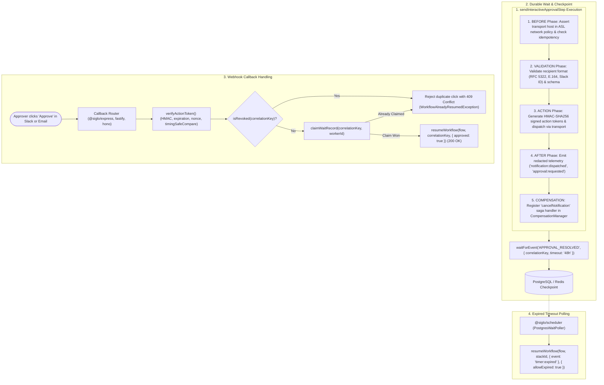

# @siglo/notifications Adapter Guide

> Security migration: read [approval authorization, POST confirmation, durable recovery and delivery guarantees](./notification-hardening.md). GET is read-only; configure `authorize` or explicitly opt into `allowBearerApproval`.


`@siglo/notifications` provides multi-channel messaging, tamper-proof cryptographic approval tokens, and distributed durable callback resumption for `Siglo` workflows. It enables human-in-the-loop workflows (deployment gates, expense approvals, manual fraud reviews) with signed tokens, application-provided authorization, distributed concurrency control, and zero external SDK dependencies.

---

## 1. Overview & Problem Space

In enterprise backend workflows, human intervention and multi-channel notifications (Slack, Discord, Email, SMS, Push) are standard requirements. Implementing these with ad-hoc scripts introduces critical failure modes that `@siglo/notifications` helps address:

| Ad-Hoc Anti-Pattern | Operational Risk | How `@siglo/notifications` Solves It |
|---|---|---|
| **Unregulated Network Egress** | Direct HTTP calls bypass the workflow perimeter, exposing workflows to SSRF or data exfiltration. | Enforces Siglo's AsyncLocalStorage (ASL) network perimeter (`allowNetwork`) with static host assertions (`slack.com`, `api.resend.com`, `api.twilio.com`) verified in the `BEFORE` phase. |
| **Split-Brain Dual-Worker Resumption** | Multiple workers behind a load balancer receive the same callback simultaneously, triggering duplicate downstream side effects. | Integrates with Siglo's atomic storage claims (`claimWaitRecord`) and CAS state transitions, rejecting duplicate callbacks with `WorkflowAlreadyResumedException` (HTTP 409). |
| **Dormant Zombie Workflows** | Workflows suspended on approval timeouts (`waitForEvent(..., { timeout: '48h' })`) remain suspended indefinitely if processes restart. | Direct integration with `@siglo/scheduler` (`PostgresWaitPoller` with per-stack database-session locks) to awaken expired approvals deterministically across container restarts. |
| **Tampered / Replayed Tokens** | Approval URLs in emails or Slack can be forged, manipulated, or replayed by unauthorized actors. | Native integration with `@siglo/crypto`: constant-time HMAC tokens (`timingSafeCompare`), signed nonce fields, future timestamp checks (`toleranceSeconds`), durable request claims, and `KeyRing` secret rotation. |
| **Orphaned Cards on Failure** | When a workflow cancels or fails after sending an approval card, users can still click buttons, triggering invalid state transitions. | Integrates with Siglo's Named Saga Compensation registry (`cancelNotification`), updating Slack cards to "Workflow Cancelled" or recording token revocations in PostgreSQL. |
| **Duplicate Alerts on Step Retries** | Transient failures in downstream steps cause upstream retries, spamming recipients with duplicate emails or alerts. | Native integration with `@siglo/core`'s `IdempotencyStore`, deduplicating dispatches using stack ID, step name, and recipient hash with configurable TTL. |
| **PII & Credential Leaks** | Recipient emails, phone numbers, and bearer tokens leak into DevTools, OpenTelemetry traces, and server logs. | Automatic context redaction in `@siglo/core` before telemetry dispatch, combined with `@siglo/notifications`'s `NotificationMonitor` for wildcard path masking. |

---

## 2. Architecture & Step Lifecycle Integration

Siglo executes steps through a formal 5-phase lifecycle: `BEFORE` &rarr; `VALIDATION` &rarr; `ACTION` &rarr; `AFTER` &rarr; `COMPENSATE`. `@siglo/notifications` hooks into every phase:



---

## 3. Installation & Requirements

Install `@siglo/notifications` alongside core Siglo and crypto packages:

```bash
npm install @siglo/notifications @siglo/crypto @siglo/http @siglo/core
```

Optional dependencies for production multi-worker deployments:
```bash
npm install @siglo/postgres @siglo/scheduler pg
```

Peer dependencies:
- `@siglo/core`: `^1.0.0`
- `@siglo/crypto`: `^1.0.0`
- `@siglo/http`: `^1.0.0`
- `@siglo/scheduler` (optional, for background timeout polling): `^1.0.0`
- `@siglo/postgres` (optional, for persistent checkpoints and shared revocation): `^1.0.0`

---

## 4. Multi-Channel Transports

`@siglo/notifications` provides zero-dependency transport implementations using native HTTPS with validated socket DNS resolution with strict network host assertions:

### Transport Capability Matrix

| Transport | Channel | Egress Host | Action Buttons | Cancellation / Sagas | Additional Capabilities |
|---|---|---|---|---|---|
| `SlackTransport` | `slack` | `slack.com` | Block Kit buttons | `chat.update` message replacement | Modal dialogs via `openModal()` |
| `ResendTransport` | `email` | `api.resend.com` | Responsive HTML links | Revocation store invalidation | Modern transactional email API |
| `SendGridTransport` | `email` | `api.sendgrid.com` | Responsive HTML links | Revocation store invalidation | `x-message-id` header tracking |
| `PostmarkTransport` | `email` | `api.postmarkapp.com` | Responsive HTML links | Revocation store invalidation | Server token authentication |
| `SmtpTransport` | `email` | User-defined host | Responsive HTML links | Revocation store invalidation | Injected Nodemailer / custom client |
| `DiscordTransport` | `discord` | `discord.com` | Embedded markdown links | Revocation store invalidation | Webhook embeds with action buttons |
| `TwilioTransport` | `sms` | `api.twilio.com` | N/A (Text reply) | Revocation store invalidation | Inbound SMS reply signature parsing |
| `PushWebhookTransport` | `push` | Webhook host | JSON action links | Revocation store invalidation | HTTPS push notifications with auth |

### Transport Registration

Transports can be registered globally in the application registry or passed directly to individual steps:

```typescript
import {
  registerNotificationTransport,
  SlackTransport,
  ResendTransport,
  TwilioTransport,
  SmtpTransport
} from '@siglo/notifications';

// 1. Register global transports at application startup
registerNotificationTransport(new SlackTransport({
  apiKey: process.env.SLACK_BOT_TOKEN!
}));

registerNotificationTransport(new ResendTransport({
  apiKey: process.env.RESEND_API_KEY!,
  from: 'notifications@acme.com'
}));

registerNotificationTransport(new TwilioTransport({
  accountSid: process.env.TWILIO_ACCOUNT_SID!,
  authToken: process.env.TWILIO_AUTH_TOKEN!,
  from: '+15551234567'
}));

// Injected SMTP client (e.g. Nodemailer)
registerNotificationTransport(new SmtpTransport({
  host: 'smtp.mailgun.org',
  from: 'no-reply@acme.com',
  sendMail: async (mail) => nodemailerTransport.sendMail(mail)
}));
```

---

## 5. Workflow Step Integration

### `sendNotificationStep(name, options)`

Used for one-way alerts and messages with automatic idempotency deduplication and context redaction:

```typescript
import { sendNotificationStep } from '@siglo/notifications';

export const alertOpsStep = sendNotificationStep('alertOps', {
  channel: 'slack',
  recipient: (ctx: { channelId: string }) => ({ slackChannelId: ctx.channelId }),
  template: (ctx: { service: string; latency: number }) =>
    `⚠️ High latency detected on ${ctx.service}: ${ctx.latency}ms (p99)`,
  deduplicationTtl: 3600 // 1 hour idempotency window
});
```

### `sendInteractiveApprovalStep(name, options)`

Generates signed callback URLs for human sign-off, dispatches the interactive card/email, and registers saga compensation:

```typescript
import { sendInteractiveApprovalStep } from '@siglo/notifications';
import { approvalKeyRing } from './keys';

export const approvalStep = sendInteractiveApprovalStep('deploymentApproval', {
  channel: 'slack',
  recipient: (ctx: { approverSlackId: string }) => ({ slackUserId: ctx.approverSlackId }),
  title: (ctx: { service: string; version: string }) =>
    `Deployment Approval: ${ctx.service}@${ctx.version}`,
  description: (ctx: { deploymentId: string; changelog: string }) =>
    `Deployment ${ctx.deploymentId} requires sign-off.\n${ctx.changelog}`,
  correlationKey: (ctx: { deploymentId: string }) => `deploy:${ctx.deploymentId}`,
  timeout: '24h',
  onApproveEvent: 'APPROVAL_RESOLVED',
  onRejectEvent: 'APPROVAL_RESOLVED',
  callbackBaseUrl: 'https://orchestrator.acme.com/api/siglo/callback',
  signingSecret: approvalKeyRing,
  autoCompensate: true // Updates Slack card to 'Cancelled' if downstream fails or aborts
});
```

---

## 6. Cryptographic Action Tokens & Secret Rotation

Action tokens embed all callback state directly in a signed, URL-safe bearer token:

$$\text{Token} = \text{base64url}(\text{Payload}) \,\|\, \text{base64url}(\text{HMAC-SHA256}(\text{Payload}, \text{Secret}))$$

### Embedded Payload Structure
```typescript
interface ActionTokenPayload {
  stackId: string;
  correlationKey: string;
  expectedEvent: string;
  approved: boolean;
  expiresAt: number;
  issuedAt: number;
  nonce: string;
  kid?: string;
}
```

### Security Defenses:
1. **Zero Database Lookups**: The token is verified cryptographically before touching persistent storage.
2. **Timing Attack Defense**: Comparisons use `timingSafeCompare` from `@siglo/crypto`.
3. **Future Clock Skew Defense**: Validates `issuedAt <= now + toleranceSeconds`. Nonces are not a consumption registry; completed durable claims reject replay.
4. **Key Rotation**: Accepts both raw string secrets and `KeyRing` instances (`StaticKeyRing` from `@siglo/crypto`):

```typescript
import { StaticKeyRing } from '@siglo/crypto';
import { verifyActionToken } from '@siglo/notifications';

const keyRing = new StaticKeyRing('2026-q1', {
  '2026-q1': process.env.SIGLO_SECRET_2026_Q1!,
  '2025-q4': process.env.SIGLO_SECRET_2025_Q4!
});

// During key rotation, tokens signed with '2025-q4' are still verified safely
const payload = await verifyActionToken(token, keyRing, {
  toleranceSeconds: 60
});
```

---

## 7. Web Framework Resumption Handlers

`@siglo/notifications` exports turnkey callback handlers for Express, Fastify, and Hono.

### Security Headers & Sanitization
Every callback response automatically includes:
- `Cache-Control: no-store`
- `Referrer-Policy: no-referrer`
- `X-Content-Type-Options: nosniff`
- `Content-Security-Policy: default-src 'none'; frame-ancestors 'none'`
- Optional allowlisted CORS origin headers (`allowedOrigins: ['https://orchestrator.acme.com', 'https://dashboard.acme.com']`)

### Express Example

```typescript
import express from 'express';
import { createNotificationExpressMiddleware } from '@siglo/notifications';
import { productionDeploymentFlow } from './workflows';

const app = express();
app.use(express.urlencoded({ extended: false }));

app.all(
  '/api/siglo/callback',
  createNotificationExpressMiddleware({
    workflow: productionDeploymentFlow,
    signingSecret: process.env.APPROVAL_SECRET!,
    authorize: authorizeApproval, // Application identity and CSRF check; see migration guide.
    responseFormat: 'html', // Renders user-friendly confirmation screen
    allowedOrigins: ['https://orchestrator.acme.com', 'https://dashboard.acme.com'],
    onSuccessRedirect: 'https://dashboard.acme.com/deployments/success',
    onExpiredRedirect: 'https://dashboard.acme.com/deployments/expired',
    onErrorRedirect: 'https://dashboard.acme.com/deployments/error'
  })
);
```

### Fastify Example

```typescript
import Fastify from 'fastify';
import { createNotificationFastifyHandler } from '@siglo/notifications';
import { deploymentWorkflow } from './workflows';

const fastify = Fastify();

const handler = createNotificationFastifyHandler({
  workflow: orderFlow,
  signingSecret: process.env.APPROVAL_SECRET!,
  authorize: authorizeApproval // Application authentication and CSRF check.
});
fastify.route({ method: ['GET', 'POST'], url: '/api/siglo/callback', handler });
```

### Hono Example (Node)

```typescript
import { Hono } from 'hono';
import { createNotificationHonoHandler } from '@siglo/notifications';
import { deploymentWorkflow } from './workflows';

const app = new Hono();

app.all('/api/siglo/callback', createNotificationHonoHandler({
  workflow: deploymentWorkflow,
  signingSecret: process.env.APPROVAL_SECRET!,
  authorize: authorizeApproval
}));
```

### HTTP Status Code Normalization

| HTTP Status | Condition | Message |
|---|---|---|
| `200 OK` | Resumption successful and workflow continuation executed | `Approval recorded` |
| `400 Bad Request` | Forged, malformed, or tampered token | `Invalid approval` |
| `403 Forbidden` | Missing authorization, wrong approver or disallowed configured origin | Authorization required / forbidden |
| `405 Method Not Allowed` | Unsupported mutation method | `Method not allowed` |
| `409 Conflict` | Approval already resolved (concurrent click) or cancelled via saga | `Approval already resolved` / `Approval cancelled` |
| `410 Gone` | Token timestamp or durable wait expired | `Approval expired` |
| `500 Internal Error` | Unexpected downstream step failure during resumption | `Unable to process approval` |

---

## 8. Distributed Resumption, Shared Revocation & Concurrency

### Dual-Worker Atomic Claims
When an approval link is clicked, multiple workers behind a load balancer may receive duplicate requests simultaneously. `@siglo/notifications` integrates with `@siglo/core`'s atomic `claimWaitRecord` call:
1. **Worker 1** acquires the stack session lock, persists the accepted event, and atomically updates (`WAITING` &rarr; `RESUMING`). Claim succeeds; workflow resumes.
2. **Worker 2** cannot acquire the active session lock or finds the request already completed. Core throws a conflict exception, which the callback handler maps to HTTP `409 Conflict`.

### Shared PostgreSQL Revocation Store
When a workflow aborts or compensation runs, tokens must be revoked across all worker processes.

```typescript
import { Pool } from 'pg';
import {
  configureApprovalRevocationStore,
  PostgresApprovalRevocationStore
} from '@siglo/notifications';

const pool = new Pool({ connectionString: process.env.DATABASE_URL });

const revocationStore = new PostgresApprovalRevocationStore(pool);
await revocationStore.initialize(); // Creates table siglo_approval_revocations
configureApprovalRevocationStore(revocationStore);
```

---

## 9. Two-Way Twilio SMS Approvals

Approvers can reply directly via SMS with `APPROVE <ref>` or `REJECT <ref>`. `@siglo/notifications` provides `parseTwilioSmsReply` to verify Twilio's signed form webhooks:

```typescript
import express from 'express';
import { parseTwilioSmsReply } from '@siglo/notifications';
import { resumeWorkflow } from '@siglo/core';
import { deploymentWorkflow } from './workflows';

const app = express();
app.use(express.urlencoded({ extended: false }));

app.post('/api/twilio/sms', express.urlencoded({ extended: false }), async (req, res) => {
  try {
    const reply = parseTwilioSmsReply(req.body, {
      publicUrl: 'https://api.acme.com/api/twilio/sms',
      authToken: process.env.TWILIO_AUTH_TOKEN!,
      signature: req.headers['x-twilio-signature'] as string
    });

    // reply: { messageId: 'SM...', from: '+15551234567', to: '+15550000', approved: true, reference: 'deploy:101' }
    // Application service: validate the persisted challenge and sender, then
    // atomically accept the decision and deduplicate MessageSid.
    await approvalService.acceptVerifiedSmsReply(reply);

    res.type('text/xml').send('<Response><Message>Decision recorded.</Message></Response>');
  } catch (err: any) {
    res.status(400).send(err.message);
  }
});
```

---

## 10. Saga Compensation & Interactive Message Invalidation

If downstream steps fail or the workflow is cancelled, Siglo's named compensation mechanism triggers `cancelNotification`:

```typescript
const approvalStep = sendInteractiveApprovalStep('managerApproval', {
  channel: 'slack',
  recipient: { slackChannelId: 'C_DEV' },
  title: 'Deploy to Production?',
  correlationKey: (ctx) => `deploy:${ctx.id}`,
  timeout: '4h',
  onApproveEvent: 'APPROVED',
  onRejectEvent: 'REJECTED',
  callbackBaseUrl: 'https://api.acme.com/callback',
  signingSecret: process.env.APPROVAL_SECRET!,
  autoCompensate: true // Enables automatic compensation
});
```

1. **Slack Channels**: The registered `SlackTransport` invokes `chat.update` on the original message ID, removing interactive buttons and replacing the text with `"Workflow cancelled"`.
2. **Email & Discord**: Calls `revocationStore.revoke(correlationKey)`. If an approver clicks an old email link later, the callback endpoint rejects it with HTTP `409 Conflict`.

---

## 11. Network Egress Security & ASL Perimeter

`@siglo/notifications` asserts all transport hostnames against Siglo's AsyncLocalStorage (ASL) network policy:
- Static host assertions (`slack.com`, `api.resend.com`, `api.sendgrid.com`, `api.postmarkapp.com`, `discord.com`, `api.twilio.com`) run in the `BEFORE` phase before any network connection is initiated.
- HTTP requests reject redirects and validate DNS results in the actual socket lookup; injected clients must provide their own controls.
- Injected transports declare `allowedHosts` directly on their class definition.

---

## 12. Observability, Telemetry & PII Redaction

### Automatic Core Redaction
Siglo core automatically masks sensitive fields before emitting monitoring events:
- Standard keys masked: `recipient`, `email`, `phone`, `slackUserId`, `slackChannelId`, `discordWebhookUrl`, `approvalTokens`, `approveUrl`, `rejectUrl`, `signingSecret`.
- Cyclic data structures are safely replaced with `'[Circular]'`.

### Custom Wildcard PII Masking (`NotificationMonitor`)
To mask domain-specific PII in execution logs and DevTools:

```typescript
import { NotificationMonitor } from '@siglo/notifications';

const monitor = new NotificationMonitor([
  'outputSummary.customers.*.contact',
  'order.billingAddress.creditCard'
]);

await workflow.execute(input, { monitor });
```

---

## 13. Testing & Deterministic Mocking

### `MockNotificationTransport`
Exported from `@siglo/notifications/testing` to inspect payloads and URLs without real network traffic:

```typescript
import { MockNotificationTransport } from '@siglo/notifications/testing';
import { sendNotificationStep, sendInteractiveApprovalStep } from '@siglo/notifications';

const mockTransport = new MockNotificationTransport('slack');

const step = sendInteractiveApprovalStep('approval', {
  channel: 'slack',
  recipient: { slackUserId: 'U12345' },
  title: 'Approve?',
  correlationKey: 'deploy:1',
  timeout: '2h',
  onApproveEvent: 'YES',
  onRejectEvent: 'NO',
  callbackBaseUrl: 'https://api.acme.com/callback',
  signingSecret: 'test-secret',
  transport: mockTransport
});

await step.execute({});

console.log(mockTransport.messages.length); // 1
console.log(mockTransport.messages[0].interactiveActions?.approveUrl);
```

### Fast-Forwarding Timeouts with `FakeClock`
To test approval timeouts deterministically:

```typescript
import { FakeClock } from '@siglo/testing';

const clock = new FakeClock();
// Advance virtual timestamp by 24 hours
clock.advanceTime(24 * 60 * 60 * 1000);
```

> [!NOTE]
> `FakeClock` advances its own internal virtual timestamp counter (`clock.now()`). Calling `clock.tick()` flushes microtasks via `setImmediate` without replacing global Node.js `Date.now` or `setTimeout`.

---

## 14. Complete TypeScript API Signatures

```typescript
import type { Step, Flow, IdempotencyStore } from '@siglo/core';
import type { KeyRing } from '@siglo/crypto';
import type { StandardSchemaV1 } from '@siglo/http';

export type NotificationChannel = 'email' | 'slack' | 'discord' | 'sms' | 'push';

export interface NotificationRecipient {
  email?: string;
  phone?: string;
  slackUserId?: string;
  slackChannelId?: string;
  pushToken?: string;
  discordWebhookUrl?: string;
}

export interface NotificationMetadata {
  notificationId: string;
  channel: NotificationChannel;
  dispatchedAt: number;
  recipientMasked: string;
  stackId?: string;
}

export interface ResolvedNotificationMessage {
  to: string | NotificationRecipient;
  subject?: string;
  content: string;
  interactiveActions?: {
    approveUrl: string;
    rejectUrl: string;
    title: string;
    description?: string;
  };
  metadata?: Record<string, unknown>;
  signal?: AbortSignal;
}

export interface NotificationTransport {
  readonly channel: NotificationChannel;
  readonly allowedHosts: string[];
  send(message: ResolvedNotificationMessage): Promise<{ id: string; timestamp: number }>;
  cancel?(notificationId: string, reason: string): Promise<void>;
}

export interface SendNotificationOptions<TInput> {
  channel: NotificationChannel | ((ctx: TInput) => NotificationChannel);
  recipient: string | NotificationRecipient | ((ctx: TInput) => string | NotificationRecipient);
  subject?: string | ((ctx: TInput) => string);
  template: string | ((ctx: TInput) => string);
  dataSchema?: StandardSchemaV1;
  data?: (ctx: TInput) => Record<string, unknown>;
  deduplicationTtl?: number;
  compensateOnFailure?: boolean;
  transport?: NotificationTransport;
  idempotencyStore?: IdempotencyStore;
}

export function sendNotificationStep<const TName extends string, TInput = any>(
  name: TName,
  options: SendNotificationOptions<TInput>
): Step<TInput, NotificationResult, TName>;

export interface InteractiveApprovalOptions<TInput> {
  channel: 'email' | 'slack';
  recipient: string | NotificationRecipient | ((ctx: TInput) => string | NotificationRecipient);
  title: string | ((ctx: TInput) => string);
  description?: string | ((ctx: TInput) => string);
  correlationKey: string | ((ctx: TInput) => string);
  timeout: string;
  onApproveEvent: string;
  onRejectEvent: string;
  callbackBaseUrl: string;
  signingSecret: string | KeyRing;
  autoCompensate?: boolean;
  transport?: NotificationTransport;
  idempotencyStore?: IdempotencyStore;
}

export function sendInteractiveApprovalStep<const TName extends string, TInput = any>(
  name: TName,
  options: InteractiveApprovalOptions<TInput>
): Step<TInput, ApprovalResult, TName>;

export interface CallbackHandlerOptions {
  allowBearerApproval?: boolean;
  authorize?: (payload: ActionTokenPayload, request?: any) => boolean | Promise<boolean>;
  responseFormat?: 'json' | 'html';
  allowedOrigins?: string[];
  signingSecret: string | KeyRing;
  workflow: Flow<any, any>;
  onSuccessRedirect?: string;
  onExpiredRedirect?: string;
  onErrorRedirect?: string;
  toleranceSeconds?: number;
}

export function createNotificationExpressMiddleware(options: CallbackHandlerOptions): (req: any, res: any) => Promise<void>;
export function createNotificationFastifyHandler(options: CallbackHandlerOptions): (req: any, reply: any) => Promise<void>;
export function createNotificationHonoHandler(options: CallbackHandlerOptions): (c: any) => Promise<Response>;
```
