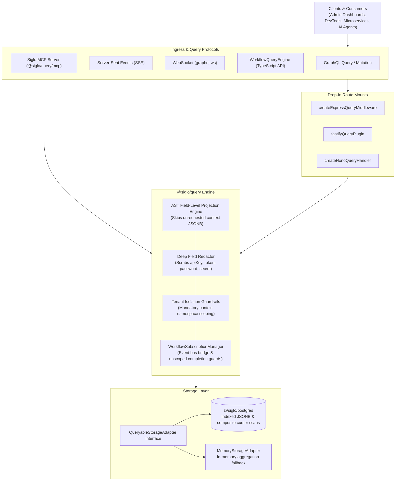

# @siglo/query Adapter Guide

For end-to-end walkthroughs, see [Querying Workflows with GraphQL and React DevTools](/querying-workflows-graphql) and [Querying & Diagnosing Workflows with MCP and AI Agents](/querying-workflows-mcp).

`@siglo/query` provides a unified, storage-agnostic query engine, a complete GraphQL schema contract with AST-driven projection, real-time SSE and WebSocket subscription transports, drop-in route handlers for **Hono**, **Express**, and **Fastify**, and an AI-native **Model Context Protocol (MCP) Server** (`@siglo/query/mcp`).

---

## 1. Overview & Architecture

Accessing workflow execution history directly through database queries introduces tight coupling to database schemas, risks JSONB lock contention, and bypasses tenant isolation. `@siglo/query` decouples clients from storage implementation details by providing an intelligent projection layer:



### Core Architectural Guarantees

| Guarantee | Description |
| :--- | :--- |
| **Workflow-Centric State** | Queries operate on execution instances (`stackId`) and materialized POJO contexts rather than isolated step deltas. |
| **Zero-Cost Projection** | AST inspection inspects whether `context` or `steps` were requested. Listing queries omit heavy context JSONB blobs entirely. |
| **Strict Multi-Tenancy** | All queries, mutations, subscriptions, and MCP tools mandate an authenticated namespace. Mismatched scopes are rejected before accessing storage. |
| **Deep Field Redactor** | Sensitive attributes (`password`, `token`, `secret`, `apiKey`) are scrubbed before serialization. Backing unredacted data is kept in private `WeakMap` registries. |
| **Resilient Resumption** | Mutations delegate directly to Siglo's runtime durable continuation, guaranteeing remaining steps execute and leaving waits untouched on mismatch. |
| **AI-Native via MCP** | Exposes structured MCP tools, URI resources, and failure diagnosis prompts over `stdio` and `sse` without blowing LLM context token budgets. |

---

## 2. Installation & Requirements

Install `@siglo/query` along with `@siglo/core`:

```bash
npm install @siglo/query @siglo/core graphql
```

Optional WebSocket support:

```bash
npm install graphql-ws ws
```

Peer dependency matrix:
- `@siglo/core`: `^1.0.0`
- `graphql`: `^16.0.0 || ^17.0.0`
- `graphql-ws` (optional): `^5.14.0 || ^6.0.0`

---

## 3. GraphQL Schema Contract (SDL)

`@siglo/query` exports the complete GraphQL SDL contract via `WORKFLOW_SCHEMA_SDL`:

```graphql
scalar JSON
scalar DateTime

enum WorkflowStatus {
  RUNNING
  WAITING
  COMPLETED
  FAILED
  CANCELLED
}

enum SortDirection {
  ASC
  DESC
}

enum WorkflowSortField {
  CREATED_AT
  UPDATED_AT
  STATUS
  REVISION
}

type WorkflowExecution {
  stackId: ID!
  workflowId: String
  namespace: String
  status: WorkflowStatus!
  revision: Int!
  createdAt: DateTime!
  updatedAt: DateTime!
  expiresAt: DateTime
  metadata: JSON
  context(path: String, redact: Boolean = true): JSON
  steps: [StepExecution!]!
  waitRecord: WaitRecord
  compensations: [CompensationRecord!]!
}

type StepExecution {
  stepId: ID!
  name: String!
  status: String!
  output(redact: Boolean = true): JSON
}

type WaitRecord {
  correlationKey: String!
  eventName: String
  expiresAt: DateTime
  lockedBy: String
  status: String
}

type CompensationRecord {
  stepId: String!
  stepName: String!
  status: String!
}

input WorkflowFilterInput {
  workflowId: String
  namespace: String
  status: WorkflowStatus
  createdAfter: DateTime
  createdBefore: DateTime
  correlationKey: String
  metadata: JSON
}

input WorkflowSortInput {
  field: WorkflowSortField! = CREATED_AT
  direction: SortDirection! = DESC
}

input PaginationInput {
  limit: Int = 20
  cursor: String
}

type PageInfo {
  hasNextPage: Boolean!
  hasPreviousPage: Boolean!
  startCursor: String
  endCursor: String
}

type WorkflowEdge {
  cursor: String!
  node: WorkflowExecution!
}

type WorkflowConnection {
  edges: [WorkflowEdge!]!
  pageInfo: PageInfo!
  totalCount: Int!
}

type Query {
  workflow(stackId: ID!, namespace: String): WorkflowExecution
  workflows(
    filter: WorkflowFilterInput
    sort: WorkflowSortInput
    pagination: PaginationInput
  ): WorkflowConnection!
}

type Mutation {
  resumeWorkflow(correlationKey: String!, payload: JSON, namespace: String): Boolean!
  cancelWorkflow(stackId: ID!, reason: String): Boolean!
}

type Subscription {
  workflowUpdated(stackId: ID!, namespace: String): WorkflowExecution!
  workflowCompleted(namespace: String!): WorkflowExecution!
}
```

---

## 4. Programmatic Query Engine (`WorkflowQueryEngine`)

Backend microservices can query executions directly in TypeScript without an HTTP/GraphQL hop:

```typescript
import { createWorkflowQueryEngine } from '@siglo/query';
import { PostgresStorageAdapter } from '@siglo/postgres';

const storage = new PostgresStorageAdapter({ /* client config */ });

const engine = createWorkflowQueryEngine({
    storage,
    redactFields: ['creditCard', 'ssn'],
    // Optional workflow resolver to allow runtime resume:
    resolveWorkflow: (checkpoint) => getWorkflowDefinition(checkpoint.workflowId),
});

// 1. Paginated Listing with AST Context Selection
const page = await engine.findMany({
    filter: {
        namespace: 'tenant-acme',
        status: 'running',
        workflowId: 'order-flow',
    },
    sort: { field: 'createdAt', direction: 'desc' },
    pagination: { limit: 10 },
    select: {
        includeContext: true,
        contextPath: 'shipping.address',
    },
});

console.log(`Found ${page.totalCount} workflows`);
for (const edge of page.edges) {
    console.log(`- ${edge.node.stackId}: ${edge.node.status}`);
}

// 2. Fetch Single Execution by ID
const execution = await engine.findById('stack-123', {
    namespace: 'tenant-acme',
    redact: true,
});
```

---

## 5. Drop-In Web Framework Route Handlers

`@siglo/query` provides pre-built handlers for major TypeScript web frameworks.

### Express (`createExpressQueryMiddleware`)

```typescript
import express from 'express';
import { createWorkflowQueryEngine, createExpressQueryMiddleware } from '@siglo/query';
import { defaultStorageManager } from '@siglo/core';

const app = express();
app.use(express.json());

const engine = createWorkflowQueryEngine({
    storage: defaultStorageManager.getAdapter(),
});

// Mount GraphQL query & SSE endpoint
app.use(
    '/graphql',
    createExpressQueryMiddleware({
        engine,
        // Resolve authenticated tenant from session / JWT:
        namespace: (req) => req.user?.organizationId,
        keepAliveIntervalMs: 15000,
    }),
);

app.listen(3000);
```

### Fastify (`fastifyQueryPlugin`)

```typescript
import Fastify from 'fastify';
import { createWorkflowQueryEngine, fastifyQueryPlugin } from '@siglo/query';
import { defaultStorageManager } from '@siglo/core';

const fastify = Fastify();

const engine = createWorkflowQueryEngine({
    storage: defaultStorageManager.getAdapter(),
});

fastify.register(fastifyQueryPlugin, {
    engine,
    path: '/graphql',
    namespace: (req) => req.headers['x-tenant-id'],
});

await fastify.listen({ port: 3000 });
```

### Hono (`createHonoQueryHandler`)

```typescript
import { Hono } from 'hono';
import { createWorkflowQueryEngine, createHonoQueryHandler } from '@siglo/query';
import { defaultStorageManager } from '@siglo/core';

const app = new Hono();

const engine = createWorkflowQueryEngine({
    storage: defaultStorageManager.getAdapter(),
});

// Mount on Web standard Fetch request/response
app.all(
    '/graphql',
    createHonoQueryHandler({
        engine,
        namespace: (c) => c.get('jwtPayload')?.tenantId,
        keepAliveIntervalMs: 15000,
    }),
);

export default app;
```

---

## 6. Real-Time Subscriptions & Transports

### Server-Sent Events (SSE)

Clients can subscribe to live lifecycle updates using HTTP Server-Sent Events by querying with `Accept: text/event-stream` or subscribing to `workflowUpdated`:

```javascript
const eventSource = new EventSource('/graphql?query=' + encodeURIComponent(`
  subscription {
    workflowUpdated(stackId: "order-101") {
      stackId
      status
      context
    }
  }
`));

eventSource.onmessage = (event) => {
  const result = JSON.parse(event.data);
  console.log('Live workflow update:', result.data.workflowUpdated);
};
```

#### Idle Heartbeat Guarantee
Proxy servers and API gateways (such as Nginx, Cloudflare, or AWS ALB) terminate idle SSE connections if no bytes are sent within 30–60 seconds. `@siglo/query` automatically emits periodic SSE keepalive comments (`: keepalive\n\n`) when `keepAliveIntervalMs` is configured, preventing proxy timeouts during long pauses between workflow steps.

### WebSockets (`graphql-ws`)

For bidirectional protocols, `@siglo/query` integrates with `graphql-ws`:

```typescript
import { createServer } from 'node:http';
import { WebSocketServer } from 'ws';
import { createWorkflowGraphQLSchema, createWorkflowWSHandler } from '@siglo/query';

const server = createServer();
const wss = new WebSocketServer({ server });

const schema = createWorkflowGraphQLSchema(engine);

createWorkflowWSHandler({
    schema,
    context: (ctx) => ({
        namespace: authenticateSocket(ctx),
    }),
})(wss);

server.listen(4000);
```

---

## 7. Model Context Protocol (MCP) Server (`@siglo/query/mcp`)

To enable querying, inspecting, diagnosing, and resuming workflows via natural language prompts in AI assistants (Claude Desktop, Cursor, Antigravity, JetBrains AI), `@siglo/query/mcp` provides a built-in Model Context Protocol server.

### Starting the MCP Server (`stdio` or `sse`)

```typescript
import { createWorkflowMcpServer } from '@siglo/query/mcp';
import { defaultStorageManager } from '@siglo/core';

// 1. Stdio transport (for local IDE / desktop assistants)
const mcpServer = createWorkflowMcpServer({
    storage: defaultStorageManager.getAdapter(),
    namespace: 'tenant-acme',
    redactFields: ['apiKey', 'password', 'token', 'secret'],
    transport: 'stdio',
});

await mcpServer.start();
```

For distributed agents over HTTP Server-Sent Events (`sse`):

```typescript
const sseMcpServer = createWorkflowMcpServer({
    storage: defaultStorageManager.getAdapter(),
    namespace: 'tenant-acme',
    transport: 'sse',
    sse: {
        port: 4100,
        host: '127.0.0.1',
        ssePath: '/sse',
        messagePath: '/messages',
    },
});

await sseMcpServer.start();
console.log('MCP SSE endpoint:', sseMcpServer.getSseUrl());
```

### Registered MCP Capabilities

| Type | Identifier | Description |
| :--- | :--- | :--- |
| **Tool** | `search_workflows` | Search executions by `status`, `workflowId`, date range, or `metadataFilter` (returns lightweight summaries without context bloat). |
| **Tool** | `inspect_workflow` | Retrieve detailed execution state, step history, failed step diagnostics, and redacted context (`contextPath`, `includeSteps`). |
| **Tool** | `execute_workflow_query` | Execute arbitrary GraphQL queries against the Siglo schema with redaction guardrails (`redact: false` is blocked). |
| **Tool** | `resume_workflow` | Resume a suspended durable workflow by `correlationKey` with an event `payload`. |
| **Resource** | `siglo://workflows/active` | Live list of currently `RUNNING` and `WAITING` workflows. |
| **Resource** | `siglo://workflows/{stackId}` | Real-time status, step history, and redacted context snapshot of a specific workflow. |
| **Resource** | `siglo://schema/graphql` | Full GraphQL SDL contract for text-to-GraphQL query generation. |
| **Prompt** | `diagnose_failure` | Structured root-cause diagnosis template embedding redacted failure diagnostics and step history. |

---

## 8. PostgreSQL Adapter Acceleration (`@siglo/postgres`)

When persisting workflows with `@siglo/postgres`, `@siglo/query` leverages database-level composite indexes and GIN metadata paths for sub-millisecond pagination across millions of checkpoints:

```typescript
import { PostgresStorageAdapter } from '@siglo/postgres';
import { createWorkflowQueryEngine } from '@siglo/query';

const storage = new PostgresStorageAdapter({
    checkpointsTable: 'siglo_checkpoints',
    client: pgPool,
});

// Automatically creates optimized indexes during ensureTables():
// 1. Composite cursor index: (namespace, created_at DESC, stack_id COLLATE "C")
// 2. Status index: (namespace, status)
// 3. Metadata GIN index: USING GIN ((state->'metadata') jsonb_path_ops)
await storage.ensureTables();

const engine = createWorkflowQueryEngine({ storage });
```

---

## 9. Summary of Security & Tenant Guardrails

1. **Mandatory Request Context Scoping**: Resolvers and MCP tools enforce tenant namespace boundaries, preventing cross-tenant data leaks.
2. **Conflict Prevention**: If a client or LLM passes an explicit `namespace` argument that contradicts the bound session namespace, the request is immediately rejected.
3. **Atomic Resumption Claim**: Durable wait records are claimed using atomic SQL conditional checks on `namespace`. Conflicting resume requests cannot lock or mutate another tenant's wait record.
4. **Unscoped Completion Event Dropping**: Completion events received from internal event buses without explicit namespace tags are matched against the checkpoint storage owner before dispatch.
5. **Private Backing Data & MCP Redaction Lock**: Unredacted raw checkpoints are held in module-scoped `WeakMap` collections, and the MCP `execute_workflow_query` tool blocks `redact: false` arguments so secrets never enter LLM transcripts.
