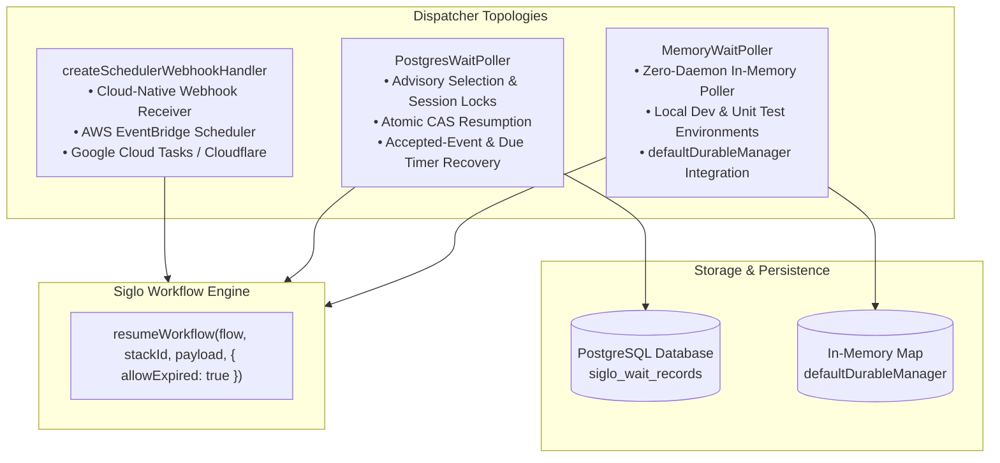

# @siglo/scheduler Adapter Guide

`@siglo/scheduler` provides background timer polling, distributed lock claiming, and cloud-native webhook dispatchers for `Siglo` durable workflows. It ensures that time-based durables (`wait('24h')`, `waitForEvent('CONFIRM', { timeout: '7d' })`) resume on time across container restarts, node crashes, and multi-worker Kubernetes clusters.

---

## 1. Overview & Architecture

Siglo workflows operate in-process without requiring a central coordinator daemon. However, when workflows suspend with long-running timers in durable environments (PostgreSQL, Redis), a mechanism is required to wake sleeping workflows when their expiration timestamps elapse.

`@siglo/scheduler` solves this with three complementary dispatchers:



---

## 2. Installation & Requirements

Install `@siglo/scheduler` alongside `@siglo/core` and `@siglo/postgres`:

```bash
npm install @siglo/core @siglo/scheduler @siglo/postgres pg
npm install --save-dev @types/pg
```

Peer dependencies:
- `@siglo/core`: `^1.0.0`
- `@siglo/postgres`: `^1.0.0` (for `PostgresWaitPoller`)
- `pg`: `^8.0.0` (or compatible PostgreSQL client with a `.query()` method)

---

## 3. Database Schema & Row-Level Locking

`PostgresWaitPoller` relies on the `siglo_wait_records` table. It provides an automated DDL initialization method: `poller.ensureTable()`. Prefer running migrations or `poller.ensureTable()` over manual table creation.

### DDL Schema

```sql
CREATE TABLE IF NOT EXISTS siglo_wait_records (
    correlation_key VARCHAR(255) PRIMARY KEY,
    stack_id VARCHAR(255) NOT NULL,
    namespace VARCHAR(255),
    event_name VARCHAR(255),
    status VARCHAR(50) NOT NULL DEFAULT 'WAITING',
    continuation_step_index INT NOT NULL DEFAULT 0,
    version VARCHAR(50),
    data JSONB,
    resume_payload JSONB,
    locked_by VARCHAR(255),
    locked_at TIMESTAMPTZ,
    resumed_by VARCHAR(255),
    resumed_at TIMESTAMPTZ,
    expires_at TIMESTAMPTZ,
    created_at TIMESTAMPTZ NOT NULL DEFAULT NOW(),
    updated_at TIMESTAMPTZ NOT NULL DEFAULT NOW()
);

-- Crucial composite index for high-throughput polling
CREATE INDEX IF NOT EXISTS idx_siglo_wait_records_due 
    ON siglo_wait_records(status, expires_at);
```

### The Advisory Resumption Query & Session Locking

To coordinate execution across concurrent worker pods, `PostgresWaitPoller` executes an advisory selection query to find due timers and accepted events:

```sql
WITH due_records AS (
    SELECT * FROM siglo_wait_records
    WHERE (status = 'WAITING' AND expires_at IS NOT NULL AND expires_at <= NOW())
       OR (status = 'RESUMING' AND resume_payload IS NOT NULL)
    ORDER BY updated_at ASC
    LIMIT $1
) SELECT * FROM due_records
```

- **Advisory Selection & Session Locks**: Selection is advisory. The storage adapter serializes execution using a database-session lock (`withWorkflowLock`), claiming and completing wait records atomically. If a worker pod crashes mid-resumption, PostgreSQL automatically releases the session lock upon connection disconnect.
- **Accepted-Event Recovery**: Records with `status = 'RESUMING'` and a non-null `resume_payload` represent accepted resume events that survived process termination and will be picked up by surviving workers.
- **Lock Deprecation**: `lockTimeoutMs` is deprecated for `PostgresStorageAdapter` as lock lifecycles are tied to database sessions rather than manual timeout windows.

---

## 4. `PostgresWaitPoller` Usage

### Starting the Background Poller in Worker Pods

```typescript
import { Pool } from 'pg';
import { PostgresWaitPoller } from '@siglo/scheduler';
import { orderProcessingFlow, onboardingFlow } from './workflows';

const pgPool = new Pool({ connectionString: process.env.DATABASE_URL });

// 1. Maintain a registry of known workflow definitions
const workflowRegistry = new Map<string, any>([
    ['order-processing', orderProcessingFlow],
    ['onboarding', onboardingFlow]
]);

// 2. Initialize the poller daemon
const poller = new PostgresWaitPoller({
    client: pgPool,
    waitRecordsTable: 'siglo_wait_records',
    pollIntervalMs: 1000,   // Poll every 1 second
    batchSize: 50,          // Claim up to 50 due records per batch
    workerId: `worker-${process.env.HOSTNAME || process.pid}`,
    flowLookup: (workflowId, stackId) => {
        // Resolve workflow by ID, or fallback based on stack prefix
        if (workflowId && workflowRegistry.has(workflowId)) {
            return workflowRegistry.get(workflowId);
        }
        if (stackId?.startsWith('order:')) return orderProcessingFlow;
        return onboardingFlow;
    },
    onResumed: async (record, result) => {
        console.log(`[Scheduler] Successfully resumed stack ${record.stackId}`);
    },
    onFailed: async (record, error) => {
        console.error(`[Scheduler] Failed to resume stack ${record.stackId}:`, error.message);
    }
});

// 3. Ensure tables exist and start polling
await poller.ensureTable();
poller.start();

// 4. Handle graceful shutdown (Kubernetes SIGTERM)
process.on('SIGTERM', async () => {
    console.log('[Scheduler] Shutting down poller daemon...');
    await poller.stop();
    await pgPool.end();
    process.exit(0);
});
```

---

## 5. `MemoryWaitPoller` (In-Memory Development)

For local development, integration tests, or single-process prototypes where a PostgreSQL cluster is unnecessary, use `MemoryWaitPoller`. It automatically inspects in-memory waiting workflows tracked by `defaultDurableManager`:

```typescript
import { MemoryWaitPoller } from '@siglo/scheduler';
import { myFlow } from './flow';

const poller = new MemoryWaitPoller({
    pollIntervalMs: 500,
    flowLookup: () => myFlow,
    onResumed: (rec) => console.log('In-memory timer elapsed:', rec.correlationKey)
});

poller.start();

// In tests or shutdown:
await poller.stop();
```

---

## 6. `createSchedulerWebhookHandler` (Cloud-Native Schedulers)

In serverless environments (AWS Lambda, Google Cloud Run) where long-running daemon processes cannot run, use external cloud scheduling services:

- **AWS EventBridge Scheduler**: Schedules one-time HTTP targets.
- **Google Cloud Tasks / Cloud Scheduler**: Dispatches webhook calls with specific timestamps.
- **Cloudflare Queues / Scheduled Workers**: Dispatches HTTP POST requests.

### Setting Up the Webhook Dispatcher

```typescript
import http from 'http';
import { createSchedulerWebhookHandler } from '@siglo/scheduler';
import { orderFlow } from './workflows';

const webhookHandler = createSchedulerWebhookHandler({
    // Expected in Authorization: Bearer <token> or X-Siglo-Token
    secretToken: process.env.SCHEDULER_SECRET_TOKEN,
    flowLookup: (workflowId, stackId) => orderFlow,
    onResumed: async (stackId, result) => {
        console.log(`Cloud dispatcher resumed workflow ${stackId}`);
    }
});

const server = http.createServer(webhookHandler);
server.listen(8080, () => {
    console.log('Scheduler webhook handler listening on port 8080');
});
```

### Ingress Request Specification

The dispatcher expects a `POST` request with JSON body:

```json
{
  "stackId": "stack-order-12345",
  "workflowId": "order-processing",
  "payload": {
    "type": "timer:expired",
    "timestamp": 1730598000000
  }
}
```

#### HTTP Response Codes

| Status Code | Description |
|---|---|
| `200 OK` | Workflow was located, claimed, and resumed successfully. Returns `{"ok": true, "stackId": "..."}`. |
| `400 Bad Request` | Missing required `stackId` or invalid JSON body. |
| `401 Unauthorized` | Missing or invalid authentication token. |
| `404 Not Found` | `flowLookup` returned `undefined` for the provided workflow or stack identifier. |
| `405 Method Not Allowed` | Incoming request method is not `POST`. |
| `500 Internal Server Error` | Workflow step execution threw an unhandled error during resumption. |

---

## 7. Operational Best Practices

1. **Size `lockTimeoutMs` Appropriately**:
   Set `lockTimeoutMs` to at least $3\times$ the maximum expected runtime of the steps following the wait node (default: 60,000ms). If steps perform external HTTP calls with 15s timeouts, 60s prevents premature lock reclamation by peer workers.
2. **Synchronize Clocks with NTP**:
   Ensure all Kubernetes nodes and database instances use NTP synchronization (e.g., Amazon Time Sync Service, Google NTP) to prevent premature lock reclamation.
3. **Graceful Worker Shutdown**:
   Always `await poller.stop()` in your process `SIGTERM` handler. The method waits for any active in-flight query loop to finish before resolving.
4. **Partition / Archive Completed Records**:
   Periodically archive records where `status IN ('RESUMED', 'FAILED')` to keep the `idx_siglo_wait_records_due` index lean and ensure fast query execution.

---

## 8. API Reference

### `PostgresWaitPoller`
- `constructor(options: PostgresPollerOptions)`
- `ensureTable(): Promise<void>`
- `pollOnce(): Promise<PollerReport>`
- `start(): void`
- `stop(): Promise<void>`
- `isRunning(): boolean`

### `MemoryWaitPoller`
- `constructor(options: MemoryPollerOptions)`
- `pollOnce(): Promise<PollerReport>`
- `start(): void`
- `stop(): Promise<void>`
- `isRunning(): boolean`

### `createSchedulerWebhookHandler`
- `createSchedulerWebhookHandler(options: CloudSchedulerWebhookOptions): WebhookHandler`
