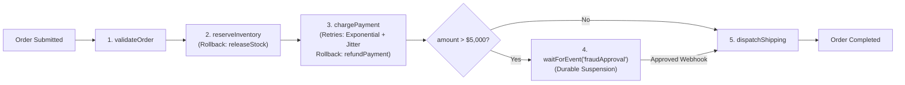

# Tutorial: AI-Assisted Development with Siglo

Siglo Agent Skills provide AI coding assistants (Antigravity, JetBrains AI Assistant, Claude Code, Cursor, and GitHub Copilot) with deep framework knowledge—including the 5-phase step lifecycle, AST/DAG graph semantics, saga compensation ordering, and deterministic testing patterns.

This tutorial guides you through installing the skills in your project and using your AI assistant to scaffold, implement, persist, expose, and test a resilient workflow from scratch.

---

## 1. Prerequisites & Skill Installation

When you install `@siglo/core` from npm, your IDE's AI assistant scans your local project directory (specifically `.agents/skills` or `skills/`). Install the Siglo Agent Skills using any of the three methods below:

### Method 1: The One-Liner (Recommended for any project)

Directly install the verified skills into your workspace using `degit`:

```bash
npx degit jsoftgem/siglo/skills .agents/skills
```

### Method 2: Via `@siglo/cli`

If scaffolding a brand-new Siglo project:

```bash
# Initializes starter project and equips .agents/skills automatically
npx @siglo/cli init my-siglo-app
cd my-siglo-app
```

To add skills to an existing project:

```bash
npx @siglo/cli skills install
```

### Method 3: From `@siglo/core` npm Package

Because skills are packaged inside `@siglo/core`, you can copy them locally:

```bash
npm install @siglo/core
mkdir -p .agents
cp -r node_modules/@siglo/core/skills .agents/skills
```

### Verifying IDE Detection

Once the folder `.agents/skills/` exists in your project root, open your AI chat assistant and ask:

> _"What Siglo skills are available in this project?"_

Your assistant will confirm that it has loaded:

1. `siglo-workflow-development`
2. `siglo-durable-workflows`
3. `siglo-ecosystem-adapters`
4. `siglo-testing-and-replay`

---

## 2. Interactive Hands-on Tutorial

In this tutorial, we will build a production **Order Fulfillment System** with payment retries, saga rollbacks, human fraud review suspension, an Express REST API, and zero-flake unit tests—entirely assisted by your AI agent.



---

### Step 1: Scaffold a Resilient Workflow with Sagas

Ask your AI assistant to generate the core order workflow:

#### Developer Prompt:

> _"Using the `siglo-workflow-development` skill, write an order fulfillment workflow in `src/workflows/order.ts`. It should:_
> _1. Validate `orderId`, `sku`, `quantity`, and `amountCents`._
> _2. Reserve stock in our inventory service. If downstream steps fail, release the stock._
> _3. Charge the customer's card with Stripe. If transient network errors occur, retry up to 3 times with exponential backoff and jitter. If downstream steps fail, refund the payment._
> _4. If `amountCents` exceeds 500,000 ($5,000), suspend for human fraud approval._
> _5. Dispatch shipping._
> _Adhere to context immutability and the 5-phase step lifecycle."_

#### What Your AI Generates (`src/workflows/order.ts`):

```typescript
import { Step, flow, when, waitForEvent } from '@siglo/core';

export interface OrderInput {
    orderId: string;
    sku: string;
    quantity: number;
    amountCents: number;
}

export interface InventoryService {
    reserve(orderId: string, sku: string, qty: number): Promise<string>;
    release(reservationId: string): Promise<void>;
}

export interface PaymentService {
    charge(orderId: string, amount: number): Promise<string>;
    refund(chargeId: string): Promise<void>;
}

export interface ShippingService {
    dispatch(orderId: string): Promise<string>;
}

export function createOrderWorkflow(deps: {
    inventory: InventoryService;
    payment: PaymentService;
    shipping: ShippingService;
}) {
    // 1. Validation Step
    const validateOrder = Step.create('validateOrder', (input: OrderInput) => {
        if (!input.orderId || !input.sku) throw new Error('Missing orderId or sku');
        if (!input.quantity || input.quantity <= 0) throw new Error('Quantity must be positive');
        if (!input.amountCents || input.amountCents <= 0) throw new Error('amountCents must be positive');
        return { validatedAt: new Date().toISOString() };
    });

    // 2. Reserve Stock with LIFO Compensation
    const reserveStock = Step.create('reserveStock', async (ctx: OrderInput) => {
        const reservationId = await deps.inventory.reserve(ctx.orderId, ctx.sku, ctx.quantity);
        return { reservationId };
    }).compensate(async ({ reservationId }) => {
        if (reservationId) await deps.inventory.release(reservationId);
    });

    // 3. Charge Payment with Exponential Backoff + Jitter & Compensation
    const chargePayment = Step.create('chargePayment', async (ctx: OrderInput & { reservationId: string }) => {
        const chargeId = await deps.payment.charge(ctx.orderId, ctx.amountCents);
        return { chargeId };
    })
        .onFail({
            maxRetries: 3,
            delay: 150,
            backoff: 'exponential',
            jitter: true,
            retryIf: (err: any) => err.isTransient === true || err.status >= 500,
        })
        .compensate(async ({ chargeId }) => {
            if (chargeId) await deps.payment.refund(chargeId);
        });

    // 4. Fraud Review Suspension for High-Value Orders (> $5,000)
    const fraudReview = waitForEvent('fraudReview', {
        correlationKey: (ctx: OrderInput) => ctx.orderId,
        timeout: '3d', // Auto-expires after 3 days
    });

    const checkFraudGate = when((ctx: OrderInput) => ctx.amountCents > 500_000, fraudReview);

    // 5. Dispatch Shipping
    const dispatchShipping = Step.create('dispatchShipping', async (ctx: OrderInput) => {
        const trackingId = await deps.shipping.dispatch(ctx.orderId);
        return { trackingId, status: 'FULFILLED' };
    });

    return flow(validateOrder, reserveStock, chargePayment, checkFraudGate, dispatchShipping);
}
```

---

### Step 2: Add Durable Storage & Webhook Resumption

Now ask your AI assistant to configure durable database persistence and create the webhook endpoint that resumes suspended workflows:

#### Developer Prompt:

> _"Using the `siglo-durable-workflows` skill, configure PostgreSQL persistence for our order workflow and write an Express webhook endpoint at `/api/webhooks/fraud-review` that resumes suspended orders when fraud analysts approve or reject them."_

#### What Your AI Generates (`src/server/fraud-webhook.ts`):

```typescript
import express from 'express';
import { Pool } from 'pg';
import { useStorage, resumeWorkflow } from '@siglo/core';
import { PostgresStorageAdapter } from '@siglo/postgres';
import { createOrderWorkflow } from '../workflows/order';

// 1. Initialize PostgreSQL Storage Adapter
const pool = new Pool({ connectionString: process.env.DATABASE_URL });
export const storage = new PostgresStorageAdapter({ client: pool });
useStorage(storage);

export function registerFraudWebhook(app: express.Express, workflow: ReturnType<typeof createOrderWorkflow>) {
    app.post('/api/webhooks/fraud-review', async (req, res) => {
        const { orderId, approved, reviewerEmail } = req.body;

        if (!orderId || typeof approved !== 'boolean') {
            return res.status(400).json({ error: 'orderId and approved boolean required' });
        }

        try {
            // Guard against race conditions using PostgreSQL advisory lock
            const finalResult = await storage.withWorkflowLock(orderId, async () => {
                return await resumeWorkflow(
                    workflow,
                    orderId, // Matches correlationKey defined on waitForEvent
                    { approved, reviewerEmail },
                    { pojo: true },
                );
            });

            return res.json({ success: true, result: finalResult });
        } catch (err: any) {
            if (err.name === 'ExpiredWaitException') {
                return res.status(410).json({ error: 'Fraud review expired' });
            }
            return res.status(500).json({ error: err.message });
        }
    });
}
```

---

### Step 3: Expose via Express with Live DevTools

Next, ask your AI assistant to expose the workflow as a REST API endpoint and attach live DevTools monitoring:

#### Developer Prompt:

> _"Using the `siglo-ecosystem-adapters` skill, expose our order workflow as an Express POST route `/api/orders`:_
> _1. Use `sigloExpressMiddleware`._
> _2. Run with `{ durable: true }`._
> _3. Map validation failures to 400, suspensions to 202 Accepted, and timeouts to 504._
> _4. Launch a live DevTools monitoring server on port 4000."_

#### What Your AI Generates (`src/server/index.ts`):

```typescript
import express from 'express';
import { sigloExpressMiddleware } from '@siglo/express';
import { createMonitorServer } from '@siglo/monitor';
import { createOrderWorkflow } from '../workflows/order';
import { registerFraudWebhook } from './fraud-webhook';

export async function bootstrapApp(services: any) {
    // Launch live DevTools dashboard on port 4000
    const monitor = await createMonitorServer({ port: 4000, host: '127.0.0.1' });
    console.log('Siglo DevTools running at http://127.0.0.1:4000');

    const app = express();
    app.use(express.json());

    const workflow = createOrderWorkflow(services).monitor(monitor.emitter);

    // Mount workflow route via sigloExpressMiddleware
    app.post(
        '/api/orders',
        sigloExpressMiddleware(workflow, {
            input: req => req.body,
            namespace: 'e-commerce',
            durable: true,
            timeout: 10_000,
            output: (result, res) => {
                if (result?.status === 'waiting') {
                    return res.status(202).json({
                        message: 'Order received and suspended for fraud approval',
                        orderId: result.correlationKey,
                    });
                }
                return res.status(201).json({ success: true, order: result });
            },
        }),
    );

    registerFraudWebhook(app, workflow);

    return app;
}
```

---

### Step 4: Write Zero-Flake Unit & Saga Tests

Finally, ask your AI assistant to write deterministic tests verifying retries and saga compensations:

#### Developer Prompt:

> _"Using the `siglo-testing-and-replay` skill, write unit tests in `src/workflows/order.test.ts`:_
> _Test 1: Happy path execution for a standard order (< $5,000)._
> _Test 2: When shipping throws an error, verify that `chargePayment` and `reserveStock` compensations execute in reverse LIFO order._
> _Test 3: Simulate a transient failure on Stripe charge; use `FakeClock` to advance virtual time and assert `assertStepRetried()`."_

#### What Your AI Generates (`src/workflows/order.test.ts`):

```typescript
import assert from 'node:assert/strict';
import { test, describe } from 'node:test';
import { createWorkflowHarness, FakeClock } from '@siglo/testing';
import { createOrderWorkflow } from './order';

describe('Order Fulfillment Workflow Tests', () => {
    test('executes standard order successfully (< $5,000)', async () => {
        const services = {
            inventory: { reserve: async () => 'res-101', release: async () => {} },
            payment: { charge: async () => 'ch-101', refund: async () => {} },
            shipping: { dispatch: async () => 'track-101' },
        };

        const workflow = createOrderWorkflow(services);
        const harness = createWorkflowHarness(workflow);

        const result = await harness.run({
            orderId: 'ORD-1',
            sku: 'WIDGET-A',
            quantity: 2,
            amountCents: 2000,
        });

        assert.equal(result.status, 'FULFILLED');
        assert.equal(result.trackingId, 'track-101');
        harness.assertStepExecuted('validateOrder', 1);
        harness.assertStepExecuted('reserveStock', 1);
        harness.assertStepExecuted('chargePayment', 1);
        harness.assertStepExecuted('dispatchShipping', 1);
    });

    test('rolls back in reverse LIFO order when shipping fails', async () => {
        const rollbackEvents: string[] = [];

        const services = {
            inventory: {
                reserve: async () => 'res-202',
                release: async () => {
                    rollbackEvents.push('released-stock');
                },
            },
            payment: {
                charge: async () => 'ch-202',
                refund: async () => {
                    rollbackEvents.push('refunded-charge');
                },
            },
            shipping: {
                dispatch: async () => {
                    throw new Error('Courier dispatch failed');
                },
            },
        };

        const workflow = createOrderWorkflow(services);
        const harness = createWorkflowHarness(workflow);

        await assert.rejects(
            harness.run({
                orderId: 'ORD-FAIL',
                sku: 'WIDGET-B',
                quantity: 1,
                amountCents: 4000,
            }),
            /Courier dispatch failed/,
        );

        // Assert Sagas unwound in reverse LIFO order:
        // chargePayment refunded first, then reserveStock released
        assert.deepEqual(rollbackEvents, ['refunded-charge', 'released-stock']);
    });

    test('retries transient payment failures without wall-clock delay', async () => {
        const clock = new FakeClock(1000);
        let attempts = 0;

        const services = {
            inventory: { reserve: async () => 'res-303', release: async () => {} },
            payment: {
                charge: async () => {
                    attempts++;
                    if (attempts < 3) {
                        const err: any = new Error('503 Service Unavailable');
                        err.isTransient = true;
                        throw err;
                    }
                    return 'ch-recovered';
                },
                refund: async () => {},
            },
            shipping: { dispatch: async () => 'track-303' },
        };

        const workflow = createOrderWorkflow(services);
        const harness = createWorkflowHarness(workflow, { clock });

        const result = await harness.run({
            orderId: 'ORD-RETRY',
            sku: 'WIDGET-C',
            quantity: 1,
            amountCents: 1500,
        });

        assert.equal(result.chargeId, 'ch-recovered');
        harness.assertStepRetried('chargePayment', 3);
    });
});
```

---

## 3. Conversational Prompting Playbook

Use this table as a quick guide for what to prompt your AI assistant during daily development:

| Goal                         | Skill                        | Example Prompt                                                                                     |
| ---------------------------- | ---------------------------- | -------------------------------------------------------------------------------------------------- |
| **Scaffold new flow**        | `siglo-workflow-development` | _"Create a typed Siglo workflow for onboarding new users with welcome emails and CRM sync."_       |
| **Add Saga rollback**        | `siglo-workflow-development` | _"Add a `.compensate()` handler to step 2 to cancel the reservation if step 3 fails."_             |
| **Parallel execution**       | `siglo-workflow-development` | _"Fan out KYC verification across identity, sanctions, and credit score using `parallel()`."_      |
| **Bounded batch processing** | `siglo-workflow-development` | _"Process this 500-item array using the `map()` combinator with concurrency capped at 5."_         |
| **Durable pause**            | `siglo-durable-workflows`    | _"Pause this subscription renewal workflow for 14 days using `wait('14d')`."_                      |
| **Webhook resumption**       | `siglo-durable-workflows`    | _"Implement the webhook endpoint that resumes this workflow using `resumeWorkflow()`."_            |
| **Queue consumer**           | `siglo-ecosystem-adapters`   | _"Create a BullMQ processor for this workflow with atomic idempotency claims."_                    |
| **AWS Lambda SQS**           | `siglo-ecosystem-adapters`   | _"Write an AWS Lambda handler using `@siglo/sqs` with partial batch failure reporting."_           |
| **AI Step with Tools**       | `siglo-ecosystem-adapters`   | _"Create an `@siglo/ai` step with structured output and tool calling where tools have sagas."_     |
| **Zero-flake tests**         | `siglo-testing-and-replay`   | _"Write unit tests with `createWorkflowHarness` and verify that retries occur on network errors."_ |
| **Architecture review**      | `siglo-workflow-development` | _"Audit this workflow file against the Siglo Golden Rules and list any anti-patterns."_            |

---

## 4. Human Developer Offline Reference

When coding offline or without an AI assistant, consult these pre-built references:

- **API Cheatsheet**: [`skills/siglo-workflow-development/references/api-cheatsheet.md`](file:///Users/jericodeguzman/Projects/fluid-func/skills/siglo-workflow-development/references/api-cheatsheet.md)
- **Database Schema (PostgreSQL/Redis)**: [`skills/siglo-durable-workflows/references/storage-adapters.md`](file:///Users/jericodeguzman/Projects/fluid-func/skills/siglo-durable-workflows/references/storage-adapters.md)
- **Ecosystem npm Packages**: [`skills/siglo-ecosystem-adapters/references/adapter-matrix.md`](file:///Users/jericodeguzman/Projects/fluid-func/skills/siglo-ecosystem-adapters/references/adapter-matrix.md)
- **Testing Cheatsheet**: [`skills/siglo-testing-and-replay/references/testing-cheatsheet.md`](file:///Users/jericodeguzman/Projects/fluid-func/skills/siglo-testing-and-replay/references/testing-cheatsheet.md)
