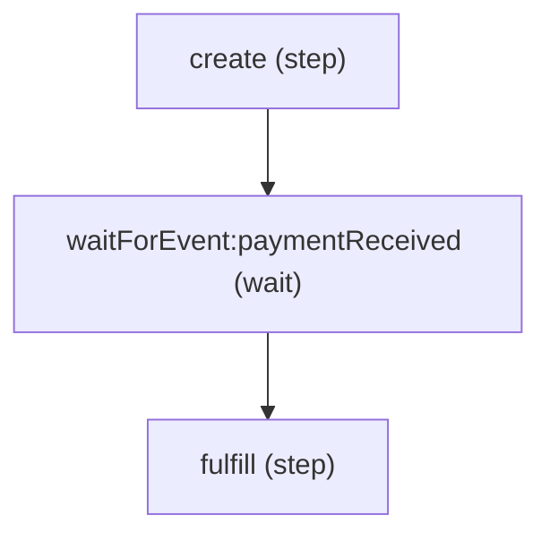

# API Reference: Flow Instance Methods (`Flow`)

The `Flow` interface represents an executable, composable workflow pipeline in **Siglo**. Instances are created using `flow(...steps)`. A `Flow` encapsulates sequential step execution, deadline timeouts, versioning, saga rollbacks, durable event resumption, and AST graph visualization.

---

## Table of Contents

- [The `Flow` Interface](#the-flow-interface)
- [Execution Methods](#execution-methods)
  - [`flow.run(param?, options?)`](#flowrunparam-options)
  - [`flow.execute(param?, options?)`](#flowexecuteparam-options)
  - [`flow.start(param?, options?)`](#flowstartparam-options)
- [Configuration Methods](#configuration-methods)
  - [`flow.timeout(ms)`](#flowtimeoutms)
  - [`flow.version(version)`](#flowversionversion)
  - [`flow.networkPolicy(policy)`](#flownetworkpolicypolicy)
- [Lifecycle & Resumption Methods](#lifecycle--resumption-methods)
  - [`flow.resume(correlationKeyOrStackId, payload?, options?)`](#flowresumecorrelationkeyorstackid-payload-options)
  - [`flow.compensate(stackId, options?)`](#flowcompensatestackid-options)
- [Graph & Export Methods](#graph--export-methods)
  - [`flow.toGraph()`](#flowtograph)
  - [`flow.inspect()`](#flowinspect)
  - [`flow.toMermaid(options?)`](#flowtomermaidoptions)
  - [`flow.toDot(options?)`](#flowtodotoptions)
  - [`flow.toJSON()`](#flowtojson)
- [Properties](#properties)
  - [`flow.steps`](#flowsteps)
  - [`flow.timeoutMs`](#flowtimeoutms-1)
  - [`flow.workflowVersion`](#flowworkflowversion)
- [Composing Flows Within Flows](#composing-flows-within-flows)

---

## The `Flow` Interface

```typescript
export interface Flow<TInput = any, TOutput = any> {
    execute: (param?: TInput, options?: ExecutionOptions) => Promise<TOutput>;
    start: (param?: TInput, options?: ExecutionOptions) => Promise<TOutput>;
    run: (param?: TInput, options?: ExecutionOptions) => Promise<TOutput>;
    steps: Step<any, any, any>[];
    readonly isFlow?: boolean;
    timeout: (ms: number) => Flow<TInput, TOutput>;
    timeoutMs?: number;
    workflowVersion?: string | number;
    version: (v: string | number) => Flow<TInput, TOutput>;
    networkPolicy?: (policy: NetworkPolicyConfig) => Flow<TInput, TOutput>;
    toGraph: () => WorkflowNode;
    inspect: () => GraphInspectionResult;
    toMermaid: (options?: MermaidExportOptions) => string;
    toJSON: () => string;
    toDot: (options?: DotExportOptions) => string;
    resume: (correlationKeyOrStackId: string, eventPayload?: any, options?: ExecutionOptions) => Promise<any>;
    compensate: (stackId: string, options?: any) => Promise<any>;
}
```

---

## Execution Methods

### `flow.run(param?, options?)`

Executes the workflow from the first step through to completion, propagating accumulated context from step to step and returning a Promise resolving to the final output.

#### Signature

```typescript
flow.run(param?: TInput, options?: ExecutionOptions): Promise<TOutput>;
```

#### Parameters

- `param`: `TInput` *(optional)* &mdash; Initial POJO input parameters passed to the first step.
- `options`: [`ExecutionOptions`](execution-options.md) *(optional)* &mdash; Runtime options such as `signal`, `timeout`, `services`, `pojo`, `durable`, `namespace`, and `idempotencyKey`.

#### Returns

A Promise resolving to `TOutput`, which contains:
- All fields accumulated across step outputs.
- `$steps`: Typed record containing outputs of every named step (e.g. `result.$steps.fetchUser`).
- `$timing`: Total workflow execution duration in milliseconds.

#### Example

```typescript
import { Step, flow } from '@siglo/core';

const step1 = Step.create('init', async (ctx: { orderId: string }) => ({ status: 'pending' }));
const step2 = Step.create('calculate', async (ctx: { status: string }) => ({ total: 99.95 }));

const orderFlow = flow(step1, step2);

const output = await orderFlow.run({ orderId: 'ord_123' }, { pojo: true });
console.log(output.status);            // 'pending'
console.log(output.total);             // 99.95
console.log(output.$steps.init);       // { status: 'pending' }
console.log(output.$steps.calculate);  // { total: 99.95 }
```

---

### `flow.execute(param?, options?)` and `flow.start(param?, options?)`

Direct aliases for `flow.run()`. Provided for functional style preferences or backwards compatibility.

---

## Configuration Methods

### `flow.timeout(ms)`

Configures an overall workflow-level SLA deadline. If the total elapsed execution duration across all steps exceeds `ms`, execution is cancelled and a `FlowTimeoutException` is thrown.

#### Signature

```typescript
flow.timeout(ms: number): Flow<TInput, TOutput>;
```

#### Chainable

Returns the `flow` instance for fluent chaining.

#### Behavior

- Overridden at runtime if `options.timeout` is supplied to `.run()`.
- If a timeout occurs, any in-flight steps receive an abort signal from the internal cancellation controller.

#### Example

```typescript
import { Step, flow, FlowTimeoutException } from '@siglo/core';

const longStep = Step.create('slow', async () => {
    await new Promise(r => setTimeout(r, 5000));
    return { done: true };
});

const workflow = flow(longStep).timeout(1000); // 1-second overall SLA

try {
    await workflow.run();
} catch (err) {
    if (err instanceof FlowTimeoutException) {
        console.error(`Workflow timed out after ${err.timeoutMs}ms on stack ${err.stackId}`);
    }
}
```

---

### `flow.version(version)`

Declares the schema version of the workflow (e.g. `'v1'`, `'v2'`, `2`). Used in durable executions to detect version mismatches when restoring suspended checkpoints.

#### Signature

```typescript
flow.version(version: string | number): Flow<TInput, TOutput>;
```

#### Chainable

Returns the `flow` instance for fluent chaining.

#### Behavior

When a durable workflow resumes:
- The declared `flow.workflowVersion` is compared against the version stored in the checkpoint.
- If they differ and no migration function was supplied in `options.migrations`, a `WorkflowVersionMismatchException` is thrown.

#### Example

```typescript
import { Step, flow } from '@siglo/core';

export const userOnboarding = flow(
    Step.create('step1', async () => ({ v: 2 }))
).version('v2.1');
```

---

### `flow.networkPolicy(policy)`

Configures the workflow-level network egress policy perimeter. The flow policy supersedes all individual step policies: steps can only narrow permissions within what the flow permits. Outbound requests are intercepted across `globalThis.fetch`, `node:http`/`node:https`, and raw `node:net.Socket`. Loopback addresses and local Unix sockets are permitted by default.

#### Signature

```typescript
flow.networkPolicy(policy: NetworkPolicyConfig): Flow<TInput, TOutput>;
```

#### Chainable

Returns the `flow` instance for fluent chaining.

#### Parameters

- `policy`: `NetworkPolicyConfig`
  - `allowedHosts`: `(string | RegExp)[]` *(optional)* &mdash; Outer permissible hosts or wildcard patterns.
  - `defaultPolicy`: `'allow' | 'deny'` *(optional, default: `'deny'`)* &mdash; Outer perimeter default policy.
  - `allowLocalhost`: `boolean` *(optional, default: `true`)* &mdash; Loopback and Unix socket exemption.

#### Precedence & Narrowing Rules

1. **Outer Envelope**: The flow's `allowedHosts` defines the outer boundary. If a flow only allows `['api.stripe.com']`, a step cannot allow `api.github.com`.
2. **Step Narrowing**: A step can choose to permit only a subset of the flow's allowed hosts or call `.denyNetwork()`.
3. **Execution Options Override**: Network policy can also be supplied dynamically per execution run via `flow.run(payload, { networkPolicy: { ... } })`.

#### Example

```typescript
import { Step, flow } from '@siglo/core';

const chargeCustomer = Step.create('charge', async () => {
    return await fetch('https://api.stripe.com/v1/charges');
}).allowNetwork(['api.stripe.com']);

const sendEmail = Step.create('email', async () => {
    return await fetch('https://api.sendgrid.com/v3/mail/send');
}).allowNetwork(['api.sendgrid.com']);

// Flow allows both, but individual steps only have access to their designated service
export const paymentFlow = flow(chargeCustomer, sendEmail)
    .networkPolicy({
        defaultPolicy: 'deny',
        allowedHosts: ['api.stripe.com', 'api.sendgrid.com']
    });
```

---

## Lifecycle & Resumption Methods

### `flow.resume(correlationKeyOrStackId, payload?, options?)`

Resumes a suspended durable workflow instance that paused at a `waitForEvent` or `wait` step.

#### Signature

```typescript
flow.resume(
    correlationKeyOrStackId: string,
    eventPayload?: any,
    options?: ExecutionOptions
): Promise<any>;
```

#### Parameters

- `correlationKeyOrStackId`: `string` &mdash; Either the correlation key specified during `waitForEvent` or the execution `stackId`.
- `eventPayload`: `any` *(optional)* &mdash; Data injected from the external event (e.g. webhook body). Merged into context before resumed steps execute.
- `options`: `ExecutionOptions` *(optional)* &mdash; Runtime options including schema migrations.

#### Example

```typescript
import { Step, flow, waitForEvent } from '@siglo/core';

const orderFlow = flow(
    Step.create('create', async () => ({ orderId: 'ord_123' })),
    waitForEvent('paymentReceived', {
        correlationKey: (ctx) => ctx.orderId
    }),
    Step.create('fulfill', async (ctx: { paymentId: string }) => ({ fulfilled: true }))
);

// Resumed upon receiving webhook:
const finalResult = await orderFlow.resume('ord_123', { paymentId: 'pay_999' });
console.log(finalResult.fulfilled); // true
```

---

### `flow.compensate(stackId, options?)`

Manually triggers saga compensation rollbacks for an execution stack in reverse order of execution (LIFO).

#### Signature

```typescript
flow.compensate(stackId: string, options?: any): Promise<any>;
```

#### Parameters

- `stackId`: `string` &mdash; The execution stack ID whose registered compensations should run.
- `options`: `any` *(optional)* &mdash; Optional compensation execution options.

#### Example

```typescript
try {
    await orderFlow.run(input, { stackId: 'custom-stack-id' });
} catch (err) {
    // Manually trigger rollback if needed outside automatic step error boundaries
    await orderFlow.compensate('custom-stack-id');
}
```

---

## Graph & Export Methods

### `flow.toGraph()`

Compiles the workflow into a JSON-serializable `WorkflowNode` AST structure representing the hierarchical topology of steps and combinators.

```typescript
const ast = flow.toGraph();
console.log(ast.type); // 'sequence'
console.log(ast.children);
```

---

### `flow.inspect()`

Analyzes the workflow graph and returns structural metrics including node count, depth, and directed edges.

```typescript
const metrics = flow.inspect();
console.log(metrics.nodeCount); // 5
console.log(metrics.depth);     // 3
```

---

### `flow.toMermaid(options?)`

Exports the workflow topology as a Mermaid flowchart diagram with policy badges for timeouts, retries, sagas, and waits.

#### Signature

```typescript
flow.toMermaid(options?: { direction?: 'TD' | 'LR' }): string;
```

#### Example

```typescript
const mermaid = orderFlow.toMermaid({ direction: 'TD' });
console.log(mermaid);
```

Output:


---

### `flow.toDot(options?)`

Exports the workflow topology as a Graphviz DOT diagram string.

```typescript
const dotCode = orderFlow.toDot({ graphName: 'OrderWorkflow' });
```

---

### `flow.toJSON()`

Serializes the complete workflow AST into a formatted JSON string.

```typescript
const json = orderFlow.toJSON();
```

---

## Properties

### `flow.steps`

Returns the flattened array of `Step` execution units contained in the flow.

```typescript
console.log(orderFlow.steps.map(s => s.name)); // ['create', 'waitForEvent:paymentReceived', 'fulfill']
```

### `flow.timeoutMs`

Read-only number reflecting the workflow-level timeout configured via `.timeout(ms)`.

### `flow.workflowVersion`

Read-only string or number reflecting the workflow schema version configured via `.version(v)`.

---

## Composing Flows Within Flows

Flows are first-class execution units and can be nested seamlessly within other flows:

```typescript
import { Step, flow } from '@siglo/core';

const subFlowA = flow(
    Step.create('stepA1', async () => ({ a1: true })),
    Step.create('stepA2', async () => ({ a2: true }))
);

const subFlowB = flow(
    Step.create('stepB1', async () => ({ b1: true }))
);

export const masterWorkflow = flow(
    subFlowA,
    subFlowB,
    Step.create('finalize', async (ctx: { a1: boolean; b1: boolean }) => ({
        complete: ctx.a1 && ctx.b1
    }))
);

const result = await masterWorkflow.run();
console.log(result.complete); // true
```

---

## Related Topic Guides

- [02. Core Concepts](../02-core-concepts.md)
- [03. Sequential Workflows](../03-sequential-workflows.md)
- [05. Retries, Timeouts, and Cancellation](../05-retries-timeouts-and-cancellation.md)
- [06. Durable Workflows](../06-durable-workflows.md)
- [08. Observability & Diagrams](../08-observability.md)
