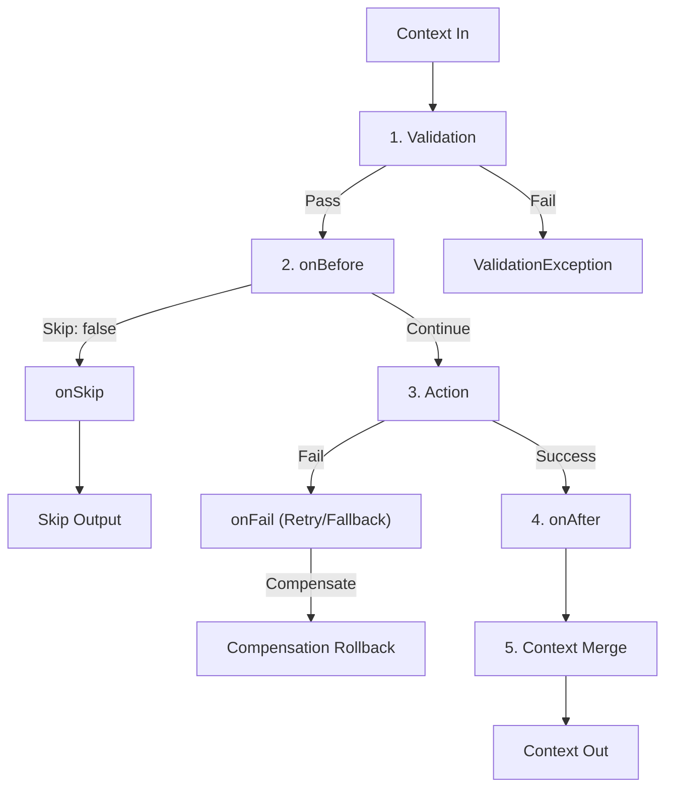

# API Reference: Step Methods (`Step` & `ComputeStep`)

The `Step` class is the fundamental asynchronous execution unit in **Siglo**, encapsulating an async action, parameter validation contracts, lifecycle hooks, structured retry policies, SLA deadlines, idempotency locks, caching, and saga compensations.

For pure, CPU-bound, or in-memory transformations, **`Step.compute`** creates a lightweight synchronous **`ComputeStep`** with zero-microtask batching, synchronous `.spec()` validation, in-memory LRU+TTL `.cache()`, and an unconditional always-deny network perimeter.

---

## Table of Contents

- [The 5-Phase Step Lifecycle](#the-5-phase-step-lifecycle)
- [Instantiating Steps](#instantiating-steps)
    - [`Step.create(name?, action)`](#stepcreatename-action)
    - [`Step.compute(name?, action)`](#stepcomputename-action)
- [Validation and Contracts](#validation-and-contracts)
    - [`step.schema(schema)`](#stepschemaschema)
    - [`step.spec(field, options)`](#stepspecfield-options)
    - [`step.strict()`](#stepstrict)
- [Lifecycle Hooks](#lifecycle-hooks)
    - [`step.onBefore(hook)`](#steponbeforehook)
    - [`step.onSkip(hook)`](#steponskiphook)
    - [`step.onAfter(hook)`](#steponafterhook)
- [Fault Tolerance and Resilience](#fault-tolerance-and-resilience)
    - [`step.timeout(ms)`](#steptimeoutms)
    - [`step.onFail(config)`](#steponfailconfig)
    - [`step.compensate(handler, options?)`](#stepcompensatehandler-options)
- [Optimization and Deduplication](#optimization-and-deduplication)
    - [`step.idempotent(keyOrFnOrOptions?, options?)`](#stepidempotentkeyorfnoroptions-options)
    - [`step.cache(msOrOptions)`](#stepcachemsoroptions)
- [Dependency Injection](#dependency-injection)
    - [`step.withDependencies(deps)`](#stepwithdependenciesdeps)
    - [`step.requireDependency(key)`](#steprequiredependencykey)
- [Context Transformation](#context-transformation)
    - [`step.reduce(field)`](#stepreducefield)
- [Network Egress Guardrails](#network-egress-guardrails)
    - [`step.allowNetwork(hosts)`](#stepallownetworkhosts)
    - [`step.allowUnixSockets(sockets)`](#stepallowunixsocketssockets)
    - [`step.denyNetwork()`](#stepdenynetwork)
    - [`step.networkPolicy(policy)`](#stepnetworkpolicypolicy)
- [Execution and Inspection](#execution-and-inspection)
    - [`step.run and step.execute`](#steprun-and-stepexecute)
    - [`step.toGraph`, `step.inspect`, `step.toMermaid`](#graph-and-export-methods)
- [Static Methods and Configuration](#static-methods-and-configuration)

---

## The 5-Phase Step Lifecycle

Every `Step.create` step executes through five distinct, deterministic phases:



1. **Validation**: Enforces parameter constraints declared via `.schema()` or `.spec()`. Rejections throw `ValidationException`.
2. **Pre-Execution Guard (`onBefore`)**: Evaluates whether the step should run. Returning `false` bypasses the action and triggers `onSkip`.
3. **Action Execution**: Runs the step action under the configured `timeout`, `idempotent` lock, and `onFail` retry strategy.
4. **Post-Execution Transform (`onAfter`)**: Modifies or enriches the raw output before merging.
5. **Context Merge**: Merges step output into the accumulated workflow context (or assigns it to a target property if `.reduce()` was configured).

> [!NOTE]
> **Network Guardrails Across Lifecycle Phases**: When `.allowNetwork()`, `.allowUnixSockets()`, `.denyNetwork()`, or `.networkPolicy()` is declared, the network egress policy governs phases 2 (`onBefore`/`onSkip`), 3 (`action`), 4 (`onAfter`), and `onFail` through Node's `AsyncLocalStorage`. Any unauthorized outbound call triggers a `NetworkPolicyViolationException` tagged with the active phase (`before`, `action`, or `after`).

---

## Instantiating Steps

### `Step.create(name?, action)`

Instantiates a typed asynchronous `Step` execution unit with input and output contracts.

#### Signatures

```typescript
export type StepAction<TInput = any, TOutput = any> = (
    parameter: TInput,
    current?: any,
    index?: number,
) => TOutput | Promise<TOutput>;

export class Step<TInput = any, TOutput = any, TName extends string = string> {
    static create<TName extends string, TIn = any, TOut = any>(
        name: TName,
        action?: StepAction<TIn, TOut>,
    ): Step<TIn, TOut, TName>;

    static create<TIn = any, TOut = any>(action: StepAction<TIn, TOut> | Flow<TIn, TOut>): Step<TIn, TOut, string>;
}
```

#### Example

```typescript
import { Step } from '@siglo/core';

interface UserInput {
    userId: string;
}

interface UserOutput {
    name: string;
    email: string;
}

export const fetchUser = Step.create('fetchUser', async (param: UserInput): Promise<UserOutput> => {
    return { name: 'Bob', email: 'bob@example.com' };
});
```

---

### `Step.compute(name?, action)`

Instantiates a lightweight, synchronous `ComputeStep<TInput, TOutput, TName>` designed for pure calculations, pricing engines, data shaping, and policy rules.

Unlike `Step.create`, a `ComputeStep`:
- **Requires a synchronous return value**: TypeScript rejects `Promise` return types at compile time (`SyncValue<TOut>`), and the runtime rejects any returned Promise or thenable from `action` or `keySerializer` with a `SigloError` (`phase: 'action'`, `retryable: false`) and any async `.spec()` callback/schema with a `ValidationException` (`phase: 'validation'`, `retryable: false`).
- **Enforces an unconditional always-deny network perimeter**: `COMPUTE_NETWORK_POLICY` (`defaultPolicy: 'deny'`, `allowedHosts: []`, `allowLocalhost: false`, `throwSync: true`) is active across `.spec()`, `.cache()`, and `action`. Neither flow-level nor execution-level network policies can widen a `ComputeStep`'s network permissions.
- **Executes in a synchronous fast path**: Consecutive `Step.compute` nodes in `flow()` execute in a tight synchronous loop without allocating `SingleChain`, `StartChain`, `PromiseChain`, or per-step `Context` instances.
- **Exposes a focused chainable API**: Supports only `.spec()`, `.cache()`, and `.run()`. Async I/O and lifecycle methods (`.timeout()`, `.onFail()`, `.compensate()`, `.idempotent()`, `.allowNetwork()`, etc.) do not exist on `ComputeStep`.

#### Signatures

```typescript
export type SyncValue<T> = T extends PromiseLike<any> ? never : T;

export type SyncStepAction<TInput = any, TOutput = any> = (parameter: TInput) => SyncValue<TOutput>;

export interface SyncSpecData {
    defaultValue?: any;
    default?: any;
    require?: boolean | (() => boolean);
    requireMessage?: string;
    validator?: (currentValue?: any) => SyncValue<any>;
    validate?: (currentValue?: any) => SyncValue<any>;
    transformer?: (currentValue?: any) => SyncValue<any>;
    transform?: (currentValue?: any) => SyncValue<any>;
    translator?: (currentValue?: any, context?: Record<string, any>) => SyncValue<void>;
    translate?: (currentValue?: any, context?: Record<string, any>) => SyncValue<void>;
    schema?: any; // Synchronous Standard Schema (~standard), safeParse, parse, validate, or predicate
}

export interface ComputeCacheOptions {
    ttl?: DurationInput; // Default: 1500ms
    maxEntries?: number; // Bounded in-memory LRU capacity (default: 1000)
    keySerializer?: (stepId: string, param: any, namespace?: string) => SyncValue<string>;
}

export class ComputeStep<TInput = any, TOutput = any, TName extends string = string> {
    readonly isCompute = true as const;
    readonly name: TName;
    readonly func: string;
    readonly $stepId: string;
    readonly action: SyncStepAction<TInput, TOutput>;
    readonly specs: SyncSpec[];
    readonly networkPolicyConfig: Readonly<NetworkPolicyConfig>;
    cachedLast?: number;
    cacheOptions?: ComputeCacheOptions;

    spec(fieldOrSchema: string | any, json?: SyncSpecData | any): ComputeStep<TInput, TOutput, TName>;
    cache(ttlOrOptions?: DurationInput | ComputeCacheOptions): ComputeStep<TInput, TOutput, TName>;
    run(param?: TInput, options?: ExecutionOptions): Promise<TOutput>;
}

export class Step {
    static compute<TName extends string, TIn = any, TOut = any>(
        name: TName,
        action: SyncStepAction<TIn, TOut>,
    ): ComputeStep<TIn, TOut, TName>;

    static compute<TIn = any, TOut = any>(
        action: SyncStepAction<TIn, TOut>,
    ): ComputeStep<TIn, TOut, string>;
}
```

#### Example

```typescript
import { Step, flow } from '@siglo/core';

const calculateTotals = Step.compute(
    'calculateTotals',
    (ctx: { subtotal: number; discount: number; taxRate: number }) => {
        const taxable = Math.max(0, ctx.subtotal - ctx.discount);
        const tax = Math.round(taxable * ctx.taxRate * 100) / 100;
        return { tax, total: taxable + tax };
    },
)
    .spec('subtotal', {
        require: true,
        validate: v => typeof v === 'number' && v >= 0,
    })
    .spec('discount', {
        default: 0,
        transform: v => Math.max(0, Number(v)),
    })
    .spec('taxRate', {
        default: 0.08,
    })
    .cache({
        ttl: '5m',
        maxEntries: 500,
        keySerializer: (_stepId, ctx) => `${ctx.subtotal}:${ctx.discount}:${ctx.taxRate}`,
    });

export const pricingFlow = flow(calculateTotals);
```

---

## Validation and Contracts

### `step.schema(schema)`

Validates the incoming execution context against standard schema validators supporting the [Standard Schema](https://github.com/standard-schema/standard-schema) specification (`~standard`), including **Zod**, **Valibot**, and **ArkType**.

#### Signature

```typescript
step.schema<TSchema = any>(schemaObj: TSchema): Step<TInput, TOutput, TName>;
```

#### Example with Zod

```typescript
import { Step } from '@siglo/core';
import { z } from 'zod';

const OrderInputSchema = z.object({
    orderId: z.string().min(1),
    amount: z.number().positive(),
    currency: z.enum(['USD', 'EUR', 'GBP']),
});

export const processPayment = Step.create('processPayment', async (param: z.infer<typeof OrderInputSchema>) => {
    return { paymentCaptured: true };
}).schema(OrderInputSchema);
```

If validation fails, a `ValidationException` is thrown before the step action executes, containing detailed issue descriptions in `err.errors`.

---

### `step.spec(field, options)`

Declares granular parameter constraints, default values, transforms, and translations for a specific context field. Supported on both `Step` (sync or async hooks) and `ComputeStep` (strictly synchronous hooks via `SyncSpecData`).

#### Signature

```typescript
export interface SpecData {
    require?: boolean;
    requireMessage?: string;
    default?: any;
    validate?: (value: any) => boolean;
    transform?: (value: any) => any;
    translate?: string; // Rename field in context
    schema?: any;       // Standard schema for this field
}

step.spec(field: string, options: SpecData): Step<TInput, TOutput, TName>;
```

#### Example

```typescript
const sanitizeInput = Step.create('sanitizeInput', async (param: any) => {
    return { cleanEmail: param.userEmail };
})
    .spec('email', {
        require: true,
        requireMessage: 'Customer email is mandatory.',
        validate: async (v: string) => v.includes('@'),
        transform: async (v: string) => v.trim().toLowerCase(),
        translate: async (param: any, value: string) => {
            param.userEmail = value;
        },
    })
    .spec('newsletterOptIn', {
        default: false,
    });
```

---

### `step.strict()`

Enforces strict parameter filtering on incoming parameters, selecting only declared spec fields and filtering out undeclared properties before the action executes.

#### Signature

```typescript
step.strict(): Step<TInput, TOutput, TName>;
```

#### Example

```typescript
const strictStep = Step.create('createAccount', async (param: any) => {
    // Only declared spec fields ('username') are present in param; extra keys are filtered
    return { created: param.username, hasExtra: 'extraField' in param };
})
    .spec('username', { require: true })
    .strict();

const result = await strictStep.run({ username: 'alice', extraField: 'filtered out' } as any);
console.log(result.hasExtra); // false
```

---

## Lifecycle Hooks

### `step.onBefore(hook)`

Pre-execution guard hook. Evaluates the incoming parameter context before the action executes. If it returns `false`, step action execution is skipped and control transfers to `onSkip` (or context passes through unchanged).

#### Signature

```typescript
export type OnBeforeAction<TInput = any> = (
    parameter: TInput
) => boolean | Promise<boolean>;

step.onBefore(hook: OnBeforeAction<TInput>): Step<TInput, TOutput, TName>;
```

#### Example

```typescript
const sendInvoice = Step.create('sendInvoice', async (param: { amount: number }) => ({ invoiceSent: true })).onBefore(
    param => param.amount > 0,
); // Skip if amount is 0
```

---

### `step.onSkip(hook)`

Fallback hook that executes if and only if `onBefore` returns `false`. Its returned value is merged into the context in place of the step action output.

#### Signature

```typescript
export type OnSkipAction<TInput = any, TFallback = any> = (
    parameter: TInput
) => TFallback | Promise<TFallback>;

step.onSkip(hook: OnSkipAction<TInput>): Step<TInput, TOutput, TName>;
```

#### Example

```typescript
const chargeSubscription = Step.create('charge', async () => ({ charged: true }))
    .onBefore((param: { isTrial: boolean }) => !param.isTrial)
    .onSkip(param => ({ charged: false, trialSkipped: true }));
```

---

### `step.onAfter(hook)`

Post-execution transformation hook. Receives the raw output produced by the step action and the input parameters, returning an enriched or transformed output.

#### Signature

```typescript
export type OnAfterAction<TOutput = any, TInput = any> = (
    output: TOutput,
    parameter: TInput
) => any | Promise<any>;

step.onAfter(hook: OnAfterAction<TOutput, TInput>): Step<TInput, TOutput, TName>;
```

#### Example

```typescript
const calculateTax = Step.create('calcTax', async (param: { subtotal: number }) => ({
    tax: param.subtotal * 0.08,
})).onAfter((output, param) => ({
    ...output,
    totalWithTax: param.subtotal + output.tax,
}));
```

---

## Fault Tolerance and Resilience

### `step.timeout(ms)`

Enforces a per-step SLA deadline. Accepts milliseconds (`number`) or a `DurationInput` string (e.g. `'2s'`, `'500ms'`), resolved via `parseDuration`. If the step action takes longer than the resolved duration, the action is aborted via `AbortSignal` and throws a `StepTimeoutException`.

#### Signature

```typescript
step.timeout(ms: DurationInput): Step<TInput, TOutput, TName>;
```

#### Example

```typescript
import { Step, StepTimeoutException } from '@siglo/core';

const callExternalVendor = Step.create('vendorApi', async () => {
    const res = await fetch('https://api.vendor.com/data');
    return res.json();
}).timeout('2s'); // 2-second timeout (or 2000)
```

---

### `step.onFail(config)`

Configures structured retry policies or custom error fallback handlers when the step action throws.

- `delay` and `maxDelay` accept `DurationInput` (`number | string`, e.g. `'500ms'`, `'5s'`).
- `retryIf` remains a synchronous predicate `(err, attempt) => boolean`.

#### Signatures

```typescript
export type RetryPredicate = (error: any, attempt: number) => boolean;

export interface RetryConfig {
    maxRetries?: number;
    delay?: DurationInput;
    backoff?: 'fixed' | 'linear' | 'exponential' | ((attempt: number) => number);
    jitter?: boolean | ((delay: number) => number);
    maxDelay?: DurationInput;
    retryIf?: RetryPredicate;
    onRetry?: (error: any, attempt: number, delayMs?: number) => void;
}

export type OnFailCallback = (
    error: any,
    retry: (fallback?: any) => void,
    reject: (err?: any) => void
) => any;

step.onFail(config: RetryConfig | OnFailCallback): Step<TInput, TOutput, TName>;
```

#### Example with Exponential Backoff & Jitter

```typescript
const resilientFetch = Step.create('fetchData', async () => {
    return await externalService.call();
}).onFail({
    maxRetries: 3,
    delay: '500ms',
    backoff: 'exponential',
    jitter: true,
    maxDelay: '5s',
    retryIf: err => err.status >= 500, // Synchronous predicate: only retry 5xx server errors
    onRetry: (err, attempt) => console.warn(`Retry attempt ${attempt} due to ${err.message}`),
});
```

#### Example with OnFail Fallback

To provide a graceful fallback return value when errors occur, use the callback form:

```typescript
const resilientFetchWithFallback = Step.create('fetchData', async () => {
    return await externalService.call();
}).onFail((err, retry, reject) => {
    if (err.status >= 500) {
        retry({ fallbackData: true }); // Resolves step with fallback data
    } else {
        reject(err);
    }
});
```

---

### `step.compensate(handler, options?)`

Registers a saga compensation rollback handler. If downstream steps in the workflow fail, registered compensation handlers execute automatically in reverse order (LIFO) inside the effective `networkPolicy` perimeter captured when the step executed.

- `delay` accepts `DurationInput` (`number | string`, e.g. `'1s'`, `1000`).
- `retryIf` remains a synchronous predicate `(err, attempt) => boolean`.

#### Signature

```typescript
export interface CompensationOptions {
    maxRetries?: number;
    delay?: DurationInput;
    retryIf?: (err: any, attempt: number) => boolean;
}

step.compensate(
    handler: (output: any, input: any, context?: any) => Promise<void> | void,
    options?: CompensationOptions
): Step<TInput, TOutput, TName>;
```

#### Example

```typescript
const bookFlight = Step.create('bookFlight', async (ctx: { flightNo: string }) => {
    const booking = await airlineApi.reserve(ctx.flightNo);
    return { flightReservationId: booking.id };
}).compensate(
    async ctx => {
        // Automatically called if payment or hotel booking fails downstream
        await airlineApi.cancelReservation(ctx.flightReservationId);
    },
    { maxRetries: 3, delay: '1s' },
);
```

---

## Optimization and Deduplication

### `step.idempotent(keyOrFnOrOptions?, options?)`

Guarantees step deduplication and concurrent claim locking using deterministic idempotency keys (`DynamicOption<string>`) and TTL storage (`DurationInput`).

#### Signature

```typescript
export interface IdempotencyOptions<TContext = any> {
    key?: DynamicOption<string, TContext>;
    ttl?: DurationInput;
    ttlMs?: DurationInput;
    store?: IdempotencyStore;
    settleTimeoutMs?: number;
    pollIntervalMs?: number;
    isPermanentError?: (err: any) => boolean;
}

step.idempotent(
    keyOrFnOrOptions?: DynamicOption<string> | IdempotencyOptions,
    options?: IdempotencyOptions,
): Step<TInput, TOutput, TName>;
```

#### Semantics

1. **Claiming**: Before execution, attempts to claim the key in the configured `IdempotencyStore`.
2. **Conflict**: If already in-progress, throws `IdempotencyConflictException`.
3. **Cache Hit**: If previously completed and within TTL, returns cached output without re-executing.
4. **Completion**: Upon successful execution, records output and marks status `COMPLETED`.

#### Example

```typescript
const chargeCard = Step.create('chargeCard', async (ctx: { idempotencyToken: string; amount: number }) => {
    return await stripe.charges.create({ amount: ctx.amount });
}).idempotent(ctx => ctx.idempotencyToken, { ttlMs: '24h' });

// Or using the single options-object overload:
const chargeCardAlt = Step.create('chargeCardAlt', async (ctx: { idempotencyToken: string; amount: number }) => {
    return await stripe.charges.create({ amount: ctx.amount });
}).idempotent({
    key: ctx => ctx.idempotencyToken,
    ttl: '24h',
});
```

---

### `step.cache(msOrOptions)`

Caches step output based on input parameters.

- On **`Step`** (`Step.create`), `.cache()` caches output in memory or persistent storage (`StorageAdapter`) and accepts `DurationInput` or `CacheOptions` (including `swr` / `staleWhileRevalidate` and `stampedeProtection`).
- On **`ComputeStep`** (`Step.compute`), `.cache()` uses a **purely in-memory synchronous LRU + TTL cache** (`ComputeCacheOptions`) that never touches `StorageAdapter` (Redis/Postgres), operates in zero microtasks, defensively clones cached plain objects and arrays to prevent cross-run mutation, keys on post-`.spec()` normalized inputs, and scopes keys by `ExecutionOptions.namespace`.

#### Signatures

```typescript
// For Step.create:
export interface CacheOptions {
    ttl?: DurationInput;
    staleWhileRevalidate?: DurationInput;
    swr?: boolean | DurationInput;
    keySerializer?: (stepId: string, param: any, namespace?: string) => string;
    stampedeProtection?: boolean;
}

step.cache(cachedLastOrOptions?: DurationInput | CacheOptions): Step<TInput, TOutput, TName>;

// For Step.compute:
export interface ComputeCacheOptions {
    ttl?: DurationInput; // Default: 1500ms
    maxEntries?: number; // Default: 1000
    keySerializer?: (stepId: string, param: any, namespace?: string) => SyncValue<string>;
}

computeStep.cache(ttlOrOptions?: DurationInput | ComputeCacheOptions): ComputeStep<TInput, TOutput, TName>;
```

#### Example

```typescript
const getExchangeRates = Step.create('rates', async () => {
    return await fetchRates();
}).cache({ ttl: '60s', swr: '5m' }); // Cache for 60s, serve stale for 5m while revalidating

const computeTariff = Step.compute('tariff', (ctx: { hsCode: string; value: number }) => ({
    duty: ctx.value * 0.045,
})).cache({
    ttl: '10m',
    maxEntries: 1000,
    keySerializer: (_stepId, ctx) => `${ctx.hsCode}:${ctx.value}`,
});
```

---

## Dependency Injection

### `step.withDependencies(deps)`

Attaches runtime dependencies and service repositories directly to the step.

#### Signature

```typescript
step.withDependencies(dependencies: Record<string, any>): this;
```

---

### `step.requireDependency(key)`

Retrieves a required injected dependency or throws a descriptive error if missing.

#### Signature

```typescript
step.requireDependency<T = any>(key: string): T;
```

#### Example

```typescript
interface DatabaseClient {
    query: (sql: string) => Promise<any>;
}

const saveUser = Step.create('saveUser', async (param: { name: string }) => {
    const db = saveUser.requireDependency<DatabaseClient>('db');
    await db.query(`INSERT INTO users (name) VALUES ('${param.name}')`);
    return { saved: true };
}).withDependencies({ db: myDbClient });
```

---

## Context Transformation

### `step.reduce(field)`

Assigns the step output directly to a designated field in the accumulated context instead of shallow-merging properties.

#### Signature

```typescript
step.reduce(field: string): Step<TInput, TOutput, TName>;
```

#### Example

```typescript
const countItems = Step.create('count', async () => 42).reduce('itemCount');

// Output context: { itemCount: 42 } rather than { value: 42 }
```

---

## Network Egress Guardrails

Steps can declare granular network egress permissions enforced via Node's `AsyncLocalStorage` (ASL). In flows with an outer network policy, the flow supersedes the step; steps can only narrow permissions within what the flow permits. By default, loopback addresses (`localhost`, `127.0.0.1`, `::1`, `0.0.0.0`) and local Unix domain socket IPC are allowed.

> [!IMPORTANT]
> **Unconditional Always-Deny on `Step.compute`**: `Step.compute` enforces an immutable always-deny network perimeter (`defaultPolicy: 'deny'`, `allowedHosts: []`, `allowLocalhost: false`, `throwSync: true`) across `.spec()`, `.cache()`, and `action`. Even if an enclosing `Flow` or `ExecutionOptions` permits external hosts or localhost, `Step.compute` blocks all outbound `fetch`, `http`/`https`, and `net.Socket` connections synchronously with `NetworkPolicyViolationException`.

### Lifecycle Hook Governance

The network policy boundary wraps the **entire step execution lifecycle** via `AsyncLocalStorage`:

- **`onBefore` & `onSkip`**: Pre-execution guards and fallback computations are governed by the step's allowlist (violations tagged with `phase: 'before'`).
- **`action` & `reduce`**: The core step execution runs within the policy context (violations tagged with `phase: 'action'`).
- **`onAfter`**: Context enrichment and post-processing cannot bypass step network restrictions (violations tagged with `phase: 'after'`).
- **`onFail`**: Step-level retries and fallback error handlers adhere to the policy perimeter.
- **Global Plugins (`executeBefore`, `executeAfter`)**: Engine-level plugins execute **outside** this boundary to ensure system observability and metrics remain unaffected.
- **Compensations (`step.compensate`)**: Saga rollbacks capture the step's effective network perimeter (intersected with enclosing flow/execution policies) and enforce it via `AsyncLocalStorage` during both automatic rollbacks and checkpoint-hydrated `flow.compensate()` calls.

---

### `step.allowNetwork(hosts)`

Declares an allowlist of target hosts, wildcard subdomains, ports, or regular expressions permitted for network calls during this step.

#### Signatures

```typescript
step.allowNetwork(hosts: (string | RegExp)[] | string | RegExp): this;
```

#### Parameters

- `hosts`: `(string | RegExp)[]` &mdash; Array of hostnames (`'api.stripe.com'`), wildcard patterns (`'*.stripe.com'`), specific ports (`'api.internal:8080'`), or RegExps (`/^api\.internal$/`).

#### Example

```typescript
const chargeStep = Step.create('charge', async ({ amount }) => {
    return await fetch('https://api.stripe.com/v1/charges', {/* ... */});
}).allowNetwork(['api.stripe.com', '*.stripe.network']);
```

---

### `step.allowUnixSockets(sockets)`

Explicitly permits communication over specified local Unix domain sockets (IPC filesystem paths) during step execution.

#### Signature

```typescript
step.allowUnixSockets(sockets: string | string[]): this;
```

#### Example

```typescript
const dockerStep = Step.create('dockerInspect', async () => {
    // Connects to local Docker daemon Unix socket
    return await queryDockerDaemon('/var/run/docker.sock');
}).allowUnixSockets(['/var/run/docker.sock']);
```

---

### `step.denyNetwork()`

Shorthand for `.allowNetwork([])`. Strictly denies all external outbound network access from the step's lifecycle hooks and action.

#### Signature

```typescript
step.denyNetwork(): this;
```

#### Example

```typescript
const computeTax = Step.create('computeTax', ({ subtotal }) => {
    return { tax: subtotal * 0.08 };
}).denyNetwork(); // Disallows external network egress entirely
```

---

### `step.networkPolicy(policy)`

Configures the complete network egress policy object for the step.

#### Signature

```typescript
step.networkPolicy(policy: NetworkPolicyConfig): this;
```

#### Parameters

- `policy`: `NetworkPolicyConfig`
    - `allowedHosts`: `(string | RegExp)[]` _(optional)_ &mdash; Allowed target host patterns.
    - `defaultPolicy`: `'allow' | 'deny'` _(optional, default: `'deny'`)_ &mdash; Default fallback rule.
    - `allowLocalhost`: `boolean` _(optional, default: `true`)_ &mdash; Loopback exemption.
    - `allowUnixSockets`: `string[]` _(optional)_ &mdash; Allowed Unix domain socket paths.

#### Example

```typescript
const syncStep = Step.create('sync', async () => {
    /* ... */
}).networkPolicy({
    allowedHosts: ['api.github.com'],
    defaultPolicy: 'deny',
    allowLocalhost: true,
    allowUnixSockets: ['/var/run/docker.sock'],
});
```

---

## Execution and Inspection

### `step.run and step.execute`

Runs a `Step` (`.run()` or `.execute()`) or `ComputeStep` (`.run()`) directly as a standalone unit.

```typescript
const output = await fetchUser.run({ userId: 'u_123' }, { pojo: true });
```

### Graph and Export Methods

- `step.toGraph()` / `toGraph(step)`: Returns a `StepNode` AST (`Step.compute` sets `metadata.compute = true` and `metadata.networkPolicy = COMPUTE_NETWORK_POLICY`).
- `step.inspect()` / `inspectGraph(step)`: Returns inspection metrics for this step.
- `toMermaid(step)` / `toDot(step)` / `toJSON(step)`: Visual diagram and AST exports.

---

## Static Methods and Configuration

The `Step` class exposes static utilities and orchestrator shortcuts:

- `Step.create(name, action)`: Primary factory method for asynchronous step construction.
- `Step.compute(name, action)`: Factory method for lightweight synchronous `ComputeStep` construction with always-deny network guardrails.
- `Step.flow(...steps)` / `Step.pipe(...steps)`: Shorthand alias to compose a sequential `Flow`.
- `Step.start(steps, param?, options?)`: Low-level executor entry point.
- `Step.config(props)`: Configures global runtime settings (logging, plugins, telemetry).
- `Step.useStorage(adapter)`: Registers the global `StorageAdapter`.
- `Step.checkpoint(stackId, options?)`: Captures an instantaneous checkpoint snapshot.
- `Step.restoreCheckpoint(data, options?)`: Restores stack state from a serialized snapshot.
- `Step.parallel(...)`, `Step.all(...)`, `Step.allSettled(...)`, `Step.race(...)`: Combinator factories.
- `Step.when(...)`, `Step.branch(...)`, `Step.map(...)`: Branching and collection combinators.
- `Step.waitForEvent(...)`, `Step.wait(...)`: Durable wait factories.

---

## Related Topic Guides

- [02. Core Concepts](/02-core-concepts)
- [03. Sequential Workflows](/03-sequential-workflows)
- [05. Retries, Timeouts, and Cancellation](/05-retries-timeouts-and-cancellation)
- [10. TypeScript Reference](/10-typescript-reference)
- [Compensation and Sagas Contract](/compensation-and-sagas)
- [Idempotency Contract](/idempotency)
- [Network Egress Policy](/network-egress-policy)
