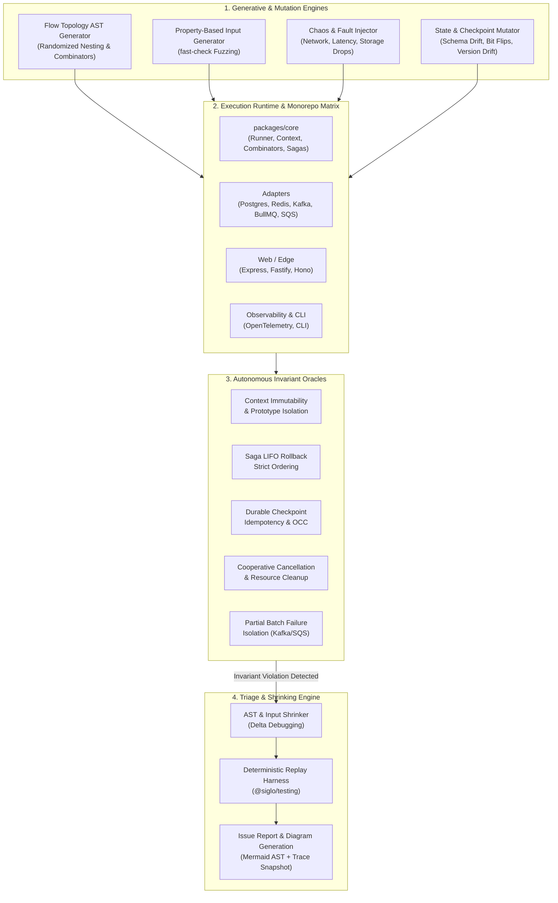
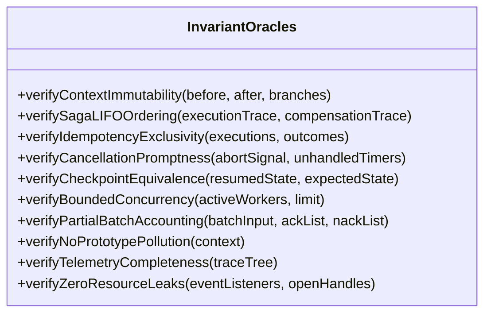
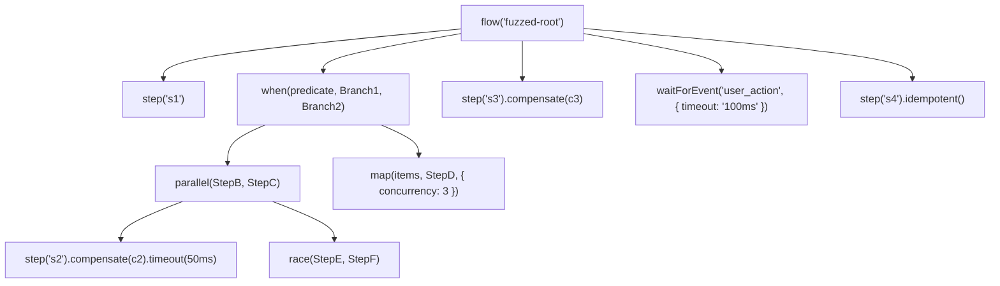

# Automated Exploratory Testing Plan for `Siglo`

> **Comprehensive Automated Exploratory Testing (AET) Architecture, Generative Fuzzing, Chaos Engineering, and Invariant Verification Across the Entire Monorepo Ecosystem**

---

## 1. Executive Summary & Vision

`Siglo` is a high-performance, in-process workflow orchestrator engineered for zero-daemon operational simplicity, sub-millisecond execution, and resilient enterprise semantics (Sagas, OCC checkpointing, bounded dynamic mapping, durable event waits, and distributed ecosystem adapters).

While the core runtime achieves 100% statement and line coverage under deterministic unit tests, **traditional scripted tests only verify known paths and predictable sequences**. Complex workflow runtimes fail in the "unknown unknowns":
- High-concurrency race conditions during parallel branching and distributed lock claims.
- Cascading compensation failures during asynchronous saga rollbacks.
- State-space corruption under transient storage disconnects or deserialization drifts.
- Edge-case thread starvation or timer drift during two-tier timeout preemption.
- Partial batch failure drops or duplicate executions across streaming and queue consumers.

This **Automated Exploratory Testing (AET) Plan** establishes an autonomous, generative, and chaos-driven exploratory framework. Instead of static unit assertions, autonomous exploration engines continuously synthesize arbitrary workflow topologies, inject chaotic environmental faults, stress asynchronous concurrency, and verify **formal system invariants** (oracles) across all 11 packages in the monorepo.



---

## 2. System Attack Surface & Component Decomposition

The exploratory matrix targets all layers of the `Siglo` monorepo:

| Component | Package Path | Primary Attack Surface & Exploratory Focus |
|---|---|---|
| **Core Runtime** | [`packages/core`](../packages/core) | Dynamic flow AST execution, accumulated context immutability, 5-phase step lifecycle, combinators (`parallel`, `allSettled`, `race`, `when`, `branch`, `map`), two-tier timeouts, cooperative `AbortSignal`, saga LIFO compensations, durable `wait`/`waitForEvent`, idempotency locks. |
| **Testing Harness** | [`packages/testing`](../packages/testing) | Virtual clock (`FakeClock`) drift, step spies, trace recording accuracy, mocking fidelity, deterministic replay of failure fixtures. |
| **Developer CLI** | [`packages/cli`](../packages/cli) | Scaffolding robustness, AST parsing of malformed user code, Mermaid/DOT/JSON visual export fidelity, fixture replay validation. |
| **PostgreSQL Storage** | [`packages/postgres`](../packages/postgres) | Connection pool exhaustion, transaction rollbacks during checkpoints, optimistic concurrency conflicts (OCC `version`), advisory lock collisions, JSONB state serialization limits. |
| **Redis Storage** | [`packages/redis`](../packages/redis) | Key eviction policies under OOM, Redis cluster failover, Redlock distributed lock expiration, pipeline batching desynchronization, pub/sub event drops. |
| **BullMQ Worker** | [`packages/bullmq`](../packages/bullmq) | Stalled job recovery, backpressure overflow, lock renewal timeouts during long-running workflows, worker graceful shutdown mid-step. |
| **Kafka Streaming** | [`packages/kafka`](../packages/kafka) | Partition rebalance during in-flight batch execution, out-of-order offsets, poison-pill isolation, commit semantics (`at-least-once` vs `at-most-once`). |
| **AWS SQS Consumer** | [`packages/sqs`](../packages/sqs) | Visibility timeout expiration mid-flow, `batchItemFailures` partial acknowledgement accuracy, message deduplication ID race conditions. |
| **HTTP Frameworks** | [`packages/express`](../packages/express), [`packages/fastify`](../packages/fastify), [`packages/hono`](../packages/hono) | Client disconnection (`req.on('close')`) triggering workflow cancellation, streaming backpressure, payload schema mismatch error codes, header injection attacks. |
| **OpenTelemetry** | [`packages/opentelemetry`](../packages/opentelemetry) | Span context leaks across concurrent branches, missing parent-child spans during parallel fan-out/fan-in, baggage propagation across durable resume boundaries. |

---

## 3. The 10 Invariant Oracles (The "Never-Break" Axioms)

Autonomous exploratory testing requires automated **oracles** that evaluate whether any synthesized flow, chaos injection, or input permutation violates system guarantees.



1. **Oracle 1: Accumulated Context Immutability & Scope Isolation**
   - *Axiom:* A step or parallel branch must never mutate an ancestor scope, a sibling branch context, or JavaScript's `Object.prototype`.
   - *Check:* Deep frozen snapshots taken before execution; prototype integrity checked with canary properties (`__proto__.canary`).
2. **Oracle 2: Saga LIFO Compensation Ordering & Completeness**
   - *Axiom:* If step $K$ in pipeline $[S_1, S_2, \dots, S_N]$ fails, all registered compensations for completed steps $S_{K-1}, \dots, S_1$ must execute in strict reverse (LIFO) order. No uncompleted steps may be compensated.
   - *Check:* Verify compensation event sequence against the reversed topological execution log.
3. **Oracle 3: Optimistic Concurrency & Checkpoint Idempotency**
   - *Axiom:* In the presence of duplicate resumption attempts or concurrent checkpoint writes, exactly one write succeeds; stale writes must throw `ConcurrencyConflictException` or be safely deduplicated. Resumed flows must never repeat already-completed side-effects.
   - *Check:* Inject concurrent resume calls with the same checkpoint ID; assert single winner and deterministic state.
4. **Oracle 4: Cooperative Cancellation & Timer Teardown**
   - *Axiom:* When an `AbortSignal` is triggered, running async promises, backoff retry timers, and durable wait pollers must abort immediately without hanging the Node.js event loop or producing unhandled promise rejections.
   - *Check:* Active timer handle count verified via `process._getActiveHandles()` or `FakeClock`.
5. **Oracle 5: Bounded Concurrency Enforcement**
   - *Axiom:* In `map(items, step, { concurrency: C })`, the number of simultaneously executing step promises must never exceed $C$ under any condition, including heavy async delay variance.
   - *Check:* High-water mark counter instrumented on step concurrency spy.
6. **Oracle 6: Combinator Outcome Soundness**
   - *Axiom:* `race` must return the first settled branch and cleanly cancel all other branches; `allSettled` must record every branch result regardless of individual rejections; `parallel` must fail-fast on the first error while aborting sibling branches.
   - *Check:* Compare branch results against theoretical combinator truth tables.
7. **Oracle 7: Batch Stream Partial Failure Precision (SQS & Kafka)**
   - *Axiom:* When processing a batch of $M$ items where $F$ items fail and $S$ succeed ($M = F + S$), the adapter must report exactly the $F$ item identifiers as failures without dropping, double-committing, or falsely rejecting the $S$ items.
   - *Check:* Set intersection verification: `ACKed ∩ NACKed == ∅` and `ACKed ∪ NACKed == AllItems`.
8. **Oracle 8: Two-Tier Timeout Determinism**
   - *Axiom:* A step timeout ($T_{step}$) must fire if step duration exceeds $T_{step}$; a flow timeout ($T_{flow}$) must abort the entire flow if total cumulative duration exceeds $T_{flow}$, even across multiple retries.
   - *Check:* Virtual time verification with `FakeClock` ensuring correct timeout error class (`StepTimeoutException` vs `FlowTimeoutException`).
9. **Oracle 9: Distributed Tracing & Span Hierarchy Continuity**
   - *Axiom:* In `@siglo/opentelemetry`, every step span must be a direct child of the workflow root span; parallel branches must have parallel sibling spans with valid W3C traceparent context. No orphaned spans.
   - *Check:* Span tree graph traversal ensuring single root and zero disconnected subgraphs.
10. **Oracle 10: Zero Resource & Event Listener Leaks**
    - *Axiom:* Executing, aborting, pausing, or failing 10,000 continuous workflows must not leave lingering listeners on `EventEmitter`, unclosed database clients, or accumulating memory.
    - *Check:* Heap snapshot differential analysis and `EventEmitter.listenerCount()` assertions.

---

## 4. Automated Exploratory Strategies & Methodologies

### 4.1 Generative Flow Topology Synthesis (The "Random Flow Fuzzer")

We build an automated AST generator that constructs randomized, deeply nested workflows with arbitrary topological depth:



#### Fuzzer Configuration Parameters:
- **Max Depth:** 1 to 6 levels of nesting (e.g. `parallel` containing `map` containing `branch`).
- **Combinator Pool:** `parallel`, `allSettled`, `race`, `when`, `branch`, `map`.
- **Modifiers Pool:** `.timeout(ms)`, `.compensate(fn)`, `.retry({ maxAttempts, backoff })`, `.idempotent()`, `.onBefore(fn)`, `.onAfter(fn)`, `.onSkip(fn)`, `.spec(schema)`.
- **Action Injections:** Randomized return values, deliberate error throwing, async delays, AbortSignal queries, context reading/writing.

### 4.2 Property-Based Testing (PBT) with `fast-check`

Generates arbitrary inputs and edge-case data to stress-test schema translation, context proxies, and serialization:
- **Data Edge Cases:** Circular references, symbols, `BigInt`, prototype poisoning strings (`__proto__`, `constructor`), huge buffers, unicode glyphs, NaN, Infinity, -0, sparse arrays.
- **Contract Schemas:** Standard Schema, Zod, Valibot, ArkType schemas generated on the fly to test strict input/output contract enforcement.

### 4.3 Fault Injection & Chaos Engine

An automated chaos proxy intercepts storage adapters, timers, and messaging channels:
- **Storage Chaos:** Randomized `ECONNRESET`, transaction deadlocks, latency spikes (50ms - 2000ms), partial JSON truncation in checkpoints.
- **Worker Chaos:** Sudden process kill simulation (`SIGTERM`/`SIGKILL`), thread pool saturation, worker crash during step 2 of a 4-step saga.
- **Clock Chaos:** Virtual time leaps, reverse jitter, micro-skips simulating NTP sync jumps.

### 4.4 Checkpoint & State Mutation Fuzzer

Explores durable workflow recovery resilience:
- Injects mutations into serialized checkpoint JSON:
  - Modifying `version` (testing workflow version migrations).
  - Removing mandatory fields (`completedSteps`, `context`).
  - Swapping step output types.
  - Simulating corrupted base64 payloads.
- Verifies that `resumeWorkflow` fails safely with typed exceptions rather than unhandled crashes.

---

## 5. Component-by-Component Exploratory Charters

### Charter 1: Core Combinator & Parallelism Stress
- **Target:** `parallel()`, `allSettled()`, `race()`, `map()`, `branch()`, `when()`.
- **Exploration Mission:** Explore high concurrency fan-outs, branch cancellation propagation, race condition losers, and memory consumption under 100+ concurrent branches.
- **Technique:**
  - Generate randomized race topologies where 5 branches compete with varying random delay (1ms - 50ms) and one throws an error. Verify that the winner resolves immediately and losers are cancelled without unhandled rejections.
  - Stress `map()` with 1,000 array elements, random concurrency ($C \in [1, 50]$), and randomized step failure at element index $K$. Verify error aggregation and bounded concurrency limits.

### Charter 2: Saga Rollbacks & Cascading Failure Chaos
- **Target:** Step compensations (`step.compensate()`), nested sagas, compensation errors.
- **Exploration Mission:** Force failures at arbitrary lifecycle stages (inside `prepare`, `execute`, `onAfter`, or during another compensation).
- **Technique:**
  - Create a 10-step pipeline where each step has a compensation. Fail step 7.
  - In addition, inject a failure into the compensation of step 4.
  - Verify: Sagas must execute in strict LIFO order ($6 \to 5 \to 4 \to 3 \to 2 \to 1$); the secondary error in compensation 4 must be captured into a multi-error or aggregate error without halting the remaining compensations ($3 \to 2 \to 1$).

### Charter 3: Durable Waits & Checkpoint Resumption Under OCC Contention
- **Target:** `waitForEvent()`, `wait()`, checkpoint storage, `resumeWorkflow()`.
- **Exploration Mission:** Explore simultaneous resume calls from multiple workers on the same paused workflow checkpoint.
- **Technique:**
  - Pause a workflow on `waitForEvent('order_paid')`.
  - Concurrently dispatch 50 identical resume requests using both Redis and Postgres adapters.
  - Verify Oracle 3: Exactly 1 worker transitions the state to running; the remaining 49 receive optimistic concurrency lock errors or idempotently yield the cached output.

### Charter 4: Idempotency Key Collisions & TTL Expiry
- **Target:** `@siglo/redis`, `@siglo/postgres`, in-memory idempotency store.
- **Exploration Mission:** Bombard idempotent steps with simultaneous identical requests with jittered execution durations.
- **Technique:**
  - Simulate an idempotent step taking 150ms.
  - Fire 20 concurrent invocations across 5 clustered worker processes.
  - Test TTL expiration boundary: Trigger a call at $T = TTL - 1\text{ms}$ and $T = TTL + 1\text{ms}$. Verify clean claim lock release and subsequent re-execution.

### Charter 5: Streaming & Message Queue Batch Processing
- **Target:** `@siglo/sqs`, `@siglo/kafka`, `@siglo/bullmq`.
- **Exploration Mission:** Explore partial batch failures, out-of-order execution, and queue worker crashes.
- **Technique:**
  - Feed SQS/Kafka adapters batches of 20 messages where messages at indices [3, 7, 18] trigger fatal workflow failures, [2, 11] trigger retryable timeouts, and the rest succeed.
  - Invalidate worker heartbeat mid-batch.
  - Verify Oracle 7: `batchItemFailures` strictly reports [3, 7, 18]; no successful messages are re-processed upon redrive.

### Charter 6: Web / Edge Adapter Disconnects & Abort Propagation
- **Target:** `@siglo/express`, `@siglo/fastify`, `@siglo/hono`.
- **Exploration Mission:** Abruptly drop client HTTP connections while long-running or durable workflows are executing.
- **Technique:**
  - Start an HTTP request that launches a 5-step flow.
  - Client sends `RST` or closes socket during Step 2.
  - Verify: AbortSignal fires immediately; Step 2 and subsequent steps abort; active timers clear; no memory leaks or unhandled stream write errors occur on closed sockets.

### Charter 7: CLI Tooling, Diagram Export & Validation
- **Target:** `@siglo/cli`.
- **Exploration Mission:** Fuzz the CLI with corrupted workflow files, circular references, invalid syntax, and extreme graph topologies.
- **Technique:**
  - Generate 500-node workflow ASTs and pass to `siglo export --format=mermaid` and `--format=dot`.
  - Validate that exported Mermaid/DOT diagrams parse cleanly without syntax errors using Mermaid CLI / Graphviz validator.
  - Feed malformed JSON ASTs to `siglo validate` and assert structured error reporting with line/column references.

### Charter 8: Observability, W3C Trace Context & Metric Fidelity
- **Target:** `@siglo/opentelemetry`.
- **Exploration Mission:** Validate span parenting, distributed context propagation across durable suspension, and baggage preservation.
- **Technique:**
  - Suspend a workflow with an active OpenTelemetry trace. Persist to Postgres.
  - Resume the workflow in a completely different process after 5 minutes with a synthetic trace carrier.
  - Verify: Resumed steps link back to the parent trace via `traceparent` link; span attributes contain execution phase, step names, attempt counts, and error metadata.

---

## 6. Implementation Blueprint: Autonomous Exploratory Engine

To execute this plan systematically, we design a modular test engine in `packages/testing` or a dedicated test harness:

```
test/exploratory/
├── engine/
│   ├── ast-generator.ts         # Generates randomized flow graphs
│   ├── property-generators.ts   # fast-check arbitraries for steps & payloads
│   ├── chaos-proxy.ts           # Intercepts DB, Redis, and network calls
│   ├── invariant-evaluator.ts   # Evaluates all 10 Oracles
│   └── shrinker.ts              # Minimizes failing flow trees to minimal repro
├── charters/
│   ├── combinators.explore.ts   # Charter 1 runner
│   ├── sagas.explore.ts         # Charter 2 runner
│   ├── durable-occ.explore.ts   # Charter 3 runner
│   ├── idempotency.explore.ts   # Charter 4 runner
│   ├── queues-batch.explore.ts  # Charter 5 runner
│   ├── http-abort.explore.ts    # Charter 6 runner
│   └── cli-diagrams.explore.ts  # Charter 7 runner
└── runner.ts                    # Orchestrates iterations, logs, and failure artifacts
```

### 6.1 Flow AST Generator Prototype

```typescript
// test/exploratory/engine/ast-generator.ts
import { flow, step, parallel, race, allSettled, when, branch, map } from 'siglo';

export interface FuzzedFlowConfig {
    maxDepth: number;
    errorProbability: number;
    timeoutProbability: number;
    compensationProbability: number;
}

export function generateRandomFlow(name: string, depth: number, config: FuzzedFlowConfig): any {
    if (depth <= 0) {
        return createFuzzedStep(`leaf_${name}_${Math.random().toString(36).slice(2, 7)}`, config);
    }

    const constructType = pickRandom([
        'sequential',
        'parallel',
        'race',
        'allSettled',
        'when',
        'map'
    ]);

    switch (constructType) {
        case 'parallel':
            return parallel(
                generateRandomFlow(`${name}_p1`, depth - 1, config),
                generateRandomFlow(`${name}_p2`, depth - 1, config)
            );
        case 'race':
            return race(
                generateRandomFlow(`${name}_r1`, depth - 1, config),
                generateRandomFlow(`${name}_r2`, depth - 1, config)
            );
        case 'map':
            return map(
                [1, 2, 3],
                generateRandomFlow(`${name}_map`, depth - 1, config),
                { concurrency: Math.floor(Math.random() * 3) + 1 }
            );
        case 'when':
            return when((ctx: any) => Boolean(ctx && Math.random() > 0.5),
                generateRandomFlow(`${name}_then`, depth - 1, config)
            ).otherwise(
                generateRandomFlow(`${name}_else`, depth - 1, config)
            );
        case 'sequential':
        default:
            return flow(`seq_${name}`)
                .use(createFuzzedStep(`${name}_s1`, config))
                .use(generateRandomFlow(`${name}_sub`, depth - 1, config));
    }
}
```

### 6.2 Invariant Evaluator Prototype

```typescript
// test/exploratory/engine/invariant-evaluator.ts
export class InvariantEvaluator {
    static assertContextImmutability(initialContext: any, currentContext: any): void {
        if (Object.prototype.hasOwnProperty('canary')) {
            throw new Error('Invariant 1 Violated: Prototype pollution detected on Object.prototype!');
        }
    }

    static assertSagaLIFO(completedSteps: string[], compensatedSteps: string[]): void {
        const expectedOrder = [...completedSteps].reverse();
        for (let i = 0; i < compensatedSteps.length; i++) {
            if (compensatedSteps[i] !== expectedOrder[i]) {
                throw new Error(
                    `Invariant 2 Violated: Saga out-of-order compensation! Expected ${expectedOrder[i]}, got ${compensatedSteps[i]}`
                );
            }
        }
    }

    static assertBoundedConcurrency(highWaterMark: number, maxAllowed: number): void {
        if (highWaterMark > maxAllowed) {
            throw new Error(
                `Invariant 5 Violated: Concurrency limit exceeded! Limit: ${maxAllowed}, Recorded: ${highWaterMark}`
            );
        }
    }
}
```

---

## 7. Execution Matrix & Continuous Pipeline

Exploratory testing is scheduled across continuous phases to catch regressions early while deeply fuzzing overnight:

| Cadence | Suite | Focus & Parameters | Output Artifact |
|---|---|---|---|
| **Per Pull Request** (Smoke Fuzz) | 5-minute Generative Smoke | 100 randomized flows, depth $\le 3$, zero external dependencies (in-memory storage). | Pass/Fail badge, minimized repro fixture if violated. |
| **Nightly Build** (Chaos Soak) | 2-hour Distributed Exploratory Run | 5,000 randomized flows, depth $\le 5$, with real Postgres/Redis/BullMQ docker containers, network latency injection, high OCC contention. | Trend metrics, memory growth slope, coverage delta. |
| **Weekly Soak** (Longevity & Leak) | 12-hour Stress Test | 100,000 sustained workflow executions, continuous durable pause/resumes, client abort flooding. | Memory heap profiles, event listener leak audit, latency percentiles ($p95, p99$). |

---

## 8. Failure Triaging, Shrinking & Automated Reporting

When an invariant violation is discovered by the exploratory fuzzer:
1. **Delta Debugging / AST Shrinking:**
   - The engine automatically eliminates unused steps, collapses parallel branches, and simplifies inputs to find the **minimal failing sub-flow**.
2. **Replay Fixture Generation:**
   - The minimal failure is serialized into a `@siglo/testing` JSON replay fixture (`test/fixtures/fuzzed-crash-<id>.json`).
3. **Automated Reproduction Test:**
   - Generates an executable test file reproducing the bug with `flow.toMermaid()` visualization embedded into the report.

---

## 9. Next Steps & Implementation Milestones

- [ ] **Milestone 1:** Implement core Invariant Oracles (`ContextImmutability`, `SagaLIFO`, `BoundedConcurrency`) in `packages/testing`.
- [ ] **Milestone 2:** Implement the AST Flow Topology Synthesizer & fast-check parameter fuzzer.
- [ ] **Milestone 3:** Create dockerized chaos harnesses for `@siglo/postgres` and `@siglo/redis` verifying OCC and idempotency collisions.
- [ ] **Milestone 4:** Add batch permutation fuzzing for `@siglo/sqs` and `@siglo/kafka`.
- [ ] **Milestone 5:** Wire the PR smoke fuzz runner and nightly chaos job into `.github/workflows`.
