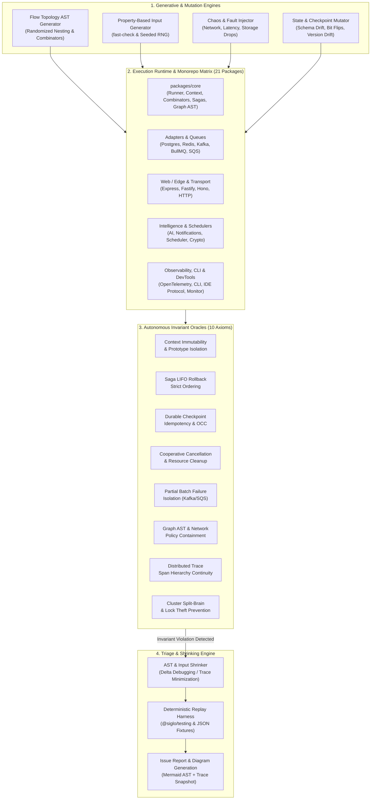
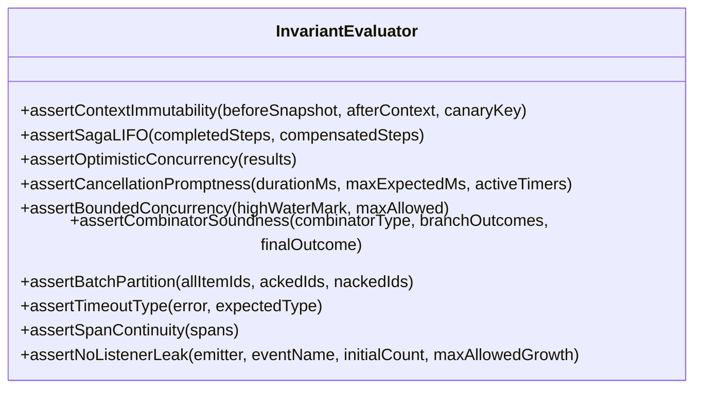
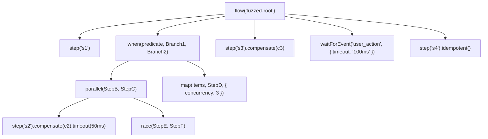

# Automated Exploratory Testing Plan for `Siglo`

> **Comprehensive Automated Exploratory Testing (AET) Architecture, Generative Fuzzing, Chaos Engineering, and Invariant Verification Across the Entire Monorepo Ecosystem**

---

## 1. Executive Summary & Vision

`Siglo` is a high-performance, in-process workflow orchestrator engineered for zero-daemon operational simplicity, sub-millisecond execution, and resilient enterprise semantics (Sagas, OCC checkpointing, bounded dynamic mapping, durable event waits, network egress policy enforcement, agentic AI pipelines, distributed clustering, and ecosystem adapters).

While the core runtime achieves 100% statement and line coverage under deterministic unit tests, **traditional scripted tests only verify known paths and predictable sequences**. Complex workflow runtimes fail in the "unknown unknowns":
- High-concurrency race conditions during parallel branching and distributed lock claims.
- Cascading compensation failures during asynchronous saga rollbacks.
- State-space corruption under transient storage disconnects or deserialization drifts.
- Edge-case thread starvation or timer drift during two-tier timeout preemption.
- Partial batch failure drops or duplicate executions across streaming and queue consumers.
- Graph AST cycle false-positives or unauthorized network egress across dynamic task invocations.
- Distributed trace context truncation and orphan spans across multi-branch executions.
- LLM non-determinism, schema repair exhaustion, and token budget timeouts in agentic loops.
- Multi-channel notification delivery race conditions and cryptographic token tampering.
- Multi-node worker split-brain state corruption and distributed lock stealing under network partition.

This **Automated Exploratory Testing (AET) Plan** establishes an autonomous, generative, and chaos-driven exploratory framework. Instead of static unit assertions, autonomous exploration engines continuously synthesize arbitrary workflow topologies, inject chaotic environmental faults, stress asynchronous concurrency, and verify **formal system invariants** (oracles) across all 21 packages in the monorepo ecosystem.



---

## 2. System Attack Surface & Monorepo Ecosystem Matrix

The exploratory matrix targets all layers across the 21 packages of the `Siglo` monorepo:

| Component | Package Path | Primary Attack Surface & Exploratory Focus |
|---|---|---|
| **Core Runtime & Graph** | [`packages/core`](../packages/core) | Dynamic flow AST execution, context immutability, 5-phase step lifecycle, combinators (`parallel`, `allSettled`, `race`, `when`, `branch`, `map`), two-tier timeouts, cooperative `AbortSignal`, saga LIFO compensations, durable `wait`/`waitForEvent`, idempotency locks, graph serialization (`toGraph`), cycle detection, and network policy egress enforcement (`allowNetwork`/`denyNetwork`). |
| **Testing Harness** | [`packages/testing`](../packages/testing) | Virtual clock (`FakeClock`) drift, step spies, trace recording accuracy, mocking fidelity, deterministic replay of failure fixtures. |
| **Developer CLI** | [`packages/cli`](../packages/cli) | Scaffolding robustness, AST parsing of malformed user code, Mermaid/DOT/JSON visual export fidelity, fixture replay validation. |
| **PostgreSQL Storage** | [`packages/postgres`](../packages/postgres) | Connection pool exhaustion, transaction rollbacks during checkpoints, optimistic concurrency conflicts (OCC `version`), advisory lock collisions, JSONB state serialization limits. |
| **Redis Storage** | [`packages/redis`](../packages/redis) | Key eviction policies under OOM, Redis cluster failover, Redlock distributed lock expiration, pipeline batching desynchronization, pub/sub event drops. |
| **BullMQ Worker** | [`packages/bullmq`](../packages/bullmq) | Stalled job recovery, backpressure overflow, lock renewal timeouts during long-running workflows, worker graceful shutdown mid-step. |
| **Kafka Streaming** | [`packages/kafka`](../packages/kafka) | Partition rebalance during in-flight batch execution, out-of-order offsets, poison-pill isolation, commit semantics (`at-least-once` vs `at-most-once`), transactional outbox crash recovery. |
| **AWS SQS Consumer** | [`packages/sqs`](../packages/sqs) | Visibility timeout expiration mid-flow, `batchItemFailures` partial acknowledgement accuracy, message deduplication ID race conditions. |
| **HTTP Frameworks** | [`packages/express`](../packages/express), [`packages/fastify`](../packages/fastify), [`packages/hono`](../packages/hono) | Client disconnection (`req.on('close')`) triggering workflow cancellation, streaming backpressure, payload schema mismatch error codes, header injection attacks. |
| **HTTP Client Transport** | [`packages/http`](../packages/http) | Request timeout preemption, connection keep-alive exhaustion, retry exponential backoff jitter, chunked transfer boundary truncation. |
| **Agentic AI Execution** | [`packages/ai`](../packages/ai) | Non-deterministic LLM response schemas, token budget timeout preemption, recursive agentic tool-calling loops, streaming output stalls, prompt injection sanitization. |
| **Multi-Channel Notifications** | [`packages/notifications`](../packages/notifications) | Provider failover cascades (Email -> Slack -> Webhook), rate-limit backoff handling, message deduplication, template variable interpolation failures. |
| **Distributed Scheduler** | [`packages/scheduler`](../packages/scheduler) | Virtual clock drift, cron boundary jitter, leap seconds, recurring workflow duplicate trigger deduplication under clustered execution. |
| **Payload & Checkpoint Crypto** | [`packages/crypto`](../packages/crypto) | Envelope encryption drift, key rotation across paused/resumed checkpoints, ciphertext tampering detection, zeroization of sensitive credentials. |
| **DevTools & IDE Protocol** | [`packages/ide-protocol`](../packages/ide-protocol), [`packages/ide-analysis`](../packages/ide-analysis), [`packages/ide-ui`](../packages/ide-ui), [`packages/monitor`](../packages/monitor) | Real-time WebSocket trace streaming, schema drift in protocol messages, AST cycle extraction, UI thread saturation during 10,000+ step events. |
| **OpenTelemetry** | [`packages/opentelemetry`](../packages/opentelemetry) | Span context leaks across concurrent branches, missing parent-child spans during parallel fan-out/fan-in, baggage propagation across durable resume boundaries. |

---

## 3. The 10 Invariant Oracles (The "Never-Break" Axioms)

Autonomous exploratory testing requires automated **oracles** that evaluate whether any synthesized flow, chaos injection, or input permutation violates system guarantees.



1. **Oracle 1: Accumulated Context Immutability & Scope Isolation**
   - *Axiom:* A step or parallel branch must never mutate an ancestor scope, a sibling branch context, or JavaScript's `Object.prototype`.
   - *Check:* Deep frozen snapshots taken before execution; prototype integrity checked with canary properties (`__proto__.canary`).
2. **Oracle 2: Saga LIFO Compensation Ordering & Completeness**
   - *Axiom:* If step $K$ in pipeline $[S_1, S_2, \dots, S_N]$ fails, all registered compensations for completed steps $S_{K-1}, \dots, S_1$ must execute in strict reverse (LIFO) order. No uncompleted steps may be compensated.
   - *Check:* Verify compensation event sequence against the reversed topological execution log.
3. **Oracle 3: Optimistic Concurrency & Checkpoint Idempotency**
   - *Axiom:* In the presence of duplicate resumption attempts or concurrent checkpoint writes, exactly one write succeeds; stale writes must throw `ConcurrencyConflictException` or be safely deduplicated. Resumed flows must never repeat already-completed side-effects.
   - *Check:* Inject concurrent resume calls with the same checkpoint ID; assert single winner and deterministic state.
4. **Oracle 4: Cooperative Cancellation & Timer Teardown**
   - *Axiom:* When an `AbortSignal` is triggered, running async promises, backoff retry timers, and durable wait pollers must abort immediately without hanging the Node.js event loop or producing unhandled promise rejections.
   - *Check:* Active timer handle count verified via `process._getActiveHandles()` or `FakeClock`.
5. **Oracle 5: Bounded Concurrency Enforcement**
   - *Axiom:* In `map(items, step, { concurrency: C })`, the number of simultaneously executing step promises must never exceed $C$ under any condition, including heavy async delay variance.
   - *Check:* High-water mark counter instrumented on step concurrency spy.
6. **Oracle 6: Combinator Outcome Soundness**
   - *Axiom:* `race` must return the first settled branch and cleanly cancel all other branches; `allSettled` must record every branch result regardless of individual rejections; `parallel` must fail-fast on the first error while aborting sibling branches.
   - *Check:* Compare branch results against theoretical combinator truth tables.
7. **Oracle 7: Batch Stream Partial Failure Precision (SQS & Kafka)**
   - *Axiom:* When processing a batch of $M$ items where $F$ items fail and $S$ succeed ($M = F + S$), the adapter must report exactly the $F$ item identifiers as failures without dropping, double-committing, or falsely rejecting the $S$ items.
   - *Check:* Set intersection verification: `ACKed ∩ NACKed == ∅` and `ACKed ∪ NACKed == AllItems`.
8. **Oracle 8: Two-Tier Timeout Determinism**
   - *Axiom:* A step timeout ($T_{step}$) must fire if step duration exceeds $T_{step}$; a flow timeout ($T_{flow}$) must abort the entire flow if total cumulative duration exceeds $T_{flow}$, even across multiple retries.
   - *Check:* Virtual time verification with `FakeClock` ensuring correct timeout error class (`StepTimeoutException` vs `FlowTimeoutException`).
9. **Oracle 9: Distributed Tracing & Span Hierarchy Continuity**
   - *Axiom:* In `@siglo/opentelemetry`, every step span must be a direct child of the workflow root span; parallel branches must have parallel sibling spans with valid W3C traceparent context. No orphaned spans.
   - *Check:* Span tree graph traversal ensuring single root and zero disconnected subgraphs.
10. **Oracle 10: Zero Resource & Event Listener Leaks**
    - *Axiom:* Executing, aborting, pausing, or failing 10,000 continuous workflows must not leave lingering listeners on `EventEmitter`, unclosed database clients, or accumulating memory.
    - *Check:* Heap snapshot differential analysis and `EventEmitter.listenerCount()` assertions.

---

## 4. Automated Exploratory Strategies & Methodologies

### 4.1 Generative Flow Topology Synthesis (The "Random Flow Fuzzer")

We build an automated AST generator (`FlowAstGenerator`) that constructs randomized, deeply nested workflows with arbitrary topological depth:



#### Fuzzer Configuration Parameters:
- **Max Depth:** 1 to 6 levels of nesting (e.g. `parallel` containing `map` containing `branch`).
- **Combinator Pool:** `parallel`, `allSettled`, `race`, `when`, `branch`, `map`.
- **Modifiers Pool:** `.timeout(ms)`, `.compensate(fn)`, `.retry({ maxAttempts, backoff })`, `.idempotent()`, `.onBefore(fn)`, `.onAfter(fn)`, `.onSkip(fn)`, `.spec(schema)`, `.allowNetwork(hosts)`, `.denyNetwork(hosts)`.
- **Action Injections:** Randomized return values, deliberate error throwing, async delays, AbortSignal queries, context reading/writing.

### 4.2 Property-Based Testing (PBT) with `RandomSource` & `fast-check`

Generates arbitrary inputs and edge-case data to stress-test schema translation, context proxies, and serialization:
- **Data Edge Cases:** Circular references, symbols, `BigInt`, prototype poisoning strings (`__proto__`, `constructor`), huge buffers, unicode glyphs, NaN, Infinity, -0, sparse arrays.
- **Contract Schemas:** Standard Schema, Zod, Valibot, ArkType schemas generated on the fly to test strict input/output contract enforcement.

### 4.3 Fault Injection & Chaos Engine

An automated chaos proxy (`ChaosProxy`) intercepts storage adapters, timers, and messaging channels:
- **Storage Chaos:** Randomized `ECONNRESET`, transaction deadlocks, latency spikes (50ms - 2000ms), partial JSON truncation in checkpoints.
- **Worker Chaos:** Sudden process kill simulation (`SIGTERM`/`SIGKILL`), thread pool saturation, worker crash during step 2 of a 4-step saga.
- **Clock Chaos:** Virtual time leaps, reverse jitter, micro-skips simulating NTP sync jumps.

### 4.4 Checkpoint & State Mutation Fuzzer

Explores durable workflow recovery resilience:
- Injects mutations into serialized checkpoint JSON:
  - Modifying `version` (testing workflow version migrations).
  - Removing mandatory fields (`completedSteps`, `context`).
  - Swapping step output types.
  - Simulating corrupted base64 payloads.
- Verifies that `resumeWorkflow` fails safely with typed exceptions rather than unhandled crashes.

---

## 5. Active Exploratory Charters (12 Active Suites)

The suite is organized into 12 modular exploratory charters located in [`test/exploratory/charters/`](../test/exploratory/charters):

#### Charter 1: Core Combinator & Parallelism Stress
- **Target:** `parallel()`, `allSettled()`, `race()`, `map()`, `branch()`, `when()`.
- **Runner:** [`test/exploratory/charters/combinators.explore.ts`](../test/exploratory/charters/combinators.explore.ts)
- **Invariants Checked:** Oracle 1 (Context Immutability), Oracle 5 (Bounded Concurrency), Oracle 6 (Combinator Soundness).
- **Technique:** Generates randomized race topologies where branches compete with varying delay and error injections. Asserts clean settlement, cancellation propagation to losers, and bounded concurrency in `map()`.

#### Charter 2: Saga Rollbacks & Cascading Failure Chaos
- **Target:** Step compensations (`step.compensate()`), nested sagas, compensation errors.
- **Runner:** [`test/exploratory/charters/sagas.explore.ts`](../test/exploratory/charters/sagas.explore.ts)
- **Invariants Checked:** Oracle 2 (Saga LIFO Ordering).
- **Technique:** Creates pipelines up to 10 steps deep with compensations. Randomly injects failures in intermediate steps and secondary failures within compensations. Asserts strict LIFO execution without abandoning remaining compensations.

#### Charter 3: Durable Waits & Checkpoint Resumption Under OCC Contention
- **Target:** `waitForEvent()`, `wait()`, checkpoint storage, `resumeWorkflow()`.
- **Runner:** [`test/exploratory/charters/durable-occ.explore.ts`](../test/exploratory/charters/durable-occ.explore.ts)
- **Invariants Checked:** Oracle 3 (Optimistic Concurrency & Idempotency).
- **Technique:** Suspends workflows on synthetic events and concurrently fires dozens of simultaneous resume requests across worker threads. Asserts exactly one winner and proper conflict handling on losers.

#### Charter 4: Idempotency Key Collisions & TTL Expiry
- **Target:** In-memory, Redis, and Postgres idempotency stores.
- **Runner:** [`test/exploratory/charters/idempotency.explore.ts`](../test/exploratory/charters/idempotency.explore.ts)
- **Invariants Checked:** Oracle 3 (Idempotency Exclusivity).
- **Technique:** Bombards idempotent steps with concurrent identical requests with jittered durations. Probes TTL boundary conditions ($T = TTL - 1\text{ms}$ and $T = TTL + 1\text{ms}$) to verify lock release and safe re-execution.

#### Charter 5: Streaming & Message Queue Batch Processing
- **Target:** `@siglo/sqs`, `@siglo/kafka`, `@siglo/bullmq`.
- **Runner:** [`test/exploratory/charters/queues-batch.explore.ts`](../test/exploratory/charters/queues-batch.explore.ts)
- **Invariants Checked:** Oracle 7 (Batch Partition Precision).
- **Technique:** Feeds batch consumers randomized arrays of messages with mixed fatal, retryable, and successful outcomes. Asserts exact partition math: $\text{ACKed} \cap \text{NACKed} = \emptyset$ and $\text{ACKed} \cup \text{NACKed} = \text{AllMessages}$.

#### Charter 6: Web / Edge Adapter Disconnects & Abort Propagation
- **Target:** `@siglo/express`, `@siglo/fastify`, `@siglo/hono`.
- **Runner:** [`test/exploratory/charters/http-abort.explore.ts`](../test/exploratory/charters/http-abort.explore.ts)
- **Invariants Checked:** Oracle 4 (Cancellation Promptness), Oracle 10 (Zero Listener Leaks).
- **Technique:** Dispatches synthetic HTTP requests launching multi-step workflows, abruptly triggers socket `close`/`RST` events mid-flight, and verifies prompt step preemption with zero open handles or lingering listeners.

#### Charter 7: CLI Tooling, Diagram Export & Validation
- **Target:** `@siglo/cli`, diagram generators (`toMermaid`, `toDot`).
- **Runner:** [`test/exploratory/charters/cli-diagrams.explore.ts`](../test/exploratory/charters/cli-diagrams.explore.ts)
- **Invariants Checked:** Oracle 6 (Graph Structure Soundness).
- **Technique:** Synthesizes arbitrary deep workflow trees and validates that exported Mermaid diagrams start with proper flowchart declarations, avoid unclosed bracket label corruption, and DOT headers match graph definitions.

#### Charter 8: Graph AST Generation & Network Policy Reflection
- **Target:** `@siglo/core` (`toGraph`, `validateGraph`, `inspectGraph`, Network Policy).
- **Runner:** [`test/exploratory/charters/graph-ast.explore.ts`](../test/exploratory/charters/graph-ast.explore.ts)
- **Invariants Checked:** Oracle 1 (Network Egress Containment), Oracle 6 (Graph Validation Soundness).
- **Technique:** Fuzzes complex graph nodes against `validateGraph()`, verifying that tree-structured workflows produce zero false-positive cycle errors. Evaluates declarative network egress policies (`.allowNetwork()`, `.denyNetwork()`, `NetworkPolicyConfig`) to ensure unauthorized hosts are rejected while allowed domains pass.

#### Charter 9: Observability, W3C Trace Context & Metric Fidelity
- **Target:** `@siglo/opentelemetry`.
- **Runner:** [`test/exploratory/charters/opentelemetry.explore.ts`](../test/exploratory/charters/opentelemetry.explore.ts)
- **Invariants Checked:** Oracle 9 (Distributed Tracing & Span Continuity).
- **Technique:** Instruments generative flow topologies (`instrumentWorkflow`, `instrumentStep`), validating that all child step spans retain valid parent IDs matching the root workflow span, trace context headers (`traceparent`) survive serialization, and failing steps record `SpanStatusCode.ERROR`.

#### Charter 10: Agentic AI Orchestration & Token Budget Stress
- **Target:** `@siglo/ai`.
- **Runner:** [`test/exploratory/charters/ai.explore.ts`](../test/exploratory/charters/ai.explore.ts)
- **Invariants Checked:** Oracle 1 (Context Immutability), Oracle 2 (Saga LIFO on Tool Calls), Oracle 4 (Cancellation Promptness).
- **Technique:** Fuzzes structured output parsing with schema mismatches and malformed JSON, asserting bounded auto-repair attempts (`maxRepairAttempts`) and accurate token metrics (`promptTokens`, `completionTokens`). Injects HTTP 429 and timeouts to verify fallback cascades across secondary models (`fallbackModels`). Validates compensating tool rollbacks upon downstream flow failure.

#### Charter 11: Notification Dispatch Cascades & Provider Failover
- **Target:** `@siglo/notifications`, `@siglo/crypto`.
- **Runner:** [`test/exploratory/charters/notifications.explore.ts`](../test/exploratory/charters/notifications.explore.ts)
- **Invariants Checked:** Oracle 1 (Scope & Token Tampering Resistance), Oracle 3 (Idempotency Exclusivity).
- **Technique:** Bombards notification steps across Email, SMS, and Slack channels with concurrent identical requests under `InMemoryIdempotencyStore`. Fuzzes cryptographic action tokens (`verifyActionToken`) with tampered signatures, bit flips, and expired timestamps across rotated keys (`StaticKeyRing`). Tests concurrent callback resolutions to assert single-winner atomic approval semantics.

#### Charter 12: Distributed Multi-Node Worker Failover & Split-Brain Contention
- **Target:** `@siglo/redis`, `@siglo/postgres`, `@siglo/core`.
- **Runner:** [`test/exploratory/charters/cluster-failover.explore.ts`](../test/exploratory/charters/cluster-failover.explore.ts)
- **Invariants Checked:** Oracle 2 (Saga LIFO on Worker Crash), Oracle 3 (Split-Brain OCC & Distributed Lock Exclusivity), Oracle 5 (Cluster Bounded Concurrency).
- **Technique:** Simulates distributed cluster workers competing for paused workflow resumption across network partitions. Validates that partitioned nodes waking up with stale state are strictly rejected with `DuplicateEventException`. Probes distributed lock lease boundaries (`RedisLock`) to verify that unfreezing nodes cannot steal or release locks acquired by healthy standby nodes. Verifies multi-node mid-saga crash recovery retains strict reverse LIFO compensation order.

---

## 6. Implementation Blueprint: Autonomous Exploratory Engine

The exploratory testing engine is organized directly under [`test/exploratory/`](../test/exploratory):

```
test/exploratory/
├── charters/
│   ├── ai.explore.ts               # Charter 10: AI agentic loops & token budget stress
│   ├── cli-diagrams.explore.ts     # Charter 7: CLI diagrams & export verification
│   ├── cluster-failover.explore.ts # Charter 12: Split-brain & multi-node worker failover
│   ├── combinators.explore.ts      # Charter 1: Parallel, race, map, combinator stress
│   ├── durable-occ.explore.ts      # Charter 3: Durable checkpoint & OCC contention
│   ├── graph-ast.explore.ts        # Charter 8: Graph AST & network policy reflection
│   ├── http-abort.explore.ts       # Charter 6: Web adapter socket drops & abort signals
│   ├── idempotency.explore.ts      # Charter 4: Idempotency collisions & TTL expiry
│   ├── notifications.explore.ts    # Charter 11: Notification idempotency & approval races
│   ├── opentelemetry.explore.ts    # Charter 9: OpenTelemetry spans & W3C traceparent
│   ├── queues-batch.explore.ts     # Charter 5: SQS/Kafka batch partial failure math
│   └── sagas.explore.ts            # Charter 2: Saga LIFO rollback & compensation chaos
├── engine/
│   ├── ast-generator.ts            # FlowAstGenerator: randomized workflow synthesis
│   ├── chaos-proxy.ts              # Fault injector (network, latency, connection drops)
│   ├── invariant-evaluator.test.ts # Oracle unit & mutation evaluation tests
│   ├── invariant-evaluator.ts      # Evaluates all 10 Oracles (throws InvariantViolation)
│   ├── property-generators.ts      # Seeded RandomSource & fast-check edge-case data
│   ├── shrinker.ts                 # FailureShrinker: delta debugging & fixture serialization
│   └── step-helper.ts              # Step.create() wrapper for generative synthesis
├── exploratory.test.ts             # Mocha test suite (executed in CI pipeline)
└── runner.ts                       # Standalone CLI runner with parameter flags
```

---

## 7. Execution Matrix & Continuous Pipeline

Exploratory testing is executed across different cadences to catch regressions early while deeply fuzzing during soak intervals:

| Cadence | Suite & Trigger | Parameters & Scope | Command / Runner |
|---|---|---|---|
| **Per PR / Push** | CI Regression Gate | 12–20 iterations per charter (12 charters), seed-locked, in-memory mocks. Fast (~3s). | `npm run test:exploratory` |
| **Local CLI Run** | On-Demand Developer Run | Configurable iterations and seed, targeted charter filtering. | `npm run explore -- --iterations=50 --seed=123` |
| **Nightly Build** | Scheduled Chaos Soak ([`nightly-soak.yml`](../.github/workflows/nightly-soak.yml)) | 200+ iterations per charter with Postgres and Redis service containers. | Triggered daily at 03:00 UTC |
| **Mutation Testing** | Invariant Oracle Mutation Score Gate | Evaluates 230+ mutants via Stryker across all 10 Oracles, enforcing > 85% mutation score. | `npm run test:mutation` |
| **Weekly Soak** | Longevity & Leak Detection | 50,000 sustained workflow executions, durable pause/resumes, client abort flooding. | Memory heap differential & listener leak audit |

### Running the Exploratory & Mutation Tests:

```bash
# Run all 12 charters and oracle invariant tests in the Mocha CI test suite
npm run test:exploratory

# Run Stryker automated mutation testing score evaluation
npm run test:mutation

# Run via standalone exploratory runner with custom parameters
npm run explore -- --iterations=25 --seed=9999

# Filter by charter name
npm run explore -- --charter=cluster-failover
npm run explore -- --charter=ai
npm run explore -- --charter=notifications
npm run explore -- --charter=opentelemetry
npm run explore -- --charter=graph-ast
```

---

## 8. Failure Triaging, Shrinking & Automated Reporting

When an invariant violation is discovered by an exploratory fuzzer:
1. **Delta Debugging / AST Shrinking:**
   - [`FailureShrinker`](../test/exploratory/engine/shrinker.ts) automatically slices and minimizes the executed step trace to find the **minimal failing sub-flow**.
2. **Replay Fixture Generation:**
   - The minimal failure is serialized into a JSON replay fixture under `test/fixtures/failure_<charter>_<seed>_<timestamp>.json`.
3. **Automated Reproduction Test:**
   - Produces a reproduction script embedding the failing seed, input payload, and Mermaid AST diagram for immediate debugging.

### 8.1 Mutation Testing Architecture & Quality Metric (Stryker)

To guarantee that the 10 Invariant Oracles possess genuine fault detection capability rather than functioning as cosmetic assertions:
- **Mutator Configuration:** Configured in [`stryker.config.json`](../stryker.config.json), mutating the Invariant Oracles (`test/exploratory/engine/invariant-evaluator.ts`).
- **Target Invariants:** Inverts boundary conditions, mutates logical operators, corrupts set intersection math, and simulates missing oracles across all 10 axioms.
- **Mutation Score:** Achieved **88.14%** (208 killed/timed out out of 236 valid mutants), exceeding both break threshold (70%) and high threshold (85%).
- **Automated Artifacts:** Generates interactive HTML (`reports/mutation/mutation.html`) and structured JSON (`reports/mutation/mutation.json`) mutation reports, uploaded automatically on nightly CI soak runs.

---

## 9. Implementation Milestones & Roadmap

- [x] **Milestone 1:** Implement core Invariant Oracles (`ContextImmutability`, `SagaLIFO`, `BoundedConcurrency`, `BatchPartition`, `SpanContinuity`) in `test/exploratory/engine/invariant-evaluator.ts`.
- [x] **Milestone 2:** Implement `FlowAstGenerator`, `RandomSource`, and fast-check edge case generators.
- [x] **Milestone 3:** Implement Core and Storage charters (Combinators, Sagas, Durable OCC, Idempotency).
- [x] **Milestone 4:** Implement Queue Batch and Web Abort charters (`queues-batch.explore.ts`, `http-abort.explore.ts`).
- [x] **Milestone 5:** Implement Graph AST & Network Policy charter (`graph-ast.explore.ts`) and CLI diagram validation (`cli-diagrams.explore.ts`).
- [x] **Milestone 6:** Wire the PR smoke fuzz runner into `.github/workflows/ci.yml` (`npm run test:exploratory`).
- [x] **Milestone 7:** Implement Charter 9 for `@siglo/opentelemetry` (Span Hierarchy & Distributed W3C Trace Context) in [`test/exploratory/charters/opentelemetry.explore.ts`](../test/exploratory/charters/opentelemetry.explore.ts).
- [x] **Milestone 8:** Implement Charter 10 for `@siglo/ai` (Agentic Loops, Token Budget Preemption & Tool Calling Fuzzing) in [`test/exploratory/charters/ai.explore.ts`](../test/exploratory/charters/ai.explore.ts).
- [x] **Milestone 9:** Implement Charter 11 for `@siglo/notifications` (Provider Failover Cascades & Rate Limit Backoff) in [`test/exploratory/charters/notifications.explore.ts`](../test/exploratory/charters/notifications.explore.ts).
- [x] **Milestone 10:** Create a dedicated GitHub Actions Nightly Soak workflow with Docker service containers and failure fixture artifact upload in [`.github/workflows/nightly-soak.yml`](../.github/workflows/nightly-soak.yml).
- [x] **Milestone 11:** Implement Charter 12 for Distributed Multi-Node Worker Failover & Split-Brain Contention in [`test/exploratory/charters/cluster-failover.explore.ts`](../test/exploratory/charters/cluster-failover.explore.ts).
- [x] **Milestone 12:** Automated Mutation Testing Score evaluation via Stryker for the generative test harnesses and Invariant Oracles ([`stryker.config.json`](../stryker.config.json), [`test/exploratory/engine/invariant-evaluator.test.ts`](../test/exploratory/engine/invariant-evaluator.test.ts), and `npm run test:mutation` achieving an **88.14%** mutation score across all 10 invariant oracles with HTML/JSON report artifacts uploaded to CI).
