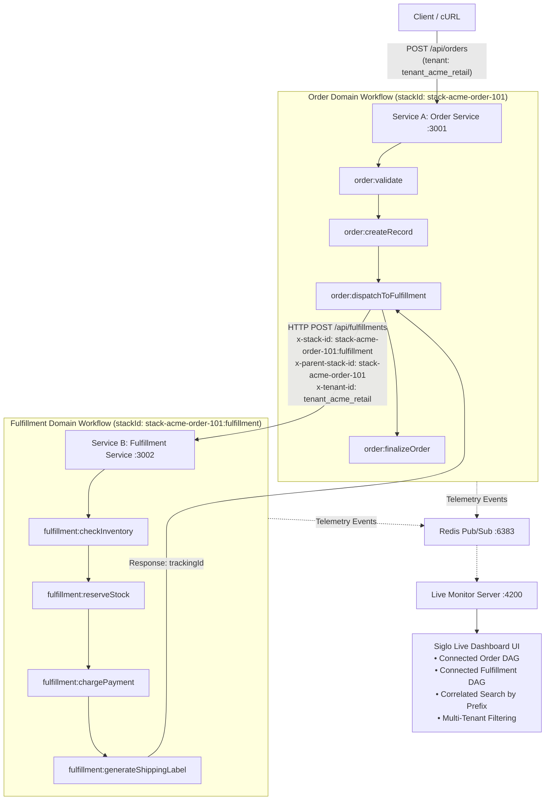

# Correlate Distributed Multi-Domain Services with `stackId` and `namespace`

In modern microservice architectures, an end-to-end business transaction rarely lives inside a single service. An **Order Service** might initiate a checkout workflow, but midway through execution it needs to invoke an independent **Fulfillment or Payment Service** via Kafka or HTTP REST.

Traditionally, tracking this distributed flow across microservices requires deploying heavy external orchestrator clusters (like Temporal or Camunda) or stitching together fragmented distributed traces.

Siglo provides a zero-daemon alternative using two first-class options in [`ExecutionOptions`](/api/execution-options):
- **`stackId`**: An explicit execution stack identifier passed downstream across service boundaries.
- **`namespace`**: A multi-tenant partition key (e.g., `tenant_acme_retail`) that scopes storage, idempotency, and live monitoring telemetry.

---

## Architecture: Parent-Child Correlated Workflows

Instead of forcing multiple distinct services to share the exact same `stackId`—which would collapse their distinct DAG graphs into a single AST and relegate downstream steps into *"Other observed steps"*—the recommended pattern is **Parent-Child Correlated Workflows**:

1. **Service A (Order Domain)** executes with its own `stackId` (e.g. `stack-acme-order-101`).
2. In its dispatch step (`order:dispatchToFulfillment`), it forwards a correlated child stack ID (e.g. `stack-acme-order-101:fulfillment`), together with `x-parent-stack-id` and `x-tenant-id`.
3. **Service B (Fulfillment Domain)** runs its workflow using the child `stackId`.
4. **In the Live Monitoring Dashboard**:
   - Both services receive **their own complete, fully-connected DAG topologies**.
   - Searching for the parent stack ID (`stack-acme-order-101`) instantly surfaces both parent and child runs in the Run List.
   - The trigger step in Order Service records and references the child workflow execution.



---

## 1. The Downstream Service: Fulfillment Domain

The downstream service exposes an independent workflow responsible for inventory, payment, and shipping. It accepts `x-stack-id` and `x-tenant-id` in its HTTP request headers and runs its workflow:

```typescript
// fulfillment-service.ts
import { Step, flow } from '@siglo/core';

export interface FulfillmentInput {
    orderId: string;
    sku: string;
    quantity: number;
    amountCents: number;
}

export const fulfillmentWorkflow = flow(
    Step.create('fulfillment:checkInventory', async (input: FulfillmentInput) => {
        return { inventoryStatus: 'AVAILABLE', availableQuantity: 42 };
    }),
    Step.create('fulfillment:reserveStock', async (ctx: any) => {
        return { reservationId: `res_${ctx.orderId}_${ctx.sku}` };
    }),
    Step.create('fulfillment:chargePayment', async (ctx: any) => {
        return { paymentId: `pay_${ctx.orderId}_${Date.now()}` };
    }),
    Step.create('fulfillment:generateShippingLabel', async (ctx: any) => {
        return { trackingId: `trk_${ctx.orderId}_express` };
    }),
);

// HTTP route handler in fulfillment-server.ts:
app.post('/api/fulfillments', async (req, res) => {
    // Child stack ID passed from upstream (e.g. "stack-acme-order-101:fulfillment")
    const stackId = String(req.headers['x-stack-id']);
    const namespace = req.headers['x-tenant-id'] || req.headers['x-namespace'];

    // Run downstream workflow with its own complete DAG
    const result = await fulfillmentWorkflow.run(req.body, {
        stackId,                        // Correlated child stack ID
        namespace: String(namespace),   // Multi-tenant partition key
        workflowId: 'fulfillment-service',
        pojo: true,
    });

    res.json(result);
});
```

---

## 2. The Upstream Service: Order Domain

In the Order Service, the workflow initiates the business process. During the dispatch step, it extracts `$stackId()` and `$namespace()`, generates a correlated child stack ID (`${stackId}:fulfillment`), and forwards them in the HTTP headers:

```typescript
// order-service.ts
import { Step, flow } from '@siglo/core';

export function createOrderWorkflow(fulfillmentClient: FulfillmentClient) {
    const validateOrder = Step.create('order:validate', async (input: any) => {
        if (!input.orderId || !input.sku) throw new Error('Invalid order payload');
        return { validated: true };
    });

    const createOrderRecord = Step.create('order:createRecord', async (ctx: any) => {
        return { dbRecordId: `rec_${ctx.orderId}`, initialStatus: 'PENDING' };
    });

    // Cross-Domain Dispatch Step with Child Workflow Linking
    const dispatchToFulfillment = Step.create('order:dispatchToFulfillment', async (ctx: any) => {
        const stackId = typeof ctx.$stackId === 'function' ? ctx.$stackId() : ctx.stackId;
        const namespace = typeof ctx.$namespace === 'function' ? ctx.$namespace() : ctx.namespace;

        // Form a correlated child stack ID
        const childStackId = `${stackId}:fulfillment`;

        // Invoke downstream service, forwarding child stack ID and parent correlation headers
        const fulfillment = await fulfillmentClient.dispatch({
            payload: {
                orderId: ctx.orderId,
                sku: ctx.sku,
                quantity: ctx.quantity,
                amountCents: ctx.amountCents,
            },
            headers: {
                'x-stack-id': childStackId,       // <--- Correlated Child Stack ID
                'x-parent-stack-id': stackId,     // <--- Parent Stack Link
                'x-tenant-id': namespace,         // <--- Tenant Name
            },
        });

        // Record the child workflow link in step output for full observability
        return {
            fulfillment,
            childWorkflow: {
                service: 'fulfillment-service',
                stackId: childStackId,
                parentStackId: stackId,
                triggeredBy: 'order:dispatchToFulfillment',
            },
        };
    });

    const finalizeOrder = Step.create('order:finalizeOrder', async (ctx: any) => {
        return {
            status: 'CONFIRMED' as const,
            completedAt: new Date().toISOString(),
        };
    });

    return flow(
        validateOrder,
        createOrderRecord,
        dispatchToFulfillment,
        finalizeOrder,
    );
}
```

---

## 3. How Live Monitoring Displays Parent & Child Workflows

When both services emit events to the shared Live Monitoring instance:

1. **Separate, Complete Connected DAGs**:
   - `order-processing-service` (`stack-acme-order-101`) renders its full 4-step Order graph.
   - `fulfillment-service` (`stack-acme-order-101:fulfillment`) renders its full 4-step Fulfillment graph.
   - **No steps are dumped into "Other observed steps"** because each service publishes its own complete AST.
2. **Correlated Search by Prefix**:
   - Typing `stack-acme-order-101` in the dashboard search bar matches and displays **both** the parent order workflow and the child fulfillment workflow in the Run List.
3. **Trigger Causality in Step Details**:
   - Clicking into `order:dispatchToFulfillment` in the Order graph reveals the `childWorkflow` object with the exact child `stackId`, providing clear bidirectional traceability.
4. **Multi-Tenant Filtering**:
   - The **Tenant dropdown** filters all executions to `tenant_acme_retail`, displaying both the parent and child workflows for that tenant.

---

## 4. Run the Example via Docker Compose

The complete runnable example is available in [`examples/distributed-cross-service-workflows/`](https://github.com/jsoftgem/siglo/tree/main/examples/distributed-cross-service-workflows).

### Service Ports

| Service | Address | Description |
| :--- | :--- | :--- |
| **Order Service** | `http://127.0.0.1:3001` | Service A (Order Domain REST API) |
| **Fulfillment Service** | `http://127.0.0.1:3002` | Service B (Fulfillment Domain REST API) |
| **Live Monitoring Dashboard** | `http://127.0.0.1:4200` | Real-time Web DevTools dashboard |
| **Redis** | `127.0.0.1:6383` | Pub/Sub event transport between services |

### Step 1: Start the System

From the **repository root**:

```bash
docker compose -f examples/distributed-cross-service-workflows/docker-compose.yml up --build -d --wait
```

### Step 2: Dispatch Sample Orders

Run the included smoke test script:

```bash
./examples/distributed-cross-service-workflows/smoke.sh
```

Or send requests manually via `curl`:

```bash
# Tenant A: tenant_acme_retail
curl -i -X POST http://127.0.0.1:3001/api/orders \
  -H "Content-Type: application/json" \
  -H "x-stack-id: stack-acme-order-101" \
  -H "x-tenant-id: tenant_acme_retail" \
  -d '{"orderId":"ORD-ACME-001","sku":"mechanical-keyboard-rgb","quantity":2,"amountCents":15998,"customerEmail":"buyer@acme.com"}'

# Tenant B: tenant_globex_corp
curl -i -X POST http://127.0.0.1:3001/api/orders \
  -H "Content-Type: application/json" \
  -H "x-stack-id: stack-globex-order-202" \
  -H "x-tenant-id: tenant_globex_corp" \
  -d '{"orderId":"ORD-GLOBEX-002","sku":"datacenter-switch-48p","quantity":1,"amountCents":850000,"customerEmail":"procure@globex.com"}'
```

### Step 3: Inspect Live in the Dashboard

1. Open **`http://127.0.0.1:4200`** in your browser.
2. Select **`tenant_acme_retail`** or **`tenant_globex_corp`** in the tenant dropdown.
3. Type **`stack-acme-order-101`** in the search bar to see both:
   - `order-processing-service` (`stack-acme-order-101`)
   - `fulfillment-service` (`stack-acme-order-101:fulfillment`)
4. Click **`order-processing-service`** to inspect its connected Order graph and click `order:dispatchToFulfillment` to see the child link.
5. Click **`fulfillment-service`** to inspect its connected Fulfillment graph.

### Step 4: Stop the System

```bash
docker compose -f examples/distributed-cross-service-workflows/docker-compose.yml down
```

---

## 5. Direct Host Workflow (Without Docker)

You can also run the complete demo directly with Node:

```bash
cd examples
npm run demo:distributed-domains
```

The script boots the local monitor server and runs both domain workflows, printing the live dashboard URL and execution logs to your terminal.

---

## Key Best Practices

1. **Use Correlated Hierarchical Stack IDs**:
   Naming child workflows with `${parentStackId}:<domain>` preserves full AST graph connectivity for both workflows and ensures they appear together when searching by parent ID.
2. **Propagate Tenant Namespace**:
   Passing `namespace` maintains tenant-level metrics, storage isolation, and idempotency scoping across microservice boundaries.
3. **Record Child Workflow in Step Output**:
   Returning `{ childWorkflow: { stackId: childStackId, service } }` from the dispatch step gives operators immediate drill-down links in the step inspection drawer.

---

## Related Guides

- [Execution Options API Reference](/api/execution-options)
- [Distributed REST and Live Monitoring with PostgreSQL & Redis](/distributed-rest-and-live-monitoring)
- [Route Kafka Order Events with branch and when](/kafka-order-routing)
- [Zero-Code APM Dashboards](/zero-code-apm-dashboards)
