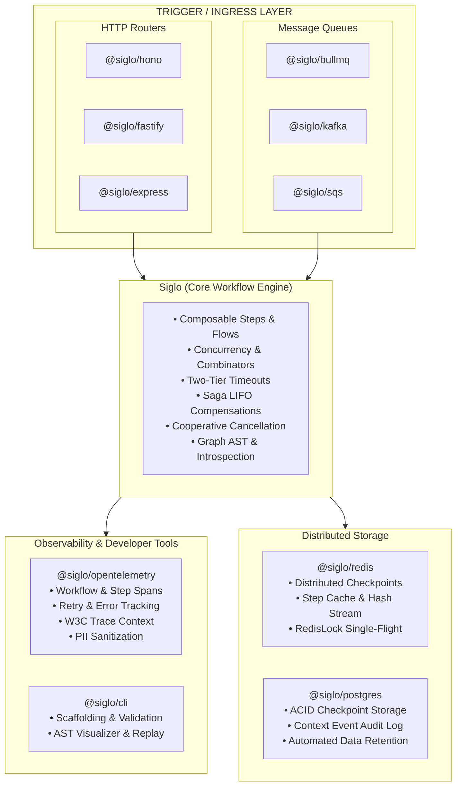
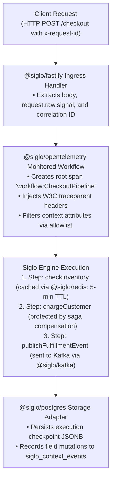

# Siglo Ecosystem Adapters & Integrations Guide

The `Siglo` ecosystem provides modular, production-ready integrations across observability, HTTP web frameworks, message brokers, persistent storage backends, and developer tooling.

The core runtime (`Siglo`) remains strictly **zero-dependency**; all ecosystem integrations are published as independent packages that depend only on standard interfaces (`StorageAdapter`, `IdempotencyStore`, `Flow`, `ExecutionOptions`).

---

## Ecosystem Directory

Detailed standalone guides are available for each plugin, adapter, and developer CLI:

| Package | Category | Documentation Guide | Key Features |
| :--- | :--- | :--- | :--- |
| **`@siglo/opentelemetry`** | Observability | [OpenTelemetry Guide](adapters/opentelemetry.md) | Distributed tracing, W3C Trace Context, step/retry spans, PII redaction |
| **`@siglo/redis`** | Storage & Caching | [Redis Adapter Guide](adapters/redis.md) | Distributed checkpoints, step caching, atomic idempotency, single-flight mutex |
| **`@siglo/postgres`** | Storage & Persistence | [PostgreSQL Adapter Guide](adapters/postgres.md) | ACID checkpoints, context mutation audit log, automatic DDL, retention cleanup |
| **`@siglo/bullmq`** | Queue & Job Worker | [BullMQ Adapter Guide](adapters/bullmq.md) | Redis job queue consumer, job ID deduplication, concurrency control |
| **`@siglo/kafka`** | Event Streaming | [Kafka Adapter Guide](adapters/kafka.md) | Partitioned consumer, composite idempotency keys, header namespace routing |
| **`@siglo/sqs`** | Cloud Message Queue | [AWS SQS Adapter Guide](adapters/sqs.md) | AWS Lambda SQS event processor, `ReportBatchItemFailures` partial responses |
| **`@siglo/hono`** | HTTP Ingress | [Hono Adapter Guide](adapters/hono.md) | Web Standards (`Request`/`Response`), Cloudflare Workers, Deno, Bun, Node.js |
| **`@siglo/fastify`** | HTTP Ingress | [Fastify Adapter Guide](adapters/fastify.md) | Low-overhead Node.js HTTP route handler, raw abort signals, schema support |
| **`@siglo/express`** | HTTP Ingress | [Express Adapter Guide](adapters/express.md) | Express 4.x/5.x middleware, correlation ID tracking, status code mapping |
| **`@siglo/cli`** | Developer Tooling | [Developer CLI Guide](adapters/cli.md) | Scaffolding (`init`), AST visualizer (`visualize`), cycle validator (`validate`), fixture replay |

---

## Architecture Overview



---

## Cross-Cutting Architectural Contracts

All adapters adhere to unified operational contracts that ensure predictable runtime behavior across diverse infrastructure backends:

### 1. Ingress & Context Extraction Contract
Every HTTP and queue adapter unwraps parameters, extracts correlation identifiers, and attaches abort signals:

- **Correlation Tracking**:
  - HTTP adapters inspect `x-correlation-id` and `x-request-id`, echoing `X-Correlation-Id` on responses.
  - SQS and BullMQ map job/message identifiers into workflow idempotency keys.
  - OpenTelemetry injects and extracts W3C `traceparent` headers across process boundaries.
- **Workflow Stack ID**:
  - Successful executions inject `X-Workflow-Stack-Id` into outgoing headers, linking client requests directly to persistence and telemetry records.
- **Context Unwrapping (`unwrapContext`)**:
  - Strips internal engine state (keys prefixed with `$`) and evaluates getter functions, ensuring clean, JSON-serializable payloads for downstreams.

### 2. Error Status Code Normalization
All HTTP adapters (`@siglo/express`, `@siglo/fastify`, `@siglo/hono`) share an identical error categorization contract:

| Workflow Exception | HTTP Status Code | Description |
| :--- | :--- | :--- |
| `StepTimeoutException` / `FlowTimeoutException` | `504 Gateway Timeout` | Step or end-to-end workflow timeout SLA was exceeded. |
| `ValidationException` / `SpecFailedException` | `400 Bad Request` | Contract or schema validation failed on input parameters. |
| `IdempotencyConflictException` | `409 Conflict` | Concurrent claim detected on an in-progress idempotency key. |
| `CancellationException` / `AbortError` | `499 Client Closed Request` | Client terminated the HTTP socket or workflow was aborted. |
| `CompensationException` | `500 Internal Server Error` | Saga forward step failed and compensation completed/failed. |
| Unhandled `Error` | `500 Internal Server Error` | Unexpected runtime error. |

### 3. Distributed Idempotency Contract
Queue and event adapters (`bullmq`, `kafka`, `sqs`) enforce exactly-once execution semantics by interfacing with an `IdempotencyStore`:

$$\text{Incoming Record} \longrightarrow \text{claim}(\text{key}, \text{ttl}) \longrightarrow \begin{cases} \text{'completed'} & \implies \text{Return cached result (ACK)} \\ \text{'in-progress'} & \implies \text{Throw conflict (Avoid parallel runs)} \\ \text{'claimed'} & \implies \text{Run workflow} \end{cases}$$

- On workflow success: `store.complete(key, result)` is called.
- On workflow error: `store.fail(key, error)` is called to clear the in-flight claim, allowing retry mechanisms to reprocess.

### 4. Cooperative Cancellation
When clients disconnect or timeouts elapse, HTTP adapters propagate `AbortSignal` into `ExecutionOptions.signal`. Steps inspect `param.$signal?.()` to cooperatively cancel pending outbound requests or database queries, eliminating orphaned server resources.

---

## Ingress Adapters Comparison Matrix

| Feature | `@siglo/hono` | `@siglo/fastify` | `@siglo/express` | `@siglo/bullmq` | `@siglo/kafka` | `@siglo/sqs` |
| :--- | :--- | :--- | :--- | :--- | :--- | :--- |
| **Runtime Target** | Cloudflare, Deno, Bun, Node | Node.js | Node.js | Node.js | Node.js | AWS Lambda, Node |
| **Trigger Mechanism** | Web Standard HTTP | HTTP Request | HTTP Request | Redis Queue Job | Kafka Topic Record | AWS SQS Batch |
| **Cancellation** | Native Web `AbortSignal` | `request.raw.signal` | `req.signal` | BullMQ Abort | Kafka Rebalance | Lambda Timeout |
| **Idempotency** | Custom / Store | Custom / Store | Custom / Store | Job ID Deduplication | Key / Offset Composite | Message ID Deduplication |
| **Batch Support** | No (Single req) | No (Single req) | No (Single req) | No (Single job) | Single / Batch loop | Partial Batch Failures |
| **Detailed Guide** | [Read Guide](adapters/hono.md) | [Read Guide](adapters/fastify.md) | [Read Guide](adapters/express.md) | [Read Guide](adapters/bullmq.md) | [Read Guide](adapters/kafka.md) | [Read Guide](adapters/sqs.md) |

---

## Storage & Persistence Backends Comparison

| Capability | `@siglo/redis` | `@siglo/postgres` |
| :--- | :--- | :--- |
| **Primary Use Case** | In-memory caching, sub-millisecond checkpoints, ephemeral locks | Durable relational persistence, compliance audit logs |
| **Storage Mechanism** | Redis Strings (`SET PX`), Hashes (`HSET`) | Relational tables (`JSONB`, `BIGSERIAL`, `TIMESTAMPTZ`) |
| **Checkpoint Retention** | Native Redis TTL expiration (`checkpointTtlMs`) | Automated cron cleanup (`cleanupOldCheckpoints(days)`) |
| **Context Change Audit** | Real-time hash update (`HSET siglo:context:...`) | Append-only event log (`siglo_context_events`) |
| **Step Output Caching** | Yes (`getCachedStep` / `setCachedStep`) | Relies on application layer / Redis |
| **Idempotency Locking** | Atomic Redis `SET ... PX ... NX` | PostgreSQL `INSERT ... ON CONFLICT DO NOTHING` |
| **Single-Flight Mutex** | Yes (`RedisLock` with Lua token validation) | Advisory locks or custom transaction tables |
| **Detailed Guide** | [Read Guide](adapters/redis.md) | [Read Guide](adapters/postgres.md) |

---

## End-to-End Reference Blueprint

The following blueprint illustrates how to combine multiple adapters into an enterprise microservice:



### Complete Code Blueprint:

```typescript
import Fastify from 'fastify';
import { Pool } from 'pg';
import { Redis } from 'ioredis';
import { Step, flow } from 'siglo';
import { sigloFastifyHandler } from '@siglo/fastify';
import { instrumentWorkflow, createTelemetryStorageAdapter } from '@siglo/opentelemetry';
import { PostgresStorageAdapter } from '@siglo/postgres';
import { RedisStorageAdapter } from '@siglo/redis';

// 1. Establish Infrastructure Connections
const pgPool = new Pool({ connectionString: process.env.DATABASE_URL });
const redis = new Redis(process.env.REDIS_URL || 'redis://localhost:6379');

// 2. Setup Persistent Storage and Auditing
const postgresStorage = new PostgresStorageAdapter({ client: pgPool });
await postgresStorage.ensureTables();
Step.useStorage(postgresStorage);

// 3. Define Business Logic Steps
const validateOrder = Step.create('validateOrder', async ({ orderId, amount }: any) => {
    if (!orderId || amount <= 0) {
        const err = new Error('Invalid order payload');
        err.name = 'ValidationException';
        throw err;
    }
    return { orderId, amount, status: 'VALIDATED' };
});

const chargeCard = Step.create('chargeCard', async (param: any) => {
    // Payment provider charge
    return { transactionId: `txn_${param.orderId}`, charged: true };
});

const checkoutFlow = flow(validateOrder, chargeCard);

// 4. Wrap with OpenTelemetry Tracing
const monitoredFlow = instrumentWorkflow(checkoutFlow, {
    workflowName: 'CheckoutService',
    workflowVersion: '2.0.0',
    allowNamespace: true,
});

// 5. Mount Ingress Fastify Handler
const app = Fastify({ logger: true });

app.post(
    '/api/checkout',
    sigloFastifyHandler(monitoredFlow, {
        timeout: 10000,
        correlationIdHeader: 'x-request-id',
        namespace: (req) => req.headers['x-tenant-id'] as string,
        output: (result, reply) => {
            reply.status(200).send({
                success: true,
                orderId: result.orderId,
                transactionId: result.transactionId,
            });
        },
    })
);

// 6. Graceful Shutdown Routine
const shutdown = async () => {
    app.log.info('Shutting down service...');
    await app.close();
    await redis.quit();
    await pgPool.end();
    process.exit(0);
};

process.on('SIGTERM', shutdown);
process.on('SIGINT', shutdown);

await app.listen({ port: 3000, host: '0.0.0.0' });
```

---

## Production Readiness Checklist

Before deploying workflows and adapters to production, verify the following configuration points:

- [ ] **Connection Pooling**: Configure database connection pool sizes (`pg.Pool`, `ioredis`) to prevent resource exhaustion during traffic spikes.
- [ ] **Idempotency TTL**: Align `idempotencyTtlMs` with queue retry policies. The idempotency claim TTL must exceed the maximum retry interval of your broker (BullMQ/Kafka/SQS).
- [ ] **Cooperative Cancellation**: Verify that external HTTP requests, RPC calls, and database drivers consume `param.$signal?.()` so client disconnects do not leave lingering queries.
- [ ] **Data Retention & Schema Cleanup**: Schedule periodic cron jobs to call `cleanupOldCheckpoints(days)` and `cleanupOldEvents(days)` in PostgreSQL.
- [ ] **PII & Data Redaction**: Verify that sensitive credentials, authentication tokens, and user data are masked when using `@siglo/cli inspect/checkpoint` or `@siglo/opentelemetry allowContextFields`.
- [ ] **Graceful Process Shutdown**: Ensure `process.on('SIGTERM')` drains active message consumers (`worker.close()`, `consumer.disconnect()`) and terminates database pools before exiting.
