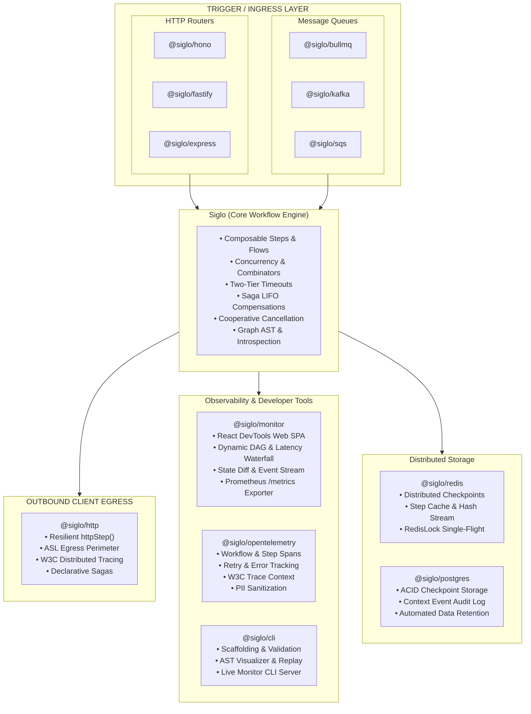

# Siglo Ecosystem Adapters & Integrations Guide

The `Siglo` ecosystem provides modular, production-ready integrations across observability, HTTP web frameworks, message brokers, persistent storage backends, and developer tooling.

The core runtime (`Siglo`) remains strictly **zero-dependency**; all ecosystem integrations are published as independent packages that depend only on standard interfaces (`StorageAdapter`, `IdempotencyStore`, `Flow`, `ExecutionOptions`).

---

## Ecosystem Directory

Detailed standalone guides are available for each plugin, adapter, and developer CLI:

| Package | Category | Documentation Guide | Key Features |
| :--- | :--- | :--- | :--- |
| **`@siglo/monitor`** | Observability & DevTools | [Live Monitoring Guide](live-monitoring.md) / [Monitor Adapter Guide](adapters/monitor.md) | React 18 DevTools SPA, dynamic DAG, latency waterfall, state diffs, SSE/WebSocket, Prometheus `/metrics` |
| **`@siglo/opentelemetry`** | Observability | [OpenTelemetry Guide](adapters/opentelemetry.md) | Distributed tracing, W3C Trace Context, step/retry spans, PII redaction |
| **`@siglo/http`** | HTTP Client Egress | [HTTP Client Guide](adapters/http.md) | Resilient client steps, ASL egress perimeter, W3C tracing, Retry-After backoff, sagas |
| **`@siglo/redis`** | Storage & Caching | [Redis Adapter Guide](adapters/redis.md) | Distributed checkpoints, step caching, atomic idempotency, single-flight mutex |
| **`@siglo/postgres`** | Storage & Persistence | [PostgreSQL Adapter Guide](adapters/postgres.md) | ACID checkpoints, context mutation audit log, automatic DDL, retention cleanup |
| **`@siglo/bullmq`** | Queue & Job Worker | [BullMQ Adapter Guide](adapters/bullmq.md) | Redis job queue consumer, job ID deduplication, concurrency control |
| **`@siglo/kafka`** | Event Streaming | [Kafka Adapter Guide](adapters/kafka.md) | Partitioned consumer, composite idempotency keys, header namespace routing |
| **`@siglo/sqs`** | Cloud Message Queue | [AWS SQS Adapter Guide](adapters/sqs.md) | AWS Lambda SQS event processor, `ReportBatchItemFailures` partial responses |
| **`@siglo/hono`** | HTTP Ingress | [Hono Adapter Guide](adapters/hono.md) | Web Standards (`Request`/`Response`), Cloudflare Workers, Deno, Bun, Node.js |
| **`@siglo/fastify`** | HTTP Ingress | [Fastify Adapter Guide](adapters/fastify.md) | Low-overhead Node.js HTTP route handler, raw abort signals, schema support |
| **`@siglo/express`** | HTTP Ingress | [Express Adapter Guide](adapters/express.md) | Express 4.x/5.x middleware, correlation ID tracking, status code mapping |
| **`@siglo/cli`** | Developer Tooling | [Developer CLI Guide](adapters/cli.md) | Scaffolding (`init`), AST visualizer (`visualize`), live monitor dev server (`monitor`), cycle validator (`validate`), fixture replay |

---

## Architecture Overview



---

## Cross-Cutting Architectural Contracts

All adapters adhere to unified operational contracts that ensure predictable runtime behavior across diverse infrastructure backends:

### 1. Ingress & Context Extraction Contract
Every HTTP and queue adapter unwraps parameters, extracts correlation identifiers, and attaches abort signals:

- **Correlation Tracking**:
  - HTTP adapters inspect `x-correlation-id` and `x-request-id`, echoing `X-Correlation-Id` on responses.
  - SQS and BullMQ map job/message identifiers into workflow idempotency keys.
  - OpenTelemetry injects and extracts W3C `traceparent` headers across process boundaries.
- **Workflow Stack ID**:
  - Successful executions inject `X-Workflow-Stack-Id` into outgoing headers, linking client requests directly to persistence and telemetry records.
- **Context Unwrapping (`unwrapContext`)**:
  - Strips internal engine state (keys prefixed with `$`) and evaluates getter functions, ensuring clean, JSON-serializable payloads for downstreams.

### 2. Error Status Code Normalization
All HTTP adapters (`@siglo/express`, `@siglo/fastify`, `@siglo/hono`) share an identical error categorization contract:

| Workflow Exception | HTTP Status Code | Description |
| :--- | :--- | :--- |
| `StepTimeoutException` / `FlowTimeoutException` | `504 Gateway Timeout` | Step or end-to-end workflow timeout SLA was exceeded. |
| `ValidationException` / `SpecFailedException` | `400 Bad Request` | Contract or schema validation failed on input parameters. |
| `IdempotencyConflictException` | `409 Conflict` | Concurrent claim detected on an in-progress idempotency key. |
| `CancellationException` / `AbortError` | `499 Client Closed Request` | Client terminated the HTTP socket or workflow was aborted. |
| `CompensationException` | `500 Internal Server Error` | Saga forward step failed and compensation completed/failed. |
| Unhandled `Error` | `500 Internal Server Error` | Unexpected runtime error. |

### 3. Distributed Idempotency Contract
Queue and event adapters (`bullmq`, `kafka`, `sqs`) enforce exactly-once execution semantics by interfacing with an `IdempotencyStore`:

$$\text{Incoming Record} \longrightarrow \text{claim}(\text{key}, \text{ttl}) \longrightarrow \begin{cases} \text{'completed'} & \implies \text{Return cached result (ACK)} \\ \text{'in-progress'} & \implies \text{Throw conflict (Avoid parallel runs)} \\ \text{'claimed'} & \implies \text{Run workflow} \end{cases}$$

---

## Trigger Adapters Comparison Matrix

| Feature | `@siglo/hono` | `@siglo/fastify` | `@siglo/express` | `@siglo/bullmq` | `@siglo/kafka` | `@siglo/sqs` |
| :--- | :--- | :--- | :--- | :--- | :--- | :--- |
| **Runtime Target** | Cloudflare, Deno, Bun, Node | Node.js | Node.js | Node.js | Node.js | AWS Lambda, Node |
| **Trigger Mechanism** | Web Standard HTTP | HTTP Request | HTTP Request | Redis Queue Job | Kafka Topic Record | AWS SQS Batch |
| **Cancellation** | Native Web `AbortSignal` | `request.raw.signal` | `req.signal` | BullMQ Abort | Kafka Rebalance | Lambda Timeout |
| **Idempotency** | Custom / Store | Custom / Store | Custom / Store | Job ID Deduplication | Key / Offset Composite | Message ID Deduplication |
| **Batch Support** | No (Single req) | No (Single req) | No (Single req) | No (Single job) | Single / Batch loop | Partial Batch Failures |
| **Detailed Guide** | [Read Guide](adapters/hono.md) | [Read Guide](adapters/fastify.md) | [Read Guide](adapters/express.md) | [Read Guide](adapters/bullmq.md) | [Read Guide](adapters/kafka.md) | [Read Guide](adapters/sqs.md) |

---

## Storage & Persistence Backends Comparison

| Capability | `@siglo/redis` | `@siglo/postgres` |
| :--- | :--- | :--- |
| **Primary Use Case** | In-memory caching, sub-millisecond checkpoints, ephemeral locks | Durable relational persistence, compliance audit logs |
| **Storage Mechanism** | Redis Strings (`SET PX`), Hashes (`HSET`) | Relational tables (`JSONB`, `BIGSERIAL`, `TIMESTAMPTZ`) |
| **Checkpoint Retention** | Native Redis TTL expiration (`checkpointTtlMs`) | Automated cron cleanup (`cleanupOldCheckpoints(days)`) |
| **Context Change Audit** | Real-time hash update (`HSET siglo:context:...`) | Append-only event log (`siglo_context_events`) |
| **Step Output Caching** | Yes (`getCachedStep` / `setCachedStep`) | Relies on application layer / Redis |
| **Idempotency Locking** | Atomic Redis `SET ... PX ... NX` | PostgreSQL `INSERT ... ON CONFLICT DO NOTHING` |
| **Single-Flight Mutex** | Yes (`RedisLock` with Lua token validation) | Advisory locks or custom transaction tables |
| **Detailed Guide** | [Read Guide](adapters/redis.md) | [Read Guide](adapters/postgres.md) |

---

## End-to-End Reference Blueprint

The following blueprint illustrates how to combine multiple adapters into an enterprise microservice:

```typescript
import Fastify from 'fastify';
import { flow, Step } from 'siglo';
import { sigloFastifyHandler } from '@siglo/fastify';
import { httpStep } from '@siglo/http';
import { RedisStorageAdapter } from '@siglo/redis';
import { instrumentWorkflow } from '@siglo/opentelemetry';
import { attachToMonitorServer } from '@siglo/monitor';
import { trace } from '@opentelemetry/api';

// 1. Initialize Fastify & Storage
const server = Fastify();
Step.useStorage(new RedisStorageAdapter({ url: process.env.REDIS_URL }));

// 2. Define Workflows using @siglo/http for external calls
const chargePayment = httpStep('chargePayment', {
  url: 'https://api.stripe.com/v1/charges',
  method: 'POST',
  body: (ctx) => ({ amount: ctx.amount, customer: ctx.customerId }),
  compensate: {
    url: (_ctx, res) => `https://api.stripe.com/v1/refunds/${res.id}`,
    method: 'DELETE'
  }
});

const checkoutPipeline = flow(
  chargePayment,
  Step.create('fulfillOrder', async (ctx) => ({ orderId: ctx.orderId, status: 'FULFILLED' }))
).monitor(attachToMonitorServer(4000)); // Attach to live DevTools monitor

// 3. Instrument Workflow with OpenTelemetry
const tracer = trace.getTracer('checkout-service');
const { instrumented } = instrumentWorkflow(checkoutPipeline, tracer);

// 4. Mount with Fastify Adapter
server.post('/api/checkout', sigloFastifyHandler(instrumented, {
  correlationIdHeader: 'x-correlation-id',
  allowHeaderNamespace: true
}));

await server.listen({ port: 3000 });
```
