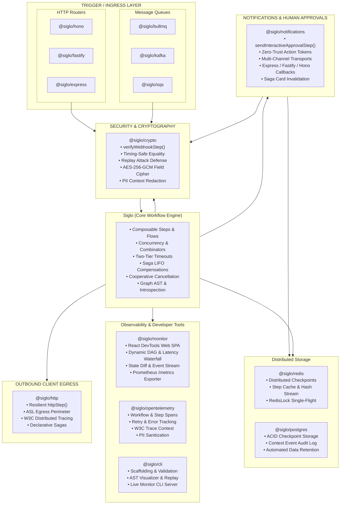

# Siglo Ecosystem Adapters & Integrations Guide

The `Siglo` ecosystem provides modular, production-ready integrations across observability, HTTP web frameworks, message brokers, persistent storage backends, and developer tooling.

The core runtime (`Siglo`) remains strictly **zero-dependency**; all ecosystem integrations are published as independent packages that depend only on standard interfaces (`StorageAdapter`, `IdempotencyStore`, `Flow`, `ExecutionOptions`).

---

## Ecosystem Directory

Detailed standalone guides are available for each plugin, adapter, and developer CLI:

| Package | Category | Documentation Guide | Key Features |
| :--- | :--- | :--- | :--- |
| **`@siglo/crypto`** | Security & Data Confidentiality | [Crypto Security Guide](adapters/crypto.md) | Timing-safe webhook verification, replay defense, AES-256-GCM envelope encryption, PII context redaction |
| **`@siglo/notifications`** | Notifications & Human Approvals | [Notifications Guide](adapters/notifications.md) | Multi-channel transports (Slack, Resend, SendGrid, Twilio, Postmark, Discord, SMTP, Push), HMAC action tokens, distributed durable resumption, saga message invalidation |
| **`@siglo/monitor`** | Observability & DevTools | [Live Monitoring Guide](live-monitoring.md) / [Monitor Adapter Guide](adapters/monitor.md) | React 18 DevTools SPA, dynamic DAG, latency waterfall, state diffs, SSE/WebSocket, Prometheus `/metrics` |
| **`@siglo/opentelemetry`** | Observability | [OpenTelemetry Guide](adapters/opentelemetry.md) | Distributed tracing, W3C Trace Context, step/retry spans, PII redaction |
| **`@siglo/http`** | HTTP Client Egress | [HTTP Client Guide](adapters/http.md) | Resilient client steps, ASL egress perimeter, W3C tracing, Retry-After backoff, sagas |
| **`@siglo/redis`** | Storage & Caching | [Redis Adapter Guide](adapters/redis.md) | Distributed checkpoints, step caching, atomic idempotency, single-flight mutex |
| **`@siglo/postgres`** | Storage & Persistence | [PostgreSQL Adapter Guide](adapters/postgres.md) | ACID checkpoints, context mutation audit log, automatic DDL, retention cleanup |
| **`@siglo/bullmq`** | Queue & Job Worker | [BullMQ Adapter Guide](adapters/bullmq.md) | Redis job queue consumer, job ID deduplication, concurrency control |
| **`@siglo/kafka`** | Event Streaming | [Kafka Adapter Guide](adapters/kafka.md) | Partitioned consumer, composite idempotency keys, header namespace routing |
| **`@siglo/sqs`** | Cloud Message Queue | [AWS SQS Adapter Guide](adapters/sqs.md) | AWS Lambda SQS event processor, `ReportBatchItemFailures` partial responses |
| **`@siglo/hono`** | HTTP Ingress | [Hono Adapter Guide](adapters/hono.md) | Web Standards (`Request`/`Response`), Cloudflare Workers, Deno, Bun, Node.js |
| **`@siglo/fastify`** | HTTP Ingress | [Fastify Adapter Guide](adapters/fastify.md) | Low-overhead Node.js HTTP route handler, raw abort signals, schema support |
| **`@siglo/express`** | HTTP Ingress | [Express Adapter Guide](adapters/express.md) | Express 4.x/5.x middleware, correlation ID tracking, status code mapping |
| **`@siglo/scheduler`** | Background Schedulers & Timers | [Scheduler Adapter Guide](adapters/scheduler.md) | PostgreSQL row-level poller (`FOR UPDATE SKIP LOCKED`), memory poller, and cloud webhook dispatchers (AWS EventBridge, GCP Cloud Tasks) |
| **`@siglo/testing`** | Testing & Deterministic Replay | [Testing Adapter Guide](adapters/testing.md) | Virtual clocks (`FakeClock`), step spies, step mocks, harness assertions, and failure replay |
| **`@siglo/cli`** | Developer Tooling | [Developer CLI Guide](adapters/cli.md) | Scaffolding (`init`), AST visualizer (`visualize`), live monitor dev server (`monitor`), cycle validator (`validate`), fixture replay |

---

## Architecture Overview



---

## Cross-Cutting Architectural Contracts

All adapters adhere to unified operational contracts that ensure predictable runtime behavior across diverse infrastructure backends:

### 1. Ingress & Context Extraction Contract
Every HTTP and queue adapter unwraps parameters, extracts correlation identifiers, and attaches abort signals:

- **Correlation Tracking**:
  - HTTP adapters inspect `x-correlation-id` and `x-request-id`, echoing `X-Correlation-Id` on responses.
  - SQS and BullMQ map job/message identifiers into workflow idempotency keys.
  - OpenTelemetry injects and extracts W3C `traceparent` headers across process boundaries.
- **Workflow Stack ID**:
  - Successful executions inject `X-Workflow-Stack-Id` into outgoing headers, linking client requests directly to persistence and telemetry records.
- **Context Unwrapping (`unwrapContext`)**:
  - Strips internal engine state (keys prefixed with `$`) and evaluates getter functions, ensuring clean, JSON-serializable payloads for downstreams.

### 2. Error Status Code Normalization
All HTTP adapters (`@siglo/express`, `@siglo/fastify`, `@siglo/hono`, `@siglo/notifications`) share an identical error categorization contract:

| Workflow Exception | HTTP Status Code | Description |
| :--- | :--- | :--- |
| `StepTimeoutException` / `FlowTimeoutException` | `504 Gateway Timeout` | Step or end-to-end workflow timeout SLA was exceeded. |
| `ValidationException` / `SpecFailedException` | `400 Bad Request` | Contract, schema, or cryptographic token validation failed. |
| `IdempotencyConflictException` / `WorkflowAlreadyResumedException` | `409 Conflict` | Concurrent claim detected on an in-progress idempotency key or already resumed wait. |
| `ExpiredWaitException` | `410 Gone` | Durable wait timeout or signed approval token expired. |
| `CancellationException` / `AbortError` | `499 Client Closed Request` | Client terminated the HTTP socket or workflow was aborted. |
| `NetworkPolicyViolationException` | `403 Forbidden` | ASL network egress perimeter rejected unauthorized destination host. |
| `SigloError` (Uncaught / Internal) | `500 Internal Server Error` | Unexpected fatal runtime failure within step execution. |

---

## Installation & Quick Start Matrix

Each package can be installed independently as needed:

```bash
# Core workflow orchestrator (required)
npm install siglo

# Notifications & Human-in-the-Loop Approvals
npm install @siglo/notifications @siglo/crypto @siglo/http

# Observability
npm install @siglo/monitor @siglo/opentelemetry

# Security & Data Confidentiality
npm install @siglo/crypto

# Client Egress
npm install @siglo/http

# Storage Backends
npm install @siglo/redis ioredis
npm install @siglo/postgres pg

# Ingress Triggers
npm install @siglo/hono
npm install @siglo/fastify
npm install @siglo/express
npm install @siglo/bullmq bullmq
npm install @siglo/kafka kafkajs
npm install @siglo/sqs @aws-sdk/client-sqs

# Background Schedulers & Timers
npm install @siglo/scheduler

# Developer Tooling
npm install -g @siglo/cli
```
