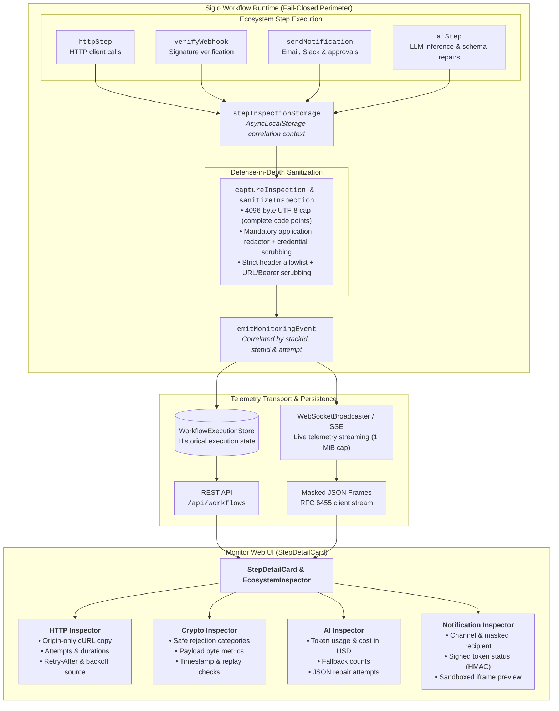
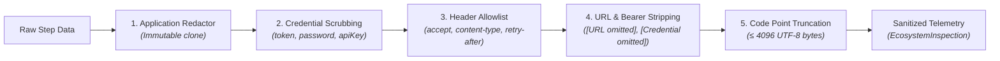
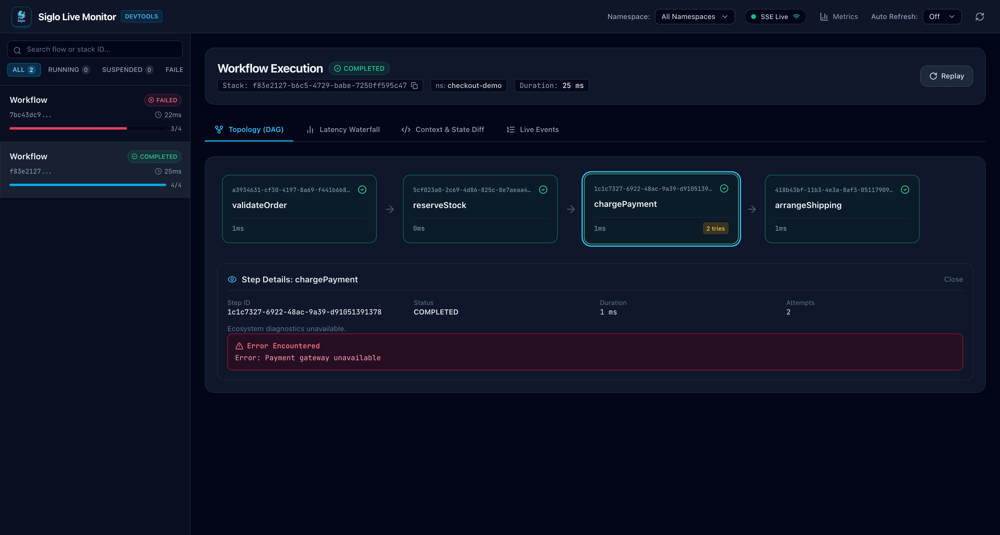
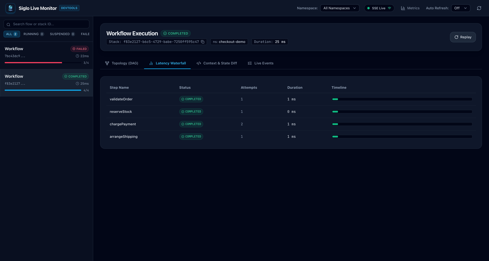
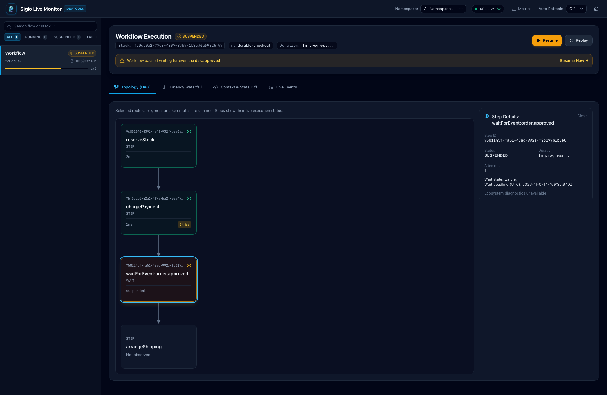
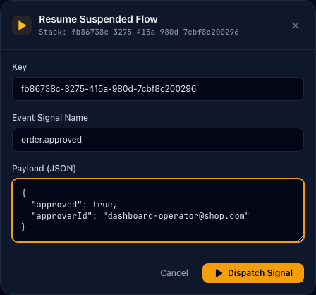
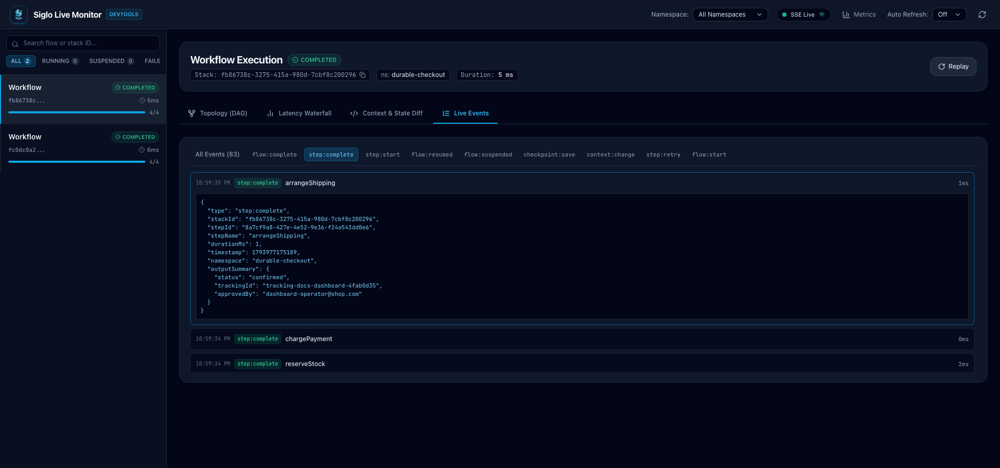

# Ecosystem DevTools and Offline Testing

The Siglo Web Monitor and Developer Tools provide deep runtime diagnostics and offline testing capabilities for ecosystem steps: HTTP client calls, webhook verification, AI completions, and interactive human notifications.

Ecosystem inspection operates through versioned telemetry (`EcosystemInspection` exported by `@siglo/core`) correlated by stack ID, runtime step ID, and workflow attempt. Telemetry is non-intrusive, strictly bounded, and fail-closed: diagnostic failures never alter workflow execution outcomes.



---

## 1. Opt-in Content Capture & Redaction Contract

### Zero-Capture Default

By default, Siglo captures only metadata (origins, status codes, token usage, durations, and categorical verification results). No request/response bodies, prompts, raw outputs, or message content are captured unless explicitly opted in.

### Configuring Capture

To capture content, supply an `InspectionCapturePolicy` to `httpStep`, `aiStep`, `sendNotificationStep`, or `sendInteractiveApprovalStep`:

```typescript
import type { InspectionCapturePolicy } from '@siglo/core';

const capturePolicy: InspectionCapturePolicy = {
    // Select fields permitted for capture
    fields: [
        'requestBody',
        'responseBody',
        'requestHeaders',
        'responseHeaders',
        'prompt',
        'output',
        'parsedOutput',
        'preview',
    ],
    // Per-field UTF-8 byte limit (capped at 4096 bytes)
    maxBytes: 2048,
    // Required application redactor: return undefined to omit sensitive fields
    redact: (field, value) => {
        if (field === 'requestHeaders') {
            // Application-specific header redaction
            const headers = { ...(value as Record<string, string>) };
            delete headers['x-custom-api-key'];
            return headers;
        }

        // Deep clone and scrub domain-specific secrets or PII
        const serialized = JSON.stringify(value ?? null);
        const scrubbed = serialized
            .replace(/fixture-secret/gi, '[REDACTED]')
            .replace(/[A-Za-z0-9._%+-]+@[A-Za-z0-9.-]+\.[A-Za-z]{2,}/g, '[EMAIL REDACTED]');

        return JSON.parse(scrubbed);
    },
};
```

### Allowed Capture Fields by Kind

| Inspection Kind  | Allowed Capture Fields                                             | Never Captured                                                                |
| ---------------- | ------------------------------------------------------------------ | ----------------------------------------------------------------------------- |
| **HTTP**         | `requestHeaders`, `requestBody`, `responseHeaders`, `responseBody` | Query strings, URL paths, credentials, binary bodies, unconsumed retry bodies |
| **Crypto**       | _None_                                                             | Webhook raw payloads, secrets, signature headers, authorization tokens        |
| **AI**           | `prompt`, `output`, `parsedOutput`                                 | Provider credentials, adapter auth states, API keys                           |
| **Notification** | `preview`                                                          | Recipient email/phone/slack IDs, callback URLs, signing secrets               |

### Multi-Layer Sanitization & Defense-in-Depth

Siglo applies several layered safeguards to prevent secret leakage:

1. **Mandatory Application Redactor**: A `redact` callback is mandatory when configuring capture. If `redact` is omitted or not a function, capture is skipped. Returning `undefined` from `redact` omits that field completely.
2. **Immutable Clones**: The redactor always receives a structured clone of execution data. Any mutation within the redactor cannot affect actual workflow execution.
3. **Fail-Closed Execution**: If an application redactor throws or encounters serialization errors, the field is silently dropped. Workflow execution proceeds unaffected.
4. **Hardcoded Credential Key Scrubbing**: Core automatically redacts common credential keys (`token`, `password`, `secret`, `authorization`, `apiKey`, `client_secret`) during telemetry preparation.
5. **URL & Bearer Token Omission**: Embedded `http://` and `https://` URLs are stripped to `[URL omitted]` to prevent token leakage in query strings. Bearer and Basic headers are replaced with `[Credential omitted]`.
6. **Strict Header Allowlist**: Captured headers are restricted exclusively to:
    - `accept`
    - `content-type`
    - `content-length`
    - `cache-control`
    - `retry-after`
      All other request and response headers are automatically discarded.
7. **Unicode-Safe Byte Limits**: Field captures are strictly bounded to `Math.min(maxBytes, 4096)` UTF-8 bytes. Truncation loops over full Unicode code points rather than raw byte slices, ensuring no malformed UTF-8 characters or surrogate splits occur.
8. **Context Telemetry Suppression**: Once a workflow stack executes an ecosystem step, generic runtime context, output summaries, and failure errors are suppressed for that stack (`hasEcosystemContent(stackId)`). This prevents later workflow steps from inadvertently leaking earlier sensitive responses via merged execution context.
9. **No Client-Side Unmasking**: Discarded or redacted values are omitted before storage and transport. The web dashboard provides no mechanism to unmask server-redacted data.



---

## 2. Inspector Behavior & Web UI Panels

The Siglo Web Monitor UI provides interactive diagnostics through the DAG visualizer and `StepDetailCard` inspector panel:



The companion latency waterfall visualizes per-attempt step durations, HTTP retry delays, and backoff sleeps:



### HTTP Inspector

The HTTP inspector visualizes client request execution, retry policies, and egress assertions:

- **Origin Isolation**: Displays method, status, URL origin, duration, and trace ID. The URL path and query parameters are stripped before emission.
- **Per-Attempt Durations**: Measures duration inclusive of response body streaming/consumption, but excludes subsequent sleep delay before retry.
- **Retry Diagnostics**:
    - `retryAttempts`: Total retry count.
    - `requestAttempt`: Current attempt index.
    - `retryDelayMs`: Actual selected sleep delay (absent after exhaustion).
    - `retryAfterMs`: Parsed HTTP `Retry-After` delay (supports seconds and RFC 2822 date formats).
    - `retryDelaySource`: Distinguishes between `'retry-after'` header response and exponential `'backoff'`.
- **Egress Policy**: Displays `'allowed'`, `'denied'`, or `'unknown'` based on the active AsyncLocalStorage network perimeter.
- **Sanitized cURL Export**: The copy action produces strictly origin-only commands (e.g., `curl --request POST --url 'https://api.stripe.com'`). It deliberately excludes headers, bodies, URL paths, query parameters, and authorization tokens.

### Crypto Webhook Inspector

The Crypto inspector reports webhook verification results without exposing payloads or cryptographic material:

- **Provider**: Displays verified protocol name (e.g., `stripe`, `github`, `shopify`, `slack`, `svix`, `generic-hmac`).
- **Payload Size**: Total received payload size in bytes.
- **Safe Diagnostic Categories**:
    - `verified`: Cryptographic signature and tolerances matched.
    - `rejected`: Signature verification failed.
    - `invalid-payload`: Payload was not raw string or Buffer (prevents JSON serialization skew).
    - `payload-too-large`: Payload exceeded configured `maxBodyBytes`.
    - `missing-secret`: No webhook signing secret supplied.
    - `unknown-provider`: Provider not registered in protocol registry.
    - `missing-signature`: Signature header was absent.
    - `timestamp-rejected`: Payload timestamp was outside allowed tolerance window.
    - `replay-detected`: Duplicate signature detected within tolerance window via `dedupStore`.
    - `invalid-signature`: Signature mismatch against computed HMAC.
- **Checks**: Explicit `'passed'`, `'failed'`, or `'unavailable'` status for timestamp tolerance and anti-replay nonce claims.
- **Privacy Guarantee**: No raw payloads, signatures, webhook secrets, or internal stack traces are captured or emitted.

### AI Completion Inspector

The AI inspector provides complete lifecycle visibility into generative inference:

- **Inference Attempts vs Workflow Attempts**: Tracks separate inference attempts for provider fallbacks and structured output JSON repairs.
- **Completion Event Unification**: Reuses the singular `ai:complete` monitoring event, maintaining accurate billing accounting without duplicate completion events.
- **Token & Cost Accounting**: Displays prompt tokens, completion tokens, total tokens, latency, and estimated cost in USD. If pricing is unknown, cost is explicitly rendered as `"Unavailable"` rather than `$0.00`.
- **Tool Calling & Diagnostics**: Tracks repair attempt counts (`repairAttempts`) and model fallback transitions (`fallbackCount`).
- **Prompt & Output Timelines**: When capture is enabled, displays bounded prompt message histories, assistant text outputs, and validated structured output schemas.

### Notification & Approval Inspector

The Notification inspector tracks delivery and interactive human-in-the-loop approvals:

- **Delivery Diagnostics**: Channel (`email`, `slack`, `discord`, `sms`, `push`), dispatched message ID, masked recipient (e.g., `u***`), and dispatch timestamp.
- **Approval States**:
    - `requested`: Dispatch completed, action token issued.
    - `approved`: Validated affirmative callback received.
    - `rejected`: Validated rejection callback received.
    - `forbidden`: Authorization callback hook rejected the user.
    - `cancelled`: Revocation store marked the approval cancelled.
    - `expired`: Callback received after approval timeout or durable wait deadline.
    - `conflict`: Callback received for an already resumed or duplicate event.
    - `failed`: Callback processing exception.
- **Token Status**: Shows `'issued'` or `'unavailable'`. Signed tokens and callback URLs are never emitted or displayed.
- **Isolated Email Previews**: Email HTML previews are rendered inside an `<iframe>` with an empty sandbox attribute (`sandbox=""`) and strict Content Security Policy (`default-src 'none'; base-uri 'none'; form-action 'none'`). Only inert formatting tags (`<p>`, `<br>`, `<b>`, `<strong>`, `<i>`, `<em>`, `<ul>`, `<ol>`, `<li>`, `<pre>`, `<code>`, `<h1>`-`<h3>`, `<blockquote>`) are rendered without attributes; all other tags, scripts, images, links, styles, and event handlers are safely HTML-escaped.
- **Slack Content**: Rendered as safely escaped text.

---

## 3. Durable Approvals & Callback Architecture

Siglo decouples notification dispatch from durable suspension. The approval step issues a cryptographically signed action token and dispatches the notification, while a subsequent `waitForEvent` node suspends the workflow until the user acts or a timeout occurs.

```mermaid
sequenceDiagram
    autonumber
    actor User as External Approver
    participant Engine as Workflow Engine
    participant Notify as @siglo/notifications
    participant Channel as Delivery Transport (Email / Slack)
    participant Callback as Callback Server (/api/approvals/callback)
    participant Monitor as Siglo Monitor

    rect rgb(30, 41, 59)
        Note over Engine, Notify: 1. Action Token Dispatch & Durable Suspension
        Engine->>Notify: sendInteractiveApprovalStep(config)
        Notify->>Notify: Generate HMAC-SHA256 action token<br/>(signs stackId, stepId, correlationKey, expiresAt)
        Notify->>Channel: Dispatch notification with signed action URL
        Channel-->>User: Delivers message with action buttons / links
        Notify->>Monitor: emitMonitoringEvent({ kind: 'notification', approvalState: 'requested', tokenStatus: 'issued' })
        Engine->>Engine: waitForEvent (Enters SUSPENDED / WAITING status)
    end

    rect rgb(15, 23, 42)
        Note over User, Callback: 2. Dual-Phase Confirmation & State Mutation
        User->>Callback: Clicks Action URL: GET /callback?token=...
        Note over Callback: Read-Only Phase: Displays preview form<br/>Guarantees GET cannot mutate workflow state
        Callback-->>User: 200 OK: Renders Confirmation Dialog (with CSRF token)
        User->>Callback: Submits Decision: POST /callback { token, approved: true }
    end

    rect rgb(30, 41, 59)
        Note over Callback, Engine: 3. Cryptographic Verification & Workflow Resumption
        Callback->>Callback: verifyActionToken(token)<br/>• Validates HMAC signature against SIGLO_SIGNING_SECRET<br/>• Checks token expiration timestamp (UTC)<br/>• Acquires correlation lock (prevents duplicate callbacks)
        Callback->>Engine: resumeWorkflow(stackId, { approved: true })
        Callback->>Monitor: emitMonitoringEvent({ kind: 'notification', approvalState: 'approved' })
        Callback-->>User: 302 Redirect (to onSuccessRedirect)
        Engine->>Engine: Transition: WAITING -> RESUMED -> COMPLETED
        Engine->>Engine: Advance workflow to next step
    end
```



### Live Monitor Suspension & Resumption

When `sendInteractiveApprovalStep` dispatches an approval request and registers `waitForEvent`, the live monitor highlights the suspended execution in amber, displaying the durable wait state and UTC deadline in the inspector:



Workflows can also be inspected and manually resumed or rejected directly from the live monitor dashboard during development and testing:



Once resumed (either via callback POST or monitor signal), the workflow completes and records the approved execution event:



### Callback Server Integration

Use the built-in HTTP middleware to handle callbacks in Express, Fastify, or Hono:

```typescript
import express from 'express';
import { createNotificationExpressMiddleware } from '@siglo/notifications';
import { myWorkflow } from './workflows';

const app = express();
app.use(express.urlencoded({ extended: true }));
app.use(express.json());

app.all(
    '/api/approvals/callback',
    createNotificationExpressMiddleware({
        workflow: myWorkflow,
        signingSecret: process.env.SIGLO_SIGNING_SECRET!,
        // Optional origin allowlist for CORS
        allowedOrigins: ['https://admin.example.com'],
        // Optional authorizer for user session / role checks
        authorize: async (payload, req) => {
            // payload contains: stackId, correlationKey, expectedEvent, approved, expiresAt
            return true;
        },
        onSuccessRedirect: 'https://admin.example.com/approvals/success',
        onExpiredRedirect: 'https://admin.example.com/approvals/expired',
        onErrorRedirect: 'https://admin.example.com/approvals/error',
    }),
);
```

### Safety Guarantees for Callbacks

1. **Dual-Phase Routing**:
    - `GET` requests act as read-only preview/confirmation prompts and cannot mutate workflow state.
    - `POST` requests execute the mutation using token data extracted exclusively from the request body.
2. **Signed Telemetry Identity**: Newly generated action tokens embed signed runtime inspection scopes (`stackId`, `stepId`, `stepName`, `attempt`). The callback handler verifies the token signature before recording approval telemetry, guaranteeing that unverified or tampered tokens cannot inject spurious workflow events.
3. **Wait Expiry vs Token Expiry**: Token expiry (encoded in the JWT payload) and durable wait expiry (scheduled in the workflow engine) are independent. Neither timeout implies a human rejection; timeouts are treated as separate expiration events.
4. **Revocation & Lock Store**: Callbacks acquire an approval lock on `correlationKey` to guarantee that concurrent approvals, retries, or duplicate callbacks cannot execute concurrently or conflict.

---

## 4. CLI Scaffolding

Generate production-ready ecosystem steps and companion tests directly from the terminal using the Siglo CLI:

```bash
# HTTP step with schema validation and retry policies
siglo generate step callStripe --type=http --url=https://api.stripe.com/v1/charges

# Webhook verification step with anti-replay and payload streaming
siglo generate step verifyStripeWebhook --type=crypto --provider=stripe

# Omnichannel notification step (email, slack, sms, discord, push)
siglo generate step sendAlert --type=notification --channel=email

# Interactive human-in-the-loop approval step
siglo generate step managerApproval --type=notification --channel=slack --interactive=true

# AI completion step with structured output schema
siglo generate step triageTicket --type=ai --provider=anthropic --model=claude-3-5-sonnet-20241022
```

### Generation Features

- **Factory Pattern**: Templates export a `create<Name>Step` factory function allowing test suites to inject mock transports, HTTP servers, or AI providers without modifying production step files.
- **Refuses Overwriting**: Generation checks for existing files and refuses to overwrite either the step file or its corresponding test file.
- **Strict Input Validation**: Validates identifiers, URLs, channels, and model options. Unsupported options return clear errors and non-zero exit codes.
- **Embedded Offline Tests**: Each generated step includes a runnable offline test that requires no live network access or real provider API keys.

---

## 5. Offline Testing & Replay Cookbook

The Siglo ecosystem provides dedicated test doubles in package-owned testing subpaths. Run tests without production network access, API tokens, or external dependencies.

### Complete Offline Test Recipe

The canonical integration recipe lives in `packages/monitor/src/ecosystem.integration.test.ts`:

```typescript
import { test } from 'node:test';
import assert from 'node:assert/strict';
import { createWorkflowHarness } from '@siglo/testing';
import { createMockHttpServer } from '@siglo/http/testing';
import { MockAiProvider } from '@siglo/ai/testing';
import { MockNotificationTransport } from '@siglo/notifications/testing';
import { createOrderProcessingWorkflow } from './orderWorkflow';

test('Order pipeline executes offline with synthetic test doubles', async () => {
    // 1. Initialize HTTP Mock Server
    const http = createMockHttpServer();

    try {
        // Intercept payment gateway call
        http.get('https://api.stripe.com')
            .intercept({ path: '/v1/charges', method: 'POST' })
            .reply(200, { id: 'ch_test_123', status: 'succeeded' });

        // 2. Initialize AI Mock Provider with scripted completion fixture
        const ai = new MockAiProvider([
            {
                text: JSON.stringify({ riskScore: 12, recommendedAction: 'APPROVE' }),
                promptTokens: 45,
                completionTokens: 18,
            },
        ]);

        // 3. Initialize Mock Notification Transport
        const notifications = new MockNotificationTransport('slack');

        // 4. Construct workflow through factory injecting test doubles
        const workflow = createOrderProcessingWorkflow({
            httpOptions: {/* custom mock endpoints if needed */},
            aiAdapter: ai,
            notificationTransport: notifications,
        });

        // 5. Execute via WorkflowHarness
        const harness = createWorkflowHarness(workflow);
        const result = await harness.run({
            orderId: 'ord_9988',
            amount: 4999,
            customerEmail: 'customer@example.com',
        });

        // 6. Assertions
        assert.equal(result.status, 'COMPLETED');
        assert.equal(result.data.chargeId, 'ch_test_123');
        assert.equal(result.data.decision, 'APPROVE');

        // Verify all mock interactions were satisfied
        http.assertDone();
        ai.assertDone();
        assert.equal(notifications.messages.length, 1);
    } finally {
        // Always clean up HTTP fetch mock in finally
        http.close();
    }
});
```

### Important Testing Rules

1. **Serial Execution for Global Fetch Mocks**: Because `createMockHttpServer` hooks into global `fetch`, tests that mock HTTP requests must run serially:
    ```bash
    node --import tsx --test --test-concurrency=1 'src/**/*.test.ts'
    ```
2. **Cleanup in `finally`**: Always call `http.close()` in a `finally` block to restore the original `globalThis.fetch`.
3. **Step Substitution vs Provider Replay vs Durable Continuation**:
    - **Provider Replay**: Executes real application code against recorded provider HTTP/AI fixtures.
    - **Step Substitution (`harness.mockStep`)**: Completely replaces a step implementation without invoking its internal logic.
    - **Durable Continuation (`resumeWorkflow`)**: Resumes a suspended workflow from a saved checkpoint state.
4. **Crypto Tests**: Crypto webhook tests need no external testing package. Use Node's built-in `node:crypto` (`createHmac`) to generate signed payloads locally.

---

## 6. Live Transport & WebSocket Protocol

The Siglo Monitor server broadcasts execution events and ecosystem inspection records over WebSocket connections and SSE.

### Connection & Authorization Scopes

| Scope     | Requirement                                                  | Actions Permitted                                 |
| --------- | ------------------------------------------------------------ | ------------------------------------------------- |
| `read`    | Bearer token in query `?token=...` or `Authorization` header | Connect to WebSocket, receive live event stream   |
| `ingest`  | Verified during `type: 'event'` frames                       | Submit external telemetry events into the monitor |
| `control` | Verified during `type: 'resume'` frames                      | Remotely trigger workflow resumption              |

### Framing & Frame Limits

- **Payload Bound**: Maximum WebSocket frame payload is 1 MiB (`1048576` bytes). Frames exceeding this limit are immediately rejected with WebSocket close code `1009 (Message Too Big)`.
- **Masking & RFC 6455**: Client frames must be masked text. Unsupported fragmentation or non-text frames close the connection with code `1003`.
- **Validation**: Incoming inspection records re-verify schema, version (`1`), recognized kinds (`http`, `crypto`, `notification`, `ai`), and bounds before storing or re-broadcasting to other connected clients.

```json
// External telemetry ingestion frame (requires 'ingest' scope):
{
  "type": "event",
  "event": {
    "type": "step:complete",
    "stackId": "stack-101",
    "stepName": "processOrder",
    "status": "success",
    "timestamp": 1731000000000
  }
}

// Remote workflow resumption frame (requires 'control' scope):
{
  "type": "resume",
  "workflowId": "orderFlow",
  "correlationKey": "order:ord-101",
  "payload": { "approved": true }
}
```

---

## 7. Package Verification & Test Commands

To verify all packages and test suites across the Siglo workspace:

```bash
# Run core test suite with 100% statement and line coverage check
npm test

# Run monitor tests including devtools, inspectors, and integration recipes
npm test --workspace=@siglo/monitor

# Run all package test suites across the monorepo
npm run test:all

# Check git diff formatting
git diff --check
```
