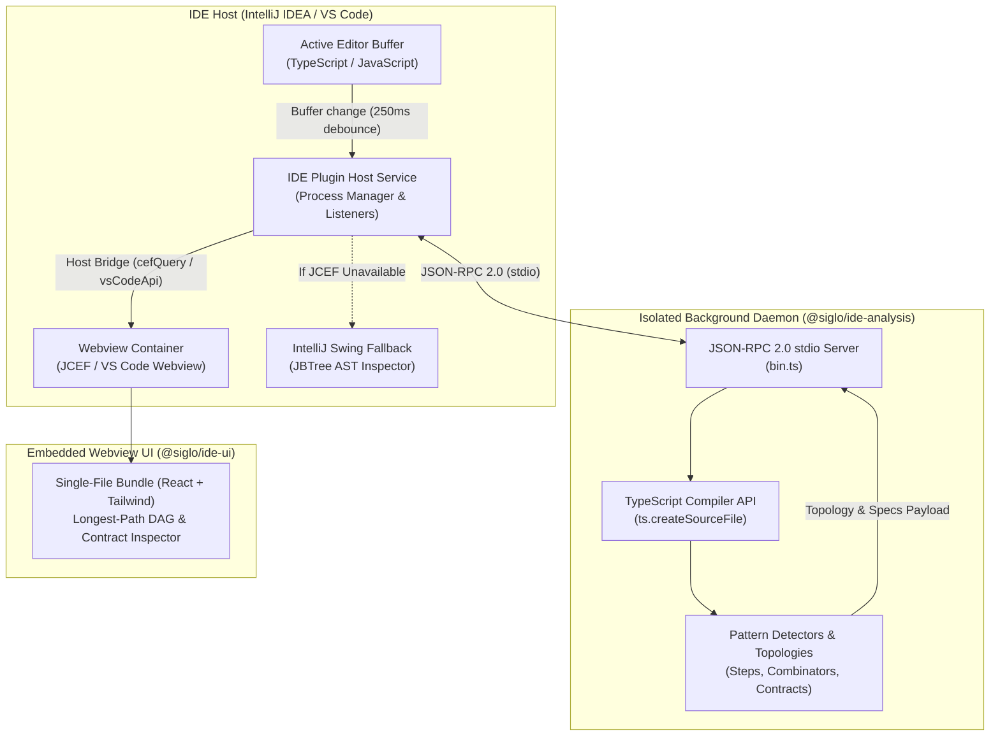
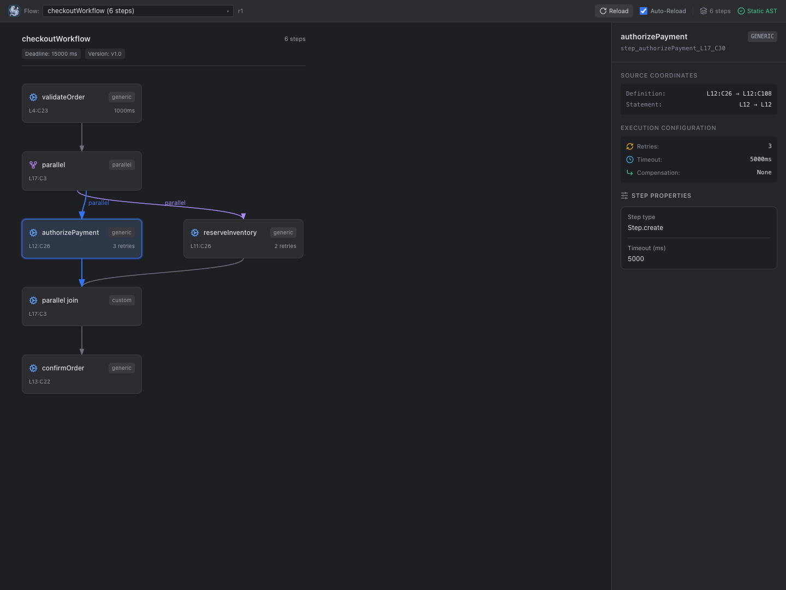
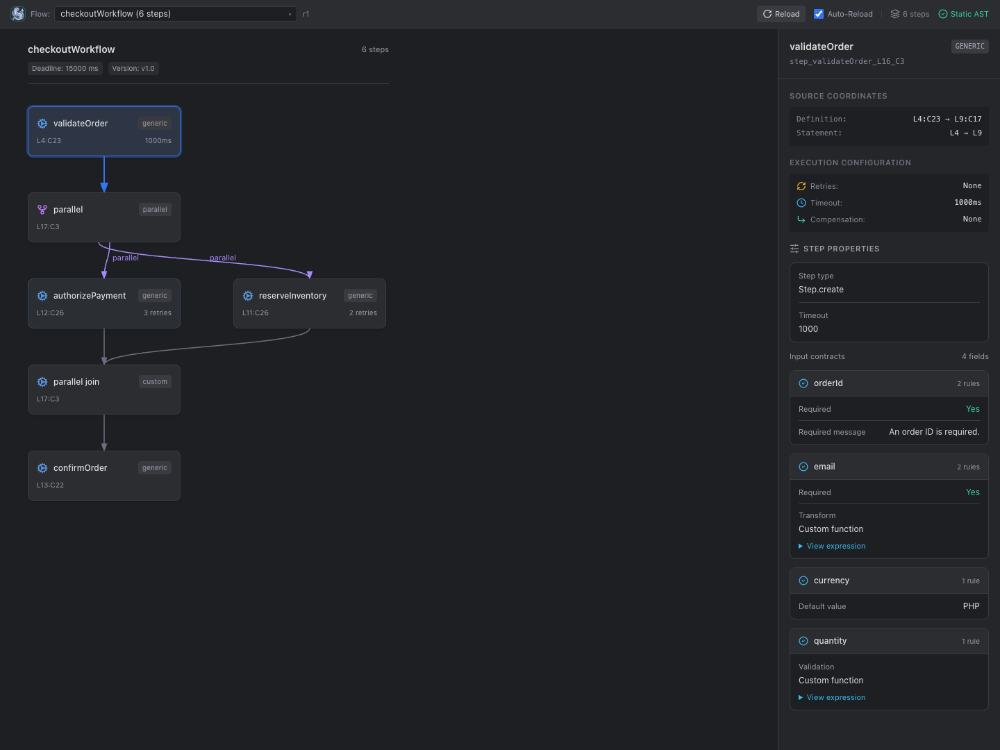
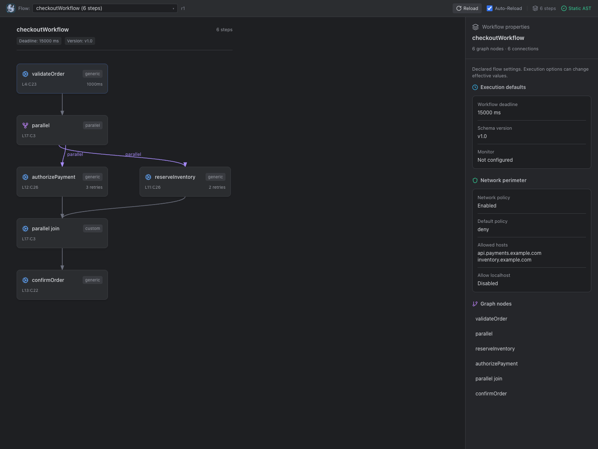
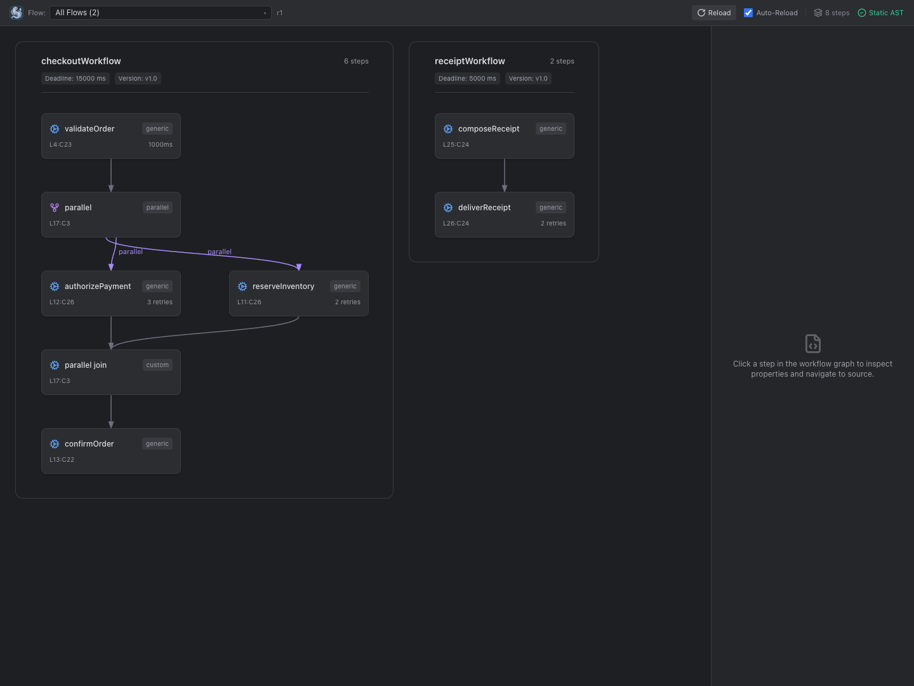

# Siglo Workflow Explorer & IDE Tooling

The **Siglo Workflow Explorer** provides developers with visual static graph inspection, live-typing feedback, and bidirectional source code navigation for Siglo workflows directly inside their IDE.

Supported IDEs:
- **IntelliJ IDEA**: 2024.1+ (Community & Ultimate editions) available on the [JetBrains Marketplace](https://plugins.jetbrains.com/) as **Siglo Workflows** (`io.siglo.idea`).
- **Visual Studio Code**: 1.90+ (Desktop & Remote Workspace hosts) available on the [VS Code Marketplace](https://marketplace.visualstudio.com/) as **Siglo Workflow Explorer** (`jsoftgem.siglo-workflow-explorer`).

> [!NOTE]
> **Static IDE Explorer vs. Live DevTools**: The IDE Workflow Explorer performs **pure static AST analysis** of your TypeScript/JavaScript source code without running your application or connecting to external services. For runtime execution streaming, event waterfall timelines, and interactive replay, see [Live Monitoring & DevTools](/live-monitoring).

---

## 1. Zero-Execution Static Architecture

Unlike traditional runtime reflection tools that dynamically evaluate or `import()` user code, the Siglo Workflow Explorer operates on an out-of-process, **zero-execution AST analyzer** (`@siglo/ide-analysis`):



### Safety & Resilience Guarantees:
- **Zero Module Imports**: Application files are never executed. Database connections, network sockets, cloud SDKs, and top-level side effects never run during analysis.
- **Fail-Safe Opening**: Untrusted repositories and production workflow definitions can be inspected safely without risk of arbitrary code execution.
- **Workspace Trust Gating**: Both the IntelliJ plugin and VS Code extension integrate with their platform's Workspace Trust framework, preventing background analyzer processes from spawning on untrusted projects.
- **Deterministic Coordinates**: Normalized Unicode source line and column ranges are attached to every node and edge, guaranteeing accurate click-to-definition navigation across platforms.
- **Process Isolation & Crash Recovery**: The analyzer daemon runs as an isolated Node.js child process with built-in timeouts and automated restart upon crash.

---

## 2. Key Visualizer Features

### 1. Longest-Path Layered DAG Visualizer
- Automatically arranges workflow steps from top to bottom using a longest-path layering algorithm.
- Displays explicit visual hubs for parallel forks and joins (`parallel`, `allSettled`, `race`, `branch`, `when`, `map`).
- Differentiates edge types with distinct visual styles and colors:
  - **Sequential**: Solid slate connecting lines.
  - **Parallel / Race**: Blue accent lines connecting fork and join hubs.
  - **Branch / When**: Purple lines labeled with branch keys (e.g. `SUBPRIME / default`).
  - **Compensation**: Amber dashed lines indicating saga rollback paths.
  - **Fallback**: Rose dashed lines indicating error recovery steps.
- Interactive controls allow smooth zoom, pan, and fit-to-view centering.



### 2. Structured Step Input Contracts & Schema Inspector
Selecting any step in the visual graph opens the **Inspector Panel**:
- **Field-Grouped Specs**: Fluent `.spec(...)` and `.schema(...)` rules are parsed and grouped into dedicated field cards.
- **Validation Rules**: Shows required fields (`*`), default values, validator functions, and exception error messages.
- **Transformations & Translations**: Inspects value transformers and translators with expandable source code snippets.
- **Root Schemas**: Whole-input validation schemas (e.g. Zod, Standard Schema) are displayed under the `$root$` contract card.



### 3. Workflow-Level Metadata & Network Policies
- **Execution Badges**: Workflow deadlines (`.timeout(...)`), schema versions (`.version(...)`), and custom tags appear directly above the graph canvas.
- **Workflow Inspector**: Clicking the workflow header reveals execution settings, declared network perimeter policies (`hosts`, `allowLocalhost`), custom monitoring configurations, and a full step inventory.



### 4. Multi-Workflow Explorer ("All Flows" View)
- When a file contains multiple workflow declarations (e.g. `flow1`, `flow2`, and composed `flow3 = flow(flow1, flow2)`), the header dropdown allows switching between individual workflows or selecting **All Flows**.
- In **All Flows** mode, each workflow is rendered in its own labeled canvas section, preserving workflow boundaries and multi-workflow composition clarity.



### 5. Live Typing & Bidirectional Navigation
- **Click-to-Definition**: Clicking any card or hub in the visualizer immediately navigates the IDE editor cursor to the exact line and character where the step is defined.
- **Cursor-to-Node Tracking**: Moving the editor cursor inside a step automatically highlights the corresponding node in the visualizer.
- **Live Debounced Refresh**: When **Auto-Reload** is enabled, editing the code buffer automatically updates the visual graph within 250ms of typing without requiring manual file saves.
- **Active Tab Tracking**: Switching editor tabs updates the tool window to display the workflows declared in the active file.

### 6. Responsive Layout & Native Swing Fallback
- **Responsive Stacking**: In narrow sidebars (such as the VS Code Activity Bar or docked IntelliJ tool windows), the Inspector automatically stacks beneath the DAG canvas for seamless visibility.
- **IntelliJ Swing Fallback (`JBTree`)**: When running in headless environments, remote development, or custom JetBrains runtimes where JCEF is disabled, the IntelliJ plugin gracefully degrades to a native Swing tree view showing the structured AST hierarchy.

---

## 3. Supported Workflow Syntax Matrix

The static analyzer extracts graph topology across core Siglo patterns and ecosystem integrations:

| Category | Supported Syntax & Patterns |
|---|---|
| **Core Step Constructors** | `Step.create(...)`, `new Step(...)`, compatibility `Func`/`Chain` constructors and `.create(...)`, inline functions |
| **Workflow Composition** | `flow(...)`, `pipe(...)`, `Step.flow(...)`, `Step.pipe(...)`, nested flows (e.g. `flow(flow1, flow2)`), sequential arrays |
| **Combinators** | `parallel(...)`, `all(...)`, `allSettled(...)`, `race(...)`, `branch(...)`, `when(...)`, `map(...)`, static helper equivalents (`Step.parallel`, etc.) |
| **Durable Waits** | `wait(...)`, `waitForEvent(...)`, static `Step.wait(...)`, `Step.waitForEvent(...)` |
| **HTTP Steps** | `httpStep(...)`, `new HttpStep(...)` (extracts retries, timeout, and origin endpoints) |
| **AI Steps** | `aiStep(...)`, `new AiStep(...)` (extracts provider, model, and repair options) |
| **Notifications** | `sendNotificationStep(...)`, `sendInteractiveApprovalStep(...)` |
| **Crypto & Webhooks** | `verifyWebhookStep(...)`, `encryptFieldsStep(...)`, `decryptFieldsStep(...)`, `maskFieldsStep(...)` |
| **Step Execution Modifiers** | `.timeout(...)`, `.compensate(...)`, `.catch(...)`, `.retry(...)`, `.cache(...)`, `.idempotent(...)`, `.spec(...)`, `.schema(...)`, `.networkPolicy(...)` |
| **Workflow Policies** | `.timeout(...)` (workflow deadline), `.version(...)` (schema version), `.networkPolicy(...)`, `.monitor(...)` |
| **Dynamic Constructs** | Dynamic runtime loops or unsupported expressions are safely represented with explicit `UnresolvedNode` placeholders rather than crashing or guessing |

### Syntax Example

```typescript
import { Step, flow, pipe, parallel, race, branch, when, wait, waitForEvent } from '@siglo/core';
import { httpStep } from '@siglo/http';
import { aiStep } from '@siglo/ai';
import { sendNotificationStep } from '@siglo/notifications';
import { verifyWebhookStep, encryptFieldsStep } from '@siglo/crypto';

// 1. Core steps with validation and execution policies
const validateOrder = Step.create('validateOrder', async (ctx) => ({ valid: true }))
  .spec('orderId', { require: true })
  .spec('amount', { require: true, validate: (v) => v > 0 })
  .timeout(2000);

const callPaymentGateway = httpStep({
  name: 'callPaymentGateway',
  url: 'https://api.stripe.com/v1/charges',
  maxRetries: 3,
});

// 2. Combinators and durable pauses
const fraudAndRiskCheck = parallel(
  aiStep({ name: 'aiRiskScore', provider: 'openai', model: 'gpt-4o' }),
  httpStep({ name: 'creditBureauCheck', url: 'https://api.credit.internal/score' })
);

const customerTierRouting = branch((ctx) => ctx.tier, {
  vip: Step.create('vipPerks', async () => ({ discount: 0.2 })),
  default: Step.create('standardProcessing', async () => ({ discount: 0 })),
});

const holdForSettlement = wait(5000);
const waitForCustomerApproval = waitForEvent('order.approved', { timeoutMs: 86400000 });

// 3. Composed workflow with saga compensation and policies
export const checkoutWorkflow = flow(
  validateOrder,
  fraudAndRiskCheck,
  customerTierRouting,
  callPaymentGateway.compensate(async (ctx) => {
    // Sagas rollback path statically detected and linked
  }),
  waitForCustomerApproval
)
  .timeout(120000)
  .version('2.1.0')
  .networkPolicy({ allowHosts: ['api.stripe.com', 'api.credit.internal'] });
```

---

## 4. IntelliJ IDEA Plugin Installation

### Requirements:
- **IntelliJ IDEA**: 2024.1+ (Community or Ultimate edition; Build 241.x through 262.x).
- **Node.js**: 18.0.0+ on your system `PATH`.
- **JDK**: Java 17 or 21 (for building from source; Gradle delegates to compatible daemon JVM via `gradle/gradle-daemon-jvm.properties`).

### Option A: Installing from JetBrains Marketplace (Recommended)
1. Open IntelliJ IDEA → **Settings / Preferences** (`⌘,` on macOS, `Ctrl+Alt+S` on Linux/Windows).
2. Go to **Plugins** → Select the **Marketplace** tab.
3. Search for **`Siglo Workflows`** (or search by Plugin ID `io.siglo.idea`).
4. Click **Install**, then click **Restart IDE**.
5. Open any Siglo TypeScript/JavaScript file and access the **Siglo Workflows** tool window from the right-hand stripe.

### Option B: Installing from Prebuilt Distribution (.zip)
1. Open IntelliJ IDEA → **Settings / Preferences** (`⌘,` on macOS, `Ctrl+Alt+S` on Linux/Windows).
2. Go to **Plugins** → Click ⚙️ (Gear Icon) → **Install Plugin from Disk...**.
3. Select `siglo-intellij-plugin-1.1.0.zip` (located in `plugins/intellij/build/distributions/`).
4. Click **Restart IDE**.
5. Access the **Siglo Workflows** tool window from the right-hand stripe.

### Option C: Building from Source (Monorepo)
From the repository root:
```bash
# 1. Build shared protocol, analyzer daemon, and webview UI
npm run build --workspace=@siglo/ide-protocol
npm test --workspace=@siglo/ide-analysis
npm run build --workspace=@siglo/ide-ui

# 2. Stage webview assets into IntelliJ plugin resources
cp packages/ide-ui/dist/index.html plugins/intellij/src/main/resources/ide-ui/index.html

# 3. Build the plugin distribution
cd plugins/intellij
./gradlew test buildPlugin
```
The distributable zip will be generated at `plugins/intellij/build/distributions/siglo-intellij-plugin-1.1.0.zip`.

---

## 5. Visual Studio Code Extension

### Requirements:
- **Visual Studio Code**: 1.90+ (Desktop or Remote Development hosts).
- **Node.js**: 18.0.0+ installed on the host system (note: the analyzer is bundled with the extension for seamless execution).
- **Workspace Trust**: Extension requires workspace trust to start the local static analyzer.

### Option A: Installing from VS Code Marketplace (Recommended)
1. Open VS Code → Go to the **Extensions** view (`⇧⌘X` on macOS, `Ctrl+Shift+X` on Linux/Windows).
2. Search for **`Siglo Workflow Explorer`** (or extension ID `jsoftgem.siglo-workflow-explorer`).
3. Click **Install**.
4. Open your project folder and trust the workspace when prompted.

*Alternatively, install directly via the command line:*
```bash
code --install-extension jsoftgem.siglo-workflow-explorer
```

### Option B: Installing from Prebuilt VSIX
1. Open VS Code → Go to the **Extensions** view (`⇧⌘X` on macOS, `Ctrl+Shift+X` on Linux/Windows).
2. Click **Views and More Actions** (`…`) at the top of the Extensions view.
3. Select **Install from VSIX…**.
4. Choose `plugins/vscode/siglo-workflow-explorer-1.1.0.vsix`.
5. When prompted, trust the workspace folder to activate the extension.

### Option C: Building from Source (Monorepo)
From the repository root:
```bash
# Builds protocol, analyzer, webview UI, and packages the VSIX extension
npm run package --workspace=@siglo/vscode
```
The packaged extension is generated at `plugins/vscode/siglo-workflow-explorer-1.1.0.vsix`.

### Usage & Contributed Commands:
- **Sidebar Explorer**: Click the **Siglo** icon in the Activity Bar to reveal the persistent **Siglo Workflows** sidebar webview.
- **Editor Tab Visualizer**: Open the Command Palette (`⇧⌘P` / `Ctrl+Shift+P`) and run **`Siglo: Open Workflow Visualizer`** to inspect the active workflow side-by-side with your code.
- **Discover Workspace Workflows**: Run **`Siglo: Discover Workspace Workflows`** to scan up to 100 TypeScript/JavaScript files across your workspace folders and jump directly into any declared flow.

---

## 6. Troubleshooting & Diagnostics

### Node.js Runtime Discovery
When an IDE activates the extension, it locates Node.js to spawn `@siglo/ide-analysis`. If your system uses version managers (such as NVM, Volta, asdf, or fnm):
- Ensure Node.js 18+ is available in your shell's default `$PATH` (e.g. `nvm alias default 20`).
- **Explicit Daemon Binary**: You can override analyzer discovery by setting the `SIGLO_ANALYZER_BIN` environment variable or the JVM system property `-Dsiglo.analyzer.bin=/path/to/packages/ide-analysis/dist/bin.js`.

### Running on JDK 25 Environments (IntelliJ)
The IntelliJ plugin includes `gradle/gradle-daemon-jvm.properties` configured for JDK 21. If your default shell uses JDK 25+ (e.g. GraalVM CE 25), Gradle automatically delegates to a compatible daemon JVM, avoiding `JavaVersion.parse` Kotlin DSL incompatibility. You can also specify `JAVA_HOME` explicitly:
```bash
export JAVA_HOME=$(/usr/libexec/java_home -v 21)
./gradlew test buildPlugin
```

### JCEF Disabled / Showing AST Tree Fallback (IntelliJ)
In customized headless environments or remote development agents where JCEF is unavailable, the plugin automatically switches to the native Swing `JBTree` view. If running desktop IntelliJ and you wish to use the graphical webview, ensure your IDE is running on the default bundled JetBrains Runtime (JBR) with JCEF enabled.

### Untrusted Workspace Notification
If the visualizer displays a blank screen or prompts that analysis is paused, check your IDE's Workspace Trust status:
- In IntelliJ: Click **Trust Project** on the yellow notification banner.
- In VS Code: Run **Manage Workspace Trust** from the Command Palette and select **Trust**.

---

## 7. Related Documentation

- [Live Monitoring & DevTools](/live-monitoring) — Real-time execution streaming, latency waterfalls, and interactive replay.
- [Execution Semantics Contract](/execution-semantics) — Formal runtime execution semantics, lifecycle phases, and context accumulation.
- [Ecosystem DevTools and Offline Testing](/ecosystem-devtools) — Inspection protocols for HTTP, AI, webhook, and notification steps.
- [IntelliJ Plugin Roadmap](/roadmap/intellij.roadmap) — Architecture and upcoming milestones for the IntelliJ plugin.
- [VS Code Extension Roadmap](/roadmap/vscode.roadmap) — Architecture and upcoming milestones for the VS Code extension.
