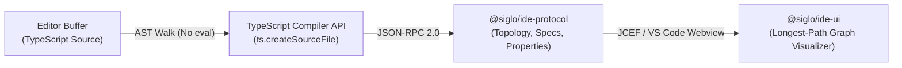

# Siglo Workflow Explorer & IDE Tooling

The **Siglo Workflow Explorer** provides developers with visual static graph inspection, live-typing feedback, and bidirectional source code navigation for Siglo workflows directly inside their IDE.

Supported IDEs:
- **IntelliJ IDEA**: 2024.1+ (Community & Ultimate editions) via the Siglo IntelliJ Plugin (`plugins/intellij`).
- **Visual Studio Code**: 1.90+ (Desktop) via `@siglo/vscode` (M0/M1 implemented; clean-install smoke test pending).

---

## 1. Zero-Execution Static Architecture

Unlike traditional runtime reflection tools that dynamically evaluate or `import()` user code, the Siglo Workflow Explorer operates on a **zero-execution AST analyzer** (`@siglo/ide-analysis`):



### Safety Guarantees:
- **Zero Module Imports**: Application files are never executed. Database connections, network requests, cloud clients, and top-level side effects never run during analysis.
- **Fail-Safe Opening**: Untrusted repositories and production workflow definitions can be inspected safely without risk of code execution.
- **Deterministic Coordinates**: Normalized Unicode source ranges are attached to every node and edge, guaranteeing accurate code navigation.

---

## 2. Key Visualizer Features

### 1. Longest-Path Layered DAG Visualizer
- Arranges workflow steps from top to bottom using a longest-path layering algorithm.
- Displays explicit visual hubs for parallel forks and joins (`parallel`, `allSettled`, `race`, `branch`, `when`, `map`).
- Differentiates edge types with distinct visual styles and colors:
  - **Sequential**: Solid slate connecting lines.
  - **Parallel / Race**: Blue accent lines connecting fork and join hubs.
  - **Branch / When**: Purple lines labeled with branch keys (e.g. `SUBPRIME / default`).
  - **Compensation**: Amber dashed lines indicating saga rollback paths.
  - **Fallback**: Rose dashed lines indicating error recovery steps.

### 2. Multi-Workflow Explorer
- When a file contains multiple workflow declarations (e.g., `flow1`, `flow2`, and composed `flow3 = flow(flow1, flow2)`), the header dropdown allows switching between individual workflows or selecting **All Flows**.
- In **All Flows** mode, each workflow is rendered in its own labeled canvas section, preserving workflow boundaries and multi-workflow composition clarity.

### 3. Structured Step Input Contracts
Selecting a step in the visual graph opens the **Inspector Panel**:
- **Field-Grouped Specs**: Fluent `.spec(...)` and `.schema(...)` rules are parsed and grouped into dedicated field cards.
- **Validation Rules**: Shows required fields (`*`), default values, validator functions, and exception error messages.
- **Transformations**: Inspects value transformers and translators with expandable source code snippets.
- **Root Schemas**: Whole-input validation schemas are displayed under the `$root$` contract card.

### 4. Workflow-Level Metadata & Policies
- **Badges**: Workflow deadlines (`.timeout(...)`) and schema versions (`.version(...)`) appear directly above the graph canvas.
- **Workflow Inspector**: Clicking any workflow header reveals execution settings, network perimeter policies (`hosts`, `allowLocalhost`), custom monitoring configurations, and a full node catalog.

### 5. Live Typing & Bidirectional Navigation
- **Click-to-Definition**: Clicking any card or hub in the visualizer immediately navigates the IDE editor cursor to the exact line and character where the step is defined.
- **Live Debounced Refresh**: When **Auto-Reload** is enabled, editing the code buffer automatically updates the visual graph within 250ms of typing without requiring manual file saves.
- **Active Tab Tracking**: Switching editor tabs updates the tool window to display the workflows in the active file.

---

## 3. Supported Workflow Syntax Matrix

The analyzer statically recognizes:

```typescript
// Core workflow definitions
const w1 = flow(step1, step2);
const w2 = pipe(stepA, stepB);
const w3 = flow('orderWorkflow', step1, step2);

// Standalone combinators
const p = parallel(branchA, branchB);
const r = race(cloudA, cloudB);
const b = branch((ctx) => ctx.tier, { enterprise: stepA, default: stepB });
const m = map(processItem, { concurrency: 4 });
const w = when((ctx) => ctx.isReady, stepAction);

// Durable pauses
const pause = wait(3000);
const resume = waitForEvent('payment.completed', { timeoutMs: 60000 });

// Ecosystem step factories
const http = httpStep({ name: 'callStripe', url: 'https://api.stripe.com/v1/charges', maxRetries: 3 });
const ai = aiStep({ name: 'generateSummary', provider: 'openai', model: 'gpt-4o' });
const notify = sendNotificationStep({ name: 'alertTeam', channel: 'slack' });
const webhook = verifyWebhookStep({ name: 'verifyStripe', provider: 'stripe' });
const crypto = encryptFieldsStep({ name: 'protectData', fields: ['ssn', 'card'] });
```

---

## 4. IntelliJ IDEA Plugin Installation

### Requirements:
- IntelliJ IDEA 2024.1+ (Community or Ultimate edition).
- Node.js 18.0.0+ on system PATH.

### Installing from Prebuilt Distribution:
1. Open IntelliJ IDEA $\rightarrow$ **Settings / Preferences** (`⌘,` on macOS, `Ctrl+Alt+S` on Linux/Windows).
2. Go to **Plugins** $\rightarrow$ Click ⚙️ $\rightarrow$ **Install Plugin from Disk...**.
3. Select `siglo-intellij-plugin-1.0.0.zip` (located in `plugins/intellij/build/distributions/`).
4. Click **Restart IDE**.
5. Access the **Siglo Workflows** tool window from the right-hand stripe.

---

## 5. Visual Studio Code Extension (Preview)

The VS Code extension (`plugins/vscode`) shares the same `@siglo/ide-protocol`, `@siglo/ide-analysis` daemon, and `@siglo/ide-ui` webview engine. It provides:
- A persistent sidebar **Siglo Workflows** Explorer view.
- A full-editor tab command: `Siglo: Open Workflow Visualizer`.
- Bidirectional cursor sync between VS Code editor tabs and the webview canvas.

See [vscode.roadmap.md](file:///Users/jericodeguzman/Projects/fluid-func/roadmap/vscode.roadmap.md) for architecture and implementation status.

### Build and install the VS Code extension

Run `npm run package --workspace=@siglo/vscode` from the repository root. Install `plugins/vscode/siglo-workflow-explorer-1.0.0.vsix` using **Extensions → … → Install from VSIX…**, trust the workspace, then run **Siglo: Open Workflow Visualizer**. The Siglo activity bar also provides a sidebar. **Siglo: Discover Workspace Workflows** scans up to 100 JavaScript/TypeScript files across workspace folders. See [extension documentation](../plugins/vscode/README.md) for lifecycle behavior, security, tests, and remaining manual verification.
