Follow [Serve a REST Endpoint and Watch It Run Live](/rest-and-live-monitoring) for a runnable Express checkout with HTTP requests, live events, and failure inspection.

`Siglo` provides complete real-time live monitoring, dynamic DAG topology visualization, execution state diff inspection, and interactive DevTools for complex asynchronous workflows.

Unlike black-box execution engines, `Siglo` streams structured, strongly-typed execution events directly from the workflow engine without imposing runtime overhead or coupling your business logic to third-party proprietary services.

---

## 1. Architecture & Observability Layers

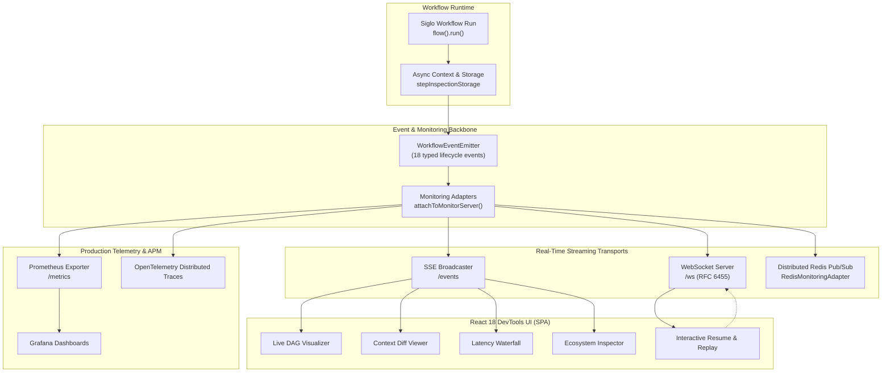

Observability is divided into four integrated layers:

1. **Core Runtime & Event Bus (`@siglo/core`)**: Zero-overhead `WorkflowEventEmitter`, asynchronous context propagation (`stepInspectionStorage`), durable wait state tracking (`applyWaitEvent`), and 18 strongly-typed execution events.
2. **Ecosystem Diagnostics & Content Capture**: Safe diagnostics and bounded, opt-in content capture (`InspectionCapturePolicy`) across `@siglo/http`, `@siglo/crypto`, `@siglo/notifications`, and `@siglo/ai`.
3. **Streaming Transports & React DevTools (`@siglo/monitor`)**: Built-in Server-Sent Events (SSE), RFC 6455 WebSocket broadcaster, Redis pub/sub adapter, telemetry ingestion API (`POST /api/events`), and a self-contained **React 18 + Vite + Tailwind CSS** DevTools Single Page Application (SPA).
4. **Developer & Production Telemetry**: CLI Dev Server (`siglo monitor`), Express/Fastify/Hono middlewares, Prometheus exposition (`/metrics`), and pre-packaged Grafana dashboard templates.

---

## 2. Standardized Execution Events

Workflows emit 18 typed lifecycle events during execution:

| Event Type                | Payload Fields                                                                                                                     | Emitted When                                            |
| ------------------------- | ---------------------------------------------------------------------------------------------------------------------------------- | ------------------------------------------------------- |
| `flow:start`              | `stackId`, `flowName?`, `version?`, `ast?`, `timestamp`, `namespace?`                                                              | A workflow begins execution                             |
| `step:start`              | `stackId`, `stepId`, `stepName`, `attempt`, `maxAttempts?`, `timestamp`, `namespace?`                                              | A step begins its action phase                          |
| `step:complete`           | `stackId`, `stepId`, `stepName`, `durationMs`, `outputSummary?`, `timestamp`, `namespace?`                                         | A step succeeds and merges output                       |
| `step:retry`              | `stackId`, `stepId`, `stepName?`, `attempt`, `maxAttempts?`, `error`, `delayMs`, `timestamp`, `namespace?`                         | A failed step triggers a scheduled retry                |
| `step:error`              | `stackId`, `stepId`, `stepName`, `attempt?`, `error`, `timestamp`, `namespace?`                                                    | A step fails definitively                               |
| `step:skipped`            | `stackId`, `stepId`, `stepName`, `timestamp`, `namespace?`                                                                         | A step is skipped via `onBefore` condition              |
| `context:change`          | `stackId`, `stepId`, `field`, `value`, `timestamp`, `namespace?`                                                                   | A context field is mutated or set                       |
| `cache:hit`               | `stackId?`, `stepId`, `key`, `timestamp`, `namespace?`                                                                             | A cached step output is retrieved                       |
| `cache:miss`              | `stackId?`, `stepId`, `key`, `timestamp`, `namespace?`                                                                             | Cache lookup missed; step will execute                  |
| `checkpoint:save`         | `stackId`, `status?`, `timestamp`, `namespace?`                                                                                    | State snapshot persisted to storage adapter             |
| `flow:suspended`          | `stackId`, `stepId?`, `waitingForEvent`, `timeoutMs?`, `expiresAt?`, `correlationKey?`, `timestamp`, `namespace?`                  | Workflow paused waiting for an event or timer           |
| `flow:resumed`            | `stackId`, `stepId?`, `correlationKey?`, `eventName?`, `resumeReason?` (`'event'` \| `'timer-expired'`), `timestamp`, `namespace?` | Suspended workflow unblocked via signal or timeout      |
| `flow:complete`           | `stackId`, `durationMs`, `status` (`'COMPLETED'` \| `'FAILED'`), `error?`, `timestamp`, `namespace?`                               | Workflow finishes execution                             |
| `flow:error`              | `stackId`, `error`, `timestamp`, `namespace?`                                                                                      | Fatal workflow execution failure                        |
| `notification:dispatched` | `stackId`, `stepId`, `notificationId`, `channel`, `dispatchedAt`, `recipientMasked`, `timestamp`, `namespace?`                     | External notification successfully dispatched           |
| `approval:requested`      | `stackId`, `stepId`, `notificationId`, `channel`, `dispatchedAt`, `recipientMasked`, `timestamp`, `namespace?`                     | Interactive approval notification dispatched            |
| `ai:complete`             | `stackId`, `stepId`, `stepName`, `aiMetrics`, `attempt?`, `inspection?`, `timestamp`, `namespace?`                                 | AI model invocation finished with token/cost accounting |
| `step:inspection`         | `stackId`, `stepId`, `stepName`, `attempt`, `inspection` (`EcosystemInspection`), `timestamp`, `namespace?`                        | Safe structured ecosystem diagnostics emitted           |

### Subscribing to Events Programmatically

Use `WorkflowEventEmitter` from `@siglo/core`:

```typescript
import { Step, flow, WorkflowEventEmitter } from '@siglo/core';

const monitor = new WorkflowEventEmitter();

// Listen to specific typed events
monitor.on('step:start', ev => {
    console.log(`Starting step ${ev.stepName} (attempt ${ev.attempt})`);
});

monitor.on('step:retry', ev => {
    console.warn(`Retrying step ${ev.stepName} in ${ev.delayMs}ms. Error: ${ev.error.message}`);
});

monitor.on('step:inspection', ev => {
    console.log(`Inspection for ${ev.stepName} (${ev.inspection.kind}): outcome=${ev.inspection.outcome}`);
});

// Wildcard listener receives all execution events
monitor.on('*', ev => {
    console.log(`[Event: ${ev.type}] stackId=${ev.stackId}`);
});

const myFlow = flow(
    Step.create('fetchData', async () => ({ count: 10 })),
    Step.create('processData', async ctx => ({ total: ctx.count * 2 })),
).monitor(monitor);

await myFlow.run({});
```

---

## 3. Global Monitoring & Static Hooks

You can register a global default monitor for all workflows executed within an application process using `Step.setDefaultMonitor` or the standalone `setDefaultMonitor` export:

```typescript
import { Step, WorkflowEventEmitter, setDefaultMonitor, getDefaultMonitor } from '@siglo/core';

const globalMonitor = new WorkflowEventEmitter();
globalMonitor.on('flow:error', ev => {
    reportToAlertingSystem(ev);
});

// Sets default monitor for all Step.start() and flow().run() calls in this process
Step.setDefaultMonitor(globalMonitor);
// or: setDefaultMonitor(globalMonitor);
```

To retrieve or remove the default monitor:

```typescript
const current = Step.getDefaultMonitor(); // or getDefaultMonitor()
Step.setDefaultMonitor(undefined); // or setDefaultMonitor(undefined)
```

---

## 4. Ecosystem Diagnostics & Safe Content Capture

Ecosystem steps (`@siglo/http`, `@siglo/crypto`, `@siglo/notifications`, `@siglo/ai`) automatically stream structured diagnostics into the monitoring pipeline using `step:inspection` and `ai:complete` events.

### 4.1 Four Diagnostic Categories

Diagnostics conform to versioned `EcosystemInspection` records:

1. **HTTP (`httpStep`)**:
    - Captures HTTP method, safe origin-only URL (path and query strings omitted to protect tokens), status code, execution duration (`durationMs`), request attempt, retry delay (`retryDelayMs`), retry delay source (`retry-after` vs. `backoff`), `Retry-After` header value in ms (`retryAfterMs`), retry count (`retryAttempts`), trace ID (`traceId`), and network policy compliance (`policy`: `'allowed'` | `'denied'` | `'unknown'`).
    - One-click **Copy sanitized cURL** button exports a valid, origin-only command (`curl --request POST --url 'https://api.stripe.com'`) omitting sensitive headers and payloads.
2. **Crypto & Webhooks (`verifyWebhookStep`)**:
    - Captures provider name, verification outcome category (`verified`, `rejected`, `invalid-payload`, `payload-too-large`, `missing-secret`, `unknown-provider`, `missing-signature`, `timestamp-rejected`, `replay-detected`, `invalid-signature`), payload byte size, timestamp check (`passed` | `failed` | `unavailable`), and replay check.
3. **Notifications & Approvals (`sendNotificationStep`)**:
    - Captures delivery channel (`email`, `slack`, `discord`, `sms`, `push`), message ID (`notificationId`), delivery outcome, interactive approval state (`requested`, `approved`, `rejected`, `forbidden`, `cancelled`, `expired`, `conflict`, `failed`), action token status (`issued` | `unavailable`), and approval deadline (`approvalExpiresAt` in UTC).
4. **AI & LLM Invocations (`aiStep`)**:
    - Captures model provider, model name, prompt tokens, completion tokens, total tokens, estimated cost in USD, duration, phase (`attempt` | `completion` | `preflight`), inference attempt count, repair attempts, and fallback counts.

### 4.2 Opt-In Content Capture Policy

To inspect request/response payloads or notification previews without leaking credentials, configure an `InspectionCapturePolicy` on the step:

```typescript
import { httpStep } from '@siglo/http';
import { InspectionCapturePolicy } from '@siglo/core';

const capturePolicy: InspectionCapturePolicy = {
    // Whitelist specific fields to capture
    fields: ['requestHeaders', 'requestBody', 'responseHeaders', 'responseBody'],
    maxBytes: 1024, // Per-field UTF-8 byte limit (capped at 4096 bytes)
    redact: (field, value) => {
        // Custom redactor: return sanitized representation or undefined to omit
        if (field === 'requestHeaders') {
            return { ...value, authorization: '[REDACTED]' };
        }
        return value;
    },
};

const checkoutStep = httpStep('chargeCard', {
    url: 'https://api.stripe.com/v1/charges',
    method: 'POST',
    capture: capturePolicy,
});
```

Content capture guarantees:

- **Header Allowlisting**: Only safe standard headers (`accept`, `content-type`, `content-length`, `cache-control`, `retry-after`) are retained; all others are stripped.
- **Credential Stripping**: Bearer tokens, Basic authorization strings, and URLs with embedded query parameters are replaced with `[Credential omitted]` and `[URL omitted]`.
- **Ecosystem Content Suppression**: When an ecosystem step executes, general workflow context changes and completion summaries for that step are suppressed to prevent credential leaks into context audit logs.
- **Sandboxed HTML Previews**: Email notification HTML previews render in an isolated `iframe` with strict Content Security Policy (`default-src 'none'; base-uri 'none'; form-action 'none'`) and inert formatting tag sanitization.

---

## 5. Durable Wait-State Inspection

Workflows utilizing `waitForEvent()` with optional timeouts have their wait lifecycles automatically tracked and surfaced in the monitor:

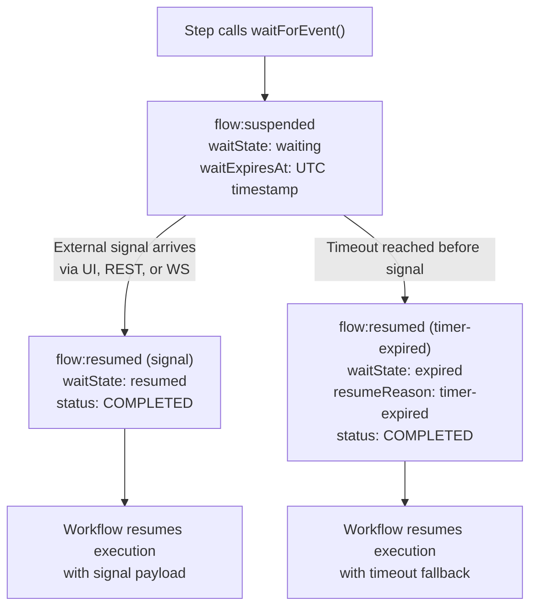

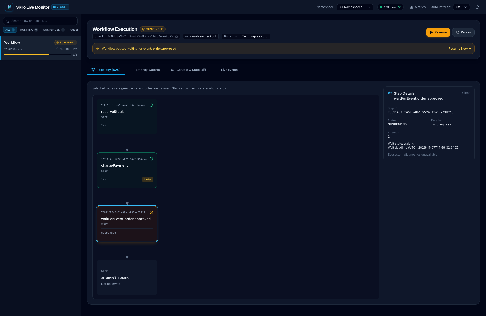

- **Step Isolation**: The `applyWaitEvent` live reducer correlates wait state changes strictly by `stepId`. Concurrent or sibling wait steps in nested flows remain completely isolated.
- **Deadline Formatting**: The monitor UI renders exact UTC deadlines (`waitExpiresAt`), allowing operators to see when a suspended approval or SLA window will expire.

---

## 6. Real-Time DevTools Web Dashboard (`@siglo/monitor`)

Install `@siglo/monitor`:

```bash
npm install @siglo/monitor @siglo/core
```

### Launching the Dashboard Server

```typescript
import { createMonitorServer } from '@siglo/monitor';
import { Step, flow } from '@siglo/core';

const monitor = await createMonitorServer({
    port: 4000,
    host: '127.0.0.1',
});

console.log(`DevTools available at http://localhost:${monitor.port}`);

// Register monitor with your workflows
Step.setDefaultMonitor(monitor.emitter);
```

### Modern React 18 DevTools Features

The web dashboard is an interactive, zero-dependency Single Page Application (SPA) built with React 18, Vite, and Tailwind CSS. It embeds the Siglo brand logo and favicon, and delivers rich real-time tooling:

1. **Interactive DAG Topology (`DagView`)**:
    - Dynamic step cards rendering Step ID, Step Name, duration, attempt count (`# tries`), and live status icons:
        - ⚪ **Pending** / **Skipped** (`Clock` icon)
        - 🔵 **Running** / **Retrying** (animated rotating `RotateCw` icon with sky glow)
        - 🟢 **Completed** (`CheckCircle2` icon)
        - 🔴 **Failed** (`XCircle` icon with rose border)
        - 🟡 **Suspended** / **Waiting** (`PauseCircle` icon with amber border)

    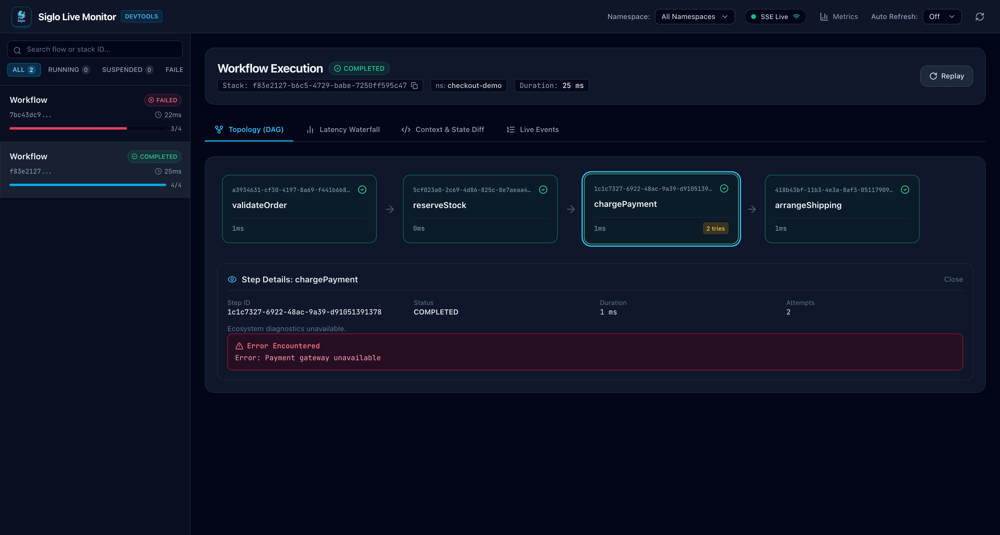

2. **Step Detail Inspector (`StepDetailCard`)**:
    - Clicking any step node opens a detailed inspection card.
    - Shows Step ID, execution status, exact duration, and retry attempts.
    - **Wait-State Banner**: Displays wait status (`waiting`, `resumed`, `expired`) and formatted UTC deadline when applicable.
    - **Ecosystem Diagnostics (`EcosystemInspector`)**: Displays protocol-specific metadata (HTTP origins, status, retries, retry delay source, crypto verification, notification approval states, token counts, model cost in USD).
    - **Sanitized cURL Export**: One-click button to copy a safe, origin-only cURL command.
    - **Content Inspection & Sandboxed Previews**: Expandable redacted request/response headers and bodies, with sandboxed iframe rendering for email notification previews.
    - **Error Details**: Formatted error message and stack trace.

    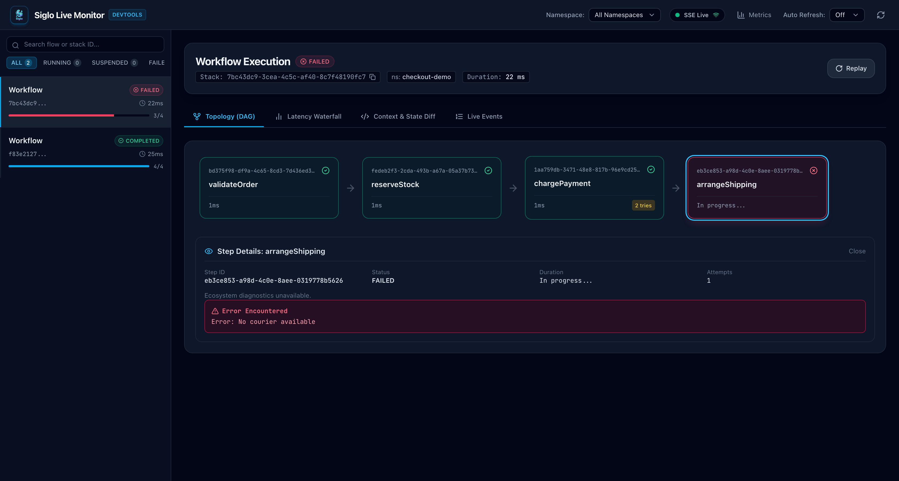

3. **Step Latency Waterfall Timeline (`WaterfallView`)**:
    - Tabular view listing step name, status badge, attempt count, duration in milliseconds, and proportional duration bar (`WaterfallBar`).
    - Quickly identifies latency bottlenecks across serial and parallel steps.

    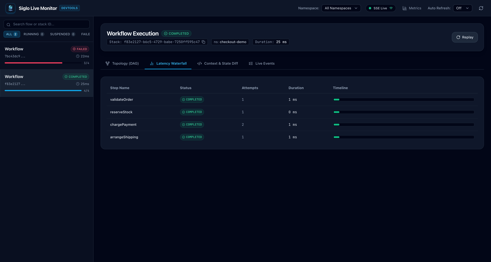

4. **Context & State Diff Inspector (`ContextViewer`)**:
    - **Current State Tab**: Monospace syntax-highlighted JSON viewer with one-click copy to clipboard.
    - **Mutations Tab**: Chronological audit trail of granular field mutations (`context:change`) with timestamps, keys, and values.

    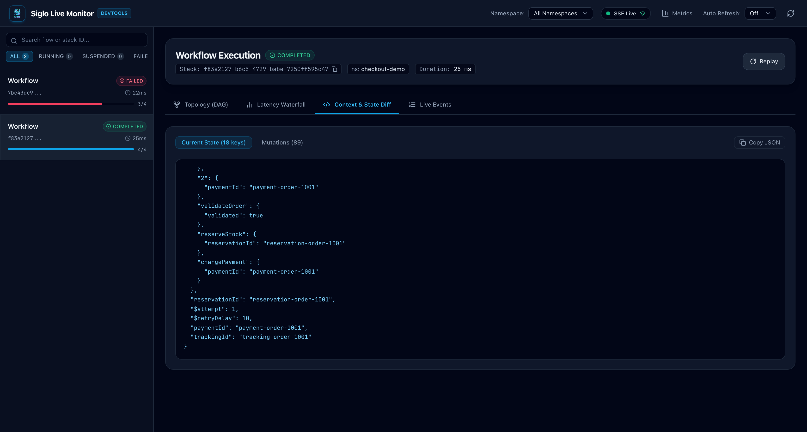

5. **Live Events Feed (`EventsFeed`)**:
    - Real-time event log streaming all 18 lifecycle events.
    - Filter by event type (`ALL`, `step:start`, `step:complete`, `step:inspection`, `ai:complete`, etc.).
    - Expandable raw event JSON viewer (`EventRow`).

6. **Interactive Durable Resumption (`ResumeModal`)**:
    - Resumption modal for workflows suspended on `waitForEvent()`.
    - Configure Stack ID / correlation key, event signal name, and custom JSON payload to unblock workflows directly from the browser.

    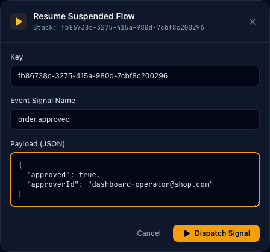

7. **Workflow Replay**:
    - One-click replay button (`POST /api/workflows/:stackId/replay`) to re-trigger recorded workflow runs.

    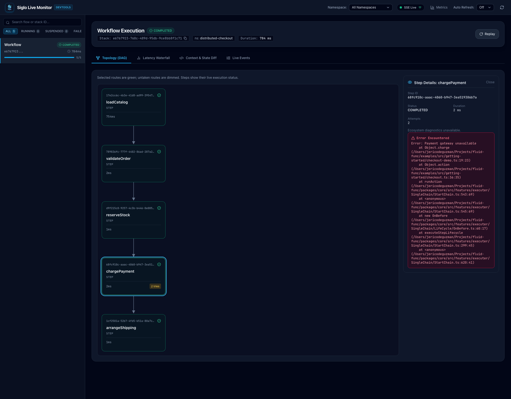

8. **Search, Metrics & Multi-Tenant Isolation**:
    - Search runs by flow name, stack ID, or namespace.
    - Status filters: `ALL`, `RUNNING`, `SUSPENDED`, `FAILED`, `COMPLETED`.
    - Multi-tenant dropdown to isolate telemetry to a specific `$namespace`.
    - High-level KPIs in `StatsOverview` showing total runs, completed, failed, and suspended counts.

---

## 7. Attaching Workflows to Running Monitor Servers

Instead of creating a new HTTP server in every script or test, workflows can attach to a monitor server that is **already running** (e.g., started via `siglo monitor` CLI, running in another container, or started once during service bootstrap).

### Scenario A: Remote / Separate Process (CLI or Dedicated Server)

When your monitor server is running in a different process (such as `siglo monitor --port 4000` in another terminal or Docker):

```typescript
import { flow, Step } from '@siglo/core';
import { attachToMonitorServer } from '@siglo/monitor';

const myWorkflow = flow(
    Step.create('fetchOrder', async () => ({ orderId: 'ord_123', total: 100 })),
    Step.create('chargeCustomer', async ctx => ({ paid: true })),
).monitor(
    attachToMonitorServer('https://monitor.corp.internal:4000', {
        apiKey: process.env.MONITOR_API_KEY,
    }),
);
// or local dev by port: .monitor(attachToMonitorServer(4000));
// or local dev default: .monitor(attachToMonitorServer());

await myWorkflow.run();
```

`attachToMonitorServer` automatically creates an asynchronous non-blocking HTTP telemetry dispatcher pointing to `POST /api/events`. Workflow execution is never delayed or blocked, and errors (such as temporary network disconnects) are handled gracefully in the background.

`attachToMonitorServer` dynamically handles five input targets:

- `attachToMonitorServer()`: Attaches to the active in-process server singleton if present, otherwise defaults to `http://127.0.0.1:4000`.
- `attachToMonitorServer(port)`: Attaches to an in-process server on that port if present, otherwise creates a client targeting `http://127.0.0.1:<port>`.
- `attachToMonitorServer(url, clientOptions)`: Connects to a remote monitor URL over HTTP.
- `attachToMonitorServer(instance)`: Directly pipes events into `instance.emitter` in memory.
- `attachToMonitorServer(clientOptions)`: Passes custom `MonitorClientOptions` directly.

### Scenario B: Same Process (In-Memory Singleton / App Bootstrap)

If your application boots the monitor server once at startup, other modules and workflows can attach directly without creating duplicate HTTP ports:

```typescript
import { createMonitorServer, attachToMonitorServer, getMonitorEmitter } from '@siglo/monitor';
import { flow, Step } from '@siglo/core';

// In server bootstrap (e.g. server.ts):
const monitor = await createMonitorServer({
    port: 4000,
    reuseExisting: true, // Reuses existing instance instead of throwing EADDRINUSE
});

// In any workflow file:
const orderPipeline = flow(stepA, stepB).monitor(attachToMonitorServer()); // Auto-resolves the active in-process server
```

You can also retrieve the active server or its emitter directly:

```typescript
import { getActiveMonitorServer, getMonitorEmitter } from '@siglo/monitor';

// Get active server instance
const activeServer = getActiveMonitorServer();

// Or get its WorkflowEventEmitter directly
const emitter = getMonitorEmitter();
const orderPipeline = flow(stepA, stepB).monitor(emitter!);
```

### Scenario C: High-Throughput Buffered Client

For high-throughput worker fleets, serverless functions, or background queues pushing events to a central monitor server, use `createMonitorClient` to configure event batching, authentication, and flush intervals:

```typescript
import { createMonitorClient } from '@siglo/monitor';
import { flow, Step } from '@siglo/core';

const client = createMonitorClient({
    url: 'https://monitor-service:4000',
    apiKey: process.env.MONITOR_INGESTION_KEY,
    batchSize: 20, // Default: 10 events
    flushIntervalMs: 50, // Default: 25ms
    maxQueueSize: 1000, // Default: 1000 (drops oldest if queue overflows to protect memory)
    redaction: {
        redactKeys: ['password', 'creditCard'],
    },
});

const workerFlow = flow(stepA, stepB).monitor(client.monitor);
await workerFlow.run();

// Clean up or flush remaining events on shutdown
await client.close();
```

---

## 8. CLI Dev Server Integration

With `@siglo/cli`, launch the live monitor server directly from your terminal:

```bash
# Start monitor on default port 4000
siglo monitor

# Specify custom port, host, and optional workflow file to inspect
siglo monitor src/workflows/checkout.ts --port=8080 --host=127.0.0.1 --namespace=production
```

Terminal output:

```text
🚀 Siglo Live Monitor running at http://127.0.0.1:8080
   - Dashboard: http://localhost:8080/
   - SSE Stream: http://localhost:8080/events
   - WebSocket: ws://localhost:8080/ws
   - Prometheus Metrics: http://localhost:8080/metrics
```

---

## 9. Web Framework Middlewares

Embed the live monitoring UI and telemetry endpoints directly into your existing HTTP applications by sharing a `WorkflowEventEmitter`:

### Express

```typescript
import express from 'express';
import { createExpressMonitorMiddleware } from '@siglo/monitor';
import { Step, WorkflowEventEmitter } from '@siglo/core';

const app = express();
const emitter = new WorkflowEventEmitter();
const monitor = createExpressMonitorMiddleware({ emitter });

// Mounts UI, /events, and /api endpoints under /_siglo
app.use('/_siglo', monitor);
Step.setDefaultMonitor(emitter);

app.listen(3000, () => {
    console.log('Monitor dashboard available at http://localhost:3000/_siglo');
});
```

### Fastify

```typescript
import Fastify from 'fastify';
import { fastifyMonitorPlugin } from '@siglo/monitor';
import { Step, WorkflowEventEmitter } from '@siglo/core';

const fastify = Fastify();
const emitter = new WorkflowEventEmitter();

await fastify.register(fastifyMonitorPlugin, { emitter, prefix: '/_siglo' });
Step.setDefaultMonitor(emitter);

await fastify.listen({ port: 3000 });
```

### Hono

```typescript
import { Hono } from 'hono';
import { honoMonitorMiddleware } from '@siglo/monitor';
import { Step, WorkflowEventEmitter } from '@siglo/core';

const app = new Hono();
const emitter = new WorkflowEventEmitter();

app.use('/_siglo/*', honoMonitorMiddleware({ emitter }));
Step.setDefaultMonitor(emitter);
```

---

## 10. Distributed Transports & Streaming

### Server-Sent Events (SSE)

Clients can subscribe to lightweight, one-way event feeds over standard HTTP with automated 15-second keep-alive heartbeats and an initial `: connected` handshake:

```bash
curl -N http://localhost:4000/events?namespace=tenant_alpha
```

SSE message format:

```http
event: step:complete
data: {"type":"step:complete","stackId":"s1","stepId":"st1","stepName":"chargeCard","durationMs":42,"timestamp":1730419200000}
```

In browser JavaScript:

```javascript
const es = new EventSource('http://localhost:4000/events?namespace=tenant_alpha&token=YOUR_API_KEY');

es.addEventListener('flow:start', e => {
    console.log('Flow started:', JSON.parse(e.data));
});

es.addEventListener('step:complete', e => {
    console.log('Step finished:', JSON.parse(e.data));
});

es.addEventListener('step:inspection', e => {
    console.log('Ecosystem inspection:', JSON.parse(e.data));
});
```

### WebSockets (RFC 6455)

Connect via WebSocket on `/ws` for bi-directional communication, remote controls, and telemetry forwarding:

```javascript
const ws = new WebSocket('ws://localhost:4000/ws?token=YOUR_API_KEY');

// Filter event stream to a specific tenant
ws.send(JSON.stringify({ action: 'subscribe', namespace: 'eu-west' }));

// Resume a suspended workflow
ws.send(
    JSON.stringify({
        action: 'resume',
        stackId: 'stk_abc123',
        eventName: 'kyc.approved',
        payload: { verifiedBy: 'compliance-officer' },
    }),
);

// Ingest telemetry event from an external client
ws.send(
    JSON.stringify({
        action: 'event',
        event: {
            type: 'step:inspection',
            stackId: 'stk_abc123',
            stepId: 'step_1',
            stepName: 'charge',
            attempt: 1,
            timestamp: Date.now(),
            inspection: { version: 1, kind: 'http', outcome: 'success', status: 200 },
        },
    }),
);
```

### Distributed Redis Pub/Sub

For distributed clusters where workflows execute across multiple serverless functions or worker nodes:

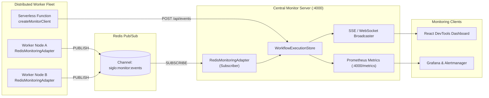

```typescript
import { RedisMonitoringAdapter, createMonitorServer } from '@siglo/monitor';
import { WorkflowEventEmitter } from '@siglo/core';
import Redis from 'ioredis';

const redisUrl = process.env.REDIS_URL || 'redis://localhost:6379';

// 1. In Worker Process: Publish events to Redis
const publisher = new Redis(redisUrl);
const workerAdapter = new RedisMonitoringAdapter({
    publisher,
    channel: 'siglo:monitor:events',
});

emitter.on('*', event => {
    workerAdapter.publish(event);
});

// 2. In Central Monitor Server: Subscribe to Redis and deliver into server's emitter
const subscriber = new Redis(redisUrl);
const monitor = await createMonitorServer({ port: 4000 });

const serverAdapter = new RedisMonitoringAdapter({
    subscriber,
    channel: 'siglo:monitor:events',
    emitter: monitor.emitter, // Automatically routes incoming Redis events to monitor store & SSE
});
```

---

## 11. Production Telemetry: Prometheus & Grafana

`@siglo/monitor` includes a built-in Prometheus metrics exposition endpoint on `/metrics`.

### Exposed Metrics

```text
# HELP siglo_active_flows Current number of actively running workflows.
# TYPE siglo_active_flows gauge
siglo_active_flows 3

# HELP siglo_flows_total Total number of workflow executions completed or failed.
# TYPE siglo_flows_total counter
siglo_flows_total{status="completed"} 142
siglo_flows_total{status="failed"} 2

# HELP siglo_flow_duration_seconds Total execution time of workflows in seconds.
# TYPE siglo_flow_duration_seconds summary
siglo_flow_duration_seconds_sum 18.4200
siglo_flow_duration_seconds_count 144

# HELP siglo_step_retries_total Total count of step execution retries.
# TYPE siglo_step_retries_total counter
siglo_step_retries_total 5

# HELP siglo_steps_total Total count of step completions and failures.
# TYPE siglo_steps_total counter
siglo_steps_total{status="completed"} 432
siglo_steps_total{status="failed"} 2
```

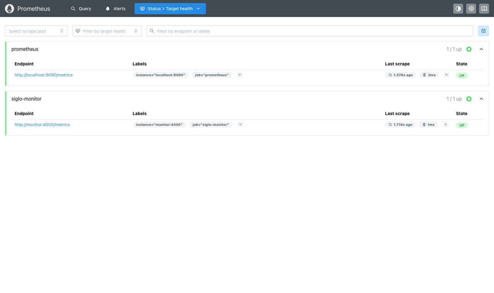

### Pre-Configured Grafana Dashboard

Import the JSON dashboard template located at:
`packages/monitor/grafana/siglo-live-monitoring.json` (or `node_modules/@siglo/monitor/grafana/siglo-live-monitoring.json`).

Panels include:

- Active workflows gauge
- Total completed and failed flow counters
- Step retries counter
- Workflow execution duration time-series graph
- Step throughput breakdown

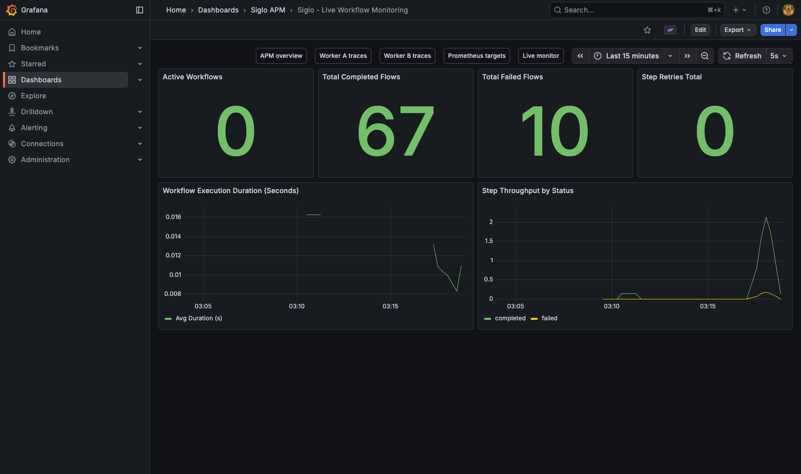

---

## 12. Security, Authentication & Production Hardening

Deploying `@siglo/monitor` in remote environments requires hardening to protect runtime state and prevent unauthorized access:

### 12.1 API Key & Token Authentication

Protect all endpoints with scoped API keys:

```typescript
const monitor = await createMonitorServer({
    port: 4000,
    auth: {
        apiKey: 'general-read-token', // Authorizes UI, /events, /metrics, /api/workflows
        ingestionKey: 'worker-token-xyz', // Authorizes POST /api/events and WS event ingestion
        adminKey: 'admin-token-abc', // Authorizes /resume, /replay, /api/workflows
        validator: (token, scope, req) => {
            // Optional custom auth verification hook
            return true;
        },
    },
});
```

Authentication Scopes:

- `read`: Accesses DevTools UI, SSE `/events`, Prometheus `/metrics`, and `/api/workflows` read endpoints.
- `ingest`: Authorizes telemetry ingestion via `POST /api/events` and WebSocket client event messages.
- `control`: Authorizes workflow resumption (`POST /api/workflows/:stackId/resume`) and replay (`POST /api/workflows/:stackId/replay`).

Clients pass keys via:

- `Authorization: Bearer <token>`
- `X-API-Key: <token>`
- Query parameter: `?token=<token>` or `?apiKey=<token>` (useful for EventSource and WebSocket browser handshakes)

### 12.2 Disabling Remote Control in Sensitive Environments

In production environments, interactive workflow resumption (`/resume`) and replays (`/replay`) can be disabled entirely to enforce zero-trust immutability:

```typescript
const monitor = await createMonitorServer({
    allowRemoteResume: false, // Rejects resume and replay requests with 403 Forbidden
});
```

### 12.3 CORS Hardening

Prevent browser-based intranet CSRF by restricting access to explicit trusted origins:

```typescript
const monitor = await createMonitorServer({
    cors: {
        origin: ['https://devtools.internal.corp', 'http://localhost:3000'],
        credentials: true,
    },
});
```

Set `cors: { origin: false }` to disable CORS headers entirely.

### 12.4 Ingestion Limits & Memory Protection

- **Payload Size Caps**: Requests exceeding `maxPayloadBytes` (default: 1MB / 1,048,576 bytes) receive `413 Payload Too Large` and are immediately destroyed to prevent denial-of-service memory exhaustion.
- **Inspection Structure Validation**: All events submitted to `POST /api/events` or over WebSocket are validated with `validInspectionEvent` before ingestion. Invalid versions or malformed structures are rejected with `400 Bad Request`.
- **Bounded In-Memory Execution Store**: `WorkflowExecutionStore` retains at most 1,000 runs, 500 events per run, and 200 context diffs per run by default, evicting oldest records on overflow.
- **Bounded Remote Client Buffer**: Remote clients automatically evict oldest events if the buffer queue reaches `maxQueueSize` (default: 1,000), preventing worker memory leaks during extended monitor server downtime.

### 12.5 Context Redaction & Ecosystem Sanitization

Automatic redaction runs before events are written to the store or broadcast over SSE/WS:

- **31 Default Redacted Keys**: Case-insensitive masking with `'[REDACTED]'` for:
  `rawBody`, `rawPayload`, `signature`, `signatureHeader`, `headers`, `cUrl`, `callbackBaseUrl`, `password`, `token`, `secret`, `apikey`, `authorization`, `cookie`, `creditcard`, `ssn`, `privkey`, `privatekey`, `recipient`, `email`, `phone`, `slackUserId`, `slackChannelId`, `discordWebhookUrl`, `approvalTokens`, `approveUrl`, `rejectUrl`, `signingSecret`.
- **Custom Redaction Hooks**: Add custom keys via `redaction.redactKeys` or supply a value transformation hook via `redaction.redactHook` (or `security.maskFn`).
- **Ecosystem Content Suppression**: During ecosystem step execution (or when a stack contains ecosystem content), general `context:change` and `step:complete` outputs are replaced with `'[Content not captured]'` and errors are generalized to prevent accidental credential leakage into standard context diffs.
- **Preview Sanitization**: Notification email HTML previews are rendered inside a sandboxed `iframe` with Content Security Policy `default-src 'none'; base-uri 'none'; form-action 'none'`.

### 12.6 Network Egress Policy Compliance

When workflows enforce least-privilege network egress using Siglo's ASL Network Egress Policy, ensure the remote monitor host is whitelisted:

```typescript
const orderFlow = flow(stepA, stepB)
    .networkPolicy({
        defaultPolicy: 'deny',
        allowedHosts: ['api.stripe.com', 'monitor.internal.corp'],
    })
    .monitor(
        attachToMonitorServer('https://monitor.internal.corp:4000', {
            apiKey: process.env.MONITOR_KEY,
        }),
    );
```

---

## 13. REST API Reference

The monitor server exposes standard REST endpoints for telemetry ingestion and DevTools control:

| Method | Endpoint                         | Description                                                  | Scope            |
| ------ | -------------------------------- | ------------------------------------------------------------ | ---------------- |
| `GET`  | `/` or `/index.html`             | Serves the single-page React DevTools dashboard              | Public / Browser |
| `GET`  | `/events`                        | Server-Sent Events (SSE) stream (`?namespace=...&token=...`) | `read`           |
| `POST` | `/api/events` or `/events`       | Ingests telemetry events from external processes / clients   | `ingest`         |
| `GET`  | `/metrics`                       | Prometheus metrics exposition endpoint                       | `read`           |
| `GET`  | `/api/workflows`                 | List recorded workflow runs (`?namespace=...&status=...`)    | `read`           |
| `GET`  | `/api/workflows/:stackId`        | Get detailed execution run, steps, and context diff          | `read`           |
| `POST` | `/api/workflows/:stackId/resume` | Resume a suspended workflow (`{ eventName, payload }`)       | `control`        |
| `POST` | `/api/workflows/:stackId/replay` | Trigger replay of a recorded workflow                        | `control`        |

---

## 14. Dashboard UI Architecture (`packages/monitor/ui`)

The live monitor web interface source code is located in [`packages/monitor/ui`](../packages/monitor/ui) and follows an industry-standard React project structure:

- **React 18** with TypeScript and functional hooks
- **Vite** with `vite-plugin-singlefile` bundling
- **Tailwind CSS** for dark-mode styling
- **Lucide React** icons
- **Zero External Runtime CDN Dependencies**: Fully inlined into `packages/monitor/src/ui/dashboard.ts` via build script (`embed-html.js`).

### UI Directory Structure

```text
packages/monitor/ui/
├── src/
│   ├── api/workflowApi.ts             # REST client for workflow fetch, resume, and replay
│   ├── constants/                     # Event types (18 SIGLO_EVENT_TYPES) and status filters
│   ├── hooks/                         # useWorkflowMonitor (SSE & state sync), useClipboard, inspectionUpdates
│   ├── types/                         # TypeScript interfaces for workflows, steps, and events
│   ├── utils/formatters.ts            # Time, duration, ID, and JSON formatters
│   ├── components/
│   │   ├── ui/                        # Reusable atoms (StatusBadge, Modal, EmptyState)
│   │   ├── layout/Header.tsx          # Navigation header with Siglo logo & live status
│   │   └── workflows/                 # Feature components
│   │       ├── RunList/               # Left sidebar workflow run selector, filter & search
│   │       ├── Dag/                   # Interactive DAG graph visualizer
│   │       │   ├── DagNode.tsx        # Step node with status icons and retry count
│   │       │   ├── DagView.tsx        # Connected flow layout
│   │       │   ├── StepDetailCard.tsx # Detailed slideout inspector with wait & error details
│   │       │   ├── EcosystemInspector.tsx # HTTP, crypto, notification, AI diagnostics
│   │       │   ├── InspectionContent.tsx  # Sandboxed iframe previews and redacted captures
│   │       │   └── curl.ts            # Sanitized origin-only cURL generator
│   │       ├── Waterfall/             # Step latency waterfall chart
│   │       ├── Context/               # Context state & mutation diff inspector
│   │       ├── Events/                # Live streaming telemetry log with expandable rows
│   │       ├── ResumeModal/           # Signal resumption modal
│   │       ├── Stats/                 # High-level metrics KPI grid
│   │       └── WorkflowDetail.tsx     # Tabbed execution details container
│   ├── App.tsx                        # Root application layout
│   └── main.tsx                       # React DOM entrypoint
├── scripts/embed-html.js              # Inlines dist/index.html into src/ui/dashboard.ts
└── vite.config.ts
```

### Developing & Building the UI

```bash
# Run Vite dev server with proxy to backend port 4000
npm run dev:ui --workspace=@siglo/monitor

# Build production bundle and embed into dashboard.ts
npm run build:ui --workspace=@siglo/monitor
```
