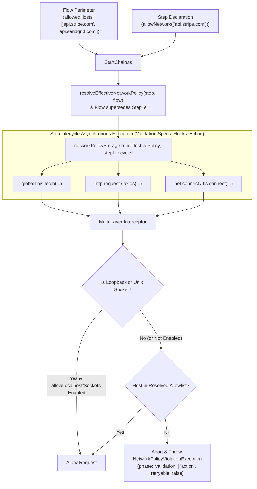

# Network Egress Policy & Guardrails via AsyncLocalStorage (ASL)

In workflow orchestration systems, governing external network egress and side-effects is critical for security, data privacy, and compliance. Without guardrails, workflow steps executing arbitrary code can contact unauthorized third-party APIs, leak secrets, or establish unmonitored raw TCP sockets.

**Siglo** provides a **declarative, least-privilege Network Egress Policy & Guardrail** enforced entirely in-process using Node's standard `node:async_hooks.AsyncLocalStorage` (ASL). It requires zero external daemons or sidecars, isolates concurrent steps and branches on the single Node.js event loop, and intercepts egress across `fetch`, HTTP/HTTPS, and raw sockets.

---

## 1. Core Principles & Guarantees

1. **Policy Activation & Default Deny**: Unconfigured workflows have no egress enforcement (unrestricted). When a network policy is declared on a flow or step, enforcement activates and defaults to denying external outbound network access unless explicitly authorized by step-level or flow-level allowlists.
2. **Flow Supersedes Step (Outer Envelope Narrowing)**: The Flow defines the outer security perimeter. A Step can only **narrow** permissions within what the Flow permits; it cannot unilaterally expand or bypass the Flow allowlist.
3. **Multi-Layer Egress Interception**: Outbound requests are governed across three distinct runtime layers:
   - Native `globalThis.fetch` (Fetch API, Undici)
   - `node:http` and `node:https` (`request` and `get`, Axios, Got, legacy clients)
   - `node:net.Socket.prototype.connect` (Raw TCP/TLS connections)
4. **Localhost & Loopback Configuration**: When network policy is active, `allowLocalhost` defaults to `false`. When enabled (`allowLocalhost: true`), loopback addresses (`localhost`, `127.0.0.1`, `::1`, `0.0.0.0`) and local Unix domain socket IPC (`allowUnixSockets`) are permitted, preserving local database pools, test mock servers, and container-local sidecars.
5. **Zero Concurrency Cross-Talk**: Handled via `AsyncLocalStorage`. When steps execute concurrently in `parallel`, `allSettled`, or `map`, each step runs in its own isolated ASL context. Background host operations (e.g. server health checks, connection pool pings) remain unaffected.

---

## 2. Architecture & Runtime Context Propagation

### 2.1 The Concurrency Challenge in Node.js
Because Node.js runs asynchronous tasks concurrently on a single event loop, global state or process-wide patching causes severe race conditions between concurrent workflows or parallel branches.

### 2.2 AsyncLocalStorage Context Isolation
When a step begins in `StartChain`, Siglo resolves the effective policy between the step's declaration and the flow's perimeter, then executes the entire step lifecycle (including `Step.spec` validation, transformers, translators, schema checks, lifecycle hooks, and the step action) inside `networkPolicyStorage.run(policy, ...)`. All downstream asynchronous operations, child promises, and third-party libraries automatically inherit the active policy store.



---

## 3. Step-Level Declarative API

Steps can declare network permissions using intuitive chainable methods on the `Step` builder.

### 3.1 `step.allowNetwork(hosts)`
Permits outbound requests matching specified host patterns during this step's execution:

```typescript
import { Step } from '@siglo/core';

// Whitelist specific domains and wildcard patterns
const chargeCustomer = Step.create('charge', async ({ amount }) => {
    const res = await fetch('https://api.stripe.com/v1/charges', {
        method: 'POST',
        headers: { 'Authorization': 'Bearer sk_test_...' },
        body: JSON.stringify({ amount })
    });
    return await res.json();
}).allowNetwork(['api.stripe.com', '*.stripe.network']);
```

### 3.2 `step.denyNetwork()`
Strictly disallows all external network calls from the step. Ideal for pure business logic, cryptographic hashing, or sensitive data transformations:

```typescript
const calculateDiscounts = Step.create('discount', ({ cart }) => {
    // Pure computation: cannot make any external HTTP or socket calls
    return { discountedTotal: applyCoupons(cart) };
}).denyNetwork();
```

### 3.3 `step.networkPolicy(policy)`
Configures complete, fine-grained network settings including localhost exemptions:

```typescript
const syncProfile = Step.create('sync', async ({ userId }) => {
    return await fetch(`https://api.github.com/users/${userId}`);
}).networkPolicy({
    allowedHosts: ['api.github.com'],
    defaultPolicy: 'deny',
    allowLocalhost: false // Defaults to false when policy is active
});
```

---

## 4. Flow-Level Declarative API

The `Flow` defines the outer security perimeter governing all enclosed steps.

### 4.1 `flow(...).networkPolicy(policy)`
Establishes the allowable perimeter for the entire workflow:

```typescript
import { Step, flow } from '@siglo/core';

const fetchUser = Step.create('fetchUser', async () => { ... })
    .allowNetwork(['api.github.com']);

const chargeCard = Step.create('chargeCard', async () => { ... })
    .allowNetwork(['api.stripe.com']);

export const onboardingFlow = flow(fetchUser, chargeCard)
    .networkPolicy({
        defaultPolicy: 'deny',
        allowedHosts: ['api.github.com', 'api.stripe.com'],
        allowLocalhost: false
    });
```

### 4.2 Per-Execution Run Overrides
Override or further restrict network policies dynamically for a specific workflow execution:

```typescript
await onboardingFlow.run(payload, {
    networkPolicy: {
        allowedHosts: ['api.stripe.com'] // Disallows api.github.com for this specific run
    }
});
```

---

## 5. Precedence Rules: Flow Supersedes Step

When both Flow-level and Step-level policies are declared, the Flow sets the boundary:

| Flow Policy | Step Policy | Resolved Effective Policy | Behavior |
| :--- | :--- | :--- | :--- |
| `['api.stripe.com']` | `['api.stripe.com']` | `['api.stripe.com']` | Permitted |
| `['api.stripe.com']` | `['api.github.com']` | `[]` (Blocked) | **Blocked**: Step cannot unilaterally expand beyond Flow allowlist. |
| `['*.stripe.com']` | `['api.stripe.com']` | `['api.stripe.com']` | Permitted: Step narrows down from wildcard. |
| `['api.stripe.com']` | `.denyNetwork()` | `[]` (Blocked) | **Blocked**: Step can always narrow to deny all calls. |
| `allowLocalhost: false` | `allowLocalhost: true` | `allowLocalhost: false` | **Blocked**: Step cannot bypass Flow's localhost restriction. |

---

## 6. Pattern Matching Grammar

Outbound network destinations are matched against configured patterns using standard rules:

| Rule Type | Pattern Example | Matches | Does NOT Match |
| :--- | :--- | :--- | :--- |
| **Localhost Exemption** | `allowLocalhost: true` | `localhost`, `127.0.0.1`, `::1`, `0.0.0.0`, Unix socket paths | Public IPs, external domains |
| **Exact Host** | `'api.stripe.com'` | `api.stripe.com`, `api.stripe.com:443` | `stripe.com`, `dev.api.stripe.com` |
| **Wildcard Subdomain** | `'*.stripe.com'` | `api.stripe.com`, `hooks.stripe.com` | `stripe.com`, `evil-stripe.com` |
| **Universal Wildcard** | `'*'` | Any external host | Empty host strings |
| **Port Specification** | `'api.internal:8080'` | `api.internal:8080` | `api.internal:3000`, `api.internal` |
| **RegExp** | `/^api\\.service\\.(internal|local)$/` | `api.service.internal` | `api.service.com` |

---

## 7. Multi-Layer Interceptors

Siglo activates interceptors lazily upon first workflow execution or via `ensureNetworkInterceptorsInstalled()`:

1. **Native `globalThis.fetch` Interceptor**:
   - Inspects target input (string, `URL`, or `Request` object).
   - Resolves target host and checks the active ASL store.
   - Throws `NetworkPolicyViolationException` synchronously before any socket is created.
   - Sets an internal validated socket flag so underlying Node HTTP socket pools avoid duplicate verification overhead.

2. **`node:http` and `node:https` Interceptor**:
   - Intercepts `http.request`, `http.get`, `https.request`, and `https.get`.
   - Protects libraries relying on Node's native HTTP client (e.g. Axios, Got, Node core).
   - If blocked, emits an `'error'` event with `NetworkPolicyViolationException` on the client request stream.

3. **`node:net.Socket.prototype.connect` Interceptor**:
   - Deepest safety net preventing raw TCP/TLS connections to unauthorized endpoints.
   - Automatically bypasses local Unix domain socket paths and sockets already validated by higher-level HTTP interceptors.
   - Destroys unauthorized sockets immediately with `NetworkPolicyViolationException`.

---

## 8. Exception & Error Model: `NetworkPolicyViolationException`

Unauthorized network attempts immediately throw a `NetworkPolicyViolationException`:

```typescript
export class NetworkPolicyViolationException extends SigloError {
    readonly requestedUrl: string;
    readonly requestedHost: string;
    readonly allowedHosts: (string | RegExp)[];
}
```

### Non-Retryable Classification
Security and policy violations are intentionally tagged with:
- `phase: 'action'` (or `phase: 'validation'` when triggered during `Step.spec` validation, transforms, or translations; `phase: 'before'` / `phase: 'after'` in hooks)
- `retryable: false`

Because an unauthorized network destination is a policy failure rather than a transient blip, Siglo halts execution immediately without wasting retry cycles.

---

## 9. Concurrency & Parallel Branch Isolation

When orchestrating parallel branches with `parallel`, `allSettled`, or `map`, each branch executes in its own isolated `AsyncLocalStorage` scope:

```typescript
import { Step, flow, parallel } from '@siglo/core';

const callStripe = Step.create('stripe', async () => {
    return await fetch('https://api.stripe.com/v1/charges');
}).allowNetwork(['api.stripe.com']);

const callSendGrid = Step.create('sendgrid', async () => {
    return await fetch('https://api.sendgrid.com/v3/mail/send');
}).allowNetwork(['api.sendgrid.com']);

// Even though both run concurrently on the single event loop,
// callStripe cannot access sendgrid.com, and callSendGrid cannot access stripe.com!
const concurrentFlow = flow(
    parallel([callStripe, callSendGrid])
).networkPolicy({
    allowedHosts: ['api.stripe.com', 'api.sendgrid.com']
});
```

---

## 10. Graph Inspection & Visualization

Step and flow network policies are fully integrated into workflow ASTs and graph export utilities:

```typescript
const node = workflow.toGraph();
console.log(node.metadata?.networkPolicy);
// Outputs: { enabled: true, allowedHosts: ['api.stripe.com'], defaultPolicy: 'deny' }

const metrics = workflow.inspect();
console.log(metrics);
```

---

## 11. Related Topic Guides

- 📜 [Execution Semantics Contract](execution-semantics.md)
- 🧱 [API Reference: Step Methods](api/step.md)
- 🌊 [API Reference: Flow Instance Methods](api/flow.md)
- 🛡️ [Retries, Timeouts, and Cancellation](05-retries-timeouts-and-cancellation.md)
- 🚨 [Error Model & Exception Hierarchy](error-model.md)
- 🧪 [Deterministic Testing Guide](09-testing-and-replay.md)
