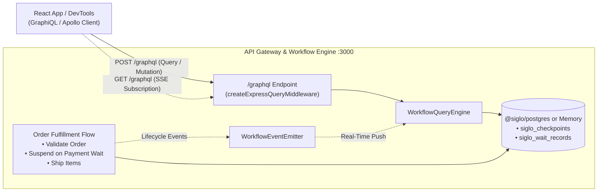

# Querying Workflows with GraphQL and React DevTools

For natural language querying and failure diagnosis with AI assistants (Claude Desktop, Cursor, IDEs), see [Querying & Diagnosing Workflows with MCP and AI Agents](/querying-workflows-mcp).

As workflows scale across distributed services, operators, customer support teams, and frontend applications need to query past and active execution states without reading raw database tables.

In this tutorial, you will:
1. Build a durable order fulfillment workflow that suspends on a payment confirmation event.
2. Mount `@siglo/query` onto an Express server with drop-in GraphQL route middleware.
3. Query executions by status and promoted metadata with cursor-based pagination.
4. Selectively project nested context fields with automatic PII redaction.
5. Stream real-time execution lifecycle transitions over Server-Sent Events (SSE).
6. Resume suspended workflows via GraphQL mutations.

---

## 1. Architecture Overview



---

## 2. Installation & Setup

Initialize a new project or install into an existing Siglo workspace:

```bash
npm install @siglo/core @siglo/query @siglo/express express graphql
npm install --save-dev @types/express @types/node tsx typescript
```

---

## 3. Step 1: Define the Order Fulfillment Workflow

Create `workflow.ts`. This workflow defines an order checkout with durable wait:

```typescript
import { Step, flow, waitForEvent, defaultStorageManager } from '@siglo/core';

export interface OrderInput {
    orderId: string;
    customerId: string;
    amount: number;
    secretToken: string;
}

// 1. Validate incoming order
const validateOrder = Step.create('validateOrder', async (input: OrderInput) => {
    if (input.amount <= 0) throw new Error('Invalid order amount');
    return {
        orderId: input.orderId,
        customerId: input.customerId,
        subtotal: input.amount,
        tax: Math.round(input.amount * 0.1),
        total: Math.round(input.amount * 1.1),
        secretToken: input.secretToken,
    };
});

// 2. Suspend execution until customer payment is confirmed
const awaitPayment = waitForEvent('payment.confirmed', {
    correlationKey: (ctx) => `payment-${ctx.orderId}`,
    timeout: 86400000, // 24 hours
});

// 3. Complete fulfillment
const shipOrder = Step.create('shipOrder', async (ctx: any) => {
    return {
        trackingNumber: `TRACK-${ctx.orderId}-${Date.now().toString(36).toUpperCase()}`,
        shippedAt: new Date().toISOString(),
    };
});

export const orderWorkflow = flow(validateOrder, awaitPayment, shipOrder);
```

---

## 4. Step 2: Create the GraphQL Server

Create `server.ts` to expose the `@siglo/query` GraphQL endpoint alongside workflow execution triggers:

```typescript
import express from 'express';
import { defaultStorageManager } from '@siglo/core';
import {
    createWorkflowQueryEngine,
    createExpressQueryMiddleware,
    createWorkflowGraphQLSchema,
} from '@siglo/query';
import { orderWorkflow } from './workflow';

const app = express();
app.use(express.json());

// 1. Initialize the query engine with runtime workflow resolution
const engine = createWorkflowQueryEngine({
    storage: defaultStorageManager.getAdapter(),
    redactFields: ['secretToken', 'apiKey', 'password'],
    resolveWorkflow: (checkpoint) => {
        if (checkpoint.workflowId === 'order-flow') {
            return orderWorkflow;
        }
        return undefined;
    },
});

// 2. Mount GraphQL API with tenant namespace isolation
app.use(
    '/graphql',
    createExpressQueryMiddleware({
        engine,
        // Authenticate tenant namespace from session or authorization header:
        namespace: (req) => req.headers['x-tenant-id'] || 'store-tenant-1',
        keepAliveIntervalMs: 15000,
    }),
);

// 3. REST endpoint to trigger new workflow runs
app.post('/api/orders', async (req, res) => {
    const { orderId, amount, customerId } = req.body;
    const execution = await orderWorkflow.run(
        { orderId, amount, customerId, secretToken: 'secret-token-xyz' },
        {
            durable: true,
            workflowId: 'order-flow',
            namespace: 'store-tenant-1',
            metadata: { orderId, priority: 'HIGH' },
        },
    );

    res.status(202).json({
        message: 'Order workflow initiated and waiting on payment',
        stackId: (execution as any).$stackId?.() ?? (execution as any).stackId,
        status: (execution as any).status,
    });
});

app.listen(3000, () => {
    console.log('Server running on http://localhost:3000');
    console.log('GraphQL Endpoint: http://localhost:3000/graphql');
});
```

---

## 5. Step 3: Querying Workflows with Filtering & Pagination

Start the server using `tsx server.ts` and send a test order:

```bash
curl -X POST http://localhost:3000/api/orders \
  -H "Content-Type: application/json" \
  -d '{"orderId": "ORD-1001", "amount": 150, "customerId": "CUST-99"}'
```

Response:
```json
{
  "message": "Order workflow initiated and waiting on payment",
  "stackId": "stack-5942-8491",
  "status": "waiting"
}
```

### Listing Workflows with Pagination

Send a GraphQL query to `/graphql` to list workflows:

```graphql
query ListWaitingOrders {
  workflows(
    filter: { status: WAITING }
    sort: { field: CREATED_AT, direction: DESC }
    pagination: { limit: 10 }
  ) {
    totalCount
    pageInfo {
      hasNextPage
      endCursor
    }
    edges {
      cursor
      node {
        stackId
        status
        createdAt
        metadata
        waitRecord {
          correlationKey
          eventName
        }
      }
    }
  }
}
```

Result:
```json
{
  "data": {
    "workflows": {
      "totalCount": 1,
      "pageInfo": {
        "hasNextPage": false,
        "endCursor": "eyJ0aW1lc3RhbXAiOjE3NzM0MTEyMDAwMDAsInN0YWNrSWQiOiJzdGFjay01OTQyLTg0OTEifQ=="
      },
      "edges": [
        {
          "cursor": "eyJ0aW1lc3RhbXAiOjE3NzM0MTEyMDAwMDAsInN0YWNrSWQiOiJzdGFjay01OTQyLTg0OTEifQ==",
          "node": {
            "stackId": "stack-5942-8491",
            "status": "WAITING",
            "createdAt": "2026-03-15T10:00:00.000Z",
            "metadata": {
              "orderId": "ORD-1001",
              "priority": "HIGH"
            },
            "waitRecord": {
              "correlationKey": "payment-ORD-1001",
              "eventName": "payment.confirmed"
            }
          }
        }
      ]
    }
  }
}
```

---

## 6. Step 4: Selective Context Projection & Redaction

When inspecting specific workflow details, clients can request the accumulated context. `@siglo/query` automatically redacts sensitive fields configured in `redactFields`:

```graphql
query InspectOrderContext {
  workflow(stackId: "stack-5942-8491") {
    stackId
    status
    # Redacted by default
    context
    # Extract specific subfield
    total: context(path: "total")
    steps {
      stepId
      status
      output
    }
  }
}
```

Result:
```json
{
  "data": {
    "workflow": {
      "stackId": "stack-5942-8491",
      "status": "WAITING",
      "context": {
        "orderId": "ORD-1001",
        "customerId": "CUST-99",
        "subtotal": 150,
        "tax": 15,
        "total": 165,
        "secretToken": "[REDACTED]"
      },
      "total": 165,
      "steps": [
        {
          "stepId": "validateOrder",
          "status": "COMPLETED",
          "output": {
            "orderId": "ORD-1001",
            "customerId": "CUST-99",
            "subtotal": 150,
            "tax": 15,
            "total": 165,
            "secretToken": "[REDACTED]"
          }
        }
      ]
    }
  }
}
```

---

## 7. Step 5: Streaming Real-Time Transitions over SSE

Connect to the subscription endpoint using standard browser `EventSource`:

```javascript
const query = `
  subscription OnOrderUpdated {
    workflowUpdated(stackId: "stack-5942-8491") {
      stackId
      status
      updatedAt
      context
    }
  }
`;

const sse = new EventSource(`/graphql?query=${encodeURIComponent(query)}`);

sse.onmessage = (event) => {
  const result = JSON.parse(event.data);
  const update = result.data?.workflowUpdated;
  if (update) {
    console.log(`[Status Transition] ${update.stackId} is now ${update.status}`);
  }
};
```

---

## 8. Step 6: Resume the Workflow via GraphQL Mutation

Now send a `resumeWorkflow` mutation to simulate payment confirmation:

```graphql
mutation ResumePayment {
  resumeWorkflow(
    correlationKey: "payment-ORD-1001"
    payload: {
      transactionId: "TXN-998877",
      paidAt: "2026-03-15T10:05:00.000Z"
    }
  )
}
```

Response:
```json
{
  "data": {
    "resumeWorkflow": true
  }
}
```

### Observation:
1. Siglo claims the wait record atomically within the tenant namespace.
2. The runtime resumes the workflow at step `shipOrder`.
3. The live SSE subscription instantly receives the `COMPLETED` event with the newly generated `trackingNumber`!

---

## 9. Step 7: Connecting with React DevTools

In your React frontend, install `@apollo/client`:

```bash
npm install @apollo/client
```

Configure the Apollo Client with HTTP and SSE transports:

```typescript
import { ApolloClient, InMemoryCache, split, HttpLink } from '@apollo/client';
import { GraphQLWsLink } from '@apollo/client/link/subscriptions';
import { createClient } from 'graphql-ws';
import { getMainDefinition } from '@apollo/client/utilities';

const httpLink = new HttpLink({
  uri: 'http://localhost:3000/graphql',
  headers: {
    'x-tenant-id': 'store-tenant-1',
  },
});

export const apolloClient = new ApolloClient({
  link: httpLink,
  cache: new InMemoryCache(),
});
```

Now render workflow cards with live subscriptions:

```tsx
import React from 'react';
import { useQuery, useSubscription, gql } from '@apollo/client';

const GET_ORDERS = gql`
  query GetOrders {
    workflows(filter: { workflowId: "order-flow" }) {
      edges {
        node {
          stackId
          status
          createdAt
        }
      }
    }
  }
`;

export function WorkflowList() {
  const { data, loading } = useQuery(GET_ORDERS);

  if (loading) return <div>Loading executions...</div>;

  return (
    <div className="p-4 space-y-2">
      <h2 className="text-xl font-bold">Active Orders</h2>
      {data?.workflows.edges.map(({ node }: any) => (
        <div key={node.stackId} className="border p-3 rounded">
          <p><strong>Stack ID:</strong> {node.stackId}</p>
          <p><strong>Status:</strong> <span className="font-mono">{node.status}</span></p>
        </div>
      ))}
    </div>
  );
}
```

---

## 10. Summary & Next Steps

You have built a production-ready GraphQL workflow query architecture with `@siglo/query`:
- **Selective Projection**: Skipped context deserialization when listing executions.
- **Tenant Isolation**: Bound all queries and mutations to the authenticated tenant.
- **Real-Time Streaming**: Streamed state updates over Server-Sent Events with proxy keepalives.
- **Durable Continuation**: Safely resumed a suspended workflow and executed remaining steps.

Next, learn how to expose your workflows to AI assistants over the Model Context Protocol in [Querying & Diagnosing Workflows with MCP and AI Agents](/querying-workflows-mcp).
