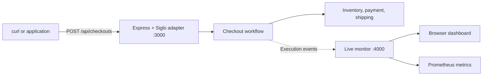
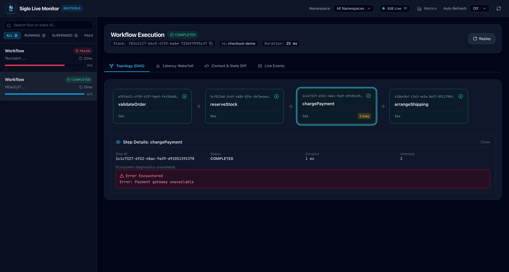
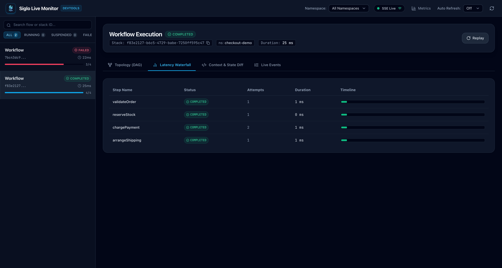
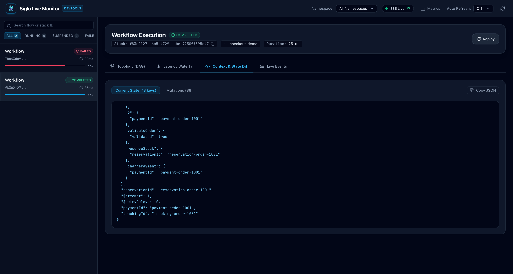
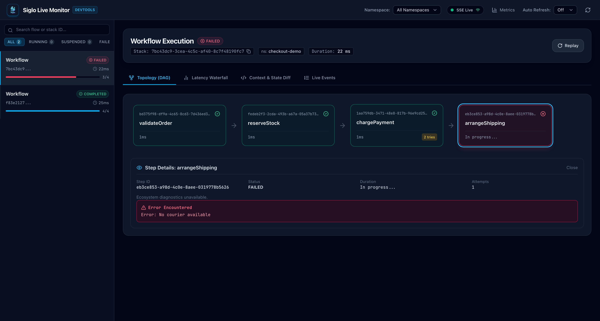

# Serve a REST Endpoint and Watch It Run Live

A customer reports that checkout failed. Your API log shows a `500`, but it doesn’t tell you whether stock was reserved, payment was retried, or shipping caused the failure.

In this tutorial, we’ll expose the checkout from [Getting Started](/01-getting-started) through an Express REST endpoint and attach Siglo’s live monitor. We’ll send real HTTP requests, inspect the named steps, and compare a successful checkout with a failed one.

The demo runs locally with fake inventory, payment, and shipping services. The API listens on port **3000**, and the monitoring dashboard listens on **4000**. Both run in the same Node.js process and share an event emitter.

## 1. How the Pieces Fit Together



The REST adapter maps HTTP input to workflow context and workflow output to an HTTP response. The monitor observes execution events. Monitoring doesn’t create the business endpoint or start a workflow by itself; we connect the two explicitly.

## 2. Install and Start

If you followed the previous tutorial, keep `checkout.ts` and `checkout-demo.ts` in the same directory. The first exports `createCheckout`; the second exports fake services for this local demo.

Install the additional dependencies:

```bash
npm install express @siglo/express @siglo/monitor
npm install --save-dev @types/express
```

This assumes the Node.js and TypeScript setup from [Getting Started](/01-getting-started). The server code below uses that tutorial’s CommonJS setup.

**Running from this repository?** The complete example is already in [`examples/src/getting-started`](../examples/src/getting-started). With repository dependencies installed, run these commands from the repository root:

```bash
npm run build --workspace=@siglo/core
npm run build --workspace=@siglo/express
npm run build --workspace=@siglo/monitor
node --import tsx examples/src/getting-started/checkout-server.ts
```

The monitor serves its packaged dashboard. If you are developing the dashboard itself, [build its UI assets](/live-monitoring#developing--building-the-ui) before rebuilding the monitor package.

## 3. Connect the Endpoint to the Monitor

Create `checkout-server.ts` alongside the other two files:

```typescript
import express from 'express';
import { once } from 'node:events';
import { sigloExpressMiddleware } from '@siglo/express';
import { createMonitorServer } from '@siglo/monitor';
import { createCheckout } from './checkout';
import type { Order } from './checkout';
import { createDemoServices } from './checkout-demo';

function isOrder(value: unknown): value is Order {
    if (!value || typeof value !== 'object') return false;
    const order = value as Partial<Order>;
    return (
        typeof order.orderId === 'string' &&
        order.orderId.trim().length > 0 &&
        typeof order.sku === 'string' &&
        order.sku.trim().length > 0 &&
        typeof order.quantity === 'number' &&
        Number.isInteger(order.quantity) &&
        order.quantity > 0 &&
        typeof order.amountCents === 'number' &&
        Number.isSafeInteger(order.amountCents) &&
        order.amountCents > 0
    );
}

export async function startCheckoutServer(port = 3000, monitorPort = 4000) {
    const monitor = await createMonitorServer({
        port: monitorPort,
        host: '127.0.0.1',
        allowRemoteResume: false,
    });
    const app = express();
    app.use(express.json({ limit: '16kb' }));

    app.post('/api/checkouts', async (req, res, next) => {
        if (!isOrder(req.body)) {
            res.status(400).json({ error: 'Provide orderId, sku, positive integer quantity, and amountCents' });
            return;
        }
        // Allowlist business fields; don't forward arbitrary request data to telemetry.
        const { orderId, sku, quantity, amountCents } = req.body;
        const input: Order = { orderId, sku, quantity, amountCents };
        // This query flag and fake services are for demonstrating failures locally.
        const { services, events } = createDemoServices(req.query.failShipping === 'true');
        const checkout = createCheckout(services).monitor(monitor.emitter);
        const handler = sigloExpressMiddleware(checkout, {
            input: () => input,
            namespace: 'checkout-demo',
            durable: false,
            timeout: 5000,
            exposeErrorDetails: false,
            output: (result, response) =>
                response.status(201).json({
                    orderId: input.orderId,
                    status: 'confirmed',
                    trackingId: result.trackingId,
                }),
        });
        await handler(req, res, next);
        console.log(`${orderId}: ${events.join(' -> ')}`);
    });

    const server = app.listen(port, '127.0.0.1');
    try {
        await once(server, 'listening');
    } catch (error) {
        await monitor.close();
        throw error;
    }
    return {
        server,
        monitor,
        async close() {
            await new Promise<void>((resolve, reject) => {
                server.close(error => (error ? reject(error) : resolve()));
            });
            await monitor.close();
        },
    };
}

if (require.main === module) {
    startCheckoutServer()
        .then(({ close }) => {
            console.log('Checkout API: http://127.0.0.1:3000/api/checkouts');
            console.log('Live monitor: http://127.0.0.1:4000');
            const shutdown = () => {
                close().catch(console.error);
            };
            process.once('SIGINT', shutdown);
            process.once('SIGTERM', shutdown);
        })
        .catch(error => {
            console.error(error);
            process.exitCode = 1;
        });
}
```

For the standalone tutorial project, start it with:

```bash
node --import tsx checkout-server.ts
```

The key connections are:

- `createMonitorServer(...)` starts one monitor at application startup.
- `.monitor(monitor.emitter)` sends this checkout’s events to that monitor.
- `sigloExpressMiddleware(checkout, ...)` executes the checkout for the HTTP request.
- `input` selects business fields; `output` returns a small public response instead of the full workflow context.
- `namespace: 'checkout-demo'` groups these executions in the monitor.

Validation happens before workflow execution. Missing fields and invalid quantities return `400` without reserving stock or recording a workflow run. The workflow retains its own validation too, so callers outside HTTP still get those checks.

A fresh set of fake services is created for each request so the demo’s payment-attempt counter belongs to that checkout. In a real application, inject reusable service clients without sharing mutable request state.

## 4. Send a Successful Request

Open **http://127.0.0.1:4000** in your browser before sending the request. In another terminal, run:

```bash
curl -i http://127.0.0.1:3000/api/checkouts \
  -H 'Content-Type: application/json' \
  -H 'X-Correlation-Id: checkout-request-1001' \
  -d '{"orderId":"order-1001","sku":"coffee-kit","quantity":1,"amountCents":4500}'
```

The response has status `201 Created`, echoes `X-Correlation-Id`, and includes an `X-Workflow-Stack-Id` header. Its JSON body is:

```json
{
    "orderId": "order-1001",
    "status": "confirmed",
    "trackingId": "tracking-order-1001"
}
```

The fake gateway rejects the first payment attempt before accepting a charge, then succeeds on retry. The server console shows:

```text
order-1001: reserve stock -> charge attempt 1 -> charge attempt 2 -> arrange shipping
```

The HTTP request waits for the workflow to complete; this endpoint doesn’t enqueue a background job. The adapter’s five-second timeout bounds workflow execution. Real service clients should also support cancellation and their own request deadlines; see [Timeouts and Cancellation](/05-retries-timeouts-and-cancellation).

## 5. Inspect the Execution

Select the new execution in the dashboard. Use its stack ID from the response header to identify the exact run. If it hasn’t appeared, click **Refresh workflows** in the top-right corner.

| Question                               | What to inspect                                        |
| -------------------------------------- | ------------------------------------------------------ |
| Did every business operation complete? | The run status and named workflow steps                |
| Why did payment take another attempt?  | The `chargePayment` step and `step:retry` event        |
| Which operation used the time?         | The step durations and waterfall                       |
| What data reached shipping?            | Context fields such as `reservationId` and `paymentId` |

The demo is fast, so you may see the completed run rather than watching each transition as it happens. Its recorded events still show the retry.

These screenshots show the dashboard running the local checkout demo. Your execution IDs and timings will differ.

In **Topology (DAG)**, select `chargePayment` to inspect its two attempts. The run is `COMPLETED`; the payment error shown in the step details belongs to the first attempt, before the retry succeeded.



Switch to **Latency Waterfall** to compare the recorded step timings.



Open **Context & State Diff** to inspect the completed checkout’s state, including `reservationId`, `paymentId`, and `trackingId`.



You can also inspect executions without the browser:

```bash
curl 'http://127.0.0.1:4000/api/workflows?namespace=checkout-demo'
```

Replace `STACK_ID` with the `X-Workflow-Stack-Id` from the successful response:

```bash
curl 'http://127.0.0.1:4000/api/workflows/STACK_ID'
```

The detail response contains the run status, steps, context changes, and events. The namespace is a grouping/filtering value in this demo, not an authentication boundary.

### Subscribe to Live Events

In a separate terminal, start the SSE stream **before** sending another checkout:

```bash
curl -N 'http://127.0.0.1:4000/events?namespace=checkout-demo'
```

Now send another request. You’ll receive events such as `flow:start`, `step:start`, `step:retry`, `step:complete`, and `flow:complete`. This stream shows new events; use the workflow detail API for recorded execution history. Press `Ctrl+C` to disconnect.

### Read Metrics

```bash
curl http://127.0.0.1:4000/metrics
```

The output includes `siglo_flow_executions_total` and `siglo_step_retries_total`. These counters belong to this monitor instance and reset when it restarts. For scraping and dashboards, continue with [Prometheus and Grafana](/live-monitoring#11-production-telemetry-prometheus--grafana).

## 6. Trigger a Shipping Failure

The demo-only `failShipping=true` query flag simulates a courier rejecting the shipment after payment succeeds:

```bash
curl -i 'http://127.0.0.1:3000/api/checkouts?failShipping=true' \
  -H 'Content-Type: application/json' \
  -d '{"orderId":"order-1002","sku":"coffee-kit","quantity":1,"amountCents":4500}'
```

The endpoint returns `500` with:

```json
{ "error": "Internal workflow execution error" }
```

`exposeErrorDetails: false` keeps internal workflow error messages out of this response. Select the failed run in the monitor to inspect the shipping failure. The server console shows the business cleanup:

```text
order-1002: reserve stock -> charge attempt 1 -> charge attempt 2 -> arrange shipping -> refund payment -> release stock
```

Refresh the dashboard if needed, select the `FAILED` execution, and click `arrangeShipping` in **Topology (DAG)**. Its step details show the internal error, `No courier available`, while the public HTTP response above stays generic.



Refunding payment and releasing stock doesn’t turn the checkout into a successful order. The workflow remains failed because delivery was never arranged. See [Compensation and Sagas](/compensation-and-sagas) for handling failed compensation operations as well.

Try changing `quantity` to `0`: that request returns `400` at the HTTP boundary and doesn’t add a workflow run.

## 7. Verify the Integration

The [HTTP integration test](../examples/src/getting-started/checkout-server.test.ts) starts both servers on available ports and exercises the real endpoint. From the repository root, after building the packages, run:

```bash
node --import tsx --test examples/src/getting-started/checkout-server.test.ts
```

It checks the response body and stack header, recorded retry, failed-run status, rejection of invalid input, exclusion of arbitrary secret fields, metrics, and dashboard HTML delivery. The [checkout tests](../examples/src/getting-started/checkout.test.ts) verify the actual compensation order.

## 8. Take It Beyond the Local Demo

For a production endpoint, replace the fake clients, remove the failure flag, derive prices from trusted order records, and authenticate callers before running the workflow. Select a namespace from trusted application identity when serving multiple tenants.

This endpoint executes each accepted request as a new workflow run. The correlation header helps trace a request; it doesn’t deduplicate it. Add workflow idempotency and provider-side payment keys using [the checkout idempotency walkthrough](/01-getting-started#6-handle-a-duplicate-checkout-request). For custom execution options beyond the Express adapter’s interface, call `checkout.run(input, options)` from your route and map the response explicitly.

The monitor binds to loopback here, keeps execution history in memory, and disables interactive resume/replay with `allowRemoteResume: false`. Before making it remotely accessible, configure authentication and telemetry redaction using the [monitor deployment guide](/live-monitoring#12-security-authentication--production-hardening). Business-field allowlisting reduces accidental data collection, but real provider results also need review for sensitive fields.

To observe workers in another process, attach a [remote monitor client](/live-monitoring#scenario-c-high-throughput-buffered-client) instead of sharing an in-process emitter. For long-running work that should outlive an HTTP request, use a [queue worker](/adapters/bullmq) or a [durable workflow](/06-durable-workflows) with persistent storage and a defined status/resumption API.

Press `Ctrl+C` in the server terminal to close the API and monitor together.

Continue with [Run Checkout Across Two Servers with PostgreSQL and Redis](/distributed-rest-and-live-monitoring) for shared checkpoints, cross-instance request deduplication, Redis caching, and a separate live monitor, with a complete Docker Compose setup.
