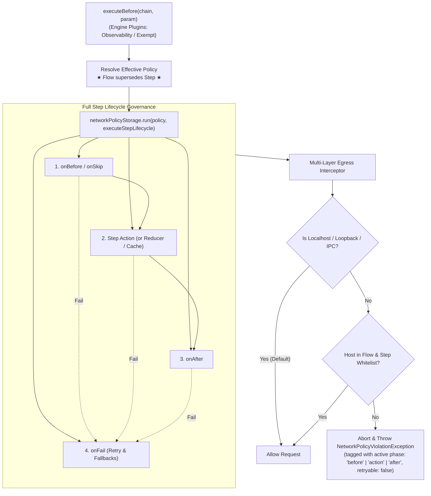

# Network Egress Policy & Guardrail via AsyncLocalStorage (ASL)

> **Status:** Implemented & Verified  
> **Target Package:** `@fluid-func/core` (`packages/core`)  
> **Key Mechanism:** `node:async_hooks.AsyncLocalStorage` + Multi-Layer Egress Interception + Full Step Lifecycle Governance

---

## 1. Overview & Motivation

In workflow orchestration systems (e.g., Siglo, Temporal, AWS Step Functions), managing and governing external side-effects is paramount. Steps inside workflows can execute arbitrary JavaScript/TypeScript that can consume external HTTP APIs or raw sockets without explicit visibility or authorization.

This design introduces a **declarative, least-privilege Network Egress Policy & Guardrail** for `fluid-func` / `Siglo` workflows.

### Core User Specifications

1. **Flows default to `deny`** unless explicitly allowed within step or flow scope.
2. **Flow supersedes step**: The Flow sets the outer perimeter. A Step can only narrow permissions within what the Flow permits; it cannot unilaterally expand or bypass the Flow allowlist.
3. **Intercept native `fetch`, `node:http`/`node:https`, and raw `node:net` egress**.
4. **Allow localhost by default** (`localhost`, `127.0.0.1`, `::1`, `0.0.0.0`, and local Unix domain socket IPC).
5. **Full Step Lifecycle Governance**: Governs all user-defined code within the step (`onBefore`, `onSkip`, `action`, `onAfter`, and `onFail`), preventing perimeter escapes through lifecycle hooks while keeping engine-level plugins (`executeBefore`, `executeAfter`) exempt for observability.

---

## 2. Architectural Architecture

### 2.1 The Concurrency Challenge in Node.js

In Node.js, multiple Steps execute concurrently on the single event loop across:

- Parallel combinators (`parallel`, `all`, `allSettled`, `race`)
- Batch mapping steps (`map`)
- Multiple concurrent HTTP server requests (Express / Fastify / Hono) running different flows

A global toggle or naive patching would cause race conditions and cross-talk between concurrently executing workflows.

### 2.2 The Solution: `AsyncLocalStorage` (ASL)

Node's standard `node:async_hooks.AsyncLocalStorage` propagates the active policy context down the asynchronous execution tree of each step:

- Any call to `fetch()`, `axios`, `got`, `http.request`, or `net.connect` initiated inside `onBefore`, `onSkip`, `action`, `onAfter`, or `onFail` automatically inherits the step's active policy store.
- Outbound requests from global engine plugins (`executeBefore`, `executeAfter`), host server tasks, initial database connection pools, or OpenTelemetry background flushers execute outside the step policy store and proceed normally.



---

## 3. Declarative API Specification

### 3.1 Step-Level API

```typescript
import { Step } from '@fluid-func/core';

// 1. Whitelist specific domains (narrowed within the flow's allowance)
const chargeCustomer = Step.create('chargeCustomer', async ({ amount }) => {
    return await fetch('https://api.stripe.com/v1/charges', { ... });
}).allowNetwork(['api.stripe.com', '*.stripe.network']);

// 2. Pure computation step: strictly disallow any external network calls (including in onBefore/onAfter)
const calculateDiscounts = Step.create('calculateDiscounts', ({ cart }) => {
    return { discountedTotal: applyCoupons(cart) };
}).denyNetwork(); // Shorthand for allowNetwork([])

// 3. Advanced step configuration
const syncUserProfile = Step.create('syncUserProfile', async ({ id }) => { ... })
    .networkPolicy({
        allowedHosts: ['api.github.com'],
        allowLocalhost: true
    });
```

### 3.2 Flow-Level API

```typescript
import { flow, Step } from '@fluid-func/core';

const paymentWorkflow = flow(
    validateInput, // default: denied
    calculateDiscounts, // explicitly denyNetwork()
    chargeCustomer, // allowed api.stripe.com
    sendEmailReceipt, // allowed api.sendgrid.com
).networkPolicy({
    defaultPolicy: 'deny', // Default for flows
    allowedHosts: ['api.stripe.com', 'api.sendgrid.com'],
    allowLocalhost: true, // Default: true
});

// Or dynamically per execution run:
await paymentWorkflow.run(payload, {
    networkPolicy: {
        allowedHosts: ['api.stripe.com'],
    },
});
```

### 3.3 Precedence Rules ("Flow Supersedes Step")

1. **Flow as Outer Envelope**: The Flow's `allowedHosts` defines the maximum permissible perimeter. If the Flow allows `['api.stripe.com']`, a Step _cannot_ unilaterally allow `api.github.com`.
2. **Step Narrowing**: A Step can only further restrict the Flow policy (e.g. `denyNetwork()` or selecting a subset of the flow's allowed hosts).
3. **Default Stance**: If an external host is not matched by the resolved allowlist (and is not localhost), the request is immediately blocked.

---

## 4. Pattern Matching Grammar & Rules

A request is allowed if it satisfies any of the following rules:

| Rule Type               | Pattern Example              | Matches                                                              | Does NOT Match                      |
| :---------------------- | :--------------------------- | :------------------------------------------------------------------- | :---------------------------------- |
| **Localhost Exemption** | `allowLocalhost: true`       | `localhost`, `127.0.0.1`, `::1`, `0.0.0.0`, `unix:/path/socket.sock` | External IPs, Public domains        |
| **Exact Host**          | `'api.stripe.com'`           | `api.stripe.com`, `api.stripe.com:443`                               | `stripe.com`, `dev.api.stripe.com`  |
| **Wildcard Subdomain**  | `'*.stripe.com'`             | `api.stripe.com`, `hooks.stripe.com`                                 | `stripe.com`, `evil-stripe.com`     |
| **Port Specification**  | `'api.internal:8080'`        | `api.internal:8080`                                                  | `api.internal:3000`, `api.internal` |
| **RegExp**              | `/^api\\.service\\.(internal | local)$/`                                                            | `api.service.internal`              | `api.service.com` |

---

## 5. Technical Implementation Details

### 5.1 Exception: `NetworkPolicyViolationException`

Added to `packages/core/src/features/executer/exceptions.ts`:

```typescript
export class NetworkPolicyViolationException extends SigloError {
    readonly requestedUrl: string;
    readonly requestedHost: string;
    readonly allowedHosts: (string | RegExp)[];

    constructor(
        stepName: string,
        requestedUrl: string,
        requestedHost: string,
        allowedHosts: (string | RegExp)[],
        metadata: ExecutionErrorMetadata = {},
    ) {
        super(
            `Step '${stepName}' attempted unauthorized network call to '${requestedHost}' (${requestedUrl}). Allowed hosts: [${allowedHosts.map(String).join(', ')}]`,
            {
                ...metadata,
                stepName,
                phase: metadata.phase || 'action',
                retryable: false, // Security/policy violations should not retry blindly
            },
        );
        this.name = 'NetworkPolicyViolationException';
        this.requestedUrl = requestedUrl;
        this.requestedHost = requestedHost;
        this.allowedHosts = allowedHosts;
        Object.setPrototypeOf(this, NetworkPolicyViolationException.prototype);
    }
}
```

### 5.2 Multi-Layer Interceptors

Implemented in `packages/core/src/features/network/interceptor.ts`:

1. **Native `globalThis.fetch` Interceptor**:
    - Inspects `input` (string, `URL`, or `Request`).
    - Resolves target host and checks `networkPolicyStorage.getStore()`.
    - Throws `NetworkPolicyViolationException` immediately before socket creation if unauthorized.
2. **`node:http` and `node:https` Interceptor**:
    - Patches `http.request`, `http.get`, `https.request`, `https.get` (covering Axios, Got, Node core).
    - If unauthorized, aborts the request and emits an `'error'` event with `NetworkPolicyViolationException`.
3. **`node:net.Socket.prototype.connect` Interceptor**:
    - Safety net for raw TCP/TLS connections.
    - Bypasses Unix domain socket paths and already-validated HTTP sockets.
    - Rejects raw external socket connections if not whitelisted.

### 5.3 Execution Boundary in `StartChain.ts`

Located in `packages/core/src/features/executer/SingleChain/StartChain.ts`:

```typescript
const effectiveNetworkPolicy = resolveEffectiveNetworkPolicy(
    chain.networkPolicy || chain.networkPolicyConfig,
    options?.networkPolicy
);
if (effectiveNetworkPolicy?.enabled) {
    ensureNetworkInterceptorsInstalled();
}

const executeStepLifecycle = () => {
    new OnBefore(chain, param, (val) => { ... }, (err: any) => { ... }, Context, async () => {
        // Idempotency claim, action execution, and onAfter enrichment
    });
};

if (effectiveNetworkPolicy?.enabled) {
    networkPolicyStorage.run(
        { ...effectiveNetworkPolicy, stepName: chainName },
        executeStepLifecycle
    );
} else {
    executeStepLifecycle();
}
```

---

## 6. Implementation Phases & Roadmap

| Phase                                                  | Tasks                                                                                                                                                                                                                                                                                                  | Deliverables                                          |
| :----------------------------------------------------- | :----------------------------------------------------------------------------------------------------------------------------------------------------------------------------------------------------------------------------------------------------------------------------------------------------- | :---------------------------------------------------- |
| **Phase 1: Core Network Abstraction**                  | - Create `features/network/` module (`types`, `matcher`, `storage`, `resolver`).<br>- Add `NetworkPolicyViolationException` to `exceptions.ts`.                                                                                                                                                        | Matcher unit tests, pattern tests.                    |
| **Phase 2: Multi-Layer Interceptors**                  | - Implement `installNetworkInterceptors()` and `uninstallNetworkInterceptors()`.<br>- Intercept `fetch`, `http/https`, and `net.Socket`.                                                                                                                                                               | Interceptor isolation tests.                          |
| **Phase 3: Engine & API Integration**                  | - Connect `StartChain.ts` and `runner.ts`.<br>- Add `.allowNetwork()`, `.denyNetwork()`, `.networkPolicy()` to `Step` and `flow()`.<br>- Include network policy in graph inspector (`inspectGraph`).                                                                                                   | End-to-end integration tests.                         |
| **Phase 4: Concurrency, Verification & Documentation** | - Parallel step tests (`parallel(allowedStep, blockedStep)`).<br>- Test localhost bypass with mock local HTTP server.<br>- Step lifecycle hook coverage (`onBefore`, `onSkip`, `onAfter`, `onFail`).<br>- Verify 100% test coverage.<br>- Update documentation (`docs/api/step.md`, `roadmap/asl.md`). | Final test suite, 100% test coverage, & updated docs. |
