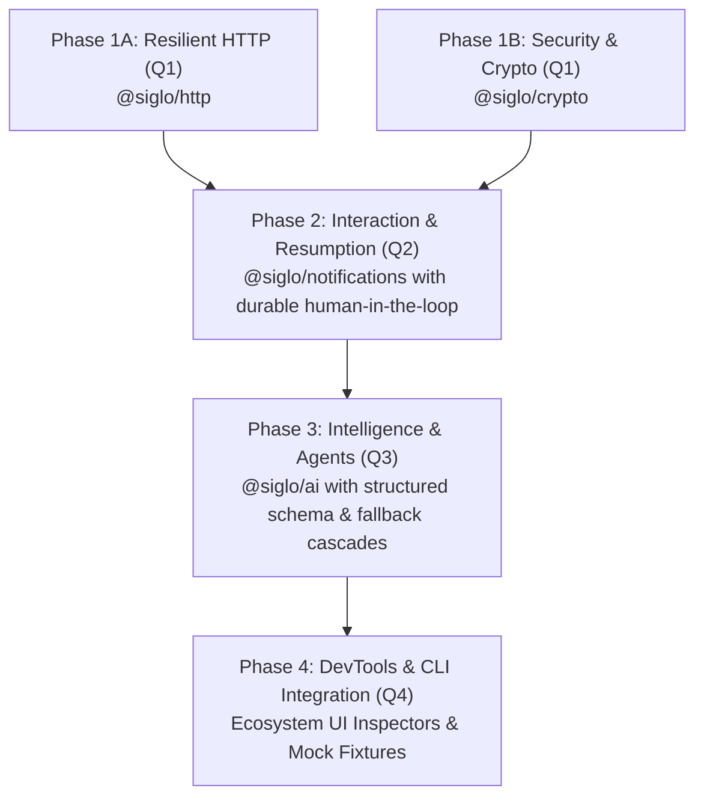

# Siglo Ecosystem Packages Master Roadmap

> Architectural overview and phased implementation roadmap for Siglo's high-impact domain extension packages: `@siglo/http`, `@siglo/crypto`, `@siglo/notifications`, and `@siglo/ai` logic.

---

## 1. Executive Summary & Design Principles

Unlike generic utility libraries (e.g., basic math or string manipulation steps), external I/O boundaries, security perimeters, outbound notifications, and non-deterministic AI completions represent the core operational complexity and failure risks in modern backend workflows.

Each proposed ecosystem package is designed according to **Siglo's Core Tenets**:

1. **Zero Mandatory Daemons**: In-process execution with minimal footprint and zero external background daemons.
2. **First-Class Resiliency**: Built-in support for `AbortSignal` cooperative cancellation, two-tier timeouts, exponential backoff, and saga compensations.
3. **Context Ergonomics**: Fluent POJO accumulation, end-to-end TypeScript inference, and `$steps` history tracking.
4. **Declarative Network Governance**: Direct alignment with Siglo's AsyncLocalStorage (ASL) network egress policies (`allowNetwork`).
5. **Observability Native**: Pre-instrumented OpenTelemetry spans, W3C trace propagation, and live DevTools event streaming.

```
                       +---------------------------------------+
                       |              Siglo Core               |
                       |  (flow, Step, ASL, Sagas, Durable)    |
                       +-------------------+-------------------+
                                           |
        +------------------+---------------+---------------+------------------+
        |                  |                               |                  |
        v                  v                               v                  v
+---------------+  +---------------+               +---------------+  +---------------+
|  @siglo/http  |  | @siglo/crypto |               |@siglo/notif...|  |   @siglo/ai   |
| Resilient I/O |  | Webhooks/PII  |               | Channels &    |  | LLMs & Schema |
| OTel Traced   |  | Envelope Enc  |               | Resumption    |  | Structured    |
+---------------+  +---------------+               +---------------+  +---------------+
```

---

## 2. Phased Roadmap Structure

The ecosystem package roadmap has been modularized into dedicated implementation specifications:



### [Phase 1A: Resilient HTTP Client (`@siglo/http`)](/roadmap/ecosystem-phase-1-http.roadmap)

- **Status**: Implemented & Verified
- **Target Delivery**: Q1
- **Scope**: Resilient HTTP client step factory with automatic ASL network policy registration, W3C trace header injection (`traceparent`/`tracestate`), smart status-code retry backoffs (`Retry-After` header parsing), Standard Schema response parsing, and two-phase saga rollback compensations (`.compensateWithHttp`).
- **Detailed Document**: See [`ecosystem-phase-1-http.roadmap.md`](/roadmap/ecosystem-phase-1-http.roadmap) for 5-phase lifecycle integration, Undici mocking, and full TypeScript signatures.

---

### [Phase 1B: Webhook Security & Data Confidentiality (`@siglo/crypto`)](/roadmap/ecosystem-phase-1-crypto.roadmap)

- **Status**: Implemented & Verified
- **Target Delivery**: Q1
- **Scope**: Zero-dependency cryptographic primitives using `node:crypto`. Webhook signature verification (Stripe, GitHub, Shopify, generic HMAC) with constant-time equality (`timingSafeEqual`) and timestamp tolerance replay defense; envelope field encryption/decryption (`aes-256-gcm`) for securing sensitive context across durable checkpoints; and context redaction for DevTools.
- **Detailed Document**: See [`ecosystem-phase-1-crypto.roadmap.md`](/roadmap/ecosystem-phase-1-crypto.roadmap) for AEAD IV management, provider signature formats, and NIST test vector strategies.

---

### [Phase 2: Interaction & Resumption (`@siglo/notifications`)](/roadmap/ecosystem-phase-2-notifications.roadmap)

- **Status**: Specification Complete (Updated for Zero-Trust ASL, Schedulers & Sagas)
- **Target Delivery**: Q2
- **Scope**:
    - Multi-channel dispatch (Slack Block Kit, Discord, Email via Resend/SendGrid/SMTP, SMS via Twilio) with ASL network policy (`allowNetwork`).
    - First-class integration with Siglo's durable `waitForEvent()` (with required `correlationKey`) and atomic multi-worker `resumeWorkflow()`.
    - Background timer recovery and timeout reclamation via `@siglo/scheduler` (`PostgresWaitPoller`).
    - Cryptographically signed HMAC action links/buttons using `@siglo/crypto` (`timingSafeEqual`, `KeyRing` rotation, replay defense).
    - Named Saga Compensation (`registerCompensationHandler('cancelNotification')`) to revoke or update stale interactive cards on workflow failure.
    - Webhook callback adapters for `@siglo/express`, `@siglo/fastify`, and `@siglo/hono`.
    - Idempotency and deduplication integration via `@siglo/core`'s `IdempotencyStore`.
- **Detailed Document**: See [`ecosystem-phase-2-notifications.roadmap.md`](/roadmap/ecosystem-phase-2-notifications.roadmap) for callback architecture, router middleware, and event contracts.

---

### [Phase 3: Intelligence & Agents (`@siglo/ai`)](/roadmap/ecosystem-phase-3-ai.roadmap)

- **Status**: Implemented & Verified Offline (Provider Runtime, Tools, Repair, Fallbacks & Telemetry)
- **Target Delivery**: Q3
- **Scope**:
    - Multi-provider LLM step abstractions (Anthropic, OpenAI, Google Gemini, Ollama/vLLM) with ASL network egress governance.
    - Standard Schema V1 (`~standard`) output extraction with full TypeScript inference.
    - Native JSON Schema structured output enforcement with self-healing prompt repair fallback loops.
    - Model fallback cascades (e.g. Claude 3.5 Sonnet -> GPT-4o -> Gemini 2.0 Flash) on rate limits (`429`), 5xx, or timeouts.
    - Step-as-Tool agentic multi-turn execution loops.
    - OpenTelemetry GenAI Semantic Convention telemetry and token cost accounting in `$steps.<stepName>.aiMetrics`.
    - Integration with Siglo caching (`step.cache()`).
- **Detailed Document**: See [`ecosystem-phase-3-ai.roadmap.md`](/roadmap/ecosystem-phase-3-ai.roadmap) for model cascades, prompt formats, and repair algorithms.

---

### [Phase 4: DevTools, CLI & Testing Integration](/roadmap/ecosystem-phase-4-devtools-cli.roadmap)

- **Status**: Specification Complete
- **Target Delivery**: Q4
- **Scope**:
    - Scaffolding CLI commands in `@siglo/cli` (`siglo generate:step --type http | crypto | notification | ai`).
    - Dedicated visual DevTools inspector panels for HTTP headers/cURL, crypto verification, notification previews, and LLM token usage waterfalls.
    - Unified offline deterministic test harnesses and mock fixtures in `@siglo/testing`.
- **Detailed Document**: See [`ecosystem-phase-4-devtools-cli.roadmap.md`](/roadmap/ecosystem-phase-4-devtools-cli.roadmap) for UI designs, CLI flags, and test harness APIs.
