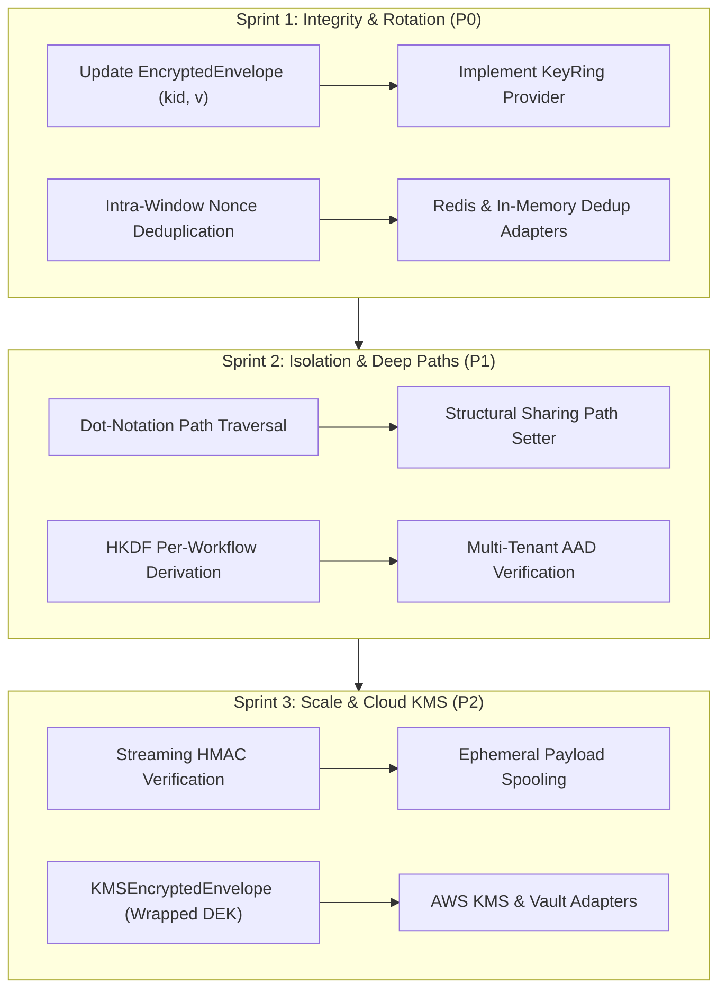

# Phase 1B Roadmap: `@siglo/crypto` (Webhook Security & Data Confidentiality)

> Detailed implementation design, runtime execution contracts, cryptographic specifications, and security guardrails for Siglo's zero-dependency crypto step package.

---

## 1. Executive Summary & Problem Space

Enterprise workflows ingest untrusted external events (webhooks) and process highly sensitive business assets (payment credentials, PII, healthcare records, API secrets). Implementing cryptographic operations manually inside workflow steps introduces severe security vulnerabilities:

| Manual Crypto Vulnerability | Real-World Attack / Impact | How `@siglo/crypto` Solves It |
|---|---|---|
| **String Comparison (`===`)** | Vulnerable to **Side-Channel Timing Attacks**, allowing attackers to brute-force valid HMAC signatures byte-by-byte. | Uses `node:crypto.timingSafeEqual` with strict buffer length checks to eliminate timing leaks. |
| **Missing Timestamp Checks** | Enables **Replay Attacks**: attackers re-transmit previously intercepted valid webhook requests hours or days later. | Automatically parses header timestamps (e.g. `t=...`) and enforces configurable clock drift tolerances (`toleranceSeconds: 300`). |
| **JSON Serialization Skew** | Verifying signatures over `JSON.stringify(req.body)` fails due to property reordering or whitespace discrepancies. | Guarantees verification strictly over the original raw `Buffer` / unparsed payload string. |
| **Hardcoded Webhook Protocols** | Rigid libraries hardcode Stripe or GitHub, failing on modern protocols (Svix, Twilio, Slack, or asymmetric Ed25519 signatures). | Pluggable **`WebhookProtocol` Strategy Pattern** supporting presets, custom protocols, asymmetric cryptography, and dynamic runtime resolution. |
| **Plaintext Checkpoint Leaks** | Siglo serializes accumulated context to PostgreSQL or Redis checkpoints. Storing raw SSNs or card tokens violates GDPR and PCI-DSS. | Transparent in-place **Envelope Encryption** (AES-256-GCM) secures sensitive context keys before storage write operations. |
| **Telemetry & Log Leaks** | Live DevTools, OpenTelemetry spans, and console logs record raw step inputs and outputs, exposing secrets in APM dashboards. | Declarative **Context Redaction & Masking** sanitizes sensitive attributes before telemetry emission. |

---

## 2. Architectural Design & Step Lifecycle Integration

`@siglo/crypto` relies exclusively on native Node.js `node:crypto` and standard Web Crypto APIs, introducing **zero external npm dependencies**.

```
+---------------------------------------------------------------------------------------------------+
|                                  verifyWebhookStep('verifyWebhook', ...)                          |
+---------------------------------------------------------------------------------------------------+
| 1. BEFORE Phase                                                                                   |
|    - Extracts signature header and raw body payload from context.                                 |
|    - Asserts that payload is a Buffer or raw unparsed string (prevents JSON re-stringify skew).   |
|    - Resolves WebhookProtocol (Preset string, custom protocol instance, or dynamic callback).     |
|                                                                                                   |
| 2. ACTION Phase (Protocol Execution & Replay Defense)                                             |
|    - Protocol parses headers (e.g., Stripe 't=...,v1=...', Svix 'svix-id,svix-timestamp,...').    |
|    - Replay Defense: Evaluates |now - timestamp| <= toleranceSeconds.                              |
|      (Throws ExpiredWaitException if outside tolerance window).                                   |
|    - Executes protocol.verify({ secret, rawPayload, header, toleranceSeconds }).                 |
|      * Evaluates symmetric HMAC (timingSafeEqual) OR asymmetric public key (Ed25519 / RSA).      |
|      * Valid: Injects { webhookVerified: true, verifiedAt: timestamp } into context.              |
|      * Invalid: Throws non-retryable ValidationException (phase: 'action').                       |
+---------------------------------------------------------------------------------------------------+

+---------------------------------------------------------------------------------------------------+
|                                  encryptFieldsStep('securePii', ...)                              |
+---------------------------------------------------------------------------------------------------+
| 1. ACTION Phase (Envelope Encryption via AES-256-GCM)                                             |
|    - Resolves 256-bit secret key (Master key, KMS key, or HKDF derived key).                     |
|    - Generates cryptographically secure 96-bit (12-byte) random Initialization Vector (IV).      |
|      (CRITICAL: A fresh IV is generated for every single step invocation—never reused).           |
|    - Serializes target field value and computes AES-256-GCM ciphertext + 128-bit Auth Tag.        |
|    - Replaces plaintext field with encrypted envelope:                                            |
|      { __sigloCipher: 'aes-256-gcm', iv: '...', tag: '...', data: '...' }                         |
|    - Siglo Checkpoints (Redis/Postgres) now store exclusively encrypted ciphertext at rest.      |
+---------------------------------------------------------------------------------------------------+
```

---

## 3. Webhook Protocol Architecture: Static vs. Pluggable

### 3.1 Why Webhook Protocols Must NOT Be Static
Real-world enterprise systems consume webhooks from dozens of distinct vendors and internal services:
- **Header formats differ**: Stripe formats `t=123,v1=abc`; GitHub uses `x-hub-signature-256: sha256=abc`; Svix / Standard Webhooks use multiple headers (`svix-id`, `svix-timestamp`, `svix-signature`); Twilio uses a single URL-parameter-based SHA1 HMAC.
- **Cryptography differs**: While most services use HMAC-SHA256, modern webhook services (such as Svix, Clerk, and Standard Webhooks) use **asymmetric Ed25519 or RSA-SHA256** public/private key pairs.
- **Payload formats differ**: Some sign raw body alone; others sign `timestamp + "." + rawBody`; others include HTTP method and path.

A static string union (`type WebhookProvider = 'stripe' | 'github'`) is an architectural bottleneck. 

### 3.2 The Pluggable `WebhookProtocol` Strategy Pattern
`@siglo/crypto` decouples protocol parsing and signature computation into an open strategy interface. Users can:
1. Use **Built-in Presets** (`'stripe'`, `'github'`, `'shopify'`, `'slack'`, `'svix'`, `'generic-hmac'`).
2. Pass an **Inline Custom Protocol** object directly to the step.
3. Register a **Global Protocol** using `registerWebhookProtocol('my-internal-gateway', customProtocol)`.
4. Dynamically select protocols per-request using a context selector: `provider: (ctx) => ctx.vendorName`.

```typescript
export interface WebhookProtocolVerificationParams {
  secret: string | Buffer;
  rawPayload: string | Buffer;
  headers: Record<string, string | string[] | undefined>;
  signatureHeader: string;
  toleranceSeconds?: number;
}

export interface WebhookProtocol {
  name: string;
  
  /** Parses timestamps, signatures, and version identifiers from raw headers */
  parseHeaders?(headers: Record<string, string | string[] | undefined>, signatureHeader: string): {
    timestamp?: number;
    signatures: string[];
    version?: string;
  };

  /** Formats the exact string or buffer to be signed (e.g. `${timestamp}.${rawBody}`) */
  formatSignedPayload?(rawBody: string | Buffer, timestamp?: number): string | Buffer;

  /** Custom verification logic (HMAC, asymmetric Ed25519, RSA, etc.) */
  verify(params: WebhookProtocolVerificationParams): Promise<boolean> | boolean;
}
```

### 3.3 Timing-Attack Safe Equality
Regardless of custom or preset protocol, all symmetric HMAC validations must pass through timing-safe buffer comparisons:
```typescript
function timingSafeCompare(computed: string, provided: string, encoding: 'hex' | 'base64' = 'hex'): boolean {
  const bufA = Buffer.from(computed, encoding);
  const bufB = Buffer.from(provided, encoding);
  
  if (bufA.length !== bufB.length) {
    return false;
  }
  
  return crypto.timingSafeEqual(bufA, bufB);
}
```

---

## 4. TypeScript API Signatures

```typescript
import { Step } from 'siglo';

/** Built-in provider preset identifiers with open string autocomplete */
export type BuiltInWebhookProvider = 'stripe' | 'github' | 'shopify' | 'slack' | 'svix' | 'generic-hmac';
export type WebhookProviderName = BuiltInWebhookProvider | (string & {});

export interface WebhookVerifyOptions<TInput> {
  /**
   * Built-in provider name, registered protocol name, custom WebhookProtocol instance,
   * or dynamic resolver function based on workflow context.
   */
  provider?: WebhookProviderName | WebhookProtocol | ((ctx: TInput) => WebhookProviderName | WebhookProtocol);
  
  /** Webhook signing secret (or public key for asymmetric protocols) */
  secret: string | Buffer | ((ctx: TInput) => string | Buffer);
  
  /** Raw unparsed payload buffer or UTF-8 string */
  payload: (ctx: TInput) => string | Buffer;
  
  /** Signature header string or entire headers dictionary */
  signature: (ctx: TInput) => string | Record<string, string | string[] | undefined>;
  
  /** Hash algorithm for generic HMAC (default: 'sha256') */
  algorithm?: 'sha256' | 'sha512' | 'sha1';
  
  /** Max allowed difference between current time and signature timestamp in seconds (default: 300) */
  toleranceSeconds?: number;
}

export interface WebhookVerificationResult {
  webhookVerified: true;
  verifiedAt: number;
  provider: string;
}

/** Factory for generating typed webhook verification steps */
export function verifyWebhookStep<const TName extends string, TInput>(
  name: TName,
  options: WebhookVerifyOptions<TInput>
): Step<TInput, WebhookVerificationResult>;

/** Global protocol registry */
export function registerWebhookProtocol(name: string, protocol: WebhookProtocol): void;
export function getWebhookProtocol(name: string): WebhookProtocol | undefined;

// ==========================================
// Envelope Encryption & Field Masking Types
// ==========================================

export interface EncryptedEnvelope {
  __sigloCipher: 'aes-256-gcm';
  iv: string;   // Hex encoded 12-byte IV
  tag: string;  // Hex encoded 16-byte auth tag
  data: string; // Hex encoded ciphertext
}

export interface FieldCipherOptions<TInput> {
  fields: (keyof TInput)[];
  secretKey: string | Buffer | ((ctx: TInput) => string | Buffer);
}

export function encryptFieldsStep<const TName extends string, TInput>(
  name: TName,
  options: FieldCipherOptions<TInput>
): Step<TInput, TInput>;

export function decryptFieldsStep<const TName extends string, TInput>(
  name: TName,
  options: FieldCipherOptions<TInput>
): Step<TInput, TInput>;

export interface MaskFieldsOptions<TInput> {
  fields: (keyof TInput)[];
  maskPattern?: (value: unknown) => string;
}

export function maskFieldsStep<const TName extends string, TInput>(
  name: TName,
  options: MaskFieldsOptions<TInput>
): Step<TInput, TInput>;
```

---

## 5. Concrete Usage Examples

### Example 1: Built-in Preset with Durable Checkpoint Encryption

```typescript
import { flow, waitForEvent, Step } from 'siglo';
import { verifyWebhookStep, encryptFieldsStep, decryptFieldsStep } from '@siglo/crypto';

interface StripeWebhookContext {
  rawBody: string;
  headers: Record<string, string>;
  customerSsn: string;
  orderId: string;
}

export const secureWebhookWorkflow = flow(
  // 1. Verify Stripe signature with replay attack tolerance
  verifyWebhookStep('verifyStripe', {
    provider: 'stripe',
    secret: process.env.STRIPE_WEBHOOK_SECRET!,
    payload: (ctx: StripeWebhookContext) => ctx.rawBody,
    signature: (ctx: StripeWebhookContext) => ctx.headers['stripe-signature'],
    toleranceSeconds: 300,
  }),

  // 2. Encrypt sensitive SSN before workflow reaches durable checkpoint
  encryptFieldsStep('protectSsn', {
    fields: ['customerSsn'],
    secretKey: process.env.ENCRYPTION_MASTER_KEY!,
  }),

  // 3. Durable wait: Checkpoint serialized to PostgreSQL/Redis with ENCRYPTED SSN!
  waitForEvent('FRAUD_CHECK_PASSED', { timeout: '24h' }),

  // 4. On resumption: Decrypt SSN back into plaintext for final bank fulfillment
  decryptFieldsStep('unprotectSsn', {
    fields: ['customerSsn'],
    secretKey: process.env.ENCRYPTION_MASTER_KEY!,
  }),

  // 5. Final business step operates on plaintext SSN
  Step.create('submitToBank', async (ctx) => {
    return { status: 'DISPATCHED_TO_BANK' };
  })
);
```

### Example 2: Custom Asymmetric Protocol (Svix / Ed25519)

```typescript
import { verifyWebhookStep, WebhookProtocol } from '@siglo/crypto';
import crypto from 'node:crypto';

// Define custom or enterprise webhook protocol
export const svixEd25519Protocol: WebhookProtocol = {
  name: 'svix-ed25519',
  verify({ secret, rawPayload, headers, signatureHeader, toleranceSeconds = 300 }) {
    const timestamp = Number(headers['svix-timestamp']);
    const svixId = headers['svix-id'];
    
    // Check replay tolerance
    const now = Math.floor(Date.now() / 1000);
    if (Math.abs(now - timestamp) > toleranceSeconds) {
      return false;
    }

    const toSign = `${svixId}.${timestamp}.${rawPayload}`;
    const signature = signatureHeader.replace(/^v1,/, '');

    // Asymmetric Ed25519 or HMAC verification
    const expected = crypto.createHmac('sha256', secret).update(toSign).digest('base64');
    return crypto.timingSafeEqual(Buffer.from(signature), Buffer.from(expected));
  },
};

// Use directly in Siglo step:
export const verifySvixWebhook = verifyWebhookStep('verifySvix', {
  provider: svixEd25519Protocol,
  secret: process.env.SVIX_SECRET!,
  payload: (ctx: { rawBody: string }) => ctx.rawBody,
  signature: (ctx: { headers: Record<string, string> }) => ctx.headers['svix-signature'],
});
```

---

## 6. Testing & Deterministic Verification

1. **Preset & Custom Protocol Tests**:
   - Verify official test vectors for Stripe, GitHub, Shopify, and Svix.
   - Assert custom `WebhookProtocol` objects receive exact `rawPayload` buffers and headers without distortion.
2. **Replay Drift Simulation**:
   - Use `@siglo/testing`'s `FakeClock` to generate webhook signatures with timestamps set 301 seconds in the past; assert step throws `ValidationException`.
3. **Ciphertext Tampering Tests**:
   - Alter 1 single bit in the AES-256-GCM auth tag or ciphertext; assert `decryptFieldsStep` aborts and throws `ValidationException`.

---

## 7. Package File Structure & Deliverables

```
packages/crypto/
├── package.json
├── tsconfig.json
├── README.md
├── src/
│   ├── index.ts                     # Public API exports
│   ├── types.ts                     # WebhookProtocol & cipher interfaces
│   ├── registry.ts                  # Protocol registry (registerWebhookProtocol)
│   ├── webhooks/
│   │   ├── verify-step.ts           # verifyWebhookStep implementation
│   │   ├── timing.ts                # Constant-time comparison utils
│   │   └── protocols/
│   │       ├── base.ts              # WebhookProtocol base contract
│   │       ├── stripe.ts            # Stripe t=,v1= parser
│   │       ├── github.ts            # GitHub sha256= parser
│   │       ├── shopify.ts           # Shopify base64 parser
│   │       ├── svix.ts              # Svix / Standard Webhook parser
│   │       └── generic-hmac.ts      # Configurable HMAC verifier
│   ├── cipher/
│   │   ├── aes-gcm.ts               # AES-256-GCM encrypt/decrypt core
│   │   ├── encrypt-step.ts          # encryptFieldsStep implementation
│   │   └── decrypt-step.ts          # decryptFieldsStep implementation
│   └── redaction/
│       └── mask-step.ts             # maskFieldsStep implementation
└── test/
    ├── webhook-verify.test.ts
    ├── custom-protocol.test.ts
    ├── replay-attack.test.ts
    ├── timing-safety.test.ts
    ├── aes-gcm-cipher.test.ts
    └── redaction.test.ts
```

### Initial Phase 1B Implementation Checklist
- [x] Scaffold `packages/crypto` in monorepo with zero external dependencies.
- [x] Implement `WebhookProtocol` strategy interface and global registry (`registerWebhookProtocol`).
- [x] Implement `timingSafeCompare` using `node:crypto.timingSafeEqual`.
- [x] Implement built-in protocol presets: Stripe, GitHub, Shopify, Svix, and generic HMAC.
- [x] Implement timestamp tolerance replay protection.
- [x] Implement `encryptFieldsStep` and `decryptFieldsStep` using AES-256-GCM with fresh 12-byte IV per invocation.
- [x] Implement `maskFieldsStep` with preset and custom masking patterns.
- [x] Validate 100% test coverage against NIST and provider test fixtures.

---

## 8. Enterprise Hardening & Security Resilience (Grill-Me Remediation)

> Architectural and cryptographic remediations targeting boundary edge-cases, replay window blind spots, key lifecycle rotation, NIST AEAD bounds, and streaming DoS vulnerabilities identified in `grill-me.md`.

### 8.1 Executive Priority Matrix

| Priority | Focus Area | Vulnerability / Failure Mode | Target Component | Core Deliverable |
|:---|:---|:---|:---|:---|
| **P0** | **Key Rotation & Archaeology** | Resumed workflows fail to decrypt checkpoints after quarterly rotation | `packages/crypto/src/cipher/` | Multi-key `KeyRing`, envelope `kid`/`v` headers, lazy re-keying |
| **P0** | **Replay Protection Window** | Intra-window replay storms ($t < 300\text{s}$) duplicate payments | `packages/crypto/src/webhooks/` | Signature/nonce deduplication cache (`Redis` & In-memory ring buffer) |
| **P1** | **Nested PII & Context Isolation** | Shallow `{ ...ctx }` leaks nested data and creates mutable race conditions | `packages/crypto/src/redaction/`, `cipher/` | Dot-notation path resolution (`user.billing.ssn`) + structural sharing path setter |
| **P1** | **AEAD Collision & Multi-Tenancy** | IV collisions after $2^{32}$ messages; cross-tenant ciphertext swapping | `packages/crypto/src/cipher/` | Per-workflow HKDF subkey derivation + tenant AAD binding |
| **P2** | **Memory DoS & Large Payloads** | 50MB–200MB webhooks cause heap exhaustion (OOM) | `packages/crypto/src/webhooks/` | Streaming HMAC (`AsyncIterable<Buffer>`) + disk/S3 spooling pointers |
| **P2** | **Cloud KMS Envelope Encryption** | Plaintext master keys stored in local environment variables | `packages/crypto/src/cipher/` | Wrapped DEKs (`KMSEncryptedEnvelope`) for AWS KMS, GCP KMS, and Vault |

---

### 8.2 Architectural Specifications

#### 8.2.1 Intra-Window Replay Defense & Nonce Deduplication (Round 1)
To stop an attacker from re-transmitting an intercepted valid webhook 500 times within the 300-second tolerance window:
1. **Extend `WebhookVerifyOptions`:**
   ```typescript
   export interface WebhookDedupStore {
     claim(key: string, ttlSeconds: number): Promise<boolean>;
   }

   export interface WebhookVerifyOptions<TInput> {
     // ... existing options ...
     dedupStore?: WebhookDedupStore;
   }
   ```
2. **Deduplication Key Derivation:**
   - Compute `dedupKey = crypto.createHash('sha256').update(`${provider}:${timestamp}:${signatureHeader}`).digest('hex')`.
   - Before executing protocol verification, call `dedupStore.claim(dedupKey, toleranceSeconds)`. If false, throw `ValidationException('Replay detected: duplicate webhook signature within tolerance window')`.
3. **Storage Adapters:**
   - **In-Memory Ring Buffer:** 2-tier ring buffer with $O(1)$ partition rotation every minute.
   - **Distributed Redis:** Native atomic claim using `SET siglo:wh:dedup:<key> 1 EX <ttl> NX`.

#### 8.2.2 Key Rotation, Archaeology & Envelope Evolution (Round 3)
To support long-running workflows pausing across key rotations (e.g. `waitForEvent('APPROVAL', { timeout: '90d' })`):
1. **Envelope Schema Versioning:**
   ```typescript
   export interface EncryptedEnvelope {
     __sigloCipher: 'aes-256-gcm';
     v?: number;          // Envelope schema version (v1, v2)
     kid?: string;        // Active Key ID at encryption time
     iv: string;          // Hex-encoded 12-byte IV
     tag: string;         // Hex-encoded 16-byte authentication tag
     data: string;        // Hex-encoded ciphertext
   }
   ```
2. **`KeyRing` Multi-Key Provider Contract:**
   ```typescript
   export interface KeyRing {
     getActiveKey(): Promise<{ kid: string; key: Buffer | string }>;
     getKey(kid: string): Promise<Buffer | string | null>;
   }
   ```
3. **Decryption & Lazy Migration:**
   - `decryptFieldsStep` resolves the matching key using `envelope.kid`. If missing (legacy envelope), it attempts the active key, falling back to historical keys.
   - If `envelope.kid !== activeKey.kid`, flag `ctx.$needsRekey = true` to re-encrypt under the active key before the next durable checkpoint.

#### 8.2.3 AES-GCM Birthday Bound, IV Management & Multi-Tenant AAD (Round 2)
1. **Per-Workflow Ephemeral Subkey Derivation (HKDF):**
   Instead of encrypting millions of step outputs under a single static master key:
   ```typescript
   const stepKey = crypto.hkdfSync('sha256', masterKey, workflowId, stepName, 32);
   ```
   *Benefit:* Eliminates the $2^{32}$ NIST SP 800-38D birthday bound by isolating IV spaces per workflow run.
2. **Additional Authenticated Data (AAD):**
   Bind `tenantId` into `cipher.setAAD(Buffer.from(tenantId))` and verify during deciphering. Cross-tenant ciphertext substitution is mathematically rejected.

#### 8.2.4 Deep Path Traversal & Structural Sharing (Round 5)
1. **Dot-Notation Path Resolvers:**
   Allow targeting nested properties: `fields: ['user.billing.taxId', 'orders.*.cardToken']`.
2. **Immutable Structural Sharing:**
   Replace `{ ...ctx }` shallow spread with path-cloning copy-on-write:
   ```typescript
   function setInPath(obj: any, path: string[], fn: (val: any) => any): any {
     if (path.length === 0) return fn(obj);
     const [head, ...tail] = path;
     const copy = Array.isArray(obj) ? [...obj] : { ...obj };
     copy[head] = setInPath(copy[head] ?? {}, tail, fn);
     return copy;
   }
   ```
   *Benefit:* Only allocates $O(d)$ wrappers along the edited path while keeping sibling object subtrees untouched, preventing accidental context mutations and race conditions.

#### 8.2.5 Streaming HMAC & Large Payload Spooling (Round 4)
1. **Streaming HMAC:**
   Update `verifyWebhookStep` to accept `AsyncIterable<Buffer>` or Node.js `Readable` streams, computing HMAC progressively via `hmac.update(chunk)`.
2. **Reference-Based Checkpointing:**
   Large webhook streams (> 5MB) spool to ephemeral temp files (`/tmp/siglo-payloads/...`) or S3. Checkpoints store only `{ payloadRef: 'file:///tmp/...' }`, avoiding Node.js heap OOMs and database checkpoint bloat.

---

### 8.3 Remediation Rollout Workflow



---

### 8.4 Enterprise Hardening Implementation Checklist

- [x] **Phase 1: Key Ring Rotation & Archaeology**
  - [x] Add `kid` and `v` fields to `EncryptedEnvelope` in `types.ts`.
  - [x] Implement `KeyRing` interface and `StaticKeyRing` provider.
  - [x] Support historical key resolution in `decryptFieldsStep`.
  - [x] Implement lazy checkpoint re-keying migration hook.
- [x] **Phase 2: Intra-Window Replay Defense**
  - [x] Add `dedupStore` option to `WebhookVerifyOptions`.
  - [x] Implement `InMemoryNonceStore` with bucketed ring buffer.
  - [x] Implement `RedisNonceStore` in `@siglo/redis`.
  - [x] Add normalized `idempotencyKey` output to `WebhookVerificationResult`.
- [x] **Phase 3: Deep Path Redaction & Structural Sharing**
  - [x] Implement dot-notation parser supporting wildcard paths (`billing.*.ssn`).
  - [x] Implement `setInPath` structural sharing helper for `encryptFieldsStep` and `maskFieldsStep`.
  - [x] Add strict development-mode proxy freezing to catch in-place context mutations.
- [x] **Phase 4: Cryptographic Hardening & AAD**
  - [x] Implement HKDF per-workflow key derivation in `aes-gcm.ts`.
  - [x] Add `aad` option to `encryptAESGCM` and `decryptAESGCM`.
  - [x] Bind tenant identity to GCM authentication tags for multi-tenant isolation.
  - [x] Enforce key message invocation threshold warnings ($2^{24}$ NIST ceiling).
- [x] **Phase 5: Streaming HMAC & Spooling**
  - [x] Support `AsyncIterable<Buffer>` / `Readable` stream payloads in `verifyWebhookStep`.
  - [x] Add disk/object storage spooling with reference-based checkpoint pointers.
  - [x] Implement `maxBodyBytes` guard with non-retryable 413 exceptions.
