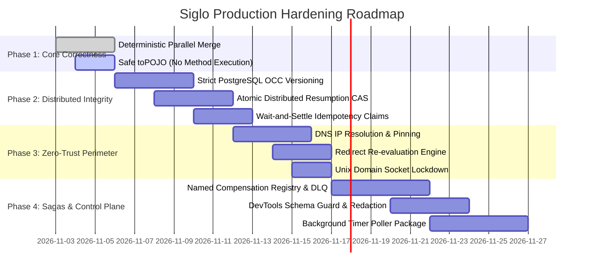

# Siglo Runtime: Architecture & Security Improvement Roadmap

> Comprehensive technical responses, failure mode root causes, distributed analyses, and architectural remediation specifications addressing the 6 Challenge Rounds in `grill-me-v2.md`.

---

## Executive Summary

**Siglo** positions itself as a *lightweight, zero-daemon, in-process workflow orchestrator* for TypeScript. While offering low-latency step transitions and excellent developer ergonomics, enterprise production deployments (financial ledgers, multi-tenant platforms, and mission-critical microservices) demand distributed correctness under network partitions, container crashes, split-brain executions, and perimeter evasions.

This document serves as the formal **Improvement Roadmap and Technical Specification** to evolve Siglo from an in-process library into a distributed-ready, enterprise-grade runtime.

---

## Round-by-Round Technical Analysis & Solutions

```
       ┌────────────────────────────────────────────────────────┐
       │             Siglo Distributed Control Plane            │
       └───────────────────────────┬────────────────────────────┘
                                   │
         ┌─────────────────────────┼─────────────────────────┐
         ▼                         ▼                         ▼
┌──────────────────┐      ┌──────────────────┐      ┌──────────────────┐
│  Atomic Claims   │      │ Strict OCC (SQL) │      │  Named Registry  │
│  & Settle Locks  │      │ Version Checking │      │  & Sagas / DLQ   │
└──────────────────┘      └──────────────────┘      └──────────────────┘
         │                         │                         │
         └─────────────────────────┼─────────────────────────┘
                                   │
         ┌─────────────────────────┴─────────────────────────┐
         ▼                                                   ▼
┌──────────────────────────────────┐       ┌──────────────────────────────────┐
│ Zero-Trust Network Interceptor   │       │ DevTools Control Plane & RBAC    │
│  - DNS Resolution & IP Pinning   │       │  - Zod Resume Schema Guard       │
│  - Strict Socket Policy (No IPC) │       │  - Automatic Field Redaction     │
│  - Manual Redirect Re-evaluation │       │  - Strict Workflow Matching      │
└──────────────────────────────────┘       └──────────────────────────────────┘
```

---

## Round 1: The "Zero-Daemon" Paradox & Resumption Split-Brain

### 1. The Operational Dilemma & Root Causes
- **The Timer Abandonment Paradox**: In `packages/core/src/features/durable/wait.ts`, a durable `wait('12h')` or `waitForEvent(..., { timeout: '30d' })` throws `WorkflowSuspendedException`, writes a wait record to storage, and registers it in `defaultDurableManager`'s in-memory `Map`. When a container restarts, crashes (OOM/SIGKILL), or deploys a new image, in-process timers die. Without an active poller or external timer daemon, workflows remain dormant zombies in PostgreSQL indefinitely.
- **Dual-Worker Resumption Race**: `defaultDurableManager.resumeWait(correlationKey)` in `packages/core/src/features/durable/resume.ts` is strictly an in-memory check on a local `Map`. If Worker A and Worker B behind a load balancer receive identical webhook resume triggers simultaneously, both workers fetch the checkpoint, resume their independent in-memory state, and execute the remaining flow in parallel—causing duplicate external side effects.
- **Context Flattening & Archeology**: In `resumeWorkflow`, `Object.assign({}, ...Object.values(cp.contexts))` flattens state destructively. Nested property structures are overwritten, property iteration order is non-deterministic across engines, and hidden symbol accessors (`$steps`, `$history`) are completely lost.

### 2. Concrete Recommendations

#### A. Opt-in External Clock & Worker Poller
For durable timers across node restarts, introduce a pluggable scheduler mechanism:
1. **Serverless / Cloud Native**: Export an HTTP/Webhook dispatch specification for AWS EventBridge Scheduler, Google Cloud Tasks, or Cloudflare Queues.
2. **Postgres-Backed Poller (`@siglo/poller` / `@siglo/scheduler`)**: Provide an opt-in poller using row-level locking:
   ```sql
   WITH due_records AS (
       SELECT correlation_key, stack_id 
       FROM siglo_wait_records
       WHERE status = 'WAITING' 
         AND expires_at IS NOT NULL 
         AND expires_at <= NOW()
       ORDER BY expires_at ASC
       LIMIT 50
       FOR UPDATE SKIP LOCKED
   )
   UPDATE siglo_wait_records r
   SET status = 'RESUMING', locked_at = NOW(), locked_by = $1
   FROM due_records d
   WHERE r.correlation_key = d.correlation_key
   RETURNING r.*;
   ```

#### B. Atomic Distributed Resumption Claims
Elevate `resumeWait` from an in-memory map operation to an atomic storage claim:
```sql
UPDATE siglo_wait_records
SET status = 'RESUMED', 
    resumed_at = NOW(), 
    resumed_by = $1
WHERE correlation_key = $2 
  AND status = 'WAITING'
RETURNING *;
```
If `rowCount === 0`, throw `DuplicateEventException` or `WorkflowAlreadyResumedException`.

#### C. Preserved Context Snapshot & `$steps` Hydration
- Replace shallow context flattening with an intact accumulated context snapshot (`cp.accumulatedContext`).
- Explicitly serialize `$steps` metadata in checkpoints:
  ```typescript
  export interface CheckpointMetadata {
      accumulatedContext: Record<string, any>;
      steps: Record<string, { status: string; output?: any; durationMs?: number }>;
      waitRecord?: WaitingWorkflowRecord;
      compensations?: SerializedCompensation[];
  }
  ```
- Rebuild the `ProxyContext` faithfully during resumption with full backward navigation capabilities.

---

## Round 2: The Phantom Saga & Silent Compensation Drops

### 1. Failure Analysis & Root Causes
- **Silent Compensation Drop on Code Deployment**: `step.compensate` matches compensation records by in-memory step reference or step name. If a service deploys new code where a step was renamed (`processPayment` -> `capturePaymentV2`) or refactored into a sub-flow, `matchingStep` is `undefined`. Siglo silently ignores the missing handler and continues executing remaining compensations without rolling back external transactions.
- **Unhandled Process Crash Mid-Saga**: If a Node.js process crashes after step 2 of 4 completes, the database records the incomplete stack, but compensations never run automatically.
- **Partial Compensation Failure Deadlock**: If a compensation step fails after exhausting retries, `CompensationException` halts the stack. Remaining compensations are never executed, leaving external resources in an indeterminate half-compensated state.

### 2. Concrete Recommendations

#### A. Named Serializable Compensation Registry
Decouple compensation execution from dynamic runtime closures:
```typescript
import { registerCompensationHandler } from 'siglo';

registerCompensationHandler('cancelStripeCharge', async ({ paymentId }, ctx) => {
    await stripe.refunds.create({ charge: paymentId });
});

// Within flow definition:
step('chargeCard')
    .action(async (ctx) => {
        const charge = await stripe.charges.create({ ... });
        return { paymentId: charge.id };
    })
    .compensate('cancelStripeCharge', (output) => ({ paymentId: output.paymentId }));
```
- The checkpoint records `{ handlerName: 'cancelStripeCharge', payload: { paymentId: 'ch_123' } }`.
- Upon rehydration, handlers are resolved from the registry.
- If a handler is missing from the registry, **throw an explicit fatal error** (`UnresolvableCompensationException`) rather than silently skipping rollback.

#### B. Resilient Compensation Traversal with DLQ
Add support for configurable failure policies during compensation:
```typescript
flow.compensate(stackId, {
    mode: 'best-effort', // Continues rolling back remaining compensations if one fails
    onFailure: async (failedCompensation, error) => {
        await deadLetterQueue.send({
            stackId,
            failedCompensation,
            error: error.message
        });
    }
});
```

#### C. Abandoned Stack Reconciliation CLI
Introduce an operational recovery CLI command for crash detection:
```bash
npx siglo reconcile --stale-threshold=10m --action=compensate
```
Identifies stacks stuck in `RUNNING` state past heartbeat windows and triggers safe rollback.

---

## Round 3: Concurrency Combinators & Non-Deterministic Merge Races

### 1. Flaw Analysis & Root Causes
- **Non-Deterministic Race in `parallel`**: `branchOutputs.push({ name: bName, output: cleaned })` pushes in arrival/completion order. Whichever branch finishes last calls `Object.assign(merged, b.output)` last. Two branches outputting the same key will produce non-deterministic results based on microsecond-level I/O jitter.
- **Array Overwrite in `deepMerge`**: Arrays are excluded from recursion (`!Array.isArray(sVal)`), meaning one branch's array completely clobbers another's instead of concatenating or raising an error.
- **The `toPOJO` Side-Effect Hazard**: `toPOJO` automatically invokes any zero-argument function (`data[key].length === 0`). Passing client objects, socket instances, or custom classes into the context results in unintended executions of methods like `db.close()`, `client.destroy()`, or `auth.logout()`.
- **Uncooperative Native Drivers on Abort**: Native database pools and synchronous libraries ignore JavaScript `AbortSignal`, continuing background execution and exhausting connection pools.

### 2. Concrete Recommendations

#### A. Deterministic Declaration-Order Merging
Replace arrival-order arrays with pre-allocated, index-pinned slots:
```typescript
const branchOutputs = new Array<{ name: string; output: any }>(branches.length);

await Promise.all(branches.map(async (branch, index) => {
    const out = await executeBranch(branch, param, combinedSignal);
    branchOutputs[index] = { name: branch.name, output: cleanBranchOutput(out) };
}));

// Merging executes in strict definition index order (0 -> N - 1)
for (const b of branchOutputs) {
    if (b?.output && typeof b.output === 'object') {
        Object.assign(merged, b.output);
    }
}
```

#### B. Safe Context Serialization (Eliminate Method Invocation in `toPOJO`)
Remove arbitrary zero-argument invocation from `proxy.ts`:
```typescript
// REMOVE:
// else if (data[key].length === 0) { val = data[key](); }

// REPLACE WITH:
if (typeof data[key] === 'function') {
    if (data[key]._isSigloComputed) {
        val = data[key].call(data);
    } else {
        // Functions and methods are omitted from serialization
        continue;
    }
}
```

#### C. Scoped Branch Namespacing
Offer an explicit merge strategy `mergeStrategy: 'namespace'` where branch outputs are placed under their branch names (`{ branchA: { ... }, branchB: { ... } }`) to prevent collision and preserve array outputs cleanly.

---

## Round 4: Network Egress Guardrails & Perimeter Bypasses

### 1. Perimeter Vulnerabilities & Root Causes
- **DNS Rebinding & SSRF**: `isHostAllowed` validates the requested string hostname *prior* to DNS resolution. An attacker pointing `api.attacker.com` to `169.254.169.254` via short-TTL DNS bypasses hostname pattern checks and queries AWS/GCP instance metadata.
- **Unix Domain Socket & Localhost Exemption**: `isLocalhost` unconditionally permits `clean.startsWith('unix:') || clean.startsWith('/') || clean.includes('.sock')`. Because `allowLocalhost` defaults to `true`, any step with outbound network access can connect to `/var/run/docker.sock` to achieve container breakout.
- **Alternative IP Encodings**: Integer IPs (`http://2130706433`), hexadecimal IPs (`0x7f000001`), and IPv6-mapped IPv4 (`[::ffff:127.0.0.1]`) evade string comparisons.
- **HTTP 30x Redirect Bypass**: `patchedFetch` sets `inValidatedScope: true` during request execution. When the remote server responds with a `302 Found` redirecting to an internal IP, internal fetch follows the redirect without re-validating the target URL.
- **`BlockedClientRequest` Compatibility**: `BlockedClientRequest` does not subclass `http.ClientRequest`, causing `instanceof` checks in `axios` or `undici` to crash with unhandled `TypeError`.

### 2. Concrete Recommendations

#### A. Pre-flight DNS Resolution & Socket IP Pinning
```typescript
import dns from 'dns/promises';
import net from 'net';

async function validateAndPinTarget(targetUrl: URL): Promise<string> {
    const addresses = await dns.lookup(targetUrl.hostname, { all: true });
    for (const addr of addresses) {
        if (isPrivateOrLoopbackIP(addr.address)) {
            throw new NetworkPolicyViolationException(
                `Target resolved to restricted IP: ${addr.address}`
            );
        }
    }
    return addresses[0].address; // Pin socket connection directly to resolved IP
}
```

#### B. Restrict Unix Sockets & Default Localhost to False
- Change `allowLocalhost` default to `false`.
- Disallow Unix domain sockets unless explicitly enabled via `allowUnixSockets: ['/specific/path']`.
- Use `net.isIP` and parse IP representations into normalized numeric canonical form before evaluating allowlists.

#### C. Manual Redirect Re-evaluation
Force `{ redirect: 'manual' }` in `patchedFetch`. On 301/302/307/308 status codes, extract the `Location` header, recursively pass it through `isHostAllowed`, and only follow the redirect if the target host and resolved IP pass policy.

#### D. Subclass `http.ClientRequest`
```typescript
import http from 'http';

class BlockedClientRequest extends http.ClientRequest {
    constructor() {
        super({ protocol: 'http:', hostname: 'localhost', path: '/' });
    }
}
```

---

## Round 5: Idempotency Lock Storms & The OCC Illusion

### 1. Flaw Analysis & Root Causes
- **The "OCC Illusion" in PostgreSQL**: `PostgresStorageAdapter.saveCheckpoint` executes `ON CONFLICT (stack_id) DO UPDATE SET state = EXCLUDED.state`. There is no `WHERE version = $currentVersion` check. This is **Last-Write-Wins (LWW)**, not Optimistic Concurrency Control. Concurrent step completions or resumptions silently overwrite each other.
- **Immediate DLQ Storms on Contention**: When a concurrent duplicate arrives, `runner.ts` immediately throws `IdempotencyConflictException`. In message queue consumers (Kafka, SQS), this causes instant message rejection into DLQs rather than spinning or waiting for the in-flight workflow to complete and return its result.
- **Fail-Open Key Deletion on Permanent Error**: In `idempotencyStore.fail(key)`, the key is deleted from PostgreSQL (`DELETE FROM ... WHERE key = $1`). If a workflow fails due to a permanent business decline (e.g. CardDeclined, InsufficientBalance), deleting the key permits retried requests to re-execute external charges rather than returning the cached refusal.

### 2. Concrete Recommendations

#### A. True Optimistic Concurrency Control
Add a `version` column to `siglo_checkpoints` and enforce CAS updates:
```sql
ALTER TABLE siglo_checkpoints ADD COLUMN IF NOT EXISTS version BIGINT NOT NULL DEFAULT 1;

-- Checkpoint update query:
UPDATE siglo_checkpoints
SET state = $1::jsonb, 
    version = version + 1, 
    updated_at = NOW()
WHERE stack_id = $2 AND version = $3;
```
If `result.rowCount === 0`, throw `OptimisticLockException` and trigger a re-read/retry cycle.

#### B. Wait-and-Settle Idempotency Mechanism
Add spin-lock / notification polling for in-flight requests:
```typescript
export interface IdempotencyClaimOptions {
    ttlMs?: number;
    settleTimeoutMs?: number; // Wait up to 3000ms for in-flight execution to complete
    pollIntervalMs?: number;
}
```
If a request encounters `IN_PROGRESS`, it polls until the record transitions to `COMPLETED` and immediately returns the cached result, eliminating spurious 409s and DLQ spikes.

#### C. Two-Tier Failure Distinction
```typescript
try {
    return await executeWorkflow();
} catch (error) {
    if (isPermanentBusinessError(error)) {
        // Cache the rejection result so retries return the exact business decline
        await idempotencyStore.complete(idempKey, { error: error.message }, ttl);
    } else {
        // Transient infrastructure failure: clear claim to allow immediate retry
        await idempotencyStore.fail(idempKey, error);
    }
    throw error;
}
```

---

## Round 6: Live DevTools Control Plane & Context Exfiltration

### 1. Security Vulnerabilities & Root Causes
- **Unchecked Resume Payload Injection**: `/api/workflows/:id/resume` takes arbitrary JSON from HTTP/WebSocket callers and passes it directly into `resumeWorkflow`, which shallow-merges it into the context without schema validation. Attackers can pollute prototypes or manipulate internal control fields (`isAdmin: true`).
- **Routing Cross-Talk (`"default"` Flow Fallback)**: If a requested `stackId` is unknown, `server.ts` falls back to `workflows.get("default")`. Resuming a payment stack checkpoint against a user onboarding flow leads to severe state corruption.
- **Plaintext Context Leakage over WebSockets/SSE**: `emitter.on('*')` broadcasts full step contexts across WebSockets without sanitization, leaking passwords, SSNs, and API keys to DevTools clients.

### 2. Concrete Recommendations

#### A. Strict Workflow Registration & Schema Validation
- Eliminate the `"default"` fallback. Return `404 Workflow Not Found` if a stack ID does not map to a registered flow.
- Enforce schema validation (Zod, TypeBox, or function validator) on `resumePayload` before context injection:
  ```typescript
  if (targetFlow.resumeSchema) {
      const validated = await targetFlow.resumeSchema.safeParse(parsed.payload);
      if (!validated.success) {
          res.writeHead(422, { 'Content-Type': 'application/json' });
          res.end(JSON.stringify({ error: validated.error }));
          return;
      }
  }
  ```

#### B. Automatic Field Redaction for Telemetry
Add a redaction pipeline to the monitor server:
```typescript
export interface MonitorSecurityOptions {
    redactedKeys?: string[]; // e.g. ['password', 'secret', 'token', 'authorization', 'ssn']
    maskFn?: (key: string, value: any) => any;
}
```
Sanitize all event payloads before broadcasting over SSE and WebSockets.

---

## Phased Implementation Roadmap



| Phase | Milestone | Priority | Packages Affected | Key Deliverables |
|---|---|---|---|---|
| **Phase 1** | **Core Concurrency & Serialization Integrity** | `P0` | `@siglo/core` | Pre-allocated declaration-order parallel merge; remove arbitrary function execution from `toPOJO`. |
| **Phase 2** | **True OCC & Atomic Resumption Claims** | `P0` | `@siglo/postgres`, `@siglo/core`, `@siglo/redis` | Versioned OCC checkpoint queries; atomic SQL claim in `resumeWorkflow`; bounded wait-and-settle in idempotency store. |
| **Phase 3** | **Zero-Trust Network Perimeter** | `P0` | `@siglo/core` (network) | Pre-flight DNS resolution & private IP blocking; socket IP pinning; manual redirect traversal; subclass `http.ClientRequest`. |
| **Phase 4** | **Saga Reliability & Code Evolution** | `P1` | `@siglo/core` | Named compensation registry; best-effort compensation mode with DLQ; unhandled crash reconciliation tooling. |
| **Phase 5** | **DevTools Security & Timer Daemon** | `P1` | `@siglo/monitor`, `@siglo/scheduler` | Strict workflow routing; Zod resume validation; real-time telemetry redaction; opt-in `@siglo/scheduler` worker. |

---

## Verification & Acceptance Test Suite

To prevent regressions, the following test cases must be added to the test suite:
1. `parallel.test.ts`: Test that two parallel branches outputting `{ count: 1 }` and `{ count: 2 }` with reverse latency (Branch 1 takes 5ms, Branch 0 takes 25ms) deterministically output Branch 1 overwriting Branch 0 (or vice versa, strictly following definition order).
2. `proxy.test.ts`: Test that objects with zero-argument functions (e.g. `{ close() { throw new Error('Closed!'); } }`) are serialized by `toPOJO` without calling `close()`.
3. `postgres-occ.test.ts`: Simulate two workers attempting to update checkpoint version 1 concurrently. Exactly one succeeds; the second receives `OptimisticLockException`.
4. `network-perimeter.test.ts`: Verify that DNS rebinding to `169.254.169.254` and HTTP 302 redirects to localhost/VPC endpoints are blocked with `NetworkPolicyViolationException`.
5. `resume-race.test.ts`: Verify that two concurrent `resumeWorkflow` calls for the same correlation key produce exactly one winner and one `DuplicateEventException`.
