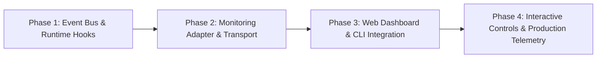

# Live Monitoring Roadmap for `Siglo`

> Architectural assessment, design proposals, and phased roadmap for introducing live workflow monitoring, visualization, and real-time DevTools to the `Siglo` ecosystem.

---

## 1. Executive Summary & Feasibility

### Feasibility: **Confirmed (High Suitability)**
Live monitoring is not only possible for `Siglo`, but the framework is architecturally primed for it. Unlike black-box workflow runtimes, `Siglo` already separates execution AST generation, lifecycle state management, context immutability, durable checkpoints, and OpenTelemetry distributed tracing into discrete, observable layers.

### Key Objectives
- **Zero-Friction Developer Experience**: Provide a local development monitor (CLI and Web UI) to inspect workflows as they execute step-by-step.
- **Real-Time Visual State**: Visualize DAG topology ahead of execution and dynamically highlight active, completed, failed, retried, and suspended nodes.
- **State & Context Introspection**: Observe context mutations, step inputs/outputs, and cache hits/misses in real time.
- **Interactive Control**: Trigger events for paused/suspended durable workflows (`waitForEvent`), inspect serialized checkpoints, and replay failed runs.
- **Production-Ready Observability**: Bridge local live monitoring with enterprise APM backends (OpenTelemetry, Prometheus, Datadog).

---

## 2. Existing Architectural Foundations

`Siglo` already exposes the building blocks required for real-time monitoring:

| Component | Codebase Reference | Live Monitoring Capability |
|---|---|---|
| **Deterministic Graph AST** | [`../../packages/core/src/features/graph`](../../packages/core/src/features/graph) | `workflow.toJSON()`, `workflow.toMermaid()`, `workflow.toDot()`, and `inspectGraph()` provide static DAG structure ahead-of-time so the UI can render node topologies before execution starts. |
| **OpenTelemetry Distributed Tracing** | [`../../packages/opentelemetry`](../../packages/opentelemetry) | Span emission, step execution durations, attempt counts, retry metadata, W3C trace propagation, and automated exception capture. |
| **Storage Event Streaming** | [`StorageAdapter`](../../packages/core/src/features/storage/adapter.ts) | `onContextChange` streams context mutations (`stackId`, `stepId`, `field`, `value`, `timestamp`); `onCacheEvent` streams cache hits/misses. |
| **Durable Execution & Checkpoints** | [`../../packages/core/src/features/durable`](../../packages/core/src/features/durable) | Checkpoints capture lifecycle status (`RUNNING`, `SUSPENDED`, `COMPLETED`, `FAILED`), pending event wait states, and serialized execution stacks. |
| **Developer CLI Tooling** | [`../../packages/cli`](../../packages/cli) | CLI scaffolding and commands (`visualize`, `inspect`, `checkpoint`, `replay`) provide the foundation for adding `siglo monitor` or `siglo dev`. |

---

## 3. Architecture & Delivery Options

```
                           +---------------------------+
                           |   Siglo Workflow Run    |
                           +-------------+-------------+
                                         |
                                         v
                    +--------------------+--------------------+
                    | Workflow Event Bus / Monitoring Adapter |
                    +--------------------+--------------------+
                                         |
                +------------------------+------------------------+
                |                                                 |
                v (SSE / WebSocket)                               v (OTel / Metrics)
   +------------+------------+                       +------------+------------+
   |   Local DevTools UI     |                       |  Production Telemetry   |
   | - Live DAG Visualizer   |                       | - Jaeger / Tempo Traces |
   | - Context Diff Viewer   |                       | - Prometheus Metrics    |
   | - Replay & Event Resume |                       | - Grafana / Datadog     |
   +-------------------------+                       +-------------------------+
```

### Option A: Web DevTools Dashboard (`@siglo/monitor` / CLI Dev Server)
- **What it is**: A dedicated web dashboard (similar to Temporal Web UI, Inngest Dev Server, or Bull-Board).
- **How it runs**: Launched via `npm exec --package=@siglo/cli -- siglo monitor --port 4000` or embedded as middleware in Fastify, Express, or Hono.
- **Features**:
  - Interactive DAG rendering (React Flow / Cytoscape) derived directly from `flow.toJSON()`.
  - Live node transitions:
    - ⚪ *Pending* &rarr; 🔵 *Running* &rarr; 🟢 *Completed* / 🔴 *Failed* / 🟡 *Suspended (`waitForEvent`)*
  - Live step timeline and duration waterfalls.
  - Context inspector displaying sanitized state changes per step.
  - Interactive event trigger to resume suspended workflows (`resumeWorkflow`).

### Option B: Terminal UI (TUI) Dashboard
- **What it is**: A terminal-based real-time dashboard for developers who prefer staying inside their terminal.
- **How it runs**: `npm exec --package=@siglo/cli -- siglo monitor --tui` built with `ink` (React for CLI) or `blessed`.
- **Features**:
  - Live progress bars for active workflows and step pipelines.
  - Streaming error logs and retry alerts.
  - Real-time throughput (executions/sec) and average latency metrics.

### Option C: Zero-Code APM Dashboards (OpenTelemetry)
- **What it is**: Production monitoring using standard APM platforms without running dedicated custom UI servers.
- **How it runs**: Already enabled via `@siglo/opentelemetry` (or `@siglo/opentelemetry`).
- **Features**:
  - Pre-built Grafana dashboards and Jaeger trace visualizations.
  - Cross-service distributed tracing across HTTP, Kafka, and SQS boundaries via W3C propagation.

---

## 4. Phased Implementation Roadmap



### Phase 1: Event Bus & Runtime Hooks
- [x] Define standardized, typed execution events in core:
  - `flow:start`, `flow:complete`, `flow:error`, `flow:suspended`, `flow:resumed`
  - `step:start`, `step:complete`, `step:retry`, `step:error`, `step:skipped`
  - `context:change`, `cache:hit`, `cache:miss`, `checkpoint:save`
- [x] Implement an in-memory `WorkflowEventEmitter` in `@siglo/core` or through an enhanced `StorageAdapter` / middleware lifecycle.
- [x] Add event subscription hooks to `flow.run(input, { monitor: eventEmitter })`.

### Phase 2: Monitoring Adapter & Transport
- [x] Create `@siglo/monitor` package.
- [x] Implement event broadcasting transports:
  - **Server-Sent Events (SSE)** for lightweight one-way browser streaming.
  - **WebSocket server** for bi-directional streaming and interactive controls.
  - **Redis Pub/Sub adapter** for multi-process / distributed worker monitoring.
- [x] Add context redaction hooks to prevent leaking sensitive credentials in monitoring feeds.

### Phase 3: Web Dashboard & CLI Integration
- [x] Implement static single-page web UI:
  - Workflow DAG visualization based on `flow.toJSON()`.
  - Node status badges: ⏱️ timeout, 🔁 retry count, ⏪ sagas, ⏳ wait state.
  - Timeline waterfall view showing step-by-step latency.
  - Context inspector with JSON diff viewer between step execution phases.
- [x] Add CLI integration:
  - `siglo monitor [options]` to serve the dashboard locally.
  - Built-in HTTP middleware for Express, Fastify, and Hono apps (`app.use('/_siglo', sigloMonitorMiddleware())`).

### Phase 4: Interactive Controls & Production Telemetry
- [x] **Interactive Resumption**: Allow sending events directly from the dashboard to unblock suspended flows (`resumeWorkflow(stackId, payload)`).
- [x] **Step Replay**: Ability to replay individual failed steps using recorded context fixtures (`@siglo/testing`).
- [x] **Prometheus Metrics Exporter**: Emit Prometheus metrics (`siglo_flow_duration_seconds`, `siglo_step_retries_total`, `siglo_active_flows`).
- [x] **Grafana Dashboard Templates**: Provide ready-to-import Grafana JSON dashboards.

---

## 5. Event Schema Specification

```typescript
export type WorkflowExecutionEvent =
  | {
      type: 'flow:start';
      stackId: string;
      flowName?: string;
      version?: string;
      ast: WorkflowNode;
      timestamp: number;
    }
  | {
      type: 'step:start';
      stackId: string;
      stepId: string;
      stepName: string;
      attempt: number;
      timestamp: number;
    }
  | {
      type: 'step:complete';
      stackId: string;
      stepId: string;
      stepName: string;
      durationMs: number;
      outputSummary?: any;
      timestamp: number;
    }
  | {
      type: 'step:retry';
      stackId: string;
      stepId: string;
      attempt: number;
      error: { message: string; code?: string };
      delayMs: number;
      timestamp: number;
    }
  | {
      type: 'flow:suspended';
      stackId: string;
      waitingForEvent: string;
      timeoutMs?: number;
      timestamp: number;
    }
  | {
      type: 'flow:complete';
      stackId: string;
      durationMs: number;
      status: 'COMPLETED' | 'FAILED';
      error?: { message: string; stack?: string };
      timestamp: number;
    };
```

---

## 6. Security, Performance & Non-Functional Requirements

1. **Zero Runtime Overhead When Disabled**:
   - Event listeners and monitors must incur negligible overhead (< 1-2% execution latency) when active, and 0 overhead when detached.
2. **Data Redaction & Privacy**:
   - Must honor `redactContextKeys` / `redactHook` to ensure PII, tokens, and secrets are stripped prior to broadcasting over WebSocket/SSE.
3. **Multi-Tenant Namespace Isolation**:
   - Workflows tagged with a `$namespace` must be filterable so developers only observe workflows in their allowed tenancy or environment.
4. **Resilience**:
   - Monitoring transport failures (e.g. dropped WebSocket connection or slow consumer) must never interrupt or throw errors into the primary workflow execution loop.
