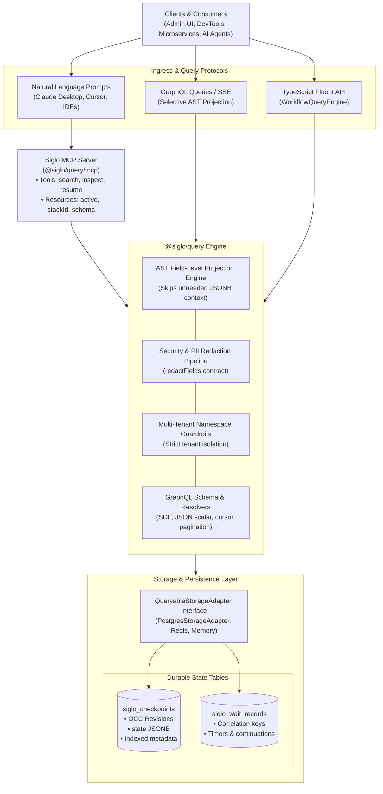
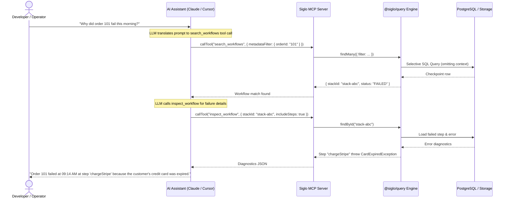
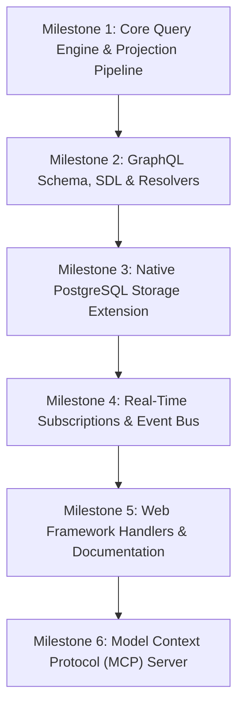

# Siglo Query Adapter (`@siglo/query`) Master Roadmap

> Architectural specification, GraphQL schema contract, Model Context Protocol (MCP) interface, storage-agnostic projection engine, security guardrails, and phased implementation roadmap for `@siglo/query`.

---

## 1. Executive Summary & Problem Space

As enterprise workflows scale, observability and operational control require querying past and active executions. Workflows in `Siglo` persist execution stacks using durable checkpoints (`SerializedExecutionStack`), containing lifecycle state, timestamps, error diagnostics, and accumulated step contexts.

### The Problem
* **Direct SQL Anti-Pattern**: Accessing workflow state directly via SQL (e.g. `SELECT state FROM siglo_checkpoints`) creates tight coupling to database schemas, risks JSONB query lock contention, forces consumers to manually deserialize deep ASTs, and bypasses tenant namespace boundaries.
* **Per-Step vs. Per-Workflow Mismatch**: Querying context data per step yields fragmented deltas and exposes internal step mechanics that change across refactors. The true unit of business value is the **Workflow Instance** and its **Materialized Accumulated Context**.
* **Over-Fetching of Heavy Context Blobs**: Checkpoints contain large context trees, compensation logs, and execution graphs. Listing workflows in admin dashboards, monitoring tools, or feeding them to AI agents should not force deserializing megabytes of unneeded JSONB context data.
* **Security & PII Risks**: Uncontrolled context queries risk leaking credentials, authorization tokens, or sensitive customer PII stored across checkpoints.
* **Lack of AI-Native Natural Language Inspection**: Operators and developers currently have no standard way to query workflow states using prompts (e.g. *"Why did order 101 fail?"*) without building custom AI scrapers or exposing raw database credentials to LLMs.

### The Solution: `@siglo/query`
`@siglo/query` provides a unified, storage-agnostic query engine, a ready-to-mount **GraphQL API**, and an **MCP (Model Context Protocol) Server** for searching, filtering, and projecting workflow executions via code or natural language prompts.



---

## 2. Core Architectural Tenets

1. **Workflow-Centric State**: Workflows represent business entities (e.g. `OrderCheckout`, `KYCVerification`). State queries operate at the workflow execution level (`stackId`), presenting the unified accumulated context rather than isolated step deltas.
2. **AST-Driven Field Projection (Zero-Cost Metadata Queries)**: GraphQL and MCP tool AST inspection determines whether the client requested `context` or `steps`. When listing workflows, resolvers skip loading or parsing heavy `state->'contexts'` JSONB blobs.
3. **Defense-in-Depth Security**:
   - **Mandatory Namespace Enforcement**: All queries are scoped to the authenticated tenant (`namespace`). Cross-tenant context leakage is prevented at the resolver/tool boundary.
   - **Automated Field Redaction**: Integrates with Siglo's `redactFields` contract ([storage-contract.md](/storage-contract)), scrubbing sensitive keys (`password`, `token`, `secret`, `apiKey`) before serialization or LLM ingestion.
4. **Storage Adapter Decoupling**: Exposes an optional `QueryableStorageAdapter` interface. When present (e.g. in `@siglo/postgres`), queries leverage database-level JSONB indexes; otherwise, `@siglo/query` provides an in-memory aggregation fallback.
5. **Real-Time Subscriptions**: Hooks directly into `WorkflowEventEmitter` from `@siglo/core` to stream live lifecycle transitions and context modifications over GraphQL Subscriptions (SSE or WebSockets).
6. **AI-Native via Model Context Protocol (MCP)**: Exposes structured MCP tools and live resources, allowing LLMs (Claude Desktop, Cursor, Antigravity, IDE assistants) to query, inspect, and resume workflows via natural language prompts without blowing context window token budgets.

---

## 3. GraphQL Schema Contract (SDL)

```graphql
scalar JSON
scalar DateTime

enum WorkflowStatus {
  RUNNING
  WAITING
  COMPLETED
  FAILED
  CANCELLED
}

enum SortDirection {
  ASC
  DESC
}

enum WorkflowSortField {
  CREATED_AT
  UPDATED_AT
  STATUS
  REVISION
}

"""
Represents a single workflow execution instance.
"""
type WorkflowExecution {
  stackId: ID!
  workflowId: String
  namespace: String
  status: WorkflowStatus!
  revision: Int!
  createdAt: DateTime!
  updatedAt: DateTime!
  expiresAt: DateTime

  """
  Promoted top-level metadata passed during workflow initialization.
  """
  metadata: JSON

  """
  Materialized accumulated context across all completed steps.
  Supports optional JSONPath filtering and security redaction.
  """
  context(path: String, redact: Boolean = true): JSON

  """
  Execution breakdown of completed and in-flight steps.
  """
  steps: [StepExecution!]!

  """
  Active suspension state if status is WAITING.
  """
  waitRecord: WaitRecord

  """
  Registered saga compensation records if configured.
  """
  compensations: [CompensationRecord!]!
}

type StepExecution {
  stepId: ID!
  name: String!
  status: String!
  output(redact: Boolean = true): JSON
}

type WaitRecord {
  correlationKey: String!
  eventName: String
  expiresAt: DateTime
  lockedBy: String
}

type CompensationRecord {
  stepId: String!
  stepName: String!
  status: String!
}

input WorkflowFilterInput {
  workflowId: String
  namespace: String
  status: WorkflowStatus
  createdAfter: DateTime
  createdBefore: DateTime
  correlationKey: String
  """Filter against promoted metadata fields (e.g. { orderId: "ord_123" })"""
  metadata: JSON
}

input WorkflowSortInput {
  field: WorkflowSortField! = CREATED_AT
  direction: SortDirection! = DESC
}

input PaginationInput {
  limit: Int = 20
  cursor: String
}

type PageInfo {
  hasNextPage: Boolean!
  hasPreviousPage: Boolean!
  startCursor: String
  endCursor: String
}

type WorkflowEdge {
  cursor: String!
  node: WorkflowExecution!
}

type WorkflowConnection {
  edges: [WorkflowEdge!]!
  pageInfo: PageInfo!
  totalCount: Int!
}

type Query {
  """
  Retrieve a single workflow execution by its unique stackId.
  """
  workflow(stackId: ID!, namespace: String): WorkflowExecution

  """
  Query and filter workflow executions with cursor-based pagination.
  """
  workflows(
    filter: WorkflowFilterInput
    sort: WorkflowSortInput
    pagination: PaginationInput
  ): WorkflowConnection!
}

type Mutation {
  """
  Resume a suspended durable workflow waiting on an external event.
  """
  resumeWorkflow(
    correlationKey: String!
    payload: JSON
    namespace: String
  ): Boolean!

  """
  Cancel an active or waiting workflow execution stack.
  """
  cancelWorkflow(stackId: ID!, reason: String): Boolean!
}

type Subscription {
  """
  Subscribe to real-time status transitions and context updates for a workflow.
  """
  workflowUpdated(stackId: ID!): WorkflowExecution!

  """
  Subscribe to workflow completion or failure events within a namespace.
  """
  workflowCompleted(namespace: String!): WorkflowExecution!
}
```

---

## 4. Programmatic Query API (`WorkflowQueryEngine`)

In addition to GraphQL, `@siglo/query` exposes a strongly typed programmatic client for backend services:

```typescript
import { createWorkflowQueryEngine, WorkflowQueryEngine } from '@siglo/query';
import { defaultStorageManager } from '@siglo/core';

const queryEngine: WorkflowQueryEngine = createWorkflowQueryEngine({
    storage: defaultStorageManager.getAdapter(),
    redactFields: ['apiKey', 'password', 'token', 'secret'],
});

// 1. Paginated Query with Context Selection
const { items, pageInfo, totalCount } = await queryEngine.findMany({
    filter: {
        workflowId: 'order-checkout',
        status: 'waiting',
        namespace: 'tenant-acme',
        createdAfter: new Date('2026-01-01'),
    },
    pagination: { limit: 25 },
    // Only deserialize context if requested
    select: {
        includeContext: true,
        contextPath: 'shippingAddress',
    },
});

// 2. Fetch Single Execution by stackId
const execution = await queryEngine.findById('stack-998877', {
    namespace: 'tenant-acme',
    redact: true,
});
```

---

## 5. Storage Engine Integration (`QueryableStorageAdapter`)

To prevent inefficient table scans, `@siglo/query` defines an extension interface for Siglo storage adapters:

```typescript
export interface QueryableStorageAdapter {
    queryWorkflows?(options: {
        filter: WorkflowFilterInput;
        sort?: WorkflowSortInput;
        pagination?: PaginationInput;
        includeContext?: boolean;
    }): Promise<{
        checkpoints: SerializedExecutionStack[];
        totalCount: number;
        endCursor?: string;
        hasNextPage: boolean;
    }>;
}
```

### PostgreSQL Optimization Plan (`@siglo/postgres`)
When used with `@siglo/postgres`, the query adapter executes native PostgreSQL queries against `siglo_checkpoints`:

```sql
-- Selective projection: state->'contexts' omitted if includeContext is false
SELECT 
    stack_id,
    namespace,
    version,
    state->>'status' AS status,
    state->>'workflowId' AS workflow_id,
    state->'metadata' AS metadata,
    CASE WHEN $include_context THEN state->'contexts' ELSE NULL END AS contexts,
    created_at,
    updated_at
FROM siglo_checkpoints
WHERE ($namespace IS NULL OR namespace = $namespace)
  AND ($workflow_id IS NULL OR state->>'workflowId' = $workflow_id)
  AND ($status IS NULL OR state->>'status' = $status)
  AND ($created_after IS NULL OR created_at >= $created_after)
ORDER BY created_at DESC
LIMIT $limit OFFSET $offset;
```

#### Recommended Database Indexes:
```sql
CREATE INDEX IF NOT EXISTS idx_siglo_cp_lookup 
ON siglo_checkpoints (namespace, (state->>'workflowId'), (state->>'status'), created_at DESC);

CREATE INDEX IF NOT EXISTS idx_siglo_cp_metadata_gin 
ON siglo_checkpoints USING GIN ((state->'metadata'));
```

---

## 6. Model Context Protocol (MCP) Interface

To support querying workflows by **natural language prompt** instead of hand-written GraphQL or SQL, `@siglo/query` includes a built-in MCP Server (`@siglo/query/mcp`).

Any MCP-compatible AI client (Claude Desktop, Cursor, Antigravity, JetBrains AI, or a custom agent) can connect to the server over `stdio` or Server-Sent Events (`sse`).

### Why MCP + `@siglo/query` Solves Token Bloat
Feeding raw database checkpoints directly into an LLM context window causes severe problems:
1. **Token Exhaustion**: A single workflow run with 10 steps, compensations, and full payload contexts can consume 50k+ tokens.
2. **Security Leakage**: Unredacted tokens or passwords in checkpoints contaminate the LLM transcript.
3. **Hallucination**: LLMs struggle to navigate deeply nested AST trees.

`@siglo/query` solves this by acting as an intelligent projection gate for MCP:
* **Summaries First**: The LLM searches workflows and receives lightweight metadata (~100 tokens).
* **Targeted Context Paths**: The LLM queries specific sub-fields (`contextPath: "paymentInfo"`) rather than entire state trees.
* **Automated Redaction**: Sensitive fields are scrubbed to `"[REDACTED]"` before reaching the LLM.



### MCP Tools Specification

#### 1. `search_workflows`
* **Description**: Search workflow executions by status, workflow type, date range, or metadata.
* **Input Schema**:
  ```json
  {
    "type": "object",
    "properties": {
      "workflowId": { "type": "string", "description": "e.g. 'order-checkout'" },
      "status": { "type": "string", "enum": ["RUNNING", "WAITING", "COMPLETED", "FAILED", "CANCELLED"] },
      "namespace": { "type": "string", "description": "Tenant partition" },
      "createdAfter": { "type": "string", "description": "ISO 8601 timestamp" },
      "createdBefore": { "type": "string", "description": "ISO 8601 timestamp" },
      "metadataFilter": { "type": "object", "description": "Key-value match, e.g. { \"orderId\": \"ord_101\" }" },
      "limit": { "type": "number", "default": 10 }
    }
  }
  ```

#### 2. `inspect_workflow`
* **Description**: Retrieve detailed execution state, step lifecycle history, and focused context for a single workflow.
* **Input Schema**:
  ```json
  {
    "type": "object",
    "properties": {
      "stackId": { "type": "string", "description": "The execution stack UUID" },
      "namespace": { "type": "string", "description": "Tenant partition" },
      "contextPath": { "type": "string", "description": "Optional dot-path to extract specific context (e.g. 'payment.status')" },
      "includeSteps": { "type": "boolean", "default": true }
    },
    "required": ["stackId"]
  }
  ```

#### 3. `execute_workflow_query` (Text-to-GraphQL)
* **Description**: Allows the LLM to execute an arbitrary GraphQL query against the Siglo schema for complex filtering or aggregations.
* **Input Schema**:
  ```json
  {
    "type": "object",
    "properties": {
      "query": { "type": "string", "description": "Valid GraphQL query string" }
    },
    "required": ["query"]
  }
  ```

#### 4. `resume_workflow`
* **Description**: Resume a suspended workflow waiting for an external approval or event.
* **Input Schema**:
  ```json
  {
    "type": "object",
    "properties": {
      "correlationKey": { "type": "string", "description": "Correlation key of the wait record" },
      "payload": { "type": "object", "description": "Data payload to merge upon resumption" },
      "namespace": { "type": "string", "description": "Tenant partition" }
    },
    "required": ["correlationKey"]
  }
  ```

### MCP Resources
* `siglo://workflows/active`: Live stream / list of currently executing or waiting workflows.
* `siglo://workflows/{stackId}`: Real-time status and context snapshot of a specific workflow.
* `siglo://schema/graphql`: The full GraphQL SDL, allowing the LLM to understand available fields.

### MCP Server Instantiation
```typescript
import { createWorkflowMcpServer } from '@siglo/query/mcp';
import { defaultStorageManager } from '@siglo/core';

// Start standalone MCP Server over stdio (for Claude Desktop / Cursor)
const mcpServer = createWorkflowMcpServer({
    storage: defaultStorageManager.getAdapter(),
    redactFields: ['apiKey', 'password', 'token', 'secret'],
    transport: 'stdio',
});

await mcpServer.start();
```

---

## 7. Phased Implementation Milestones



### Milestone 1: Core Query Engine & Projection Pipeline (Phase 1)
- [x] Create `packages/query` package scaffold with TypeScript and ESLint configuration.
- [x] Implement `WorkflowQueryEngine` class.
- [x] Implement context materializer: Shallow-merges `checkpoint.contexts` into a unified accumulated POJO.
- [x] Implement deep field redactor matching Siglo's `redactFields` specification.
- [x] Implement base64 opaque cursor encoder/decoder for deterministic pagination.
- [x] In-memory fallback query provider for `MemoryStorageAdapter`.

### Milestone 2: GraphQL Schema, SDL & Resolvers (Phase 2)
- [x] Define GraphQL schema AST using standard SDL.
- [x] Implement custom scalars: `JSON` and `DateTime`.
- [x] Build AST field inspection utility to detect whether `context`, `steps`, or `metadata` are requested.
- [x] Implement root `Query.workflow` and `Query.workflows` resolvers.
- [x] Implement root `Mutation.resumeWorkflow` and `Mutation.cancelWorkflow` handlers.
- [x] Unit tests for GraphQL execution against mock storage.

### Milestone 3: Native PostgreSQL Storage Extension (Phase 3)
- [x] Extend `@siglo/postgres` with `queryWorkflows` method.
- [x] Add parameterized SQL builder supporting namespace filtering, date ranges, and status lookups.
- [x] Support conditional context extraction (`CASE WHEN includeContext THEN state->'contexts' ELSE NULL`).
- [x] Add DDL migration in `ensureTables()` for optimized lookup and metadata GIN indexes.
- [x] Integration tests verifying query performance across 10,000+ mock checkpoints.

### Milestone 4: Real-Time Subscriptions & Event Bus (Phase 4)
- [x] Connect `Subscription.workflowUpdated` to `@siglo/core`'s `WorkflowEventEmitter`.
- [x] Support Server-Sent Events (SSE) and WebSockets transport via `graphql-yoga` / `graphql-ws`.
- [x] Add per-subscription tenant namespace guardrails.

**Verified before Milestone 5.** The core, query, and PostgreSQL suites passed, including live PostgreSQL 17 tests over 10,100 checkpoints. Regression tests cover tenant-scoped durable claims, execution of the continuation once, GraphQL and WebSocket tenant checks, redacted query and subscription results, and idle SSE heartbeats.

Framework handlers must supply an authenticated namespace in the GraphQL context. To enable resume, register the same storage adapter with the durable runtime and query engine, and provide `resolveWorkflow(checkpoint)` to select the deployed flow definition.

### Milestone 5: Web Framework Handlers & Documentation (Phase 5)
- [x] Create drop-in route handlers for `@siglo/hono`, `@siglo/express`, and `@siglo/fastify`.
- [x] Author documentation guide in `docs/adapters/query.md`.
- [x] Register `@siglo/query` in `docs/docs.json` navigation.
- [x] Provide end-to-end tutorial: "Querying Workflows with GraphQL and React DevTools".

### Milestone 6: Model Context Protocol (MCP) Server (Phase 6)
- [x] Create `@siglo/query/mcp` submodule using `@modelcontextprotocol/sdk`.
- [x] Implement MCP tools: `search_workflows`, `inspect_workflow`, `execute_workflow_query`, `resume_workflow`.
- [x] Implement MCP resources: `siglo://workflows/active`, `siglo://workflows/{stackId}`, `siglo://schema/graphql`.
- [x] Implement MCP prompt template: `diagnose_failure`.
- [x] Support both `stdio` transport (for desktop/IDE agents) and `sse` transport (for distributed agents).
- [x] Integration test suite for MCP tools with simulated LLM interactions and redaction verification.

---

## 8. Package Layout

```
packages/query/
├── src/
│   ├── index.ts                  # Public API exports
│   ├── types.ts                  # Query, filter, and pagination types
│   ├── engine.ts                 # WorkflowQueryEngine implementation
│   ├── graphql/
│   │   ├── schema.ts             # GraphQL SDL definition and schema builder
│   │   ├── resolvers.ts          # Root Query, Mutation, and Field resolvers
│   │   ├── projection.ts         # AST selection inspector
│   │   ├── scalars.ts            # JSON and DateTime scalar resolvers
│   │   └── subscriptions.ts      # WorkflowEventEmitter subscription bridge
│   ├── mcp/
│   │   ├── index.ts              # MCP entry point (createWorkflowMcpServer)
│   │   ├── server.ts             # MCP Server setup (stdio & sse transports)
│   │   ├── tools.ts              # Tool definitions (search, inspect, execute, resume)
│   │   ├── resources.ts          # URI resources (active, stackId, schema)
│   │   └── prompts.ts            # Prompt templates (diagnose_failure)
│   ├── integrations/
│   │   ├── hono.ts               # Hono GraphQL route mount
│   │   ├── express.ts            # Express GraphQL middleware
│   │   └── fastify.ts            # Fastify GraphQL plugin
│   └── utils/
│       ├── materialize.ts        # Step context shallow-merger
│       ├── redact.ts             # Recursive PII and credential scrubber
│       └── cursor.ts             # Base64 cursor pagination utilities
├── test/
│   ├── engine.test.ts
│   ├── graphql.test.ts
│   ├── mcp.test.ts
│   └── redaction.test.ts
├── package.json
├── tsconfig.json
└── README.md
```

---

## 9. Summary of Guarantees

| Capability | Guarantee |
| :--- | :--- |
| **Encapsulation** | Queries target workflow instances; steps remain internal implementation details. |
| **Performance** | Unrequested context JSONB fields are never parsed or transferred from storage. |
| **Security** | Automatic tenant namespace partitioning and recursive secret redaction before serialization or LLM ingestion. |
| **AI-Native (MCP)** | Zero-token-bloat natural language querying, automated root-cause diagnostics, and prompt-driven resumes via Model Context Protocol. |
| **Portability** | Runs on GraphQL Yoga, Apollo, Hono, Express, Fastify, stdio MCP clients, or standalone TypeScript scripts. |
