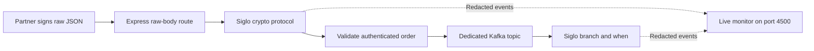

# Accept Asymmetrically Signed Orders

In [Route Kafka Order Events with `branch` and `when`](/kafka-order-routing), a producer published orders directly to Kafka. Now give a partner an HTTP entry point: the partner signs each request with its private key, and your service verifies it with a registered public key before publishing an order event.

This tutorial combines **`@siglo/crypto`**, **`@siglo/express`**, and **`@siglo/monitor`**. Its Kafka consumer repeats the earlier tutorial's standard, gift, and high-value routing decisions. All fulfillment actions are simulated. The example has its own broker, topic, consumer group, keys, and port; it runs independently while the previous tutorials keep running.

The signature authenticates the sender and binds the request bytes to its method and path. It does not encrypt the order. Use HTTPS when deploying this pattern outside localhost.

## 1. Run the Example

You need a repository checkout, Node 22 (22.13+) or Node 24+, a running Docker daemon, and Docker Compose supporting `up --wait`. Run from the repository root:

```bash
npm ci
npm run build --workspace=@siglo/core
npm run build --workspace=@siglo/crypto
npm run build --workspace=@siglo/express
npm run build --workspace=@siglo/kafka
npm run build:ui --workspace=@siglo/monitor
npm run build --workspace=@siglo/monitor
node --import tsx examples/src/signed-order-intake/keys.ts
docker compose -f examples/signed-order-intake/docker-compose.yml up -d --wait
node --import tsx examples/src/signed-order-intake/server.ts
```

Key generation creates a new Ed25519 pair in the ignored `examples/signed-order-intake/.local/` directory. It refuses to overwrite existing keys; skip that command on subsequent starts. If keys were generated with an earlier version of this example, stop the server, remove the two demo PEM files from `.local/`, and generate a new Ed25519 pair. The client reads `client-private.pem`; the server reads only `client-public.pem`. A real partner generates and keeps its private key on its own system and registers only its public key with your service.

Open **http://127.0.0.1:4500** for live monitoring, then send a request from another terminal:

```bash
node --import tsx examples/src/signed-order-intake/client.ts gift
```

The client prints `202` and a receipt containing `eventId`, `orderId`, and `status: "accepted"`. The server logs the same event ID with `status: "shipped"` and actions `reserveStock`, `chargePayment`, `wrapGift`, and `shipOrder` after Kafka delivers it. Acceptance means the broker acknowledged publication; consumer completion happens separately.

| Resource | This example |
|---|---|
| API / health | `http://127.0.0.1:3400/orders` / `/health` |
| Live monitor | `http://127.0.0.1:4500` |
| Kafka broker | `127.0.0.1:39092` |
| Compose project / volume | `siglo-signed-order-intake` / project-scoped `kafka-data` |
| Topic | `signed-order-intake.orders` |
| Consumer group | `signed-order-intake.routing-v1` |
| Client / key ID | `shop-demo` / `shop-demo-key` |

The server binds to localhost. See the [example README](https://github.com/jsoftgem/siglo/blob/main/examples/signed-order-intake/README.md) for its dedicated configuration overrides and cleanup commands.

## 2. Understand the Request Security Pattern

The partner signs requests with its private key. The service authenticates each request through a registered public key before accepting an order:

| Check | Implementation |
|---|---|
| Resolve the signing identity | `resolveClient` reads `keyid` and requires an active registered public key |
| Require the signed request components | The protocol requires method, path, body digest, and the `created`, `keyid`, and `nonce` parameters |
| Check freshness | Reject timestamps outside a ±300-second window |
| Verify body integrity and sender | Compare the raw-body SHA-256 digest and verify the Ed25519 signature |
| Prevent replay | Claim a client-scoped nonce after successful signature verification |

Public-key lookup establishes identity; an unsigned tenant header must not establish identity. The workflow derives the order's tenant from the registered client.

The service claims the nonce **after** signature verification so a forged request cannot consume a legitimate nonce. Its nonce key includes the client identity, so changing signing keys or signing another request with the same nonce does not bypass replay protection.

### Wire Profile and Compatibility

[HTTP Message Signatures (RFC 9421)](https://www.rfc-editor.org/rfc/rfc9421.html) defines signature bases and HTTP signature fields. [Digest Fields (RFC 9530)](https://www.rfc-editor.org/rfc/rfc9530.html) defines `Content-Digest`. This example defines its own restricted **signed-order POST profile** using public standards. The five-minute timestamp window is a tutorial policy. It has the following requirements:

- One signature named `sig1`, with exactly `@method`, `@path`, and `content-digest`, in that order.
- Exactly `created`, `keyid`, and `nonce`, in that order; extra, duplicate, reordered, or malformed parameters are rejected.
- Only `POST /orders`, with no query string or trailing slash.
- SHA-256 for the body digest; Ed25519 for the signature, pinned by the verifier.
- Raw 64-byte Ed25519 signatures encoded with standard Base64, as specified for `ed25519` in RFC 9421.

This custom profile supports only the request shape below. It is not a general RFC 9421 implementation. Integrating another signing client requires agreement on the covered components, parameter order, signature encoding, and original request target.

A request carries headers shaped like:

```text
Content-Digest: sha-256=:<standard-base64-sha256>:
Signature-Input: sig1=("@method" "@path" "content-digest");created=1800000000;keyid="shop-demo-key";nonce="<unique-request-nonce>"
Signature: sig1=:<base64-Ed25519-signature>:
```

The client hashes the exact JSON bytes it sends. The signature base is:

```text
"@method": POST
"@path": /orders
"content-digest": sha-256=:<standard-base64-sha256>:
"@signature-params": ("@method" "@path" "content-digest");created=1800000000;keyid="shop-demo-key";nonce="<unique-request-nonce>"
```

There is no trailing newline. Reserializing JSON can change whitespace or property order and invalidate the digest. Signing the digest binds the body to the signature; an unsigned digest alone would let an attacker replace both body and digest.



## 3. Extend `@siglo/crypto` with a Protocol

`@siglo/crypto` includes HMAC provider presets and a **`WebhookProtocol` extension point** for custom verification, including asymmetric signatures. It has no built-in RFC 9421 provider. The `secret` option accepts the public key for this custom protocol; no shared signing secret is needed.

The integration in [workflow.ts](../examples/src/signed-order-intake/workflow.ts) is:

```typescript
const authenticate = verifyWebhookStep('verifyOrderSignature', {
    provider: (request: SignedRequest) =>
        createRequestProtocol(request, resolveClient(request, keys), nonces, now),
    secret: (request: SignedRequest) => resolveClient(request, keys).publicKey,
    payload: (request: SignedRequest) => request.rawBody,
    signature: (request: SignedRequest) => request.headers,
    maxBodyBytes: 65536,
});
```

`createRequestProtocol` closes over the server-observed HTTP method and original request target, then checks the fixed profile, timestamp, digest, pinned key type/curve, signature, and nonce claim. It uses Node's `node:crypto` implementation for Ed25519. The key ID is an identifier into a trusted registry; the request cannot provide its own public key or a URL to fetch one.

The custom protocol owns timestamp and nonce validation. Do not add `dedupStore` to this step expecting client-scoped nonce protection: the adapter's generic store deduplicates signature material and claims before protocol verification. That differs from the nonce policy required here.

A future-dated signature can remain acceptable for almost twice the clock window after first receipt. The nonce TTL is therefore **601 seconds** for the ±300-second policy. [security.ts](../examples/src/signed-order-intake/security.ts) uses exact expiration times in a single-process store. A production service needs a shared atomic claim store across replicas, retained across restarts; for Redis, for example, use `SET key value NX EX ttl` and reject on store failure.

## 4. Preserve Raw Bytes in `@siglo/express`

The route in [app.ts](../examples/src/signed-order-intake/app.ts) uses `express.raw` before `sigloExpressMiddleware`:

```typescript
app.post('/orders',
    express.raw({ type: 'application/json', limit: '64kb', inflate: false }),
    sigloExpressMiddleware(createIntakeWorkflow(keys, nonces, publish), {
        durable: false,
        input: req => ({
            method: req.method,
            target: req.originalUrl,
            rawBody: req.body ?? Buffer.alloc(0),
            headers: req.headers,
        }),
        output: (result, res) => res.status(202).json(result.receipt),
        // The runnable route also maps authentication and validation errors.
    }),
);
```

Do not mount `express.json()` ahead of this route. Compressed request bodies are rejected, keeping the digest defined over the bytes the example actually accepts. Strict routing rejects the trailing-slash alias; query-bearing requests fail authentication. A proxy must preserve the signed target if this pattern is deployed behind one.

The workflow executes `verifyOrderSignature → validateOrder → publishOrder`. It parses JSON and validates order fields only after authentication. It derives the tenant from the registered client, ignoring body fields and headers claiming a tenant. `durable: false` prevents request-controlled durability and avoids persisting this authentication context as a resumable workflow. The output mapper returns only the receipt, keeping headers and raw body out of the HTTP response. The live monitor redacts raw bodies, request headers, signatures, nonces, and key material. Order identifiers and routing actions remain visible. Revisit the redaction policy before adding new business fields or persistence.

## 5. Publish and Route the Verified Order

The example publishes the same order shape used in the previous tutorial, with a trusted `tenant`, an `event-id` header, an `x-namespace` header, and `orderId` as the Kafka partition key:

```json
{
  "eventId": "partner-event-1001",
  "type": "order.placed",
  "orderId": "order-1001",
  "amountCents": 5000,
  "giftWrap": true
}
```

[server.ts](../examples/src/signed-order-intake/server.ts) starts its own Kafka consumer through `createKafkaMessageHandler`. Its independent [routing flow](../examples/src/signed-order-intake/routing.ts) sends amounts at or above 100,000 cents to review, optionally wraps gifts, and logs the result. There are no imports from the Kafka tutorial and no shared PostgreSQL or Redis services.

The nonce prevents replay of an authenticated HTTP request during its acceptance window. It does **not** deduplicate the same business event sent under a new nonce. Unlike the previous tutorial, this compact consumer has no persistent event deduplication or persisted outcomes. For real payments or fulfillment, retain the previous tutorial's shared event-id policy and make external effects idempotent.

Publication and nonce consumption are separate operations. If publication fails or the HTTP response is lost, a retry needs a new nonce and signature but the same business event ID; it can publish a duplicate event. A shared business idempotency record and transactional outbox are needed when application state and reliable publication must be coordinated. See the earlier tutorial's [delivery guarantees](/kafka-order-routing#8-what-this-example-guarantees).

## 6. Inspect the Live Monitor

The server starts its own dashboard at **http://127.0.0.1:4500**. Both workflows execute in the server process and share an event emitter; no Redis service or separate monitor process is required. `SIGNED_ORDER_MONITOR_PORT` overrides this example's monitor port.

Open the dashboard before running the client:

1. Send `gift` and inspect the HTTP intake run: `verifyOrderSignature → validateOrder → publishOrder`. The crypto step provides verification diagnostics without displaying the signed request material.
2. Find the separate consumer run and inspect `reserveStock`, `chargePayment`, `wrapGift`, and `shipOrder`. The `branch` and `when` graph shows the selected path.
3. Send `review` and inspect `queueReview`; fulfillment stays on the untaken path.
4. Send `tamper` or `expired` and inspect the failed intake. No consumer run should be created for that rejected request.

A successful `gift` request produces **two different DAGs**: the three-step HTTP intake graph and the consumer’s branching fulfillment graph. This is expected. Select the intake run to inspect signature verification, or the consumer run to inspect gift wrapping. The client prints the HTTP intake stack ID to help find it.

HTTP intake and Kafka consumption are separate executions, with separate stack IDs. For accepted requests, use the receipt's event ID and consumer log to identify the order; the monitor does not create a distributed parent-child trace between these runs. Request bodies and headers are redacted, and crypto-containing runs can suppress additional context for privacy.

If you see only consumer graphs, check that the API and dashboard belong to the same server process:

```bash
lsof -nP -iTCP:3400 -sTCP:LISTEN
lsof -nP -iTCP:4500 -sTCP:LISTEN
```

Both ports should show the same PID. Stop older example servers with Ctrl-C in their terminals and start one server again. Wait for `Signed order intake ready` (or HTTP 200 from `/health`) before running the client. A duplicate start now exits with an address-in-use error before starting another consumer or dashboard. Startup failures close any resources already opened.

The wiring in [monitoring.ts](../examples/src/signed-order-intake/monitoring.ts) creates a localhost monitor with remote resumption disabled. The server attaches its emitter to both root workflows and sets it as the default monitor so nested routing targets also report events. Run history is held in memory and clears when the server stops. Stopping the server also closes the dashboard.

## 7. Try Rejection and Replay Cases

Change the client's scenario argument:

| Scenario | HTTP result | Consumer behavior |
|---|---|---|
| `standard` | 202 | Reserve, charge, ship |
| `gift` | 202 | Reserve, charge, wrap, ship |
| `review` | 202 | Review required; no fulfillment |
| `tamper` | 401 | Changed body rejected; no publication |
| `expired` | 401 | Stale timestamp rejected; no publication |
| `replay` | 202, then 401 | Only the first request publishes |

```bash
sh examples/signed-order-intake/smoke.sh
```

The smoke check runs all six clients against the running server and checks HTTP statuses. Accepted responses await Kafka publication. Consumer results appear in the server terminal; the smoke script does not assert consumer completion.

Run the automated security checks without Docker:

```bash
node --import tsx --test examples/src/signed-order-intake/*.test.ts
npx tsc -p examples/signed-order-intake/tsconfig.json
```

The tests use fresh keys and an ephemeral HTTP port. They verify exact-body authentication, unknown/revoked keys, forged signatures, stale and future timestamps, query changes, malformed headers, client-scoped nonce reuse with a new signature, concurrent nonce claims, invalid signed JSON, and suppression of publication after rejection. The routing tests exercise the Kafka adapter with standard, gift, and review orders, including the 100,000-cent boundary and unsupported events. A publication-failure test verifies that broker errors produce a generic 500 response instead of an acceptance receipt. A live-monitor test checks the dashboard and API, nested routing events, rejected intake visibility, redaction of signed request material, and disabled remote resumption. A deterministic clock test checks that a future-dated request's nonce remains claimed throughout its remaining acceptance interval.

## 8. Files and Cleanup

| File | Purpose |
|---|---|
| [security.ts](../examples/src/signed-order-intake/security.ts) | Restricted signature profile, signing client helper, key lookup, verification, nonce store |
| [workflow.ts](../examples/src/signed-order-intake/workflow.ts) | Crypto step, authenticated order validation, publication |
| [app.ts](../examples/src/signed-order-intake/app.ts) | Raw-body route, Express adapter, safe responses |
| [server.ts](../examples/src/signed-order-intake/server.ts) | Dedicated Kafka topic, producer, consumer, and dashboard startup |
| [monitoring.ts](../examples/src/signed-order-intake/monitoring.ts) / [monitoring.test.ts](../examples/src/signed-order-intake/monitoring.test.ts) | Live monitor, redaction, and monitoring checks |
| [routing.ts](../examples/src/signed-order-intake/routing.ts) / [routing.test.ts](../examples/src/signed-order-intake/routing.test.ts) | Independent routing flow and Kafka adapter checks |
| [keys.ts](../examples/src/signed-order-intake/keys.ts) / [client.ts](../examples/src/signed-order-intake/client.ts) | Local key generation and signed request scenarios |
| [security.test.ts](../examples/src/signed-order-intake/security.test.ts) | HTTP and replay-policy checks |
| [docker-compose.yml](../examples/signed-order-intake/docker-compose.yml) | Independent Kafka broker and volume |

Stop the server with Ctrl-C, then stop its broker:

```bash
docker compose -f examples/signed-order-intake/docker-compose.yml down
```

Add `--volumes` to reset this example's Kafka records and offsets. Keys remain in `.local/`. Server restarts clear the demo nonce store, so replay protection across restarts is outside this example's guarantees. Keep production public keys in a controlled registry with activation, revocation, and client authorization checks.

Continue with the [crypto adapter reference](/adapters/crypto) and [Express adapter reference](/adapters/express) for the available integration options.
