# Zero-Code APM Dashboards

In [Route Kafka Order Events with `branch` and `when`](/kafka-order-routing), you published orders to Kafka, let two consumers share the work, and inspected routing decisions in Siglo’s live monitor. Now you’ll use **a separate APM example with its own producer, workers, workflow, PostgreSQL claims, and Redis monitor** to explore traces in Jaeger and metrics in Grafana.

You’ll follow a gift order from publication through Kafka to its selected worker, compare fulfillment with review and cancellation, and distinguish a failed workflow from a successfully quarantined Kafka record. The fulfillment operations remain fake; the Kafka, PostgreSQL, and Redis connections are real. The routing model continues the previous tutorial, while all runnable APM code lives in [`examples/zero-code-apm-dashboards`](../examples/zero-code-apm-dashboards). Neither tutorial imports the other’s application code.

“Zero-code” describes the dashboards: data sources and panels are provisioned automatically. The example includes the tracing setup and workflow instrumentation. Your own application still needs those connections.

## 1. Follow the Telemetry Paths

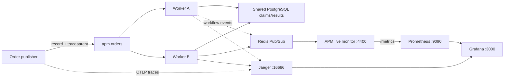

OpenTelemetry carries one event’s trace across the producer and its consumer. Redis carries workflow events from both workers to the shared monitor. Prometheus scrapes that monitor’s metrics over the Docker network, and Grafana queries both backends.

Kafka assigns a record to one worker in the consumer group. A trace normally contains **the publisher and one worker**, not both worker replicas. The selected workflow runs entirely inside that consumer process.

## 2. Start the Independent APM Example

You need the repository checkout and Docker Compose supporting `up --wait`, as in the Kafka tutorial. From the repository root:

```bash
docker compose \
  -f examples/zero-code-apm-dashboards/docker-compose.yml \
  up --build -d --wait
```

This single Compose file starts the dedicated **`siglo-zero-code-apm-dashboards`** project. Its application image, Kafka and PostgreSQL volumes, database, consumer group, topics, Redis channel, and HTTP ports are separate from the Kafka routing tutorial. You can run both tutorials at the same time.

The APM project uses workers on **3400/3401**, its monitor on **4400**, Kafka on **39092**, PostgreSQL on **5436** (`apm_orders`), and Redis on **6383**. Its broker topics are `apm.orders` and `apm.orders.dead-letter`, with consumer group `apm-order-routing-v1` and tenant `apm-demo`. Grafana, Prometheus, Jaeger, and OTLP retain ports **3000, 9090, 16686, and 4317/4318**. Keep these ports available.

| Tool | Address | Purpose |
|---|---|---|
| Grafana APM Overview | [localhost:3000/d/siglo-apm](http://localhost:3000/d/siglo-apm) | Workflow counters, scrape health, trace navigation |
| Grafana Live Workflow Monitoring | [localhost:3000/d/siglo-live-monitoring](http://localhost:3000/d/siglo-live-monitoring) | Duration, throughput, active workflows, retries |
| Jaeger | [localhost:16686](http://localhost:16686) | Producer-to-worker traces and step spans |
| Prometheus targets | [localhost:9090/targets](http://localhost:9090/targets) | Check `siglo-monitor` is `UP` |
| APM Siglo monitor | [127.0.0.1:4400](http://127.0.0.1:4400) | Routing graph, context, and workflow history |
| Workflow metrics | [127.0.0.1:4400/metrics](http://127.0.0.1:4400/metrics) | Metrics aggregated from both workers |
| Shared outcomes | [127.0.0.1:3400/results](http://127.0.0.1:3400/results) | Persisted actions and handling worker |

Sign in to Grafana with **`admin` / `admin`** and dismiss its password-change prompt or choose a local password. Open **Dashboards → Siglo APM** to find the provisioned dashboards.

### Find the Dashboards and Metrics

1. Open [Grafana](http://localhost:3000), sign in, and select **Dashboards** in the left sidebar.
2. Open the **Siglo APM** folder. It contains **siglo Workflow APM Overview** and **Siglo - Live Workflow Monitoring**.
3. Start with **siglo Workflow APM Overview**. Use its top **Workflow metrics** link to reach the duration, throughput, and counter panels. **Worker A traces** and **Worker B traces** open Jaeger filtered to that replica.

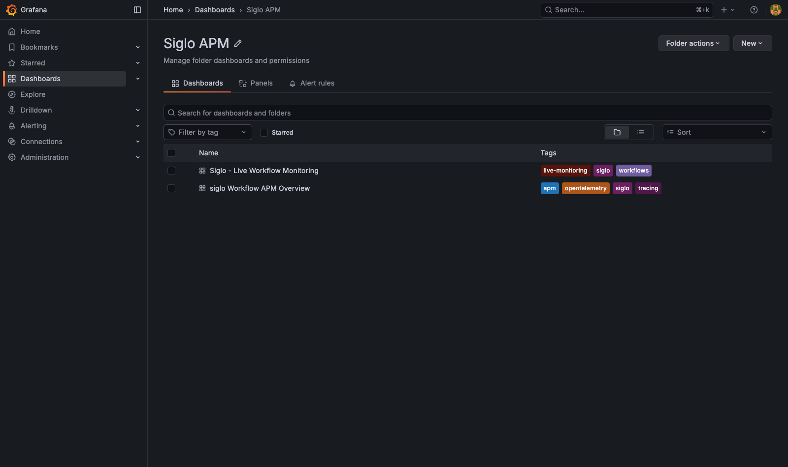

The overview below focuses on the publisher and the two Kafka workers. Its top links stay visible above the panels; **Prometheus targets** checks collection health, while **Live monitor** opens this tutorial’s routing graph on port 4400.

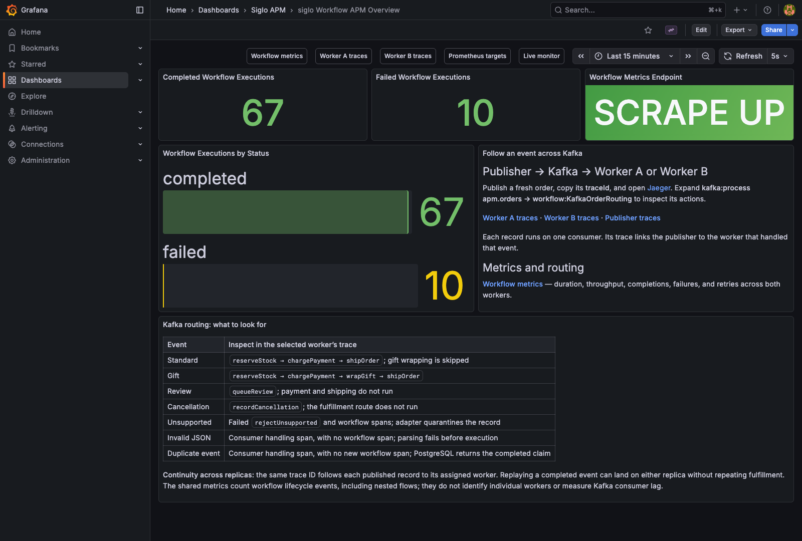

The stack pins Jaeger **2.20.0** to retain compatibility with this Grafana data source’s legacy query API. See the [Jaeger v2 setup guide](https://www.jaegertracing.io/docs/2.20/getting-started/). Upgrade Jaeger and its Grafana data source together, verifying service search as well as ingestion. APM storage is ephemeral; Kafka and PostgreSQL retain this APM example’s own named volumes.

## 3. Follow a Gift Order Across Kafka

Publish using this tutorial’s own CLI:

```bash
docker compose \
  -f examples/zero-code-apm-dashboards/docker-compose.yml \
  exec worker-a node --import tsx examples/zero-code-apm-dashboards/src/order-routing/publish.ts gift
```

The publisher prints its generated `eventId`, Kafka metadata, and **`traceId`**. Running the producer in worker A’s container does not choose the consumer; either replica can handle the record. The CLI initializes its own telemetry service, **`kafka-order-publisher`**.

Allow several seconds for the workers’ batch exporters to send spans. In Jaeger, select `kafka-order-publisher`, click **Find Traces**, and open the trace. You can also paste the printed trace ID into Jaeger’s trace-ID search or open `http://localhost:16686/trace/<traceId>`.

Expand the spans:

```text
kafka:publish apm.orders                  kafka-order-publisher
└── kafka:process apm.orders              worker-a OR worker-b
    └── workflow:KafkaOrderRouting
        ├── step:branch
        │   └── routing/combinator spans and selected actions
        │       reserveStock → chargePayment → wrapGift → shipOrder
        └── step:saveOutcome
```

The exact nesting includes the selected combinator actions. The standard and gift screenshots show the `step:when` spans inside `step:branch`, including the nested gift-wrapping condition. Untaken branches do not produce action spans: a standard order still has the condition's `step:when` span, but no `step:wrapGift`. The producer span covers the Kafka send acknowledgement; it can finish before the consumer starts. The consumer span covers adapter handling, including PostgreSQL deduplication and validation, while the workflow span covers the workflow itself.

Find `wrapGift` and `shipOrder`, then inspect `saveOutcome`. The workflow carries `siglo.workflow.name = KafkaOrderRouting`; step spans carry `siglo.step.name` and `siglo.step.attempt`. These fake operations can finish in milliseconds or less, so zoom into the trace rather than expecting artificial delays.

Read `/results`, find the printed event ID, and compare `handledBy` with the service name on the consumer span. Open the same run in the live monitor to inspect its green routing paths and context. The original [Kafka tutorial’s screenshots](/kafka-order-routing#4-walk-through-the-decisions-in-the-live-monitor) show those decisions.

## 4. Compare Routing and Failure Outcomes

Repeat the publisher command, changing its final argument:

| Scenario | Selected actions | Trace and metrics interpretation |
|---|---|---|
| `standard` | Reserve, charge, ship | No `wrapGift` action span; successful workflow |
| `gift` | Reserve, charge, wrap, ship | Optional gift step runs; successful workflow |
| `review` | `queueReview`, then save | No payment or shipping; completes with `review-required` |
| `cancel` | `recordCancellation`, then save | A different event branch; successful workflow |
| `unsupported` | `rejectUnsupported` | Failed workflow with an exception; adapter publishes a dead letter |
| `invalid` | None | JSON parsing fails before a workflow starts; adapter publishes a dead letter |

For example:

```bash
docker compose \
  -f examples/zero-code-apm-dashboards/docker-compose.yml \
  exec worker-a node --import tsx examples/zero-code-apm-dashboards/src/order-routing/publish.ts unsupported

curl -s http://127.0.0.1:3400/dead-letters
```

In its trace, `workflow:KafkaOrderRouting` and `step:rejectUnsupported` have error status. Inspect the exception event for `Unsupported event type: order.refunded`. The outer **consumer span can still be OK**: the adapter successfully quarantined the record and returned normally. That means record handling finished, not that fulfillment succeeded.

For `invalid`, expect producer and consumer spans, but **no workflow or business-step spans**. The metrics for executed workflows do not count malformed input rejected before execution. Check `/dead-letters` or the real dead-letter topic for the rejected record; see [the Kafka tutorial’s dead-letter walkthrough](/kafka-order-routing#6-unsupported-events-invalid-input-and-dead-letters).

Review is a completed decision, not a suspended workflow. Cancellation records a request; it does not refund a previous payment.

### Standard: Worker A Ships Without Gift Wrapping

This captured event was consumed by **worker-a**. Its trace continues from `kafka-order-publisher` into `kafka:process apm.orders`, the workflow, and the selected fulfillment actions. `shipOrder` is expanded; `wrapGift` is absent.

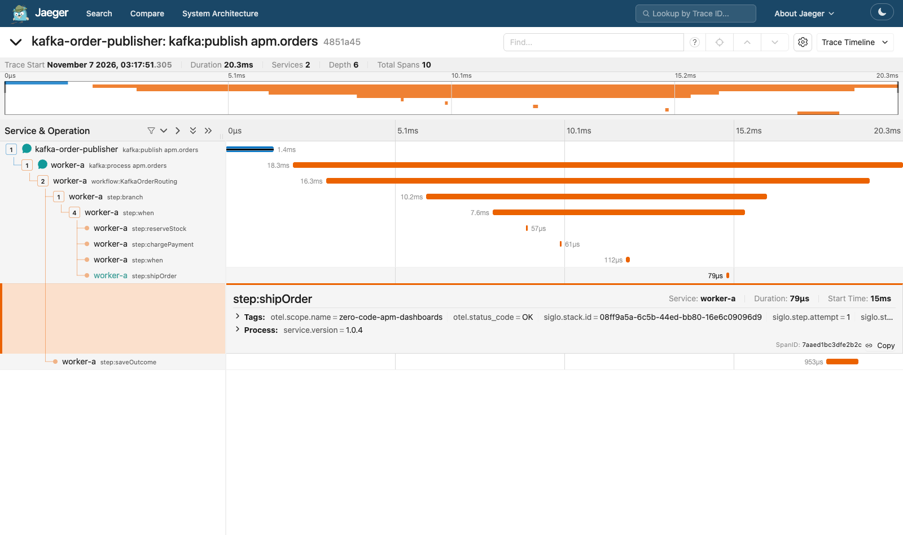

### Gift: Worker B Takes the Optional Step

This event was consumed by **worker-b**. `wrapGift` appears between payment and shipping, and its expanded details show the worker service and attempt number. Compare the service labels with the standard-order screenshot: separate records can run on different replicas while each retains its own producer-to-consumer trace.

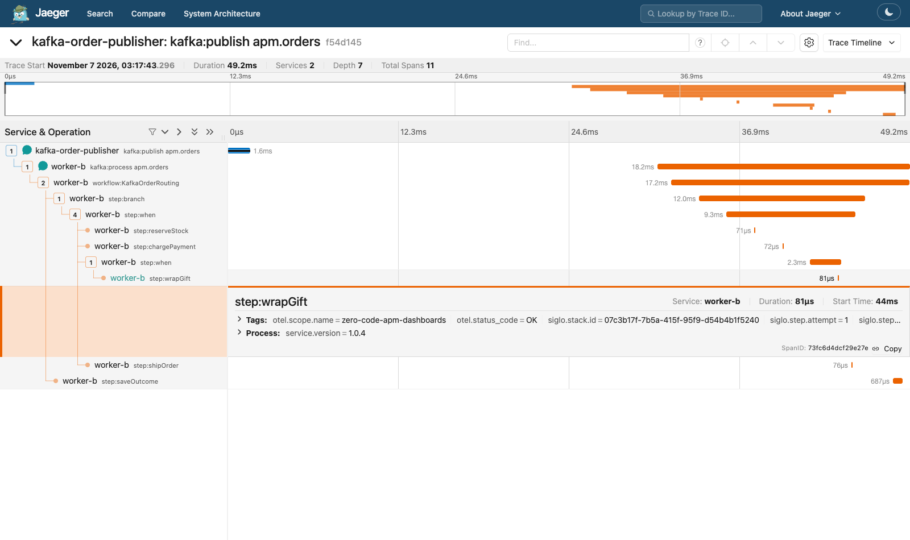

### Review: Complete the Review Decision

The selected path runs `queueReview` and `saveOutcome`. Payment and shipping spans are absent. This workflow completes its review decision; it does not wait for approval.

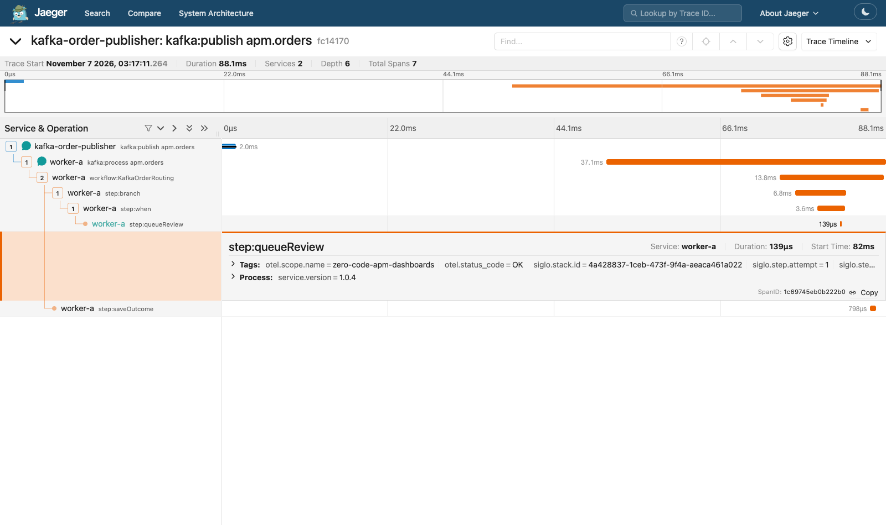

### Cancellation: Select the Cancellation Branch

The record goes through `recordCancellation` and then persists its result. Its trace contains no inventory, payment, gift-wrapping, or shipping actions.

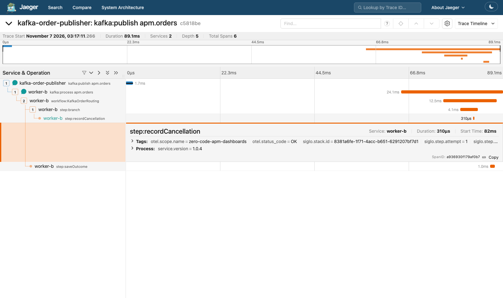

### Unsupported: Inspect the Workflow Error

The red error indicators identify the failed workflow, branch, and `rejectUnsupported` action. The expanded span shows `otel.status_code = ERROR` and the exception message **Unsupported event type: order.refunded**. The outer consumer span succeeds after the adapter publishes the dead letter.

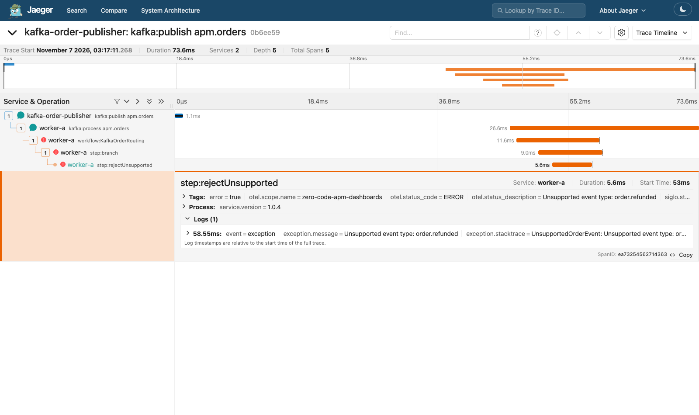

### Invalid JSON: Handling Without a Workflow

Only the publisher and consumer spans exist: **Total Spans 2**. The consumer’s expanded details show the Kafka partition and offset. There is no `workflow:KafkaOrderRouting` child because parsing failed first. Check `/dead-letters` for the rejection; an OK consumer span means quarantine completed, not that the input was valid.

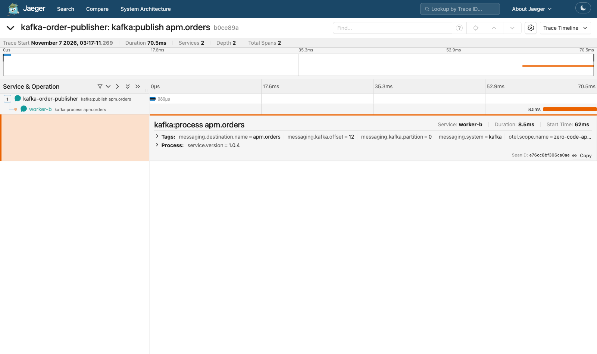

These screenshots come from real records sent through the Docker example. Trace IDs, timings, counters, and the worker assigned to each new record will differ on your machine. The screenshots deliberately include events handled by both replicas.

## 5. Read the Grafana Metrics

The dedicated stack uses [`prometheus.kafka.yml`](../examples/zero-code-apm-dashboards/prometheus.kafka.yml) to scrape **`monitor:4000/metrics`** inside Docker. Port 4400 is its host mapping. The original routing tutorial’s monitor on port 4300 is not part of this scrape configuration.

Prometheus scrapes every five seconds. After publishing, wait about 15 seconds for counters to appear. Publish fresh events over at least a minute to make the rate charts useful.

Open [Siglo - Live Workflow Monitoring](http://localhost:3000/d/siglo-live-monitoring) directly, or click **Workflow metrics** at the top of the overview. The screenshot shows completed and failed workflow counters above the duration and throughput charts. **Active Workflows = 0** and **Step Retries Total = 0** are expected between these short, non-retrying runs.

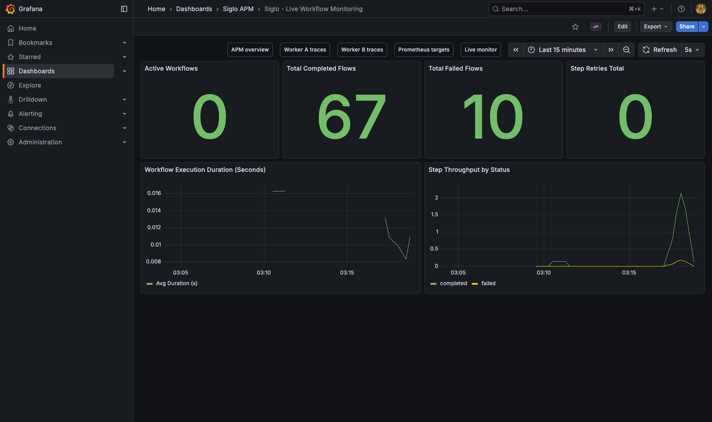

If these panels are empty, use the top **Prometheus targets** link. Expand **siglo-monitor** and verify the endpoint is **UP**. Its endpoint is `http://monitor:4000/metrics` inside Docker; the browser-facing equivalent is [127.0.0.1:4400/metrics](http://127.0.0.1:4400/metrics).

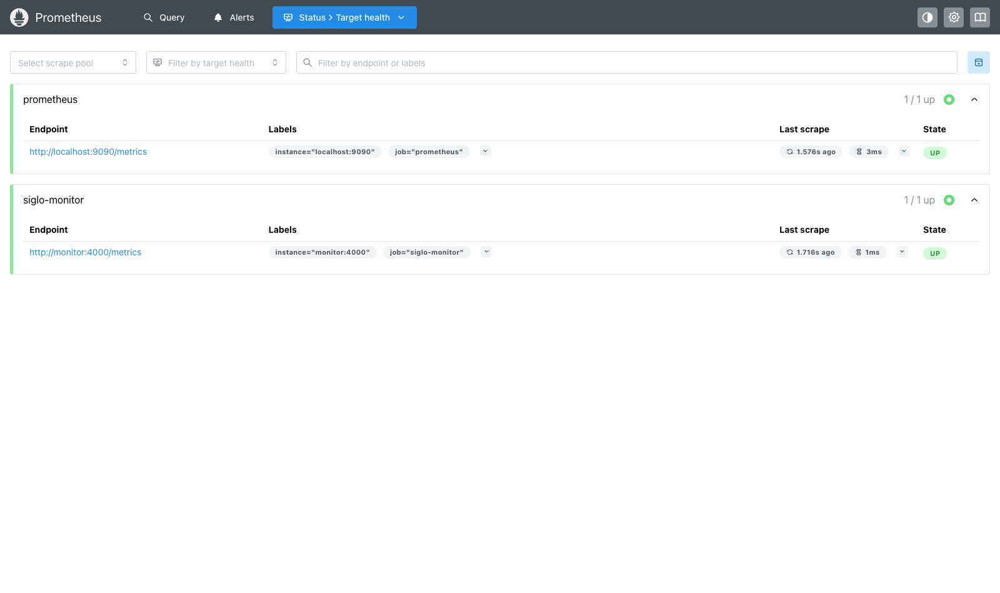

**siglo Workflow APM Overview** shows completed and failed workflow executions, metrics endpoint availability, and executions by status. Use its **Worker A traces** / **Worker B traces** navigation links or **Explore → Jaeger** to search `kafka-order-publisher`, `worker-a`, or `worker-b`.

**Siglo - Live Workflow Monitoring** shows active flows, completions, failures, step retries, average duration, and step throughput. Interpret its panels with the runtime’s scope in mind:

- Nested flows can emit their own lifecycle events. Aggregate workflow counters count those executions too; they are not a Kafka record counter.
- Invalid JSON never starts a workflow. A failed unsupported-event workflow still counts as failed after its record reaches the dead-letter topic.
- `siglo_step_retries_total` counts **Siglo step retries**, not Kafka redeliveries or adapter-level workflow retries. The normal routing scenarios do not retry steps, so zero is expected.
- Active workflows may read zero between scrapes because the fake operations finish quickly.
- Average duration uses `rate(siglo_flow_duration_seconds_sum[...]) / rate(siglo_flow_duration_seconds_count[...])`. It is an aggregate average, not a percentile or a per-worker breakdown.
- Counters reset when the shared monitor restarts. Redis Pub/Sub does not replay historical events. Grafana’s time selector does not turn a cumulative counter into a count for that interval.
- **SCRAPE UP** confirms that Prometheus can scrape the monitor; it doesn’t prove traces reached Jaeger.

Useful Prometheus queries are `up{job="siglo-monitor"}`, `siglo_flows_total`, and `siglo_step_retries_total`. Use Kafka-specific tooling for consumer lag and PostgreSQL results for persisted business outcomes; these dashboards do not supply those measures.

## 6. Observe a Deduplicated Event

Publish a standard order with explicit IDs:

```bash
docker compose \
  -f examples/zero-code-apm-dashboards/docker-compose.yml \
  exec worker-a node --import tsx examples/zero-code-apm-dashboards/src/order-routing/publish.ts standard apm-replay-1001 apm-order-1001
```

Wait until `apm-replay-1001` appears in `/results`. Run exactly the same command again and inspect the **second** printed trace ID.

The second send has a new Kafka offset and a new producer trace. Its consumer span covers the adapter’s completed PostgreSQL claim lookup, but it has **no `workflow:KafkaOrderRouting` child** because the adapter returns the cached outcome. The persisted result’s `executions` stays at one, and no new workflow run appears in the live monitor.

The replay below has just the producer and consumer spans, with the consumer’s Kafka offset expanded. Compare it with the standard-order screenshot’s full workflow. Both invalid input and a completed duplicate can have two-span traces; use the dead-letter audit and persisted outcome to distinguish their meanings.

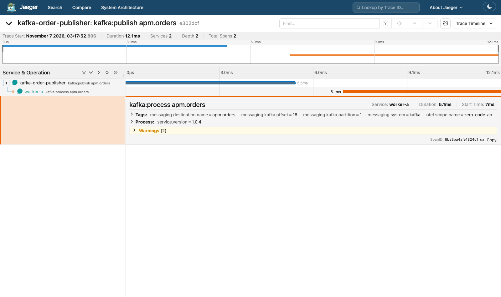

Use fresh event IDs when repeating the tutorial. A completed event ID represents the original event, not permission to change its payload and execute it again. To verify deduplication after both APM workers restart, run `sh examples/zero-code-apm-dashboards/smoke.sh`. It uses only this tutorial’s stack and its own smoke-test state file.

## 7. Inspect the Instrumentation

| File | What it connects |
|---|---|
| [telemetry.ts](../examples/zero-code-apm-dashboards/src/order-routing/telemetry.ts) | Optional Node OpenTelemetry provider, batch OTLP export, and consumer span around adapter handling |
| [publish.ts](../examples/zero-code-apm-dashboards/src/order-routing/publish.ts) | Producer span, W3C header injection, printed trace ID, flush on CLI shutdown |
| [worker.ts](../examples/zero-code-apm-dashboards/src/order-routing/worker.ts) | Per-replica telemetry, extracted Kafka headers, traced handler, SDK shutdown |
| [workflow.ts](../examples/zero-code-apm-dashboards/src/order-routing/workflow.ts) | Workflow definition and automatic nested execution tracing via `instrumentWorkflow` |
| [monitor.ts](../examples/zero-code-apm-dashboards/src/order-routing/monitor.ts) | This tutorial’s shared Redis monitor and `/metrics` endpoint |
| [docker-compose.yml](../examples/zero-code-apm-dashboards/docker-compose.yml) | Dedicated Kafka, PostgreSQL, Redis, workers, monitor, and APM services |

The CLI initializes a provider before sending. `publishScenario` creates a producer span and injects its context into the Kafka headers. The worker extracts that context, starts a consumer span, and runs `createKafkaMessageHandler` inside it. `instrumentWorkflow` establishes execution hooks that automatically trace every executed step—including nested flows, `branch`, `when`, and concurrent operations—without requiring explicit child step instrumentation.

The worker enables telemetry when an OTLP endpoint is configured and export is not disabled with `OTEL_TRACES_EXPORTER=none`. This tutorial’s Compose file supplies the endpoint. The original Kafka routing tutorial has no APM wrapper or exporter. The exporter is created in its own Node.js async resource at SDK startup. This keeps background batch exports outside a business step’s inherited network policy without changing that step’s permissions. The worker shutdown path disconnects the consumer before flushing its telemetry provider. The HTTP `/events` publisher also uses tracing when enabled; its publish span belongs to the worker service, and the endpoint itself is not automatically HTTP-instrumented.

To use an external collector, configure `OTEL_EXPORTER_OTLP_ENDPOINT` and any `OTEL_EXPORTER_OTLP_HEADERS` on the publishing and consuming processes. A base endpoint gets `/v1/traces` appended; `OTEL_EXPORTER_OTLP_TRACES_ENDPOINT` supplies an exact trace URL and takes precedence. See [OpenTelemetry exporter configuration](https://opentelemetry.io/docs/languages/sdk-configuration/otlp-exporter/). This example uses OTLP/HTTP JSON; choose a compatible receiver. Moving trace export does not move the Prometheus metrics.

## 8. Verify and Troubleshoot

After installing repository dependencies and building the core, Kafka, and OpenTelemetry packages, run the routing and tracing checks without Docker:

```bash
node --import tsx --test \
  examples/zero-code-apm-dashboards/src/order-routing/workflow.test.ts \
  examples/zero-code-apm-dashboards/src/order-routing/telemetry.test.ts
```

They verify selected actions, errors, validation, Kafka header propagation, shared trace IDs, parent relationships, the absence of workflow spans for invalid JSON, and OTLP export without inheriting a step’s network restrictions.

This tutorial’s integration smoke check verifies real Kafka delivery, persisted outcomes, dead letters, Redis monitoring, and deduplication after restarting both workers:

```bash
sh examples/zero-code-apm-dashboards/smoke.sh
```

| Symptom | Check |
|---|---|
| No `traceId` in publisher output | Use this tutorial’s Compose file, rebuild its image, and confirm the OTLP endpoint is set inside the publishing process. |
| Jaeger has only a producer span | Wait for worker batch export, check worker health/logs, and confirm the consumed event is fresh. |
| Consumer span has no workflow child | Check whether the event was deduplicated or rejected before execution. |
| Grafana shows no data | Check `http://127.0.0.1:4400/metrics` and the Prometheus `siglo-monitor` target; confirm this tutorial’s APM stack is running. |
| Rate charts are empty | Publish fresh events over a minute or longer. A quiet example has no recent throughput. |
| Data source connects but trace service search fails after an upgrade | Verify the Jaeger query API and Grafana data source versions are compatible. |
| APM ports are occupied | Check for another process using an APM port, or adjust this tutorial’s host ports and browser links together. |

Inspect logs with this tutorial’s Compose file, replacing `up --build -d --wait` with `logs --tail=100 worker-a worker-b jaeger prometheus grafana`.

Stop the example, including its APM services, with:

```bash
docker compose \
  -f examples/zero-code-apm-dashboards/docker-compose.yml \
  down
```

Kafka and PostgreSQL data survive `down`; add `--volumes` only when intentionally resetting this APM example. The original routing example’s volumes are separate. The APM services use ephemeral storage, and the live monitor’s history is held in memory.
