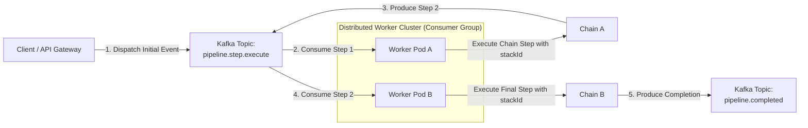
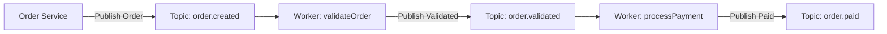
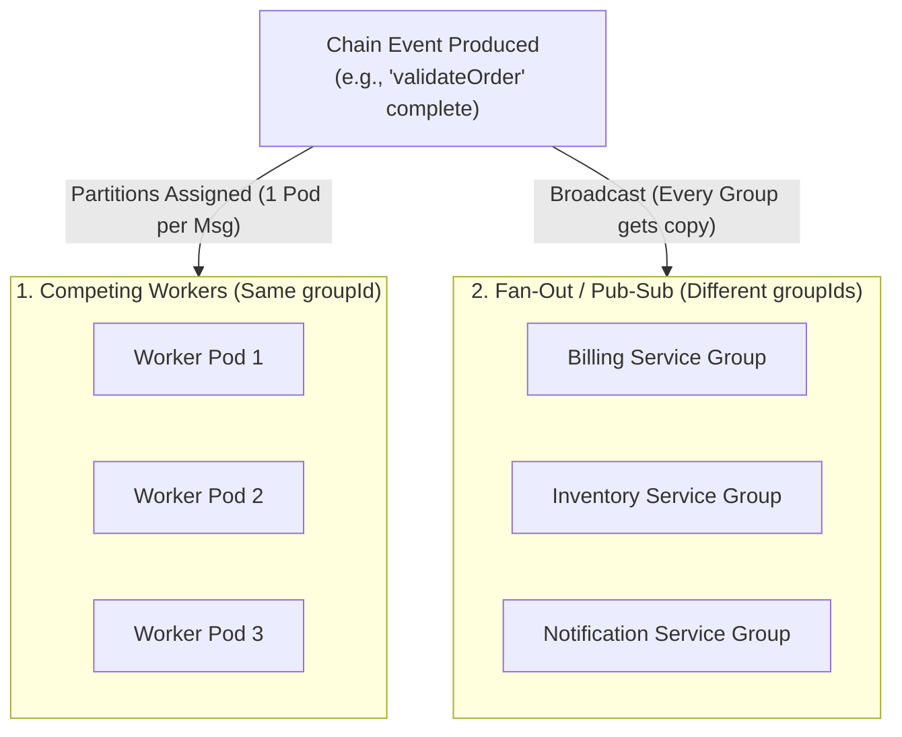
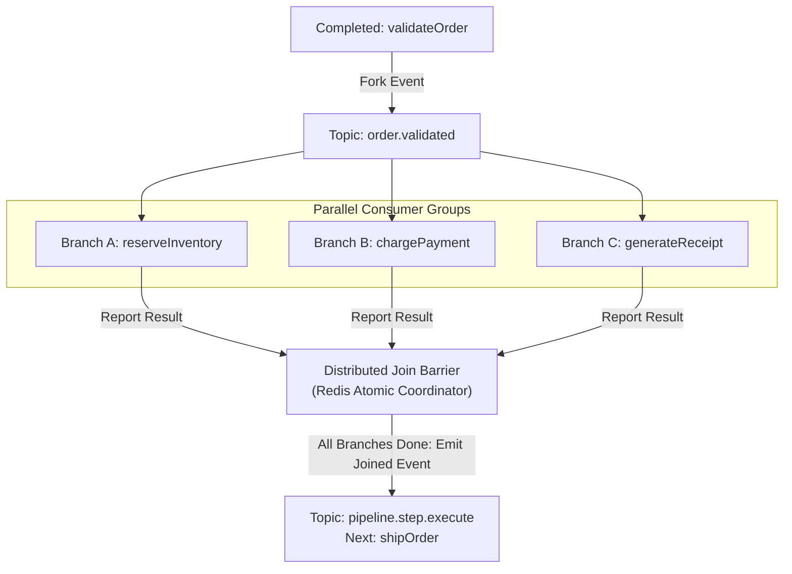

# Event-Driven Distributed Pipelines with fluid-func & Apache Kafka

A guide and reference architecture for transforming **`fluid-func`** into an event-driven, horizontally scalable workflow engine distributed via Apache Kafka.

---

## 1. Executive Summary

`fluid-func` operates by default as an in-memory asynchronous pipeline orchestrator using `Runner`, `ArrayChain`, and `SingleChain`. Because `fluid-func` enforces:
1. **Discrete, Isolated Steps (`Chain`)** with explicit inputs and outputs,
2. **Unified Execution Tracing (`stackId`)** across all steps in a sequence, and
3. **Pluggable Storage Hooks (`setPutChainContextPlugin`, `StorageManager`)**,

the engine is naturally positioned to run in a distributed, event-driven architecture where step execution is decoupled across multiple microservice workers using Kafka as the messaging backbone.

---

## 2. Architectural Patterns

There are two primary patterns for distributing `fluid-func` execution with Kafka:

### Pattern A: Distributed Step-Worker (Routing Slip / Orchestrated Bus)
In this pattern, Kafka acts as the distributed job coordinator. A pipeline is dispatched as an event containing the step list and context payload. Any worker in the consumer group picks up the event, executes the current step using `fluid-func`, and produces the next step event back to Kafka.



#### Advantages:
- **Zero Idle Resources**: Any idle worker node can pick up any step.
- **Dynamic Pipelines**: Different step sequences can be defined dynamically by the initiator.
- **Unified Consumer Logic**: Workers share standard runner/executor logic.

---

### Pattern B: Event Choreography (Topic-per-Chain)
In this pattern, each distinct `Chain` step or business domain is bound to its own Kafka topic (e.g. `orders.created` $\rightarrow$ `orders.validated` $\rightarrow$ `orders.billed`).



#### Advantages:
- **Domain Decoupling**: Each service only cares about its input events and output events.
- **Granular Autoscaling**: Scale consumers specifically for heavy/slow steps (e.g. video processing, LLM generation) using KEDA or Kubernetes HPA.

---

## 3. The `stackId` Continuity Problem & Solutions

> [!WARNING]
> Calling `const stepResult = await chain.execute(contextPayload)` inside a distributed worker will invoke `Runner.start()`, which internally calls `this.createExecutionStack()` to generate a **brand new `stackId`** and calls `this.deleteStack(stackId)` upon step completion.
>
> If this happens on each worker:
> 1. The original distributed `stackId` from the Kafka event is **lost**.
> 2. Each step runs in an isolated, disconnected stack (`stack_1`, `stack_2`, `stack_3`).
> 3. External storage plugins (`setPutChainContextPlugin` with Redis/MongoDB) and OpenTelemetry spans lose trace continuity.

To preserve the distributed `stackId` across Kafka workers, you have two approaches:

### Approach 1: Native Engine Support (`ExecutionOptions.stackId`)
Enhance `ExecutionOptions` and `Runner` to accept an existing `stackId` and a `preserveStack` flag:

```typescript
// In fluid-func ExecutionOptions
export interface ExecutionOptions {
    signal?: AbortSignal;
    stackId?: string;        // Injected distributed stackId from Kafka
    preserveStack?: boolean; // Avoid deleting stack until pipeline completion
}

// In Runner.start():
const stackId = effectiveOptions?.stackId || this.createExecutionStack();
// ...
// On completion:
if (!effectiveOptions?.preserveStack) {
    this.deleteStack(stackId);
}
```

With this option, the worker simply executes:
```typescript
const stepResult = await chain.execute(contextPayload, {
    stackId,
    preserveStack: remainingChains.length > 0 // Only delete stack on final step
});
```

---

### Approach 2: Distributed Step Executor Adapter
If using the current `fluid-func` without modifying the core library, create a lightweight `DistributedStepExecutor` that runs a single chain step with the explicit `stackId`:

```typescript
import Context from "fluid-func/context";
import { getChain, addChainToStack } from "fluid-func/storage";
import { StartChain, Reducer, Util, propertyToContext } from "fluid-func/executer";
import { cache } from "fluid-func/cache";
import { logInfo, logError } from "fluid-func/logger";
import { executeBefore, executeAfter } from "fluid-func/plugins";
import { generateUUID } from "fluid-func/shared";

export class DistributedStepExecutor {
    static async executeStep(
        chainNameOrInstance: string | any,
        contextPayload: Record<string, any>,
        stackId: string,
        options?: { signal?: AbortSignal }
    ): Promise<Record<string, any>> {
        const chain = typeof chainNameOrInstance === "string"
            ? getChain(chainNameOrInstance)
            : chainNameOrInstance;

        if (!chain) {
            throw new Error(`Chain "${chainNameOrInstance}" not found.`);
        }

        // Convert incoming payload to fluid-func Context bound to the distributed stackId
        const newParam = Util.convertToContextStructure(
            contextPayload,
            Context,
            generateUUID,
            stackId
        );
        addChainToStack(stackId, newParam.$chainId());

        if (options?.signal) {
            newParam.$signal = () => options.signal;
            newParam.signal = () => options.signal;
        }

        const singleChain = new StartChain(
            getChain,
            Context,
            propertyToContext,
            Reducer,
            addChainToStack,
            stackId,
            cache,
            logInfo,
            logError,
            executeAfter,
            executeBefore
        );

        return await singleChain.start(newParam, chain, options);
    }
}
```

---

## 4. Implementation Blueprint: Distributed Step-Worker

Below is the complete implementation incorporating `stackId` preservation.

### 4.1. Step Event Envelope

```typescript
export interface KafkaPipelineStepEvent {
    /** Unique ID identifying the entire pipeline execution across all distributed steps */
    stackId: string;
    /** Logical workflow identifier */
    pipelineId: string;
    /** Current chain step to execute */
    currentChainName: string;
    /** Remaining steps to be executed downstream */
    remainingChains: string[];
    /** Accumulated context payload (or pointer to storage) */
    contextPayload: Record<string, any>;
    /** Retry attempt count for this specific step */
    retryCount?: number;
    /** Epoch timestamp when event was produced */
    timestamp: number;
}
```

---

### 4.2. Distributed Kafka Runner (Dispatcher / Producer)

```typescript
import { Producer } from "kafkajs";
import { generateUUID } from "fluid-func";
import { KafkaPipelineStepEvent } from "./types";

export class KafkaRunner {
    constructor(
        private producer: Producer,
        private topic: string = "pipeline.step.execute"
    ) {}

    /**
     * Dispatches a chain sequence to Kafka
     * @param chains Array of registered chain step names
     * @param initialParam Starting input payload
     * @returns The execution stackId
     */
    async dispatch(chains: string[], initialParam: Record<string, any>): Promise<string> {
        if (!chains || chains.length === 0) {
            throw new Error("At least one chain step must be specified.");
        }

        const stackId = generateUUID();
        const [currentChainName, ...remainingChains] = chains;

        const event: KafkaPipelineStepEvent = {
            stackId,
            pipelineId: generateUUID(),
            currentChainName,
            remainingChains,
            contextPayload: initialParam,
            retryCount: 0,
            timestamp: Date.now()
        };

        await this.producer.send({
            topic: this.topic,
            messages: [
                {
                    key: stackId, // Route by stackId to maintain partition affinity
                    value: JSON.stringify(event)
                }
            ]
        });

        return stackId;
    }
}
```

---

### 4.3. Distributed Step Worker (Consumer & Execution)

The worker consumes step messages from Kafka, preserves the `stackId`, runs the step, and forwards the updated context:

```typescript
import { Consumer, Producer } from "kafkajs";
import { Chain } from "fluid-func";
import { KafkaPipelineStepEvent } from "./types";
import { DistributedStepExecutor } from "./DistributedStepExecutor";

export class KafkaStepWorker {
    constructor(
        private consumer: Consumer,
        private producer: Producer,
        private stepTopic: string = "pipeline.step.execute",
        private completedTopic: string = "pipeline.completed",
        private dlqTopic: string = "pipeline.dlq"
    ) {}

    async start(): Promise<void> {\
        await this.consumer.subscribe({ topic: this.stepTopic, fromBeginning: false });

        await this.consumer.run({
            eachMessage: async ({ message }) => {
                if (!message.value) return;

                const event: KafkaPipelineStepEvent = JSON.parse(message.value.toString());
                const { stackId, currentChainName, remainingChains, contextPayload } = event;

                try {
                    // 1. Execute step while preserving the distributed stackId
                    // Using DistributedStepExecutor (or chain.execute with stackId option)
                    const stepResult = await DistributedStepExecutor.executeStep(
                        currentChainName,
                        contextPayload,
                        stackId
                    );

                    // 2. Merge context: Context accumulation
                    const updatedContext = { ...contextPayload, ...stepResult };

                    // 3. Dispatch next step or emit completion
                    if (remainingChains.length > 0) {
                        const [nextChain, ...nextRemaining] = remainingChains;
                        const nextEvent: KafkaPipelineStepEvent = {\
                            ...event,
                            currentChainName: nextChain,
                            remainingChains: nextRemaining,
                            contextPayload: updatedContext,
                            retryCount: 0,
                            timestamp: Date.now()
                        };

                        await this.producer.send({
                            topic: this.stepTopic,
                            messages: [
                                {
                                    key: stackId,
                                    value: JSON.stringify(nextEvent)
                                }
                            ]
                        });
                    } else {
                        // Pipeline completed!
                        await this.producer.send({
                            topic: this.completedTopic,
                            messages: [
                                {
                                    key: stackId,
                                    value: JSON.stringify({
                                        stackId,
                                        result: updatedContext,
                                        status: "SUCCESS",
                                        completedAt: Date.now()
                                    })
                                }
                            ]
                        });
                    }
                } catch (error: any) {\
                    // Handle failure: publish to Dead Letter Queue (DLQ)
                    await this.producer.send({
                        topic: this.dlqTopic,
                        messages: [
                            {
                                key: stackId,
                                value: JSON.stringify({
                                    stackId,
                                    failedAt: currentChainName,
                                    error: error?.message || error,
                                    event,
                                    failedAtTimestamp: Date.now()
                                })
                            }
                        ]
                    });
                }
            }
        });
    }
}
```

---

## 5. Multiple Consumers: Competing Workers, Fan-Out, & Fork-Join Solutions

When multiple consumers subscribe to the same `Chain` topic or event stream, the architecture faces three primary configurations, each with its own concurrency, synchronization, and duplicate execution challenges.



---

### 5.1. Solution 1: Horizontal Scaling with Competing Consumers (Same Consumer Group)

When scaling out worker pods belonging to the **same consumer group** (`groupId`):

#### 1. Partition Affinity via `stackId` Keying
To prevent concurrent race conditions where two steps of the same pipeline execute out of order on different pods, producers **must** set the Kafka message `key` to `stackId` (or an entity key like `orderId`):
$$\text{Partition} = \text{murmur2}(\text{stackId}) \pmod{N_{\text{partitions}}}$$

* All events for a specific pipeline execution stream strictly into the **same partition**.
* Kafka guarantees that a partition is consumed by **exactly one** worker pod within a consumer group at any given time.
* This yields strict, sequential, FIFO execution per pipeline without distributed locks.

#### 2. Partition Sizing & Autoscaling Limits
* A consumer group cannot process a topic faster than its partition count. If you have 3 partitions and 10 worker pods, 7 pods will remain idle.
* **Guideline**: Size topic partitions to match or exceed peak worker replica count (e.g., 16, 32, or 64 partitions).

#### 3. Cooperative Sticky Assignor (Zero-Downtime Rebalancing)
By default, standard consumer rebalancing stops the world (Eager Rebalance Protocol). During autoscaling (HPA) or rolling deployments, all pods halt step processing.
Use KafkaJS's `CooperativeStickyAssignor` to allow healthy pods to keep processing chains while new pods join:

```typescript
import { Kafka, PartitionAssigners } from "kafkajs";

const kafka = new Kafka({ clientId: "pipeline-worker", brokers: ["localhost:9092"] });

export const consumer = kafka.consumer({
    groupId: "fluid-func-step-workers",
    // Prevents stop-the-world rebalance during autoscaling
    partitionAssigners: [PartitionAssigners.cooperativeSticky],
    sessionTimeout: 30000,
    heartbeatInterval: 3000,
    maxPollInterval: 300000 // 5 minutes for long-running chain steps
});
```

---

### 5.2. Solution 2: Fan-Out & Parallel Branching (Distributed Fork-Join)

In complex pipelines, a single chain execution needs to **fork** into multiple parallel chains executed by different consumer groups, and optionally **join** back together before continuing downstream.



#### The Concurrency Challenge:
If three branches run concurrently for the same `stackId`, writing back uncoordinated payloads will overwrite each other's context mutations (Lost Updates).

#### The Solution: The `DistributedJoinBarrier`
A Redis-backed join coordinator using an atomic Lua script to track branch completion:

```typescript
import Redis from "ioredis";
import { Producer } from "kafkajs";

export interface ForkJoinEnvelope {
    stackId: string;
    pipelineId: string;
    nextChainAfterJoin: string;
    remainingChainsAfterJoin: string[];
    expectedBranches: string[];
    contextPayload: Record<string, any>;
}

export class DistributedJoinBarrier {
    private redis: Redis;

    constructor(
        redisClient: Redis,
        private producer: Producer,
        private stepTopic: string = "pipeline.step.execute"
    ) {
        this.redis = redisClient;
    }

    /**
     * Initializes the barrier in Redis before dispatching parallel branch tasks
     */
    async initializeBarrier(envelope: ForkJoinEnvelope): Promise<void> {
        const { stackId, expectedBranches, contextPayload } = envelope;
        const key = `barrier:${stackId}`;

        await this.redis
            .multi()
            .hset(key, "totalBranches", expectedBranches.length)
            .hset(key, "completedCount", 0)
            .hset(key, "baseContext", JSON.stringify(contextPayload))
            .hset(key, "envelope", JSON.stringify(envelope))
            .expire(key, 86400) // 24 hours TTL
            .exec();
    }

    /**
     * Called by each parallel branch worker upon chain completion.
     * Uses atomic Lua script to record output and check if all branches are complete.
     */
    async completeBranch(
        stackId: string,
        branchName: string,
        branchResult: Record<string, any>
    ): Promise<boolean> {
        const key = `barrier:${stackId}`;
        const branchKey = `barrier:${stackId}:results`;

        // Store branch output in a Redis hash
        await this.redis.hset(branchKey, branchName, JSON.stringify(branchResult));

        // Atomic decrement and check barrier
        const luaScript = `
            local key = KEYS[1]
            local completed = redis.call("HINCRBY", key, "completedCount", 1)
            local total = tonumber(redis.call("HGET", key, "totalBranches"))
            if completed >= total then
                return 1
            else
                return 0
            end
        `;

        const isLastBranch = await this.redis.eval(luaScript, 1, key);

        if (isLastBranch === 1) {
            // Join barrier resolved! Merge all branch contexts and trigger downstream chain
            await this.resolveJoin(stackId);
            return true;
        }

        return false;
    }

    private async resolveJoin(stackId: string): Promise<void> {
        const key = `barrier:${stackId}`;
        const branchKey = `barrier:${stackId}:results`;

        const [envelopeRaw, baseContextRaw, branchResultsRaw] = await Promise.all([
            this.redis.hget(key, "envelope"),
            this.redis.hget(key, "baseContext"),
            this.redis.hgetall(branchKey)
        ]);

        if (!envelopeRaw || !baseContextRaw) return;

        const envelope: ForkJoinEnvelope = JSON.parse(envelopeRaw);
        const baseContext: Record<string, any> = JSON.parse(baseContextRaw);

        // Merge all branch results namespaced under their branch names
        const mergedBranchOutputs: Record<string, any> = {};
        for (const [branchName, resultStr] of Object.entries(branchResultsRaw)) {
            mergedBranchOutputs[branchName] = JSON.parse(resultStr);
        }

        const joinedContext = {
            ...baseContext,
            ...mergedBranchOutputs
        };

        // Dispatch downstream chain after join
        await this.producer.send({
            topic: this.stepTopic,
            messages: [
                {
                    key: stackId,
                    value: JSON.stringify({
                        stackId,
                        pipelineId: envelope.pipelineId,
                        currentChainName: envelope.nextChainAfterJoin,
                        remainingChains: envelope.remainingChainsAfterJoin,
                        contextPayload: joinedContext,
                        timestamp: Date.now()
                    })
                }
            ]
        });

        // Clean up barrier keys
        await this.redis.del(key, branchKey);
    }
}
```

---

### 5.3. Solution 3: Idempotency & Deduplication Engine (At-Least-Once Delivery)

Because Kafka delivers messages with **at-least-once** guarantees, network timeouts, consumer restarts, or mid-step rebalances can cause a consumer to receive the exact same step event more than once.

If a chain is non-idempotent (e.g. charging a credit card or debiting an account), duplicate execution leads to double operations or corrupted state.

#### Distributed Idempotency Guard (`DistributedIdempotencyGuard`)
Wrap step execution in a distributed state check backed by Redis:

```typescript
import Redis from "ioredis";

export enum StepExecutionState {
    ACQUIRED = "ACQUIRED",
    ALREADY_PROCESSING = "ALREADY_PROCESSING",
    ALREADY_COMPLETED = "ALREADY_COMPLETED"
}

export class DistributedIdempotencyGuard {
    constructor(private redis: Redis) {}

    /**
     * Atomically guards step execution
     */
    async guard(
        stackId: string,
        chainName: string,
        ttlSeconds: number = 300
    ): Promise<{ state: StepExecutionState; cachedResult?: Record<string, any> }> {
        const statusKey = `step_status:${stackId}:${chainName}`;
        const resultKey = `step_result:${stackId}:${chainName}`;

        // Atomic lock attempt
        const acquired = await this.redis.set(statusKey, "PROCESSING", "EX", ttlSeconds, "NX");

        if (acquired === "OK") {
            return { state: StepExecutionState.ACQUIRED };
        }

        const currentStatus = await this.redis.get(statusKey);
        if (currentStatus === "COMPLETED") {
            const cached = await this.redis.get(resultKey);
            return {
                state: StepExecutionState.ALREADY_COMPLETED,
                cachedResult: cached ? JSON.parse(cached) : undefined
            };
        }

        return { state: StepExecutionState.ALREADY_PROCESSING };
    }

    /**
     * Marks step completed and stores result for duplicate redeliveries
     */
    async markCompleted(
        stackId: string,
        chainName: string,
        result: Record<string, any>,
        retentionSeconds: number = 86400
    ): Promise<void> {
        const statusKey = `step_status:${stackId}:${chainName}`;
        const resultKey = `step_result:${stackId}:${chainName}`;

        await this.redis
            .multi()
            .set(statusKey, "COMPLETED", "EX", retentionSeconds)
            .set(resultKey, JSON.stringify(result), "EX", retentionSeconds)
            .exec();
    }

    /**
     * Clears lock on step failure so retries can proceed
     */
    async releaseLock(stackId: string, chainName: string): Promise<void> {
        const statusKey = `step_status:${stackId}:${chainName}`;
        await this.redis.del(statusKey);
    }
}
```

#### Worker Integration with Idempotency Guard:

```typescript
const idempotency = new DistributedIdempotencyGuard(redis);

const guardCheck = await idempotency.guard(stackId, currentChainName);

if (guardCheck.state === StepExecutionState.ALREADY_PROCESSING) {
    // Another worker is already executing this step; reject or pause
    console.warn(`Step ${currentChainName} currently executing on another node.`);
    return;
}

let stepResult: Record<string, any>;

if (guardCheck.state === StepExecutionState.ALREADY_COMPLETED) {
    // Short-circuit: reuse existing result without re-executing chain
    stepResult = guardCheck.cachedResult || {};
} else {
    try {
        stepResult = await DistributedStepExecutor.executeStep(
            currentChainName,
            contextPayload,
            stackId
        );
        await idempotency.markCompleted(stackId, currentChainName, stepResult);
    } catch (err) {
        await idempotency.releaseLock(stackId, currentChainName);
        throw err;
    }
}

// Proceed to publish next step with stepResult...
```

---

### 5.4. Solution 4: Context State Isolation & Claim-Check Atomic Patching

When multiple consumers execute parallel chains with the same `stackId`, sharing a single mutable payload can trigger last-write-wins collisions.

#### Two Strategies for Conflict-Free Merging:

1. **Namespace Isolation**:
   Parallel branches must write their outputs into dedicated keys rather than root-level keys:
   ```typescript
   // Worker A (inventory)
   const outputA = { inventory: { reserved: true, warehouseId: "W12" } };

   // Worker B (billing)
   const outputB = { billing: { chargeId: "ch_9876", status: "PAID" } };
   ```
   During join resolution, the barrier safely merges keys without clobbering root context.

2. **Atomic JSON Patching via Storage Plugin**:
   When using the external Claim-Check pattern (`setPutChainContextPlugin`), consumers use atomic JSON path setting (`JSON.SET .inventory ...`) instead of fetching the entire payload, updating in memory, and overwriting the whole document.

---

### 5.5. Architecture Matrix: Multiple Consumer Patterns

| Pattern | Consumer Group Config | Message Key | Data Flow | Guarantees / Solutions |
| :--- | :--- | :--- | :--- | :--- |
| **Competing Workers** | Same `groupId` across all pods | `stackId` | Point-to-point step execution | Partition affinity ensures 1 pod executes a pipeline at a time. |
| **Pub/Sub (Fan-out)** | Unique `groupId` per consumer domain | `stackId` or entity key | Broadcast to all consumer groups | Every domain receives event; completely decoupled execution. |
| **Fork-Join (Parallel Chains)** | Multiple branch-specific consumers | `stackId` | 1-to-many fork $\rightarrow$ many-to-1 join | Coordinated by `DistributedJoinBarrier` with Redis atomic Lua counter. |
| **Duplicate Redelivery** | Any (rebalance / retry) | `stackId` | Redelivered step event | Handled by `DistributedIdempotencyGuard` (`PROCESSING` / `COMPLETED`). |

---

## 6. Key Production Considerations

### 1. Payload Sizing & The Claim-Check Pattern
- **In-Memory Payloads**: If context objects are compact ($\le 100\text{ KB}$), sending JSON directly inside Kafka messages is simple and stateless.
- **External Storage (Claim-Check)**: For large payloads (e.g., file attachments, large databases records), integrate `fluid-func`'s storage plugins:
  - Store the full context in Redis or MongoDB keyed by `stackId`.
  - Pass only `{ stackId, currentChainName, remainingChains }` over Kafka.
  - Workers fetch context using `stackId`, run the chain, checkpoint state, and pass the reference forward.

### 2. Partitioning & FIFO Ordering
- Set the Kafka message `key` to `stackId` (or an entity key such as `orderId` or `userId`).
- Kafka routes messages with the same key to the same partition, guaranteeing strict step execution ordering without race conditions between steps of the same pipeline.

### 3. Idempotency & At-Least-Once Delivery
- Kafka provides at-least-once message delivery. If a worker crashes before committing consumer offsets, the message may be redelivered.
- Chain step actions should be idempotent, or record processed step IDs:
  ```typescript
  const processPayment = Chain.create("processPayment")
      .onStart(async (param) => {
          const idempotencyKey = `${param.$stackId()}-${param.orderId.val}`;
          return await paymentGateway.charge({ key: idempotencyKey, amount: param.amount.val });
      });
  ```

### 4. Distributed Cancellation
- In-memory `AbortSignal` cannot cross network/process boundaries.
- To abort an in-flight distributed pipeline:
  1. Publish a cancellation event with `stackId` to a `pipeline.cancellation` topic or write a cancellation key in Redis.
  2. Workers inspect the cancellation flag before executing the step.

### 5. Retries: Local vs. Message-Level Retries
- **Local Retries (`.onFail()`)**: Use `fluid-func`'s built-in `onFail` with exponential backoff for quick, transient failures (e.g. brief HTTP socket timeouts).
- **Cluster-Level Retries / DLQ**: When all local retries are exhausted, forward the message to a retry topic or Dead Letter Queue (`pipeline.dlq`) to alert operations without blocking worker partitions.

### 6. Distributed Tracing (OpenTelemetry)
- Propagate OpenTelemetry W3C trace context headers (`traceparent`, `tracestate`) in Kafka message headers.
- Each worker extracts headers before step execution, maintaining an unbroken trace span across distributed workers.
