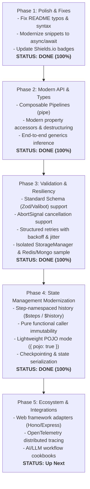

# fluid-func: Project Review, Ecosystem Landscape & Roadmap for Improvements

An architectural analysis, competitive landscape survey, and strategic improvement roadmap for **`fluid-func`**.

---

## 1. Executive Summary & Assessment

`fluid-func` is an asynchronous function-orchestration and pipeline library designed around the **Chain of Responsibility** pattern. It allows developers to compose multi-step business logic into discrete units with an immutable shared context, rich lifecycle hooks (`onBefore`, `onFail`), specifications/validations (`spec`), caching, reduction, and plugin hooks.

### Key Strengths
- **Zero Runtime Dependencies**: Completely self-contained with no external runtime bloat, making it lightweight and secure.
- **100% Test Coverage**: Strong engineering discipline demonstrated by strict `c8` test coverage constraints (100% statements and lines across all source files).
- **Comprehensive Step Lifecycle**: Bundles pre-execution validation, hooks, caching, error recovery, and retries directly into the step definition.
- **Functional Context Passing**: Encourages immutability by default across asynchronous chains.

### Modernization & Improvement Status Matrix

| Recommendation | Target | Status | Verification |
| :--- | :--- | :--- | :--- |
| **Direct Function Piping (`pipe`)** | Avoid global string collisions, enable tree-shaking | ✅ **Implemented** | 100% Coverage, Unit Tested |
| **Modern Parameter Access** | Standard property getters (`.val`, `.props`), `.modern()` destructuring, POJO mode | ✅ **Implemented** | Modern parameter access standard |
| **End-to-End Generics** | Type inference flowing through `Chain<TIn, TOut>` and `pipe<TIn, TOut>` | ✅ **Implemented** | TypeScript 5.0+ strict verified |
| **Standard Schema Support** | First-class validation via `@standard-schema/spec` (`~standard`), Zod, Valibot | ✅ **Implemented** | Root & field validation tested |
| **`AbortSignal` Cancellation** | Graceful cancellation via `options.signal`, in-flight abort & retry abort | ✅ **Implemented** | Tested across single/array chains |
| **Structured Retry Strategies** | Exponential, linear, fixed backoff, jitter, max retries, onRetry hook | ✅ **Implemented** | Unit tested in `OnFail.ts` |
| **Isolated `StorageManager`** | Dedicated Map-based storage instance for multi-tenant and testing | ✅ **Implemented** | `StorageManager` exported |
| **Distributed Storage Integration** | Redis cache & MongoDB persistent hooks + Docker Compose test project | ✅ **Implemented** | `test-project/` runnable sample |
| **Step-Namespaced History (`$steps` / `$history`)** | Prevent intermediate step collision & preserve execution timeline | ✅ **Implemented** | `$steps` by name/index & `$history` |
| **Pure Functional Context Passing** | Prevent in-place caller parameter mutation across execution | ✅ **Implemented** | Frozen caller inputs untouched |
| **Lightweight / POJO Mode** | Bypass Proxies/closures for maximum throughput & clean JSON output | ✅ **Implemented** | `{ pojo: true }` & `toPOJO()` |
| **Checkpointing & State Serialization** | Snapshot & restore execution state across processes / restarts | ✅ **Implemented** | `checkpoint` & `serializeState` |
| **Documentation & Badges** | Modernized async/await snippets, fixed typos, Shields.io badges | ✅ **Implemented** | README updated & verified |

---

## 2. Competitive Landscape

`fluid-func` exists at the convergence of several JavaScript/TypeScript library categories:

| Category | Representative Libraries | Comparison with `fluid-func` |
| :--- | :--- | :--- |
| **Functional Pipelines** | [Effect](https://effect.website), [fp-ts](https://github.com/gcanti/fp-ts), [Ramda](https://ramdajs.com) (`R.pipe`), [p-pipe](https://github.com/sindresorhus/p-pipe) | `Effect` is the standard for typed functional pipelines. `fluid-func` offers a lighter, zero-dependency alternative with intuitive chain lifecycles. |
| **Middleware & Chain of Responsibility** | [koa-compose](https://github.com/koajs/compose), [composable-functions](https://github.com/seasoned-cc/composable-functions), [tiny-async-pipeline](https://github.com/mcollina/tiny-async-pipeline) | Traditional middleware uses `(ctx, next)`, while `fluid-func` isolates steps with declarative lifecycle configurations and context pass-through. |
| **Workflow & Step Orchestrators** | [Inngest](https://www.inngest.com), [Temporal TS SDK](https://temporal.io), [BullMQ](https://bullmq.io) | Heavy distributed engines for cloud backends. `fluid-func` excels as a lightweight, fast, in-memory process-local step runner. |
| **AI / Agentic Pipelines** | [LangChain LCEL](https://js.langchain.com), [LangGraph](https://langchain-ai.github.io/langgraphjs), [Mastra](https://mastra.ai) | Pipelines chaining prompts, LLMs, tool executions, and validation. `fluid-func` offers a zero-dependency foundation for lightweight agentic chains. |
| **Validation & Specs** | [Standard Schema](https://github.com/standard-schema/standard-schema), [Zod](https://zod.dev), [Valibot](https://valibot.dev), [ArkType](https://arktype.io) | Industry standard schema validators offering rich types and transform capabilities compared to custom validation DSLs. |

---

## 3. Implemented Improvements & Architectural Modernization

### 3.1. Architecture & API Modernization

#### 1. Direct Function References & Composable Pipelines (`pipe`) &mdash; ✅ Implemented
Direct chaining of function references without requiring global string registries:
```typescript
import { Chain, pipe } from 'fluid-func';

const validateCart = Chain.create(async (param) => ({ valid: true }));
const applyDiscount = Chain.create(async (param) => ({ discount: 10 }));
const processPayment = Chain.create(async (param) => ({ status: 'paid' }));

const checkoutPipeline = pipe(
  validateCart,
  applyDiscount,
  processPayment
);

const result = await checkoutPipeline.run({ cartId: '123', amount: 100 });
```

#### 2. Native `async/await` & Modern Parameter Access &mdash; ✅ Implemented
- **`.modern()`**: Chain handlers receive clean, unwrapped objects directly:
  ```typescript
  const add = Chain.create(async ({ a, b }) => ({ sum: a + b })).modern();
  const res = await add.run({ a: 10, b: 20 });
  console.log(res.sum.val); // 30
  ```
- **Property Getters**: Parameters support direct property value access (`param.name.val`, `param.props.name`), numeric coercion (`+param.name`), and string templates (`${param.name}`).

#### 3. End-to-End TypeScript Generics &mdash; ✅ Implemented
Type definitions flow through chains and pipelines:
```typescript
interface CartInput { cartId: string; amount: number; }
interface PaymentResult { transactionId: string; status: 'paid'; }

const processOrder = Chain.create<CartInput, PaymentResult>('processOrder')
  .onStart(async (params) => {
    return { transactionId: 'tx_999', status: 'paid' };
  });

const result = await processOrder.run({ cartId: 'c_1', amount: 100 });
// result is strictly typed as Promise<PaymentResult>
```

#### 4. Standard Schema Support for `.spec()` & `.schema()` &mdash; ✅ Implemented
Adopted the [Standard Schema](https://github.com/standard-schema/standard-schema) specification (`~standard`), along with out-of-the-box support for Zod (`safeParse`), Valibot, parse/validate methods, and function predicates:
```typescript
import { z } from 'zod';
import { Chain } from 'fluid-func';

// Root context schema validation
const createUser = Chain.create('createUser')
  .schema(z.object({
    email: z.string().email(),
    age: z.number().min(18)
  }));

// Field-level schema validation
const validateOrder = Chain.create('validateOrder')
  .spec('amount', z.number().positive());
```

#### 5. Cancellation Support via `AbortSignal` &mdash; ✅ Implemented
First-class support for `AbortSignal` in `Chain.start()`, `chain.execute()`, `chain.run()`, and `pipe().run()`:
```typescript
const controller = new AbortController();

// Cancel running chains if taking too long
setTimeout(() => controller.abort(new Error('Operation timed out')), 5000);

const result = await myPipeline.run(
  { data: 'payload' },
  { signal: controller.signal }
);

// Access inside chain action
Chain.create(async (param) => {
  const signal = param.$signal.val || param.signal.val;
  const response = await fetch('https://api.example.com', { signal });
  return { result: await response.json() };
});
```

#### 6. Structured Retry Strategies on `onFail` &mdash; ✅ Implemented
Built-in backoff strategies with exponential backoff, jitter, maximum retry count, and `onRetry` audit callbacks:
```typescript
FluidFunc.create('callExternalApi')
  .onFail({
    maxRetries: 3,
    backoff: 'exponential', // 100ms, 200ms, 400ms...
    delay: 100,
    maxDelay: 5000,
    jitter: true,
    onRetry: (err, attempt) => console.warn(`Retry attempt ${attempt}:`, err)
  });
```

#### 7. Isolated `StorageManager` & External Plugins &mdash; ✅ Implemented
- Dedicated `StorageManager` class allows isolated, collision-free instances for multi-tenant and test environments.
- Plugin hooks (`setGetChainPlugin`, `setPutChainPlugin`, `setPutChainContextPlugin`, etc.) connect external databases.
- **Distributed Execution Scoping (`PutChainContextMeta`)**: `setPutChainContextPlugin` now receives `meta: { stackId?: string }` (with automatic stack resolution), enabling distributed key partitioning, single-command stack cleanup, and OpenTelemetry trace correlation.
- Working reference sample with Redis distributed caching and MongoDB durable document store in [`test-project/`](test-project/README.md) with Docker Compose.

---

### 3.2. Chain Execution State Management Modernization &mdash; ✅ Implemented

#### 1. Step-Namespaced History (`$steps` / `$history`)
To eliminate intermediate step output collisions, execution contexts now record step-namespaced history accessible via modern property getters:
- Access by step name: `param.$steps.stepName.field.val` or `param.$steps.stepName.props`
- Access by step index: `param.$steps[0].field.val`
- Full chronological execution timeline: `param.$history` (array of `{ step, index, output }`)
- Intermediate outputs remain intact even when later steps emit the same field name.

#### 2. Pure Functional Context Passing (Zero Input Mutation)
- Replaced shallow input assignments (`Object.assign(initialParam, ...)`) with non-mutating clones (`Object.assign({}, initialParam, ...)`).
- Caller-supplied input objects remain completely unchanged across chain runs, fully supporting frozen inputs (`Object.freeze(input)`).

#### 3. Lightweight / POJO Execution Mode
- Developers can pass `{ pojo: true }` or `{ mode: 'pojo' }` in `ExecutionOptions` (`chain.run(param, { pojo: true })` or `pipe(...).run(param, { mode: 'pojo' })`).
- Bypasses Proxy wrappers and closure getter functions entirely, returning clean, deep-frozen plain JavaScript objects (`toPOJO`).
- Reduces memory overhead, speeds up high-throughput pipelines, and provides instant JSON serializability without calling `.props` or `.val`.

#### 4. Checkpointing & State Serialization (Durable Execution)
- StorageManager and Chain expose first-class state snapshotting and hydration APIs:
  - `storage.checkpoint(stackId)`: Captures serializable snapshot of stack execution state and resolved context fields.
  - `storage.restoreCheckpoint(checkpoint)`: Rebuilds stack state and reconstitutes working getter closures.
  - `storage.serializeState(stackId?)`: Returns portable JSON string of single stack or full storage container.
  - `storage.hydrateState(serializedState)`: Restores execution state from serialized string or checkpoint object.
- Static helpers: `Chain.checkpoint()`, `Chain.restoreCheckpoint()`, `Chain.serializeState()`, `Chain.hydrateState()`, `Chain.toPOJO()`.

---

### 3.3. Documentation & Quality Polishing &mdash; ✅ Implemented
- Fixed all syntax errors, stray brackets, and casing inconsistencies in documentation.
- Corrected spelling typos across codebase and docs.
- Upgraded documentation examples to modern `async/await` and ES Modules.
- Replaced legacy callable/callback parameter patterns with modern destructuring and property accessors.
- Added modern Shields.io badges for TypeScript 5.0+, 100% test coverage, and MIT license.

---

## 4. Next Strategic Horizons (Ecosystem & Integrations)

To continue expanding adoption, position `fluid-func` in domains where developers regularly orchestrate multi-step asynchronous workflows:

### 1. Web Framework Adapters (Hono, Express, Fastify)
Create lightweight adapter packages (e.g. `@fluid-func/hono`):
```typescript
import { toHonoMiddleware } from '@fluid-func/hono';

app.post('/api/checkout', toHonoMiddleware(checkoutChain));
```

### 2. AI & LLM Workflow Orchestration
Position `fluid-func` as a **zero-dependency, lightweight, type-safe alternative to LangChain LCEL**:
- Prompt assembly $\rightarrow$ LLM generation $\rightarrow$ output validation (`.schema()`) $\rightarrow$ retry with backoff (`.onFail()`) $\rightarrow$ tool execution.
- Create an example cookbook showing an agentic workflow in TypeScript with structured schema parsing.

### 3. OpenTelemetry / Distributed Tracing
Add telemetry hooks to automatically generate OpenTelemetry spans for pipeline steps:
- Track execution duration, context parameters, error rates, and retries in Datadog, Jaeger, or Grafana.

### 4. Background Job & Queue Adapters (BullMQ, Cloudflare Queues)
Allow developers to process queue jobs using `fluid-func` composable pipelines:
```typescript
import { createWorker } from '@fluid-func/bullmq';

createWorker('orders-queue', checkoutPipeline);
```

---

## 5. Implementation Roadmap Status



| Phase | Milestone | Status |
| :--- | :--- | :--- |
| **Phase 1** | Polish, modern async/await docs, Shields.io badges, typo fixes | ✅ **Complete** |
| **Phase 2** | Composable pipelines (`pipe`), modern property getters, `.modern()`, TypeScript generics | ✅ **Complete** |
| **Phase 3** | Standard Schema (`~standard`, Zod), `AbortSignal`, structured retries, `StorageManager`, Redis + Mongo | ✅ **Complete** |
| **Phase 4** | Step history (`$steps`/`$history`), pure immutability, POJO mode, checkpointing / serialization | ✅ **Complete** |
| **Phase 5** | Web framework adapters (Hono/Express), OpenTelemetry tracing, LLM agentic cookbooks | 🚀 **Next Horizon** |
