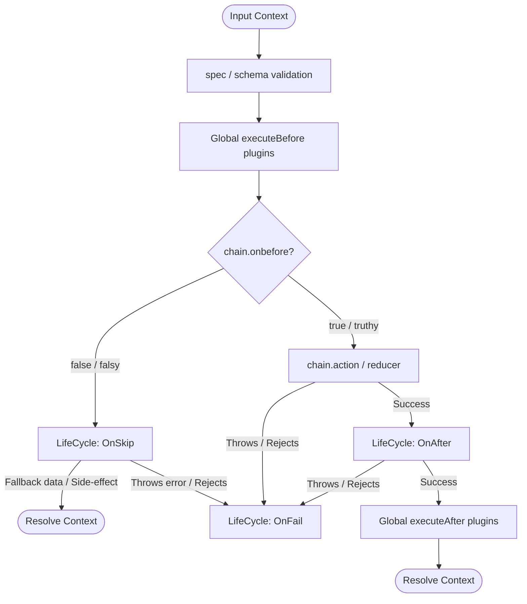

# fluid-func: Step Lifecycle Enhancement Plan (`onSkip` & `onAfter`)

Implementation plan and architectural design for extending `Chain` step lifecycles in `fluid-func` with **`onSkip`** and **`onAfter`**.

---

## 1. Executive Summary & Rationale

`fluid-func` currently implements an asymmetric step lifecycle in `src/features/executer/SingleChain/LifeCycle/`:
* **`OnBefore`**: Guards step execution with a boolean/Promise predicate.
* **`OnFail`**: Catches errors, triggers recovery routines, and performs configurable retries with backoff.
* **`StartChain`**: Executes the core action or reducer logic.

### Identified Architectural Gaps
1. **Silent / Inexpressive Bypass on Skip (`OnBefore.ts`)**:
   When `chain.onbefore(param)` returns `false`, `OnBefore.ts` silently resolves with an empty context:
   ```typescript
   resolve(Context.createContext(chain.$chainId, stackId).getData());
   ```
   Downstream pipeline steps have no signal that the step was skipped, cannot inspect reasons, and cannot receive fallback default properties.
2. **Missing Step-Level Post-Execution Hook (`onAfter`)**:
   Post-execution logic currently exists only at the global configuration level via `Chain.config({ plugins: [{ after: [...] }] })`. Individual steps cannot define isolated side effects (such as emitting domain events, dispatching webhooks, audit logging) or enrich/transform their own step output before resolving to the rest of the pipeline.

---

## 2. End-to-End Lifecycle State Machine



---

## 3. Architecture & File Layout

```text
src/features/executer/SingleChain/LifeCycle/
├── OnBefore.ts      <-- Calls OnSkip when predicate is falsy
├── OnSkip.ts        <-- (NEW) Handles skipped execution, side-effects & fallbacks
├── OnFail.ts        <-- Existing retry policy & error handler
└── OnAfter.ts       <-- (NEW) Post-step side effects & output enrichment
```

---

## 4. Component Design & Code Drafts

### 4.1. `OnSkip` Lifecycle Hook

#### Responsibilities
1. Run whenever `chain.onbefore(param)` returns or resolves to `false` (falsy).
2. **Backward Compatibility**: If `chain.onskip` is not configured, maintain existing behavior by resolving `Context.createContext(chain.$chainId, stackId).getData()`.
3. If `chain.onskip` is configured:
   - Call `chain.onskip(param)` (unwrapped if `.modern()` is enabled).
   - If a return value / object is provided, merge it into the context via `propertyToContext`.
   - If `undefined`/`void` is returned, treat as a pure side effect and resolve the default context.
   - Support both synchronous values and `Promise`.
   - If `onskip` throws or rejects, escalate to `reject(err)` so `OnFail` or the chain caller catches it.

#### Implementation: `src/features/executer/SingleChain/LifeCycle/OnSkip.ts`
```typescript
export default class OnSkip {
    constructor(
        chain: any,
        param: any,
        resolve: (value: any) => void,
        reject: (reason?: any) => void,
        Context: any,
        propertyToContext: (context: any, chainReturn: any) => void,
        stackId?: string
    ) {
        const context = Context.createContext(chain.$chainId, stackId);
        if (typeof chain.onskip === 'function') {
            try {
                const actionParam = chain.isModern && param?.raw ? param.raw : param;
                const result = chain.onskip(actionParam);
                if (result instanceof Promise) {
                    result.then(fallbackProps => {
                        if (fallbackProps !== undefined) {
                            propertyToContext(context, fallbackProps);
                        }
                        resolve(context.getData());
                    }).catch(reject);
                } else {
                    if (result !== undefined) {
                        propertyToContext(context, result);
                    }
                    resolve(context.getData());
                }
            } catch (err) {
                reject(err);
            }
        } else {
            resolve(context.getData());
        }
    }
}
```

#### Refactored: `src/features/executer/SingleChain/LifeCycle/OnBefore.ts`
```typescript
import OnSkip from './OnSkip';

export default class OnBefore {
    constructor(
        chain: any,
        param: any,
        resolve: (value: any) => void,
        reject: (reason?: any) => void,
        Context: any,
        next: () => void,
        propertyToContext: (context: any, chainReturn: any) => void,
        stackId?: string
    ) {
        const handleSkip = () => {
            new OnSkip(chain, param, resolve, reject, Context, propertyToContext, stackId);
        };

        try {
            const actionParam = chain.isModern && param?.raw ? param.raw : param;
            const onbefore = chain.onbefore(actionParam);
            if (onbefore instanceof Promise) {
                onbefore.then((con: any) => {
                    if (con) {
                        next();
                    } else {
                        handleSkip();
                    }
                }).catch((err: any) => {
                    reject(err);
                });
            } else if (onbefore) {
                next();
            } else {
                handleSkip();
            }
        } catch (err) {
            reject(err);
        }
    }
}
```

---

### 4.2. `OnAfter` Lifecycle Hook

#### Responsibilities
1. Run immediately after `chain.action` or `Reducer` succeeds and updates the step context.
2. Receive `(output, param)` where `output` is the action result and `param` is the input parameter context (unwrapped when `.modern()` is enabled).
3. If `onafter` returns an object, merge it into the step context via `propertyToContext` (output enrichment).
4. If `onafter` returns `undefined`/`void`, retain the step context as produced by `action`.
5. Support asynchronous side effects via `Promise`.
6. If `onafter` throws or rejects, forward the error to `reject` to engage `OnFail` / retry logic.

#### Implementation: `src/features/executer/SingleChain/LifeCycle/OnAfter.ts`
```typescript
export default class OnAfter {
    constructor(
        chain: any,
        output: any,
        param: any,
        context: any,
        propertyToContext: (context: any, chainReturn: any) => void,
        next: () => void,
        reject: (reason?: any) => void
    ) {
        if (typeof chain.onafter === 'function') {
            try {
                const actionParam = chain.isModern && param?.raw ? param.raw : param;
                const result = chain.onafter(output, actionParam);
                if (result instanceof Promise) {
                    result.then(enrichProps => {
                        if (enrichProps !== undefined && typeof enrichProps === 'object' && enrichProps !== null) {
                            propertyToContext(context, enrichProps);
                        }
                        next();
                    }).catch(reject);
                } else {
                    if (result !== undefined && typeof result === 'object' && result !== null) {
                        propertyToContext(context, result);
                    }
                    next();
                }
            } catch (err) {
                reject(err);
            }
        } else {
            next();
        }
    }
}
```

---

### 4.3. Pipeline Orchestrator Integration (`StartChain.ts`)

In `src/features/executer/SingleChain/StartChain.ts`:

1. Pass `propertyToContext` to `OnBefore`:
   ```typescript
   new OnBefore(chain, param, safeResolve, (err) => {
       // ... onfail error handling
   }, Context, () => {
       // ... action execution
   }, propertyToContext, stackId);
   ```

2. Wrap action resolution with `OnAfter`:
   ```typescript
   const executeOnAfterAndResolve = (rawOutput: any, ctx: any) => {
       new OnAfter(chain, rawOutput, param, ctx, propertyToContext, () => {
           new ResolveChain(safeResolve, ctx.getData(), chainName, logInfo, executeAfter, Context, safeReject);
       }, (err: any) => {
           new OnFail(chain, err, (resolvedCtx: any) => {
               new ResolveChain(safeResolve, resolvedCtx, chainName, logInfo, undefined, undefined, safeReject);
           }, safeReject.bind(this), this, initialParam, chains, logInfo, logError, executeAfter, Context, options);
       });
   };
   ```

3. Call `executeOnAfterAndResolve` for both synchronous and `Promise` actions, as well as `Reducer` completions.

---

### 4.4. Chain Fluent API & Typings (`src/features/chain/index.ts`)

```typescript
export type OnBeforeAction<TInput = any> = (parameter: TInput) => boolean | Promise<boolean>;
export type OnSkipAction<TInput = any, TFallback = any> = (parameter: TInput) => TFallback | Promise<TFallback>;
export type OnAfterAction<TOutput = any, TInput = any> = (output: TOutput, parameter: TInput) => any | Promise<any>;

export class Chain<TInput = any, TOutput = any> {
    onbefore: OnBeforeAction<TInput>;
    onskip?: OnSkipAction<TInput>;
    onafter?: OnAfterAction<TOutput, TInput>;

    onBefore(onbefore: OnBeforeAction<TInput>): Chain<TInput, TOutput> {
        this.onbefore = onbefore;
        return this;
    }

    onSkip<TFallback = any>(onskip: OnSkipAction<TInput, TFallback>): Chain<TInput, TOutput> {
        this.onskip = onskip;
        return this;
    }

    onAfter(onafter: OnAfterAction<TOutput, TInput>): Chain<TInput, TOutput> {
        this.onafter = onafter;
        return this;
    }
}
```

---

## 5. Usage Scenarios

### Scenario 1: Feature Flag / Bypass with Fallback (`onSkip`)
```typescript
import { Chain } from 'fluid-func';

const sendSmsNotification = Chain.create('sendSmsNotification')
    .onBefore(({ user }) => user().hasSmsEnabled)
    .onStart(async ({ user, message }) => {
        const id = await smsGateway.send(user().phone, message());
        return { messageId: id, delivered: true };
    })
    .onSkip(({ user }) => {
        return { messageId: null, delivered: false, reason: 'user_opted_out' };
    });
```

### Scenario 2: Asynchronous Audit Logging & Output Enrichment (`onAfter`)
```typescript
import { Chain } from 'fluid-func';

const chargeCustomer = Chain.create('chargeCustomer')
    .onStart(async ({ customerId, amount }) => {
        const charge = await paymentGateway.charge(customerId(), amount());
        return { chargeId: charge.id, status: 'succeeded' };
    })
    .onAfter(async (output, { customerId }) => {
        await auditTrail.record('payment_completed', {
            customerId: customerId(),
            chargeId: output.chargeId
        });
        return { processedAt: new Date().toISOString() };
    });
```

---

## 6. Test & Coverage Matrix (`c8` 100% Statements/Lines Target)

To satisfy `c8 --check-coverage --lines 100 --statements 100`:

| Component | Test Case | Expected Behavior |
| :--- | :--- | :--- |
| **`OnSkip`** | `onBefore` returns `false` without `onSkip` | Resolves empty default context (100% backward compatible) |
| **`OnSkip`** | `onBefore` returns sync `false`, sync `onSkip` returns fallback object | Properties merged into step context and accessible downstream |
| **`OnSkip`** | `onBefore` returns async `Promise(false)`, async `onSkip` returns fallback | Awaited and merged into step context |
| **`OnSkip`** | `onSkip` returns `undefined` (pure side effect) | Completes without mutating context |
| **`OnSkip`** | `onSkip` throws error synchronously | Routes to `reject` / `OnFail` |
| **`OnSkip`** | `onSkip` returns rejected `Promise` | Routes to `reject` / `OnFail` |
| **`OnSkip`** | Step configured with `.modern()` | Parameter in `onSkip` receives unwrapped raw values |
| **`OnAfter`** | Action succeeds without `onAfter` | Resolves normally (100% backward compatible) |
| **`OnAfter`** | `onAfter` sync returns object | Object merged into step context |
| **`OnAfter`** | `onAfter` async returns `Promise` object | Awaited and merged into step context |
| **`OnAfter`** | `onAfter` returns `undefined` (side effect only) | Preserves original action output |
| **`OnAfter`** | `onAfter` throws error synchronously | Routes to `OnFail` / retry logic |
| **`OnAfter`** | `onAfter` returns rejected `Promise` | Routes to `OnFail` / retry logic |
| **`OnAfter`** | Step configured with `.modern()` | Parameters in `onAfter` receive unwrapped raw values |
| **`OnAfter`** | Reducer step (`.reduce(...)`) | `onAfter` executes on accumulated reduced value |
