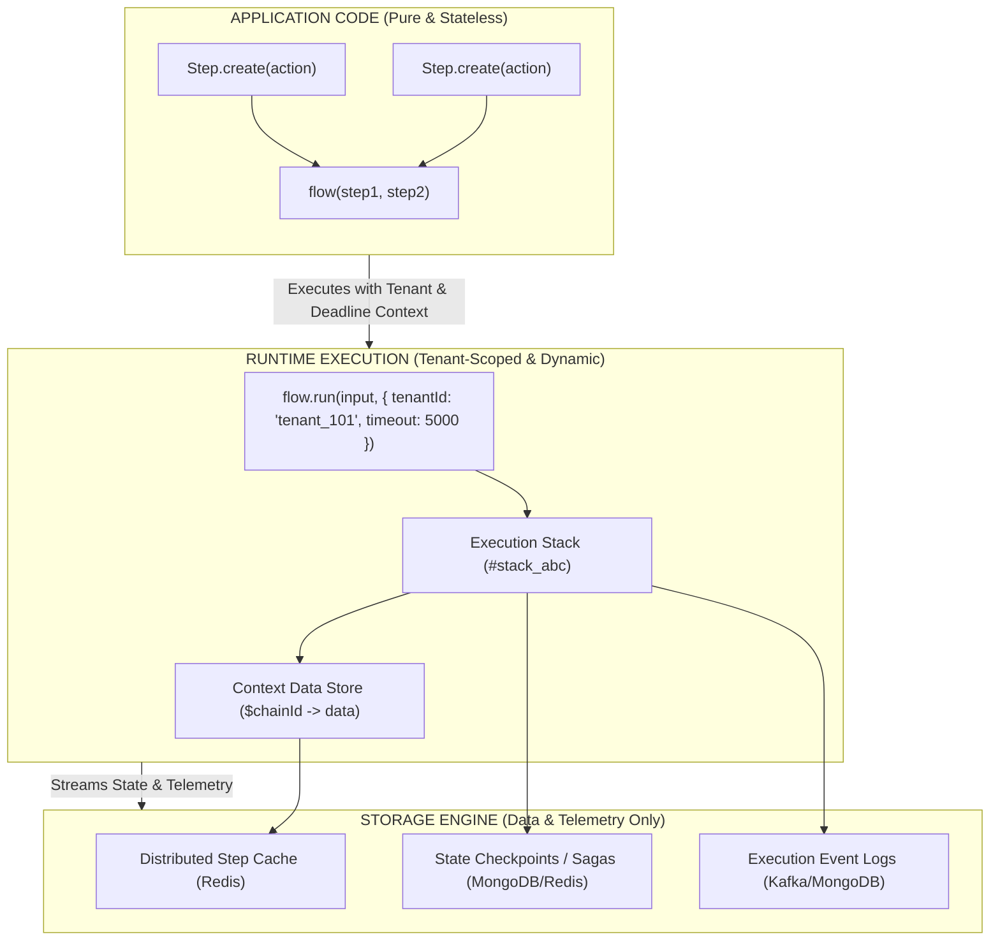

# fluid-func: Storage, Multi-Tenancy & Resilience Modernization Plan

> **Architectural Blueprint & Migration Strategy**  
> Eliminating String-Based Code Registries, Separating Code from State, Redesigning Distributed Storage & Multi-Tenancy, and Implementing Resilient Execution Timeouts.

---

## 1. Executive Summary & Problem Statement

`fluid-func` was originally architected around a global named registry where steps were registered by string keys:
```typescript
// Legacy v1 Pattern (String-based registry)
new Step('fetchUser', async (param) => ({ ... })); // Implicitly putChain('fetchUser', this)
await Step.start(['fetchUser', 'calculateTax']);     // Resolved from defaultStorageManager via strings
```

Over subsequent iterations, the library evolved into a modern, type-safe functional orchestrator based on direct step instances and composable flows:
```typescript
// Modern v2 Pattern (Direct functional composition)
const fetchUser = Step.create(async (param) => ({ ... }));
const orderFlow = flow(fetchUser, calculateTax);
await orderFlow.run(input);
```

### The Architectural Conflict ("The Loophole")

Despite this evolution, the underlying storage layer and documentation retained relics of the string-registry model, creating severe contradictions:

1. **Code vs. State Confusion (`putChain` in Redis/MongoDB)**:  
   Storage plugins (`setPutChainPlugin`, `setGetChainPlugin`) attempted to persist *executable step definitions* to Redis and MongoDB. However, executable TypeScript closures cannot be cleanly serialized to JSON or stored in distributed databases. Code belongs in versioned application bundles, not in Redis.

2. **The Anonymous Step Loophole**:  
   Modern idiomatic code creates anonymous function steps (`Step.create(async (p) => { ... })`). Because `StorageManager.putChain(name, step)` requires a string `name`, anonymous steps cannot participate in code-storage registries without forcing developers to invent synthetic string keys.

3. **Multi-Tenancy Misconception**:  
   Multi-tenancy was documented as creating isolated code registries (`tenantStorage = new StorageManager(); tenantStorage.putChain('tenantStep', ...)`). In reality, tenants do not need different function code dictionaries in memory; tenants need **runtime data isolation** (isolated parameters, execution stacks, caches, and audit logs) during workflow execution.

4. **Global Singleton Contamination**:  
   Instantiating a named step (`Step.create('stepName', ...)`) previously wrote to `defaultStorageManager.chains`, causing global memory leaks and `ChainWithTheSameNameException` collisions across concurrent tenants in the same Node.js process.

---

## 2. The Core Architectural Paradigm Shift

The modern architecture establishes a strict, clean separation between **Application Code** and **Runtime Execution State**:



### Legacy vs. Modern Paradigm Comparison

| Architectural Aspect | Legacy Model (v1 Relic) | Modernized Model (v2 Standard) |
| :--- | :--- | :--- |
| **Step Identity** | Global string key in storage (`chains.get(name)`) | In-memory object instance reference (`Step`) |
| **Step Naming** | Mandatory string key for registration | Purely optional label for logs & `$steps.name` |
| **Anonymous Steps** | Second-class citizen (breaks `putChain`) | First-class citizen (indexed via `$steps[i]`, `$history[i]`) |
| **Multi-Tenancy** | Multiple `StorageManager` code registries | Single shared workflow code; tenant-isolated execution stacks (`tenantId`) |
| **Storage Role** | Stored code closures + runtime state | **State & Telemetry only** (stacks, contexts, cache, checkpoints) |
| **Pluggable Storage** | Persisted step code to Redis/MongoDB | Streams runtime events, context audit logs, and checkpoints |
| **Execution Deadlines** | None (hung async promises freeze stacks indefinitely) | Two-tier timeout architecture (`step.timeout(ms)` & `flow.run(..., { timeout })`) |

---

## 3. Detailed Domain Redesign

### Domain 1: Step & Flow Composition (Optional Names, Zero Code Storage)

1. **Step Definition**:
   Steps are pure execution units containing action functions, parameter contracts (`.spec()`), lifecycle hooks (`.onBefore()`, `.onAfter()`, `.onFail()`), and cache rules.
   ```typescript
   // 100% Anonymous (Standard)
   const validate = Step.create(async ({ orderId }) => ({ valid: true }));

   // Named (Optional label for observability & $steps namespacing)
   const charge = Step.create('chargeCard', async ({ amount }) => ({ charged: true }));
   ```

2. **Accessing Outputs**:
   - Anonymous steps: accessed by numeric index `param.$steps[0]` or chronological history `param.$history[0]`.
   - Named steps: accessed by name `param.$steps.chargeCard` or numeric index `param.$steps[1]`.

3. **Storage Disconnect**:
   - Creating a step **never** registers it into any storage container.
   - `Step.exists(name)` and `isExists(name)` are formally deprecated.

---

### Domain 2: True Runtime Multi-Tenancy

In multi-tenant architectures, workflows are shared application logic executed across many tenants concurrently.

```typescript
import { Step, flow } from 'fluid-func';

// Workflow logic is immutable and shared across all tenants
const orderPipeline = flow(
    validateOrderStep,
    applyTenantRulesStep,
    processPaymentStep,
    recordInvoiceStep
);

// Tenant A Execution (Request 1)
const resultA = await orderPipeline.run(
    { orderId: 'ord_1', amount: 100 },
    { tenantId: 'tenant_acme' }
);

// Tenant B Execution (Request 2, concurrent in same process)
const resultB = await orderPipeline.run(
    { orderId: 'ord_2', amount: 200 },
    { tenantId: 'tenant_globex' }
);
```

#### How Multi-Tenancy Is Enforced:
1. **Zero Cross-Talk**: Execution stacks (`stackId`) are unique per invocation.
2. **Tenant Tagging**: Context metadata automatically includes `tenantId` alongside `stackId`.
3. **Tenant Cache Partitioning**: Step caching automatically namespaces cache keys:
   `cacheKey = `${tenantId}:${stepId}:${inputHash}``.
4. **Tenant Checkpoint Scoping**: When serializing state, checkpoints are tagged with `tenantId` to prevent cross-tenant restoration.

---

### Domain 3: Redesigned Pluggable Distributed Storage

Distributed storage is refocused strictly on **data, durability, and telemetry**:

#### 1. Real-Time Context Streaming & Distributed Tracing
Whenever context updates during execution, distributed hooks stream the change with tenant and stack correlation:
```typescript
import { setPutChainContextPlugin } from 'fluid-func';

setPutChainContextPlugin((stepId, field, getter, meta) => {
    const val = getter();
    const { stackId, tenantId } = meta || {};

    // Redis: Fast distributed context lookups / pub-sub
    redis.hset(`context:${stackId}:${stepId}`, field, JSON.stringify(val));

    // MongoDB: Permanent audit event log
    mongoLogs.insertOne({
        tenantId,
        stackId,
        stepId,
        field,
        value: val,
        timestamp: Date.now()
    });
});
```

#### 2. Durable Workflow Checkpoints (Sagas & Pause/Resume)
Instead of persisting step code, serialize execution checkpoints across worker boundaries:
```typescript
// Worker 1: Execute steps up to an asynchronous approval
const partialResult = await approvalFlow.run(input, { tenantId: 'tenant_1' });
const stackId = partialResult.$stackId();
const checkpoint = Step.checkpoint(stackId);

await mongoCheckpoints.insertOne({
    checkpointId: stackId,
    tenantId: 'tenant_1',
    data: checkpoint,
    status: 'pending_approval'
});

// Worker 2 (Hours later, upon webhook arrival):
const doc = await mongoCheckpoints.findOne({ checkpointId: stackId });
const restoredStorage = new StorageManager();
restoredStorage.restoreCheckpoint(doc.data);

// Resume downstream execution from restored state
```

#### 3. Distributed Step Caching
Cache deterministic step results across cluster nodes:
```typescript
// Automatic Redis-backed caching for expensive operations
const aiSummarize = Step.create(async ({ documentText }) => {
    return await llmClient.summarize(documentText);
}).cache(60000); // 60s TTL, partitioned by input hash & tenantId
```

---

### Domain 4: Execution Resilience & Deadlines (Step & Flow Timeouts)

Production workflow orchestrators require strict failure boundaries. Long-running or hanging asynchronous operations (e.g. stalled database queries, unresponsive 3rd-party APIs, LLM stream deadlocks) must not hold system resources and execution stacks indefinitely.

`fluid-func` establishes a **two-tier timeout model**:

#### 1. Two-Tier Timeout Architecture

| Dimension | **Step-Level Timeout (`step.timeout(ms)`)** | **Flow-Level Timeout (`flow.run(..., { timeout })` / `flow.timeout(ms)`)** |
| :--- | :--- | :--- |
| **Primary Purpose** | **Per-operation SLA** (e.g., individual HTTP request, LLM generation, or DB query) | **End-to-end workflow budget** (e.g., API gateway deadline, message queue SLA) |
| **Scope** | Confined to a single step's execution lifecycle | Cumulative across all steps, retries, and delays combined |
| **Failure Handling** | Triggers step's **`onFail`** (retries, backoff, or fallback) | Immediately aborts whole workflow; terminates stack and rejects |
| **Exception Type** | `StepTimeoutException` (`stepName`, `timeoutMs`, `elapsedMs`) | `FlowTimeoutException` (`stackId`, `timeoutMs`, `completedSteps`) |

#### 2. Resource Reclamation via `AbortSignal` (Zero Zombie Executions)
A naive `Promise.race([actionPromise, timerPromise])` leaves the underlying async operation running invisibly in the background, leaking network sockets and DB pools.
`fluid-func` leverages cooperative cancellation using standard `AbortSignal`:
- Each timeout is backed by an `AbortController`.
- Workflows combine outer signals (client cancellation, flow deadline, step SLA) via `AbortSignal.any([userSignal, flowSignal, stepSignal])`.
- The effective signal is provided to the step action via `param.$signal?.()` and `param.signal?.()`, enabling native cooperative aborts for `fetch`, HTTP clients, and database drivers.

#### 3. Syntax & Usage

```typescript
import { Step, flow } from 'fluid-func';

// Step-level SLA with retries
const callPaymentGateway = Step.create('processPayment', async (param) => {
    return await httpClient.post('/charge', param, {
        signal: param.$signal?.()
    });
})
.timeout(3000) // Rejects with StepTimeoutException if action takes > 3s
.onFail({ retries: 2, delay: 500 }); // Retries on timeout before giving up

// Flow-level end-to-end deadline
const checkoutFlow = flow(
    validateCartStep,
    callPaymentGateway,
    generateInvoiceStep
).timeout(10000); // 10s cumulative workflow SLA

// Alternatively, supply timeout at runtime per execution:
const result = await checkoutFlow.run(orderData, {
    timeout: 8000,
    tenantId: 'tenant_123'
});
```

---

## 4. API Deprecations & Cleanup Plan

| API / Feature | Current Status | Planned Action | Replacement / Alternative |
| :--- | :--- | :--- | :--- |
| `putChain(name, chain)` | Global code registry | **Deprecate** in v2.x, remove in v3.0 | Direct step instances (`Step.create`) |
| `getChain(name)` | Code resolution by string | **Deprecate** for code; keep for internal context | Direct step passing in `flow(...)` |
| `isExists(name)` / `Step.exists(name)` | Checks global code registry | **Deprecate** | Not needed with direct instances |
| `setPutChainPlugin` | Stores step code in Redis/Mongo | **Deprecate** | Code lives in repository |
| `setGetChainPlugin` | Retrieves step code from Redis | **Deprecate** | Standard TypeScript/ESM imports |
| `state.chains` Map | Stores step definitions in `StorageManager` | **Remove** from `StorageState` | Storage only manages `stacks`, `contexts`, `cache` |
| `ExecutionOptions.tenantId` | Missing | **Add** to `ExecutionOptions` | Native tenant correlation |
| `ExecutionOptions.timeout` | Missing | **Add** to `ExecutionOptions` | End-to-end workflow deadline in milliseconds |
| `Step.prototype.timeout(ms)` | Missing | **Add** to `Step` | Per-step timeout SLA triggering `onFail` / retry |
| `Flow.prototype.timeout(ms)` | Missing | **Add** to `Flow` | Static default flow deadline |
| `StepTimeoutException` / `FlowTimeoutException` | Missing | **Add** typed error classes | Specific error handling for timeout scenarios |
| `StorageAdapter` Interface | Fragmented callbacks | **Introduce** unified adapter | Clean pluggable storage provider interface |

---

## 5. Unified `StorageAdapter` Proposal (Future Architecture)

Instead of configuring 4 separate standalone functions (`setPutChainContextPlugin`, etc.), introduce a unified, type-safe `StorageAdapter` interface:

```typescript
export interface StorageAdapter {
    name: string;
    
    // 1. Context & Event Streaming
    onContextChange?(entry: {
        tenantId?: string;
        stackId: string;
        stepId: string;
        field: string;
        value: any;
        timestamp: number;
    }): Promise<void> | void;

    // 2. Checkpointing & Durability
    saveCheckpoint?(checkpoint: SerializedExecutionStack): Promise<void>;
    getCheckpoint?(stackId: string): Promise<SerializedExecutionStack | undefined>;

    // 3. Distributed Caching
    getCachedStep?(key: string): Promise<any | undefined>;
    setCachedStep?(key: string, value: any, ttlMs: number): Promise<void>;
}
```

This allows developers to configure their distributed infrastructure in a single call:
```typescript
import { Step } from 'fluid-func';
import { RedisMongoStorageAdapter } from './storage/redis-mongo';

Step.useStorage(new RedisMongoStorageAdapter({ redis, mongo }));
```

---

## 6. Implementation Roadmap

### Phase 1: Documentation & Conceptual Alignment (Immediate)
- Update [`README.md`](file:///Users/jericodeguzman/IdeaProjects/fluid-func/README.md) to explain the modern data-first paradigm.
- Clarify that step names are optional debug labels and never stored in a code registry.
- Document index-based history (`$steps[i]`) for anonymous function steps.
- Align the **Isolated Storage & Multi-Tenancy** and **Distributed Storage** sections around runtime state, tracing, and checkpointing.

### Phase 2: Runtime Tenant Enrichment (`tenantId`)
- Add optional `tenantId?: string` to `ExecutionOptions`.
- Forward `tenantId` through `Runner`, `StartChain`, and `meta` in `putChainContext`.
- Ensure stack state serialization includes `tenantId`.

### Phase 3: Formal Deprecation of Code-in-Storage
- Mark `putChain`, `getChain` (as a step registry), `Step.exists`, `setPutChainPlugin`, and `setGetChainPlugin` as `@deprecated`.
- Refactor internal runner so that execution never touches `state.chains`.
- Maintain 100% statement and line test coverage across all existing and refactored code paths.

### Phase 4: Unified `StorageAdapter` & Test Project Update
- Provide the unified `StorageAdapter` interface.
- Update [`test-project/`](file:///Users/jericodeguzman/IdeaProjects/fluid-func/test-project/README.md) to showcase the modern context streaming, Redis caching, and MongoDB checkpointing architecture without string step persistence.

### Phase 5: Resilient Execution & Timeout Architecture
- Introduce `Step.prototype.timeout(ms)` on `Step` and `timeout(ms)` on `Flow`.
- Add `timeout?: number` to `ExecutionOptions`.
- Update `Runner` and `StartChain` to instantiate timeout-backed `AbortController`s and compose signals via `AbortSignal.any` (with backward-compatible fallback).
- Ensure step timeouts trigger `onFail` retry loops seamlessly before failing.
- Introduce `StepTimeoutException` and `FlowTimeoutException` error classes.
