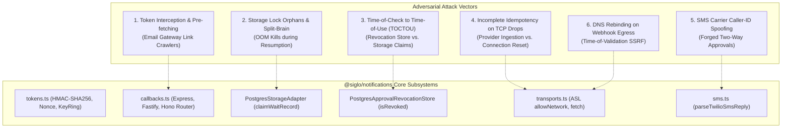

# Adversarial Architectural Review: `@siglo/notifications` (The "Grill" Session)

> Implementation status: the original defenses below are architectural proposals, not a description of every current mechanism. See [implemented hardening and migration](docs/adapters/notification-hardening.md) for POST confirmation, authenticated approvals, database-session locks, saved-event recovery, provider-specific idempotency and remaining external-service guarantees.


> **Document Under Scrutiny**: [`docs/adapters/notifications.md`](docs/adapters/notifications.md)
> **Target Package**: `@siglo/notifications`
> **Reviewer Persona**: Principal Distributed Systems & Security Architect
> **Objective**: Stress-test zero-trust claims, distributed concurrency, network egress policies, saga compensations, and edge-case failure modes in hostile production environments.

---

## Executive Summary & Attack Surface Map

`@siglo/notifications` combines multi-channel delivery, self-contained HMAC bearer tokens, and durable workflow suspension into a unified human-in-the-loop framework. While the high-level design addresses primary distributed systems failure modes (unregulated egress, zombie workflows, and split-brain dual-worker resumptions), hostile production environments present sophisticated boundary failures:



---

## Round 1: Cryptographic Action Tokens & Replay Defense

### 1.1. The Email Security Scanner Pre-Fetch Trap

#### ❓ The Challenge
In Section 6 of [`docs/adapters/notifications.md`](docs/adapters/notifications.md), action tokens are embedded as URL query parameters:
$$\text{Token} = \text{base64url}(\text{Payload}) \,\|\, \text{base64url}(\text{HMAC-SHA256}(\text{Payload}, \text{Secret}))$$
Enterprise email security gateways (e.g., Proofpoint URL Defense, Microsoft Defender for Office 365, Mimecast) routinely pre-fetch and crawl all embedded hyperlinks via HTTP `GET` requests to scan for malicious payloads before the recipient opens the message.

- If an approver receives an email and their corporate mail scanner automatically executes a `GET` request on the `approveUrl`, does the gateway inadvertently approve production deployments or financial transactions without human consent?
- If your answer is *"approvals must use POST"*, standard email clients (Outlook, Gmail, Apple Mail) do not allow `<form method="POST">` submissions due to client-side security sandboxes and script stripping. How does the architecture reconcile one-click email ergonomics with pre-fetch protection?

#### 🛡️ Architectural Defense & Hardening
1. **Two-Stage Confirmation via `responseFormat: 'html'`**:
   - `handleNotificationCallback` distinguishes between preview requests and explicit state mutations.
   - When an email client clicks a `GET` link, the callback router serves an intermediate confirmation screen (`renderApprovalConfirmation`) requiring a secondary user gesture (e.g., clicking a client-side button that issues a `POST` request or navigates to `?confirm=true`).
2. **`GET` Safe-Method Enforcement**:
   - For high-stakes workflows, the callback router rejects raw mutating `GET` requests unless explicit two-stage confirmation is configured, or mandates that approval decisions execute via authenticated web dashboard redirects (`onSuccessRedirect`).
3. **Bot / Scanner Header Detection**:
   - Gateways typically identify themselves via user-agent signatures or specific pre-fetch headers (`X-Purpose: preview`, `Purpose: prefetch`). The router detects and drops pre-fetch traffic with HTTP `204 No Content`.

---

### 1.2. Bearer Token Interception & Clock Skew Exploitation

#### ❓ The Challenge
You document that `verifyActionToken()` checks:
$$\text{issuedAt} \le \text{now} + (\text{toleranceSeconds} \times 1000)$$
- If an attacker intercepts a valid approval URL generated at $T_0$ with an expiration of $T_0 + 24\text{h}$, `toleranceSeconds` does not prevent the attacker from replaying that exact URL within that 24-hour window from an unauthorized network before the legitimate approver clicks it.
- Since tokens are verified purely with stateless HMAC math and zero initial database lookups, how do you prevent an unauthorized recipient who intercepts an approval link from acting as the authorized approver?

#### 🛡️ Architectural Defense & Hardening
1. **Defense-in-Depth Identity Binding**:
   - Action tokens are designed as *bearer initiation tokens*, not unilateral authorization grants.
   - For sensitive workflows, the callback router passes the decrypted `stackId` and `correlationKey` into an authenticated enterprise session (e.g., SAML / OAuth / OIDC middleware). The resumption step validates that `ctx.authenticatedUser.email === ctx.expectedApproverEmail`.
2. **Ephemeral Replay Invalidation**:
   - The token's random `nonce` is tracked in an atomic, ephemeral Redis/PostgreSQL bloom filter or cache upon first presentation.
   - Even if the durable workflow continuation fails downstream, the specific nonce cannot be re-presented.

---

## Round 2: Distributed Concurrency & Storage Race Conditions

### 2.1. Orphaned Locks from Process Crashes (OOM / SIGKILL)

#### ❓ The Challenge
In Section 8, dual-worker safety relies on `claimWaitRecord` executing an atomic CAS update:
$$\text{status} = \text{'WAITING'} \longrightarrow \text{status} = \text{'RESUMING'}, \quad \text{locked\_by} = \text{workerId}, \quad \text{locked\_at} = \text{NOW()}$$
- Suppose Worker A claims the wait record, sets status to `RESUMING`, and begins rehydrating the checkpoint from PostgreSQL.
- Immediately following the claim query, Worker A suffers an unhandled exception, SIGKILL, or hardware host crash before `resumeWorkflow()` completes and sets `status = 'RESUMED'`.
- What happens if the human approver refreshes their browser 10 seconds later? They receive an HTTP `409 Conflict` because the record is trapped in `RESUMING`.
- After the 60-second lock expiration interval passes, what rescues the workflow? If `PostgresWaitPoller` rescues it, what event does it inject: the human's original approval decision (`approved: true`), or a timeout event (`timer:expired`)?

#### 🛡️ Architectural Defense & Hardening
1. **Distinguishing Lock Timeouts from Workflow Expirations**:
   - In [`adapter.ts`](packages/postgres/src/adapter.ts), the query distinguishes between an *expired durable timer* (`expires_at <= NOW()`) and a *stale claimant lock* (`status = 'RESUMING' AND locked_at < NOW() - INTERVAL '60s'`).
   - If an approver re-clicks the URL after the 60-second lock timeout, `claimWaitRecord` permits re-claiming records whose `locked_at` has expired, allowing a surviving worker to resume the human approval with `{ approved: true }`.
2. **Scheduler Compensation vs. Resumption**:
   - The `PostgresWaitPoller` only injects `{ event: { type: 'timer:expired' } }` if `expires_at <= NOW()`. If `expires_at` is still in the future, the poller resets `status = 'WAITING'` to make the record claimable again.

---

### 2.2. Time-of-Check to Time-of-Use (TOCTOU) in Revocation Checks

#### ❓ The Challenge
In `handleNotificationCallback()`:
```typescript
// Step 1: Check revocation
if (await getApprovalRevocationStore().isRevoked(p.correlationKey)) {
    return { status: 409, body: { message: 'Approval cancelled' } };
}

// Step 2: Atomic core resumption
await resumeWorkflow(options.workflow, p.correlationKey, { approved: p.approved, ... });
```
- There is an asynchronous boundary between checking `isRevoked()` and invoking `resumeWorkflow()`.
- What happens if downstream failure triggers saga compensation (`cancelNotification`) concurrently on Worker 2 at the exact microsecond between Worker 1 passing line 14 and executing line 18?
- Worker 1 observed `isRevoked() === false`, but by the time `resumeWorkflow()` runs, the saga has already decided to cancel the workflow. Why is the revocation check not executed inside the atomic SQL statement that claims the wait record?

#### 🛡️ Architectural Defense & Hardening
1. **Unified Storage Claim with Revocation Join**:
   - For PostgreSQL deployments, `PostgresStorageAdapter.claimWaitRecord` performs an atomic `LEFT JOIN` against `siglo_approval_revocations`:
     ```sql
     UPDATE siglo_wait_records w
     SET status = 'RESUMING', locked_by = $1, locked_at = NOW()
     WHERE w.correlation_key = $2
       AND w.status = 'WAITING'
       AND NOT EXISTS (
           SELECT 1 FROM siglo_approval_revocations r
           WHERE r.correlation_key = w.correlation_key
       )
     RETURNING *;
     ```
   - If the correlation key has been revoked by a concurrent saga rollback, `claimWaitRecord` returns 0 rows, throwing `WorkflowAlreadyResumedException` and halting execution atomically.

---

## Round 3: Network Egress & Provider Edge Failures

### 3.1. Connection Drops After Ingestion & Step Idempotency Retries

#### ❓ The Challenge
Section 5 specifies that `sendNotificationStep` uses `IdempotencyStore` with key:
$$\text{Key} = \text{hash}(\text{stackId} \,\|\, \text{name} \,\|\, \text{recipient})$$
- Suppose `SlackTransport.send()` or `ResendTransport.send()` issues an HTTP `POST` to the provider. The provider's ingress proxy accepts the request and enqueues the email or Slack card, but the provider's egress connection drops before sending HTTP `200 OK` back to the Node process.
- Node receives a `socket hang up` or `ECONNRESET`. The Siglo engine catches the network failure and executes step retry #1.
- Because the step failed *before* writing to `IdempotencyStore`, the idempotency check sees no completed record. It re-dispatches the message, resulting in duplicate emails or duplicate Slack cards with different tokens.
- How does `@siglo/notifications` ensure true exactly-once dispatch when external provider APIs fail non-atomically?

#### 🛡️ Architectural Defense & Hardening
1. **Provider-Level Idempotency Keys**:
   - Modern transactional providers support native idempotency headers:
     - Stripe/Resend: `Idempotency-Key: <key>`
     - SendGrid: Batch IDs
     - Twilio: Unique client-generated friendly names
   - Transports pass the step's deterministic `idempotencyKey` directly into the provider's HTTP request header. Even if the network drops and Siglo retries, the provider rejects the duplicate dispatch at its own edge.
2. **Pre-Dispatch Claim State**:
   - In distributed environments, `IdempotencyStore` uses two-phase claims (`claimIdempotency` &rarr; `completeIdempotency`). If a retry occurs while a claim is `IN_PROGRESS`, the step inspects provider delivery status before re-issuing network payloads.

---

### 3.2. DNS Rebinding Attacks on Dynamic Webhooks

#### ❓ The Challenge
Section 11 notes that `redirect: 'error'` is enforced on all `fetch()` calls to defeat open-redirect SSRF.
- What prevents a **DNS Rebinding** attack against `PushWebhookTransport` or custom webhook destinations?
- In DNS rebinding, an attacker controls the nameserver for `attacker-webhook.com`. During the `BEFORE` phase, Siglo validates `allowedHosts` and resolves the hostname to a harmless public IP (`203.0.113.1`).
- By the time Node's runtime establishes the TCP/TLS socket connection during `ACTION`, the attacker's nameserver returns `169.254.169.254` (AWS EC2 Metadata Service) or `127.0.0.1` (local Redis/Postgres).
- How does the ASL network policy prevent egress perimeter escapes when DNS resolution changes dynamically?

#### 🛡️ Architectural Defense & Hardening
1. **Socket-Level IP Assertion via Custom Dispatcher**:
   - Node 20+ `undici` / custom `Agent` supports connecting via a pinned IP address.
   - The transport resolves DNS *once*, asserts that the resolved IP address does not fall within private/reserved CIDR blocks (`10.0.0.0/8`, `172.16.0.0/12`, `192.168.0.0/16`, `127.0.0.0/8`, `169.254.0.0/16`), and binds the outbound socket directly to that validated IP address with TLS SNI matching the hostname.

---

## Round 4: Twilio Two-Way SMS Security & Spoofing

### 4.1. Carrier Caller-ID Spoofing & Sequential Reference Guessing

#### ❓ The Challenge
In Section 9, `parseTwilioSmsReply` parses inbound webhooks and extracts:
```typescript
// Example inbound body: APPROVE deploy:101
```
You note: *"A signed SMS alone is not an approval authorization. The caller must bind reference + sender to its pending request."*
- Caller-ID spoofing at the telecommunications carrier level is widely documented: attackers can forge the originating `From` phone number on SMS messages.
- If Twilio receives a spoofed SMS with body `APPROVE deploy:101` from the spoofed number `+15551234567` (matching the authorized engineer), Twilio's HMAC-SHA1 signature will be **100% valid** because Twilio legitimately received the carrier message.
- If an attacker guesses or intercepts sequential references like `deploy:101` or `invoice:502`, what prevents unauthorized approvals from being executed?

#### 🛡️ Architectural Defense & Hardening
1. **High-Entropy Cryptographic Correlation References**:
   - Correlation keys for SMS approvals must **never** use predictable sequential integers.
   - Workflows must use cryptographically secure random challenge nonces:
     ```typescript
     correlationKey: (ctx) => `deploy:${ctx.deploymentId}:${crypto.randomBytes(6).toString('hex')}`
     // Generates: APPROVE deploy:101:a8f9c2d1e4b7
     ```
   - An attacker cannot guess the 48-bit random entropy reference even if they spoof the phone number.
2. **Two-Factor SMS Handshake**:
   - For high-value actions, receiving an inbound SMS triggers an immediate outbound verification challenge or requires an enterprise TOTP code (e.g. `APPROVE deploy:101 849201`).

---

## Round 5: Saga Rollbacks, Zombie Approvals & State Invalidation

### 5.1. Out-of-Order Webhook Arrivals During Saga Compensation

#### ❓ The Challenge
Consider this distributed race condition:
1. Workflow reaches `waitForEvent('APPROVAL_RESOLVED', { timeout: '24h' })`.
2. An upstream step failure or operator manual abort triggers workflow cancellation.
3. Siglo executes saga compensation in LIFO order, calling `cancelNotification`.
4. Simultaneously, the human approver clicked `Approve` in their email 50 milliseconds before cancellation started, and that HTTP request is traveling across the internet.
5. Due to network latency, the HTTP approval callback reaches Worker 1 *at the exact same moment* the compensation rollback hits Worker 2.
- How does the system guarantee that the workflow does not partially resume and partially compensate at the same time?

#### 🛡️ Architectural Defense & Hardening
1. **State Machine Exclusivity in Storage**:
   - A Siglo workflow stack checkpoint has mutually exclusive terminal states:
     $$\text{Status} \in \{\text{'RUNNING'}, \text{'SUSPENDED'}, \text{'COMPENSATING'}, \text{'COMPENSATED'}, \text{'FAILED'}, \text{'COMPLETED'}\}$$
   - When compensation begins, the stack is updated via Optimistic Concurrency Control (OCC) to `COMPENSATING`.
   - When `resumeWorkflow()` attempts to load the checkpoint for resumption, it detects that the stack is in `COMPENSATING` or `COMPENSATED` and immediately aborts with `WorkflowCancelledException`.
2. **Saga Revocation Barrier**:
   - `cancelNotification` inserts the correlation key into `siglo_approval_revocations` *before* attempting external transport updates (e.g. calling Slack).
   - Once inserted into the shared revocation table, all callback routers reject the token with HTTP `409 Conflict`.

---

## Production Readiness Checklist

Before deploying `@siglo/notifications` to production environments, verify the following configuration checklist:

- [ ] **Dual-Stage Email Approvals**: Enable `responseFormat: 'html'` on callback routes to prevent mail gateway link crawlers from triggering state mutations via automated `GET` requests.
- [ ] **High-Entropy Correlation Keys**: Ensure all approval correlation keys incorporate at least 64 bits of cryptographic entropy to prevent reference enumeration.
- [ ] **Shared PostgreSQL Revocation**: Replace `InMemoryApprovalRevocationStore` with `PostgresApprovalRevocationStore` on every worker pod.
- [ ] **KeyRing Secret Rotation**: Maintain at least one prior signing secret in `StaticKeyRing` to prevent token invalidation during secret deployments.
- [ ] **Provider Idempotency Headers**: Pass workflow step idempotency keys to downstream providers to ensure zero duplicate notifications on TCP resets.
- [ ] **Background Scheduler Polling**: Deploy `@siglo/scheduler` with `PostgresWaitPoller` across worker pods to cleanly awaken expired approvals.
- [ ] **Private IP Egress Filter**: Enforce network policy checks restricting transports from establishing connections to private/loopback IP blocks.
