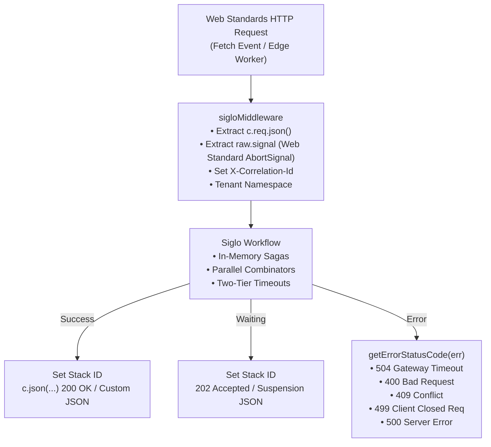

# @siglo/hono Adapter Guide

`@siglo/hono` provides a modern, Web Standards-compliant middleware and route handler adapter for executing `Siglo` workflows. It is optimized for cross-runtime deployment across Cloudflare Workers, Fastly Compute, Deno, Bun, AWS Lambda (via Hono), and traditional Node.js servers.

---

## 1. Overview & Architecture

Because Hono is built on standard `Request` and `Response` Web APIs, `@siglo/hono` enables portable, edge-ready workflow orchestration without any platform-specific Node.js bindings:



---

## 2. Installation & Requirements

Install `@siglo/hono` and Hono:

```bash
npm install @siglo/core @siglo/hono hono
```

Peer dependency matrix:

- `Siglo`: `*` (v1.0.0+)
- `hono`: `^3.0.0 || ^4.0.0`

> [!IMPORTANT]
> **Edge Runtime Compatibility (`nodejs_compat`)**:
> `@siglo/core` relies on `node:async_hooks` (for context propagation and `networkPolicy` AsyncLocalStorage perimeter tracking) and `node:net` (for socket egress checks). When deploying to edge environments like Cloudflare Workers, ensure Node.js compatibility is enabled in `wrangler.toml`:
>
> ```toml
> compatibility_flags = [ "nodejs_compat" ]
> ```

---

## 3. API Reference

### `sigloMiddleware(workflow, options)`

Creates a Hono route handler or middleware `(c: Context, next?: Next) => Promise<any>`:

```typescript
function sigloMiddleware<TInput = any, TOutput = any, TReq = any>(
    workflow: Flow<TInput, TOutput>,
    options?: SigloHonoMiddlewareOptions<TReq, TInput, TOutput>,
): (c: any, next?: () => Promise<void>) => Promise<any>;
```

---

## 4. Configuration Options (`SigloHonoMiddlewareOptions`)

| Option                 | Type                                                   | Default                                 | Description                                                                                                                              |
| :--------------------- | :----------------------------------------------------- | :-------------------------------------- | :--------------------------------------------------------------------------------------------------------------------------------------- |
| `input`                | `(c: Context) => Promise<TInput> \| TInput`            | `await c.req.json()` or `c.req.query()` | Custom parameter extraction from Hono context.                                                                                           |
| `output`               | `(result: TOutput, c: Context) => Promise<any> \| any` | `c.json(result)`                        | Custom responder formatting the HTTP response body and status code.                                                                      |
| `timeout`              | `number`                                               | `undefined`                             | SLA execution timeout in milliseconds.                                                                                                   |
| `durable`              | `boolean \| ((c: TReq) => boolean)`                    | `undefined`                             | Enables durable suspension, either for every request or through a request-specific resolver.                                             |
| `namespace`            | `string \| ((c: Context) => string \| undefined)`      | `undefined`                             | Namespace identifier or extractor function for tenant partitioning.                                                                      |
| `allowHeaderNamespace` | `boolean`                                              | `false`                                 | When true, permits extracting tenant namespace from incoming `x-namespace` headers. Keep disabled when client requests are untrusted.    |
| `exposeErrorDetails`   | `boolean`                                              | `process.env.NODE_ENV !== 'production'` | Controls whether 500 error messages expose internal details. In production, a generic `'Internal workflow execution error'` is returned. |
| `onError`              | `(err: any, c: Context) => Promise<any> \| any`        | Default JSON error response             | Custom exception handler. If omitted, maps status codes and returns sanitized `{ error: message }`.                                      |
| `correlationIdHeader`  | `string`                                               | `'x-correlation-id'`                    | Header name for correlation tracking.                                                                                                    |

Without a custom `output` callback, a workflow result with `status: 'waiting'` returns **202 Accepted** with the suspension descriptor as JSON. Completed workflows use the normal **200 OK** response. Suspension is a successful result and does not invoke `onError`. A custom `output` callback controls both the response body and status.

---

## 5. Web Standard Request Cancellation

In modern edge runtimes (Cloudflare Workers, Bun, Deno), clients closing the connection abort the native Web Standard `c.req.raw.signal`.

`@siglo/hono` passes this signal directly to `ExecutionOptions.signal`. Within workflow steps, access the cancellation signal via `param.$signal?.()`:

```typescript
const fetchExchangeRates = Step.create(async param => {
    const signal = param.$signal?.(); // Combined step timeout & request abort signal
    const response = await fetch('https://api.fx.internal/rates', { signal });
    return await response.json();
});
```

---

## 6. Multi-Runtime Deployment Guides

### A. Cloudflare Workers

```typescript
import { Hono } from 'hono';
import { Step, flow } from '@siglo/core';
import { sigloMiddleware } from '@siglo/hono';

const app = new Hono();

const geoLookup = Step.create('geoLookup', async (param: any) => {
    return { country: param.country || 'US', edgeRegion: 'WAF-EDGE-01' };
});

const rateCalculation = Step.create('rateCalculation', async (param: any) => {
    return { taxRate: param.country === 'US' ? 0.08 : 0.2 };
});

const edgeFlow = flow(geoLookup, rateCalculation);

app.post(
    '/api/calculate-tax',
    sigloMiddleware(edgeFlow, {
        input: async c => {
            const body = await c.req.json();
            return {
                ...body,
                country: c.req.header('cf-ipcountry') || 'US',
            };
        },
        output: (result, c) => c.json({ result }, 200),
    }),
);

export default app;
```

---

### B. Bun / Node.js Server

```typescript
import { Hono } from 'hono';
import { serve } from '@hono/node-server'; // Or run directly with `bun run server.ts`
import { Step, flow } from '@siglo/core';
import { sigloMiddleware } from '@siglo/hono';

const app = new Hono();

const echoWorkflow = flow(
    Step.create('echo', async (input: any) => ({
        echoed: input,
        timestamp: Date.now(),
    })),
);

app.post('/api/echo', sigloMiddleware(echoWorkflow));

// For Node.js:
serve(app, info => {
    console.log(`Hono server listening on http://localhost:${info.port}`);
});
```

---

## 7. Error Handling & Status Code Mapping

When a step fails, `@siglo/hono` checks the error type using `getErrorStatusCode(err)`:

```typescript
app.post(
    '/api/orders',
    sigloMiddleware(orderFlow, {
        onError: (err, c) => {
            if (err.name === 'IdempotencyConflictException') {
                return c.json({ error: 'Order is currently being processed by another request.' }, 409);
            }
            if (err.name === 'StepTimeoutException') {
                return c.json({ error: 'Order processing timed out.' }, 504);
            }
            return c.json({ error: err.message }, 500);
        },
    }),
);
```

Default HTTP status mappings:

- `StepTimeoutException` / `FlowTimeoutException`: `504 Gateway Timeout`
- `ValidationException` / `SpecFailedException`: `400 Bad Request`
- `IdempotencyConflictException`: `409 Conflict`
- `CancellationException` / `AbortError`: `499 Client Closed Request`
- Unhandled `Error`: `500 Internal Server Error` (sanitized in production)

---

## 8. Durable Workflows and Automatic HTTP Responses

Enable `durable: true` so `waitForEvent()` or `wait()` can suspend execution. The adapter automatically returns **202 Accepted** when the result has `status: 'waiting'`, including the suspension descriptor and `X-Workflow-Stack-Id` header. A workflow that completes uses **200 OK** by default.

```typescript
import { Hono } from 'hono';
import { Step, flow, waitForEvent, resumeWorkflow } from '@siglo/core';
import { sigloMiddleware } from '@siglo/hono';

const app = new Hono();

const approvalWorkflow = flow(
    waitForEvent('order.approved', {
        correlationKey: (input: { orderId: string }) => `order:${input.orderId}`,
        timeout: '24h',
    }),
    Step.create('confirmOrder', () => ({ status: 'confirmed' })),
);

// POST JSON: { "orderId": "order-5001" }
// Returns 202 with status: 'waiting'; no output callback is required.
app.post(
    '/api/orders',
    sigloMiddleware(approvalWorkflow, {
        durable: true,
        namespace: 'orders',
    }),
);

// In a separate approval webhook handler, resume the existing execution:
// await resumeWorkflow(approvalWorkflow, 'order:order-5001', { approved: true });
```

The waiting JSON includes `status`, `stackId`, `stepId`, `correlationKey`, `eventName`, `expiresAt` (a Unix timestamp in milliseconds when a timeout is set), and `continuationStepIndex`. Suspension is a successful result, so it does not invoke `onError`. Calling the submission handler again starts a new execution; approval webhooks must call `resumeWorkflow()` to continue the suspended one.

For request-specific control, replace `durable: true` with `durable: (c) => c.req.header('x-durable') === 'true'`. Headers, query parameters, and JSON fields do not automatically enable durable mode in this adapter. Explicit `durable: false` disables suspension; wait nodes then use their non-durable behavior.

| Workflow outcome                          | Default HTTP response                                 |
| :---------------------------------------- | :---------------------------------------------------- |
| Suspended at `waitForEvent()` or `wait()` | `202 Accepted` with the waiting descriptor            |
| Completed                                 | `200 OK` with the clean workflow result               |
| Failed                                    | Existing error-to-status mapping, or custom `onError` |

A custom `output` callback takes full control of the response body and status, including for waiting results. If you supply one, handle `result.status === 'waiting'` explicitly when you want to preserve the `202` response.

The HTTP adapter does not supply persistence. Configure a shared storage adapter that supports checkpoints and wait records to survive process restarts and resume across replicas. Timer waits also need a scheduler to resume them when due. See [Durable Workflows](../../docs/06-durable-workflows.md), [Storage and Adapters](../../docs/07-storage-and-adapters.md), and [the distributed checkout tutorial](../../docs/durable-distributed-checkout.md).
