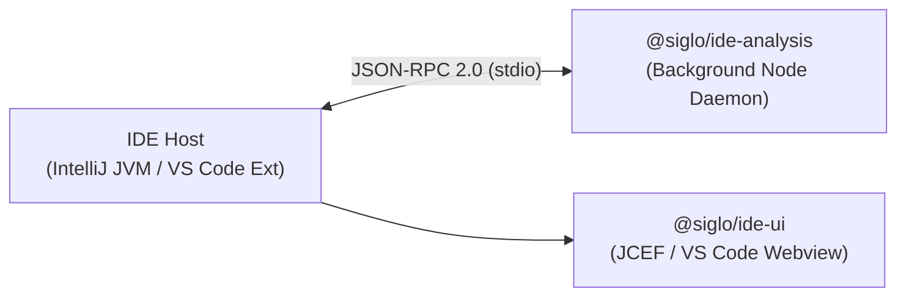

# @siglo/ide-protocol

Shared JSON-RPC 2.0 wire protocol, data models, and serialization helpers for Siglo IDE extensions (IntelliJ IDEA and Visual Studio Code).

---

## 1. Overview

`@siglo/ide-protocol` establishes a formal, host-agnostic contract between IDE client hosts (written in Kotlin for IntelliJ IDEA, or TypeScript for VS Code) and the Siglo background language analysis service (`@siglo/ide-analysis`).



---

## 2. JSON-RPC 2.0 Protocol Methods

All communication occurs over standard I/O (`stdin`/`stdout`) using standard JSON-RPC 2.0 envelopes.

| Method | Direction | Description |
|---|---|---|
| `siglo/initialize` | Client $\rightarrow$ Server | Initializes the session, exchanges capabilities, and retrieves server version and supported syntax matrix. |
| `siglo/discoverWorkflows` | Client $\rightarrow$ Server | Discovers all Siglo workflow definitions in a workspace or specific document. |
| `siglo/getGraph` | Client $\rightarrow$ Server | Parses a document's AST and returns the complete `GraphDocument` with nodes, edges, specs, properties, and diagnostics. |
| `siglo/resolveLocation` | Client $\rightarrow$ Server | Resolves a source position (line, character) to the enclosing workflow node, edge, or AST range. |
| `siglo/shutdown` | Client $\rightarrow$ Server | Requests clean termination of the background daemon process. |

### Method Payloads

#### `siglo/initialize`
- **Request Parameters**:
  ```typescript
  interface InitializeParams {
    clientName: string;
    clientVersion: string;
    rootUri: string;
    capabilities?: {
      dynamicRefresh?: boolean;
    };
  }
  ```
- **Response Result**:
  ```typescript
  interface InitializeResult {
    serverVersion: string;
    protocolVersion: string;
    supportedSyntaxMatrix: string[];
  }
  ```

#### `siglo/discoverWorkflows`
- **Request Parameters**:
  ```typescript
  interface DiscoverWorkflowsParams {
    documentUri?: string;
    workspaceUri?: string;
  }
  ```
- **Response Result**:
  ```typescript
  interface DiscoverWorkflowsResult {
    workflows: Array<{
      id: string;
      name: string;
      uri: string;
      range: SourceRange;
    }>;
  }
  ```

#### `siglo/getGraph`
- **Request Parameters**:
  ```typescript
  interface GetGraphParams {
    uri: string;
    documentVersion?: number;
    content?: string; // In-memory buffer override for live typing
    workflowName?: string; // Optional filter for a specific workflow
  }
  ```
- **Response Result**: `GraphDocument`

#### `siglo/resolveLocation`
- **Request Parameters**:
  ```typescript
  interface ResolveLocationParams {
    uri: string;
    position: SourcePosition;
    content?: string;
    workflowName?: string;
  }
  ```
- **Response Result**:
  ```typescript
  interface ResolveLocationResult {
    nodeId?: string;
    edgeId?: string;
    range?: SourceRange;
  }
  ```

---

## 3. Core Data Models

### Coordinates & Source Spans
```typescript
export interface SourcePosition {
  line: number;      // 0-indexed line number
  character: number; // 0-indexed UTF-16 code unit offset
}

export interface SourceRange {
  start: SourcePosition;
  end: SourcePosition;
}
```

### Structured Input Contract Specs
Captured from fluent `.spec(...)` and `.schema(...)` definitions without evaluating code:
```typescript
export interface StepSpecRule {
  kind: 'default' | 'required' | 'message' | 'validate' | 'transform' | 'translate' | 'schema' | 'options';
  value: string;
  expression: boolean;
  description?: string;
}

export interface StepSpec {
  field: string; // "$root$" indicates a whole-input validation schema
  rules: StepSpecRule[];
}
```

### Graph Nodes and Edges
```typescript
export interface GraphNode {
  id: string;
  name: string;
  stepKind: 'generic' | 'http' | 'crypto' | 'notification' | 'ai' | 'custom';
  location: SourceRange;
  declarationRange: SourceRange;
  specs?: StepSpec[];
  properties?: Record<string, string>; // Static display configuration
  executionConfig?: {
    retries?: number;
    timeoutMs?: number;
    hasCompensation?: boolean;
  };
}

export interface GraphEdge {
  id: string;
  from: string;
  to: string;
  type: 'sequential' | 'parallel' | 'branch' | 'fallback' | 'compensation';
  label?: string; // e.g., branch condition or case label
}
```

### Multi-Workflow Documents
```typescript
export interface WorkflowGraph {
  name: string;
  properties?: Record<string, string>; // timeout, version, networkPolicy, monitor
  nodes: GraphNode[];
  edges: GraphEdge[];
  unresolved: UnresolvedNode[];
  diagnostics: Diagnostic[];
}

export interface GraphDocument {
  uri: string;
  documentVersion: number;
  workflowName: string;
  properties?: Record<string, string>;
  nodes: GraphNode[];
  edges: GraphEdge[];
  unresolved: UnresolvedNode[];
  diagnostics: Diagnostic[];
  workflows?: WorkflowGraph[];
}
```

---

## 4. Host Synchronization Rules

1. **Protocol Mirroring**: When adding or altering fields in `@siglo/ide-protocol/src/types.ts`, the Kotlin data models in `plugins/intellij/src/main/kotlin/io/siglo/idea/process/ProtocolModels.kt` **must** be updated simultaneously to ensure GSON deserialization preserves all attributes.
2. **Monotonic Document Versions**: Host editors send increasing `documentVersion` counters with each buffer edit. Stale responses arriving out of order are discarded by tracking the monotonic version ID.
3. **Zero Application Execution**: The protocol never transmits executable lambdas, class references, or serialized runtime state; all nodes, expressions, and specs are transmitted as pure syntax trees or static string representations.
